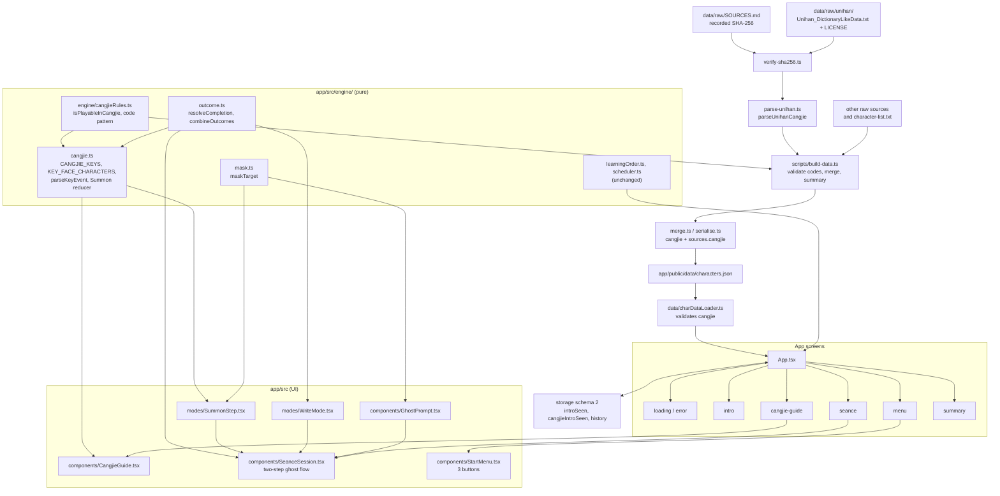
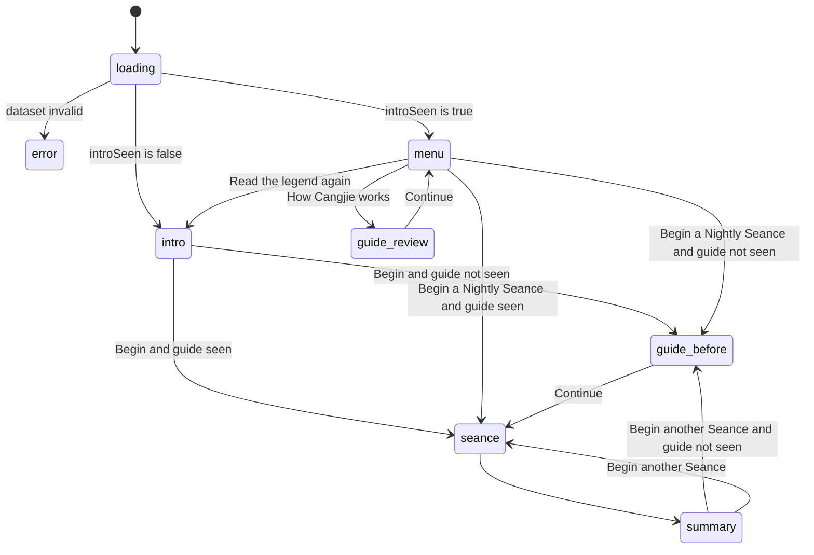
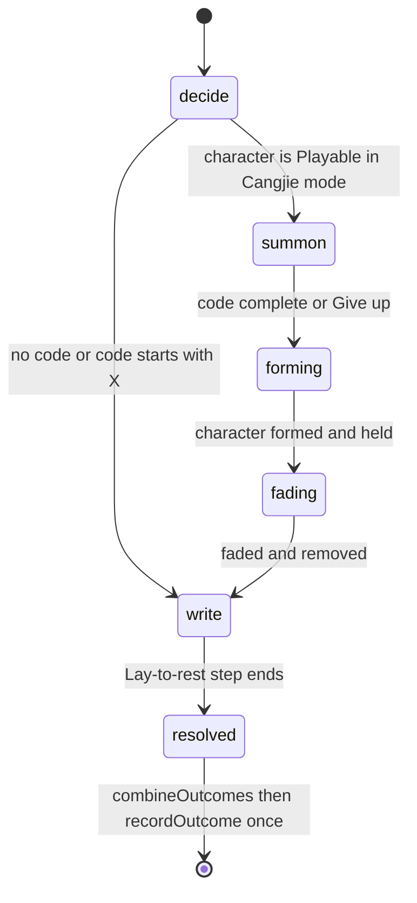

# Design Document: cangjie-seance

## Overview

The cangjie-seance feature turns every ghost into a two-step rite inside the existing Nightly Séance. First the player SUMMONS the ghost by typing its Cangjie code, and the character forms in ink and fades out. Then the player LAYS IT TO REST by writing the character from memory in the existing Write mode. There is no mode choice. Each part is traced to `requirements.md`:

1. **Pipeline (Requirement 1).** Cangjie codes enter `characters.json` from the Unicode 18.0.0 Unihan `kCangjie` field, read from a committed, hash-verified file `data/raw/unihan/Unihan_DictionaryLikeData.txt` (Unicode License V3). All 300 characters have a code; every code matches `^[A-Y]{1,5}$`; each character has one value.
2. **The rite (Requirement 2).** `SeanceSession` walks each ghost through a Summon step (`SummonStep`) and then a Lay-to-rest step (`WriteMode`, unchanged). 298 of 300 characters have a Summon step; 别 (`XRSLN`) and 错 (`XCTA`) skip it because their codes start with X.
3. **Summoning (Requirement 3).** A pure reducer in `cangjie.ts` handles key entries, mistakes, the automatic Key hint and Give up. `SummonStep` renders Code slots and a 25-key On-screen Cangjie keyboard, forms the character in ink, and fades it.
4. **Combined outcome (Requirement 4).** `combineOutcomes` in `outcome.ts` merges the two Step results into one Outcome, recorded once at the end of the Lay-to-rest step with the existing `applyReview` and `recordOutcome(char, entry)`. The scheduler and Learning order are unchanged.
5. **Never reveal (Requirement 5).** One `maskTarget` helper, letters-only keys for key-face characters, and a Summon step that unmounts completely (hanzi-writer instance destroyed) before the Lay-to-rest step starts.
6. **Guide, menu, storage (Requirements 6, 7, 8).** `CangjieGuide`, a three-button `StartMenu`, an App `cangjie-guide` screen, and storage schema version 2 with `cangjieIntroSeen` and no migration.

The shipped app makes no network request for Cangjie codes or stroke data (Requirement 9.1). Game logic stays in `app/src/engine/` (pure, no I/O, injected clock); UI stays in `app/src/components/` and `app/src/modes/`. TypeScript is `strict: true` with no `any`.

### Key design decisions

| # | Decision | Rationale | Requirements |
| --- | --- | --- | --- |
| D1 | `parseUnihanCangjie` returns `Map<string, string[]>` (every value per character). | The build can detect duplicates; the parser validates nothing and never infers a code. | 1.3, 1.4 |
| D2 | The committed file's SHA-256 is checked before it is parsed. | Pins the exact data; a changed file stops the build with no output. | 1.1, 1.9 |
| D3 | `isPlayableInCangjie` lives in `app/src/engine/cangjieRules.ts`, imported by the engine, the loader and `scripts/` by relative path (as `scripts/` already imports `app/src/data/types.ts`). | One definition of "Playable" for the build summary and the ghost flow. | 1.10, 1.11, 2.3 |
| D4 | `resolveCompletion` moves from `WriteMode.tsx` to `outcome.ts` (re-exported from `WriteMode.tsx`), next to the new `combineOutcomes`. | One place for Outcome rules; existing WriteMode tests stay green. | 3.8, 4.1–4.4, 4.9 |
| D5 | A Step result is an `Outcome` (`clean`, `struggled`, `gave-up`) for each step, so `combineOutcomes(summon, write)` is a small pure function: any `gave-up` wins, then any `struggled`, else `clean`. | Each step already compares its own mistakes to the threshold, which is the "compared separately" rule. | 4.1–4.4 |
| D6 | The Summon reducer is a pure state machine with no ambient time or I/O. | Unit-testable. | 3.12 |
| D7 | Masking is one helper, `maskTarget`, in `app/src/engine/mask.ts`, shared by `GhostPrompt` and `SummonStep`. | One rule for every displayed string. | 5.2 |
| D8 | The key-face rule is "letters only when the target is any key's face" (`KEY_FACE_CHARACTERS`), not a hard-coded list of 14 characters. | Correct for any dataset; the 14 current characters are one instance. | 5.3 |
| D9 | `SeanceSession` keeps its props and callback; the Summon Step result is held in a ref and combined when the Lay-to-rest step reports. `App` and `recordOutcome` see one Outcome per ghost. | Smallest change to the recording path; the outcome is recorded once. | 4.5 |
| D10 | The Summon step ends only after the character has formed (hanzi-writer `animateCharacter()` settled), been held for `SUMMON_HOLD_MS` (1500 ms), and faded for `SUMMON_FADE_MS` (1500 ms), the durations approved by Takshil; then the component unmounts. | The fade is the only guard against copying the character; unmounting removes every trace before writing starts. | 2.4, 5.5 |
| D11 | Schema version 2 ships with NO migration; version-1 blobs reset through the existing rule. | Smaller code and tests; the cost (one-time progress loss) is accepted (requirements Decision 6). | 8.3 |
| D12 | `BuildOptions` gains `unihanPath` and `unihanSha256`; `main()` reads the hash from `data/raw/SOURCES.md`. | `buildDataset` stays free of repository paths, so tests pass fixture files and hashes. | 1.9 |
| D13 | `pickGuideExample` picks the LAST eligible character (2 or 3 keys) in the Learning order, and the guide copy keeps only sourced statements (approved by Takshil). | A new player meets the start of the Learning order first, so a late example is not an Answer_Leak; unsourced Cangjie claims break content-accuracy. | 6.4, 6.5, 6.9 |

---

## Architecture



### Screen flow



`guide_before` and `guide_review` are the same `cangjie-guide` screen with `origin: 'before-seance'` or `'review'`.

### One ghost, two steps



### Directory layout of new and changed files

```
data/raw/unihan/
├── Unihan_DictionaryLikeData.txt        NEW  committed, pinned, verbatim
└── LICENSE                              NEW  Unicode License V3 text from unicode.org
data/raw/SOURCES.md                      CHANGED  Unihan section with both hashes
README.md                                CHANGED  "Data and licences"
scripts/
├── build-data.ts                        CHANGED
└── lib/
    ├── parse-unihan.ts                  NEW
    ├── verify-sha256.ts                 NEW
    ├── merge.ts                         CHANGED
    └── serialise.ts                     CHANGED
app/src/
├── data/{types,charDataLoader}.ts       CHANGED
├── engine/
│   ├── cangjieRules.ts                  NEW  (shared with scripts/)
│   ├── cangjie.ts                       NEW
│   ├── outcome.ts                       NEW
│   └── mask.ts                          NEW
├── storage/storage.ts                   CHANGED  (schema 2, no migration)
├── modes/
│   ├── SummonStep.tsx                   NEW
│   └── WriteMode.tsx                    CHANGED  (re-exports resolveCompletion)
├── components/
│   ├── CangjieGuide.tsx                 NEW
│   ├── GhostPrompt.tsx                  CHANGED  (re-exports maskTarget)
│   ├── StartMenu.tsx                    CHANGED  (3 buttons)
│   └── SeanceSession.tsx                CHANGED  (two-step flow)
└── App.tsx                              CHANGED  ('cangjie-guide' screen)
tests/fixtures/unihan/                   NEW  small fixture Unihan files
```

---

## Components and Interfaces

### Pipeline

#### `scripts/lib/parse-unihan.ts` (Requirements 1.1, 1.3, 1.4)

```typescript
/** Parses Unihan_DictionaryLikeData.txt. Keeps only `kCangjie` lines. */
export function parseUnihanCangjie(rawText: string): Map<string, string[]>;
```

Lines are `U+XXXX<TAB>kCangjie<TAB>value`. Lines starting with `#` and lines for other fields are skipped. The codepoint is converted to its character with `String.fromCodePoint`. Values are collected per character in source order. The parser does no validation and never infers a value.

#### `scripts/lib/verify-sha256.ts` (Requirement 1.9)

```typescript
export function sha256Hex(bytes: Uint8Array): string;

/** Reads the hash recorded for `label` in SOURCES.md; null when absent or malformed. */
export function readRecordedSha256(sourcesMd: string, label: string): string | null;

/** Throws Sha256MismatchError when the file's hash differs from `expected`. */
export async function verifyFileSha256(path: string, expected: string): Promise<void>;

export class Sha256MismatchError extends Error {
  readonly path: string;
  readonly expected: string;
  readonly actual: string;
}
```

`SOURCES.md` records two hashes in its Unihan section as lines of the form `- **SHA-256 (<label>):** <64 hex digits>`: one for `Unihan.zip` (`4c93ea9c1f636451729a840978f1667a53886af37ba854fdcce109721c63d43e`) and one for `Unihan_DictionaryLikeData.txt`. The committed file's hash is computed when the file is added; it is not stated in this design.

#### `app/src/engine/cangjieRules.ts` (shared by the app and `scripts/`; Requirements 1.8, 1.11)

```typescript
export const CANGJIE_CODE_PATTERN: RegExp;           // /^[A-Y]{1,5}$/
export function isValidCangjieCode(value: string): boolean;
/** Playable in Cangjie mode: non-null and does not start with "X". */
export function isPlayableInCangjie(code: string | null): boolean;
```

The module imports nothing, so `scripts/` can import it by relative path.

#### `scripts/lib/merge.ts` and `scripts/lib/serialise.ts` (Requirements 1.3, 1.6)

```typescript
export function mergeCharacter(
  char: string,
  hanziWriter: HanziWriterEntry | undefined,
  makeMeAHanzi: MakeMeAHanziEntry | undefined,
  ccCedict: CcCedictEntry | undefined,
  prompt: Prompt,
  cangjie: string | null,      // validated single value, or null
): MergeResult;
```

`cangjie` is not a required field: `null` never produces a failure. The record gets `cangjie` and `sources.cangjie = cangjie === null ? 'missing' : 'unihan'`. The serialiser's record key order becomes `character, pinyin, meanings, strokeCount, strokeData, decomposition, prompt, cangjie, sources`; its `sources` key order becomes `pinyin, meanings, strokeCount, strokeData, decomposition, cangjie`.

#### `scripts/build-data.ts` (Requirements 1.1, 1.4, 1.5, 1.9, 1.10)

```typescript
interface BuildOptions {
  // existing fields unchanged
  unihanPath: string;      // data/raw/unihan/Unihan_DictionaryLikeData.txt
  unihanSha256: string;    // expected hash; main() reads it from data/raw/SOURCES.md
}

type BuildResult =
  | { ok: true; output: string; promptReviewCsv: string;
      cangjieMissing: string[];       // characters whose cangjie is null
      notPlayable: string[] }         // characters for which isPlayableInCangjie is false
  | { ok: false; errors: MissingFieldError[]; cangjieErrors: CangjieError[] };

interface CangjieError {
  character: string;
  values: string[];
  reason: 'invalid-format' | 'multiple-values';
}
```

Changes to `buildDataset`:

1. The input-presence check includes `unihanPath`; a missing file throws, like the other inputs.
2. `verifyFileSha256(opts.unihanPath, opts.unihanSha256)` runs before the file is read; a mismatch throws `Sha256MismatchError`, which `main()` reports on stderr with a non-zero exit and no output.
3. `parseUnihanCangjie` runs on the verified text.
4. In the per-character pass (fail-slow, aggregated with the other errors), `values = unihan.get(char) ?? []`: more than one value gives `multiple-values`; a value failing `isValidCangjieCode` gives `invalid-format`; no value gives `cangjie = null`.
5. Any `MissingFieldError` or `CangjieError` returns `{ ok: false, … }` and writes no output.
6. On success the result includes `cangjieMissing` and `notPlayable` (from `isPlayableInCangjie`).

`main()` reads the recorded hash with `readRecordedSha256(sourcesMd, 'Unihan_DictionaryLikeData.txt')`; a missing hash is an error with a non-zero exit. Its success summary states the count of characters with a code ("300 of 300"), every character without one (or "none"), the count Playable in Cangjie mode (298), and every character that is not (别 错). On failure it prints each `CangjieError` as `character: values (reason)` to stderr.

### Engine

#### `app/src/engine/outcome.ts` (Requirements 3.8, 4.1–4.4, 4.9)

```typescript
import type { EngineConfig } from './config';
import type { Outcome } from './scheduler';

/** clean iff no hint was shown AND mistakes <= config.cleanMistakeThreshold, else struggled. */
export function resolveCompletion(
  hintShown: boolean,
  mistakes: number,
  config: Pick<EngineConfig, 'cleanMistakeThreshold'>,
): Outcome;

/**
 * The ghost's single Outcome. `summon` is null when the ghost has no Summon step.
 * gave-up if either step gave up; else struggled if either struggled; else clean.
 */
export function combineOutcomes(summon: Outcome | null, write: Outcome): Outcome;
```

`resolveCompletion` moves unchanged from `WriteMode.tsx`; `WriteMode.tsx` re-exports it (`export { resolveCompletion } from '../engine/outcome'`) so existing imports and tests keep working. A Step result of `struggled` already means "a hint appeared or this step's own mistakes exceeded the threshold", so combining Step results compares each step's mistakes to the threshold separately.

Truth table for `combineOutcomes(summon, write)`:

| summon \ write | clean | struggled | gave-up |
| --- | --- | --- | --- |
| `null` | clean | struggled | gave-up |
| clean | clean | struggled | gave-up |
| struggled | struggled | struggled | gave-up |
| gave-up | gave-up | gave-up | gave-up |

#### `app/src/engine/mask.ts` (Requirement 5.2)

```typescript
/** Replaces every occurrence of `char` in `text` with "～" (U+FF5E). Display only. */
export function maskTarget(text: string, char: string): string;
```

The body moves unchanged from `GhostPrompt.tsx`, which re-exports it so `GhostPrompt.test.tsx` keeps passing.

#### `app/src/engine/cangjie.ts` (Requirements 3.2, 3.4–3.8, 3.10, 3.12, 5.3)

```typescript
export type CangjieKey =
  | 'A' | 'B' | 'C' | 'D' | 'E' | 'F' | 'G' | 'H' | 'I' | 'J' | 'K' | 'L' | 'M'
  | 'N' | 'O' | 'P' | 'Q' | 'R' | 'S' | 'T' | 'U' | 'V' | 'W' | 'X' | 'Y';

export interface CangjieKeyInfo { readonly key: CangjieKey; readonly shape: string }

/** 25 entries, A–Y. A日 B月 C金 D木 E水 F火 G土 H竹 I戈 J十 K大 L中 M一 N弓 O人 P心 Q手 R口 S尸 T廿 U山 V女 W田 X難 Y卜. */
export const CANGJIE_KEYS: readonly CangjieKeyInfo[];

/** Every key face: the 24 base shapes plus 難. */
export const KEY_FACE_CHARACTERS: ReadonlySet<string>;

export interface KeyEventLike {
  readonly key: string;
  readonly ctrlKey: boolean;
  readonly altKey: boolean;
  readonly metaKey: boolean;
  readonly repeat: boolean;
  readonly isComposing: boolean;
}

/** A single letter A–Y (either case); null for everything else (Z, "Process", modifiers, repeat, composition). */
export function parseKeyEvent(e: KeyEventLike): CangjieKey | null;

export type SummonStatus = 'active' | Outcome;   // 'clean' | 'struggled' | 'gave-up'

export interface SummonState {
  readonly code: string;             // the target code
  readonly filled: number;           // slots filled, 0..code.length
  readonly mistakes: number;         // total wrong entries
  readonly missesOnSlot: number;     // consecutive wrong entries for the current slot
  readonly hintShown: boolean;       // true once any Key hint has appeared (sticky)
  readonly status: SummonStatus;     // the Step result once it is not 'active'
}

type SummonConfig = Pick<EngineConfig, 'cleanMistakeThreshold' | 'strokeHintAfterConsecutiveMisses'>;

export function startSummon(code: string): SummonState;
export function nextExpectedKey(state: SummonState): CangjieKey | null;   // null once resolved
export function isKeyHintVisible(
  state: SummonState,
  config: Pick<EngineConfig, 'strokeHintAfterConsecutiveMisses'>,
): boolean;
export function applyKeyEntry(state: SummonState, key: CangjieKey, config: SummonConfig): SummonState;
/** parseKeyEvent then applyKeyEntry; returns `state` itself when the event is ignored. */
export function applyKeyEvent(state: SummonState, e: KeyEventLike, config: SummonConfig): SummonState;
export function giveUpSummon(state: SummonState): SummonState;
```

`cangjie.ts` imports `resolveCompletion` from `outcome.ts`. Reducer rules for `applyKeyEntry`:

- When `status !== 'active'`, return `state` unchanged (Requirement 3.10).
- A correct key (equals `code[filled]`) gives `filled + 1` and `missesOnSlot = 0`. When `filled + 1 === code.length`, `status = resolveCompletion(hintShown, mistakes, config)` (Requirement 3.8).
- A wrong key gives `mistakes + 1`, `missesOnSlot + 1`, and `hintShown = hintShown || missesOnSlot + 1 >= config.strokeHintAfterConsecutiveMisses`; slots are unchanged (Requirements 3.6, 3.7).
- `isKeyHintVisible` is true while `status === 'active'` and `missesOnSlot >= config.strokeHintAfterConsecutiveMisses`. The visible hint disappears when the slot is filled, but `hintShown` stays true for classification.
- `giveUpSummon` sets `status = 'gave-up'` when active, else returns `state`.

### Storage (`app/src/storage/storage.ts`, Requirement 8)

```typescript
export const CURRENT_SCHEMA_VERSION = 2;

export interface PersistedState {
  readonly schemaVersion: number;
  readonly introSeen: boolean;
  readonly cangjieIntroSeen: boolean;
  readonly history: ReviewHistory;
}

export interface Store {
  readonly defaultState: PersistedState;
  loadState(): PersistedState;
  saveState(state: PersistedState): void;
  recordOutcome(char: string, entry: ReviewEntry): PersistedState;   // unchanged signature
  getIntroSeen(): boolean;
  setIntroSeen(seen: boolean): void;
  getCangjieIntroSeen(): boolean;
  setCangjieIntroSeen(seen: boolean): void;
  resetToDefaults(): void;
}
```

`SHIPPED_MIGRATIONS` stays empty. `loadState` therefore resets a version-1 blob to defaults through the existing rule "older version without a migration resets". `validateState` additionally requires a boolean `cangjieIntroSeen`. `saveState` writes the four fields; `recordOutcome` and `setIntroSeen` preserve `cangjieIntroSeen`. Module-level wrappers `getCangjieIntroSeen` and `setCangjieIntroSeen` follow the existing pattern. All reset rules and the in-memory fallback are unchanged (Requirement 8.4).

### Data loader (`app/src/data/charDataLoader.ts`, Requirement 1.8)

`isCharacterRecord` adds `v.cangjie === null || (typeof v.cangjie === 'string' && isValidCangjieCode(v.cangjie))`. A failing record gives `{ ok: false, reason: 'invalid-shape' }`, as for any other field.

### UI

#### `app/src/modes/SummonStep.tsx` (Requirements 2.4, 2.5, 3, 5)

```typescript
export const SUMMON_HOLD_MS = 1500;
export const SUMMON_FADE_MS = 1500;

export interface SummonStepProps {
  record: CharacterRecord;          // must be Playable in Cangjie mode
  dataset: CharacterDataset;
  config: EngineConfig;
  /** Called exactly once, after the character has formed, been held, faded and been removed. */
  onDone: (stepResult: Outcome) => void;
}
export function SummonStep(props: SummonStepProps): JSX.Element;
```

`SeanceSession` renders it with `key={record.character}`. The component keeps the `SummonState` in a ref plus React state (so handlers never read a stale value) and a `doneRef` guard. It has three phases: `typing`, `forming` and `fading`.

- **Slots (3.1, 3.5).** One box per key of `record.cangjie`. An empty box shows nothing visible and has the accessible name "Slot N, empty". A filled box shows the key's letter and shape (難 for X) with `lang="zh"` on the shape. Each shape string passes through `maskTarget(shape, record.character)` before the step ends, so a shape equal to the target shows "～".
- **Physical keyboard (3.2).** While `typing`, a `keydown` listener on `window` calls `applyKeyEvent`. It skips events whose `target` is an `input`, `textarea`, `select` or `contenteditable` element, and calls `preventDefault` only for accepted entries. Z and every other ignored event leave the state untouched.
- **On-screen keyboard (3.4).** 25 `<button type="button">` elements in QWERTY rows without Z (`Q W E R T Y U I O P`, `A S D F G H J K L`, `X C V B N M`). Each has `aria-label` "Key A" (the shape is added to the label unless letters-only), a minimum size of 44 × 44 px, and the shape with `lang="zh"`. A click calls the same entry function as the physical keyboard. When `KEY_FACE_CHARACTERS.has(record.character)`, every button shows its letter only and its label has no shape (Requirement 5.3). Buttons are `disabled` once the step ends.
- **Feedback (3.5, 3.6, 3.11).** A `role="status"` `aria-live="polite"` element shows text with a symbol ("✓ Key accepted", "✗ Not that key") and the mistake count.
- **Key hint (3.7).** While `isKeyHintVisible` is true, the next slot and the matching on-screen key get a highlighted outline, and the status text says "Hint: press X" (the letter, with its shape unless letters-only). No control requests a hint.
- **Notes (3.3, 3.13).** A visible IME note ("If typed letters do not appear, turn off your system Chinese input method.") and a visible source note ("Codes: Unicode Unihan kCangjie").
- **Give up (3.9).** A "Give up" button, enabled only while `typing`. Its handler calls `giveUpSummon`, shows the full code in the slots, and enters `forming`.
- **Completion (3.8).** When the reducer's status leaves `active`, the component shows the full code and enters `forming`. No hanzi-writer instance exists before this moment.
- **Forming and fading (2.4, 2.5).** In `forming` the component creates a hanzi-writer instance in its container with `makeCharDataLoader(dataset)` and `showCharacter: false`, then calls `animateCharacter()`. When that promise settles, the component waits `SUMMON_HOLD_MS`, enters `fading` (a CSS opacity transition lasting `SUMMON_FADE_MS`, or no transition when `matchMedia('(prefers-reduced-motion: reduce)')` matches), waits `SUMMON_FADE_MS`, empties the container, and calls `onDone(status)` once. If creating the writer or the animation fails, the component shows the character as plain text with `lang="zh"` for the same hold and fade, so a hanzi-writer failure never blocks the ghost. Cleanup on unmount clears timers and empties the container, and `onDone` is not called after unmount.

#### `app/src/components/CangjieGuide.tsx` (Requirement 6)

```typescript
export interface CangjieGuideProps {
  dataset: CharacterDataset;
  onContinue: () => void;
}

/**
 * LAST character in learningOrder(dataset) that is Playable and whose code (read from record.cangjie)
 * has 2 or 3 keys; null when none. Late in the order, so a new player has not met it (Answer_Leak).
 */
export function pickGuideExample(dataset: CharacterDataset): { character: string; code: string } | null;
```

The screen shows the 25 keys from `CANGJIE_KEYS` (X shown as 難, the label of that on-screen key, with no claim about its meaning), that a code is one to five keys typed in order, that each key stands for a family of related shapes of which only the base shape is shown (sourced to "Cangjie input method"), an example from `pickGuideExample(dataset)` (omitted when `null`; chosen last in the Learning order so it is not a character a new player meets early, Requirement 6.9), the claim "developed in the 1970s by Chu Bong-Foo", the three other whitelisted claims (named after Cangjie, the legendary inventor of Chinese writing; the first Chinese input method to use the standard QWERTY keyboard; released to the public in 1982), the statement that the game's codes follow the Unicode Unihan `kCangjie` field, which Unihan marks provisional, so some typists know different codes for some characters, and a visible citation line covering all of the above claims, including the family-of-shapes statement, giving the article titles and URLs as text: "Cangjie input method" `https://en.wikipedia.org/wiki/Cangjie_input_method` and "Chu Bong-Foo" `https://en.wikipedia.org/wiki/Chu_Bong-Foo`. A "Continue" button has an accessible label; shapes carry `lang="zh"`. No other claims, statistics or "dying" language, and no statement that X has no base shape or what 難 means.

#### `app/src/components/StartMenu.tsx` (Requirement 7)

```typescript
export interface StartMenuProps {
  onStartSeance: () => void;
  onReviewLegend: () => void;
  onReviewCangjieGuide: () => void;
}
```

Three buttons, each at least 44 px high with the existing focus ring: "Begin a Nightly Séance", "Read the legend again", "How Cangjie works".

#### `app/src/components/SeanceSession.tsx` (Requirements 2, 4)

Props are unchanged: `{ ghosts, dataset, config, onOutcome(char, outcome, now), onComplete }`. New state and flow:

- `step: 'summon' | 'write'`, initialised for each ghost as `isPlayableInCangjie(record.cangjie) ? 'summon' : 'write'`, and reset in `handleAdvance` for the next ghost.
- `summonResultRef: Outcome | null`, cleared when the ghost changes.
- A text label above the step, "Step 1 of 2: Summon" or "Step 2 of 2: Lay to rest" (for a ghost without a Summon step, "Lay to rest"), as approved by Takshil.
- `step === 'summon'` renders `<SummonStep key={record.character} … onDone={handleSummonDone} />`; `handleSummonDone(result)` stores the result in `summonResultRef` and sets `step` to `'write'`. The Summon step has unmounted by then.
- `step === 'write'` renders `<WriteMode … onOutcome={handleWriteOutcome} />`. `handleWriteOutcome(writeResult)` computes `combineOutcomes(summonResultRef.current, writeResult)` and passes it to the existing `handleOutcome`, which keeps its `resolvedRef` guard so `onOutcome(char, combined, Date.now())` fires once.
- "Next ghost" and the result text appear only after `handleOutcome` ran, as today.

#### `app/src/App.tsx` (Requirements 2.8, 6, 7)

- `buildSession` is unchanged (full Learning order, one history).
- `View` gains `{ screen: 'cangjie-guide'; dataset; origin: 'before-seance' | 'review' }`.
- A helper `beginSeance(dataset)`: if `getCangjieIntroSeen()` is false, show the guide with `origin: 'before-seance'`; otherwise `startSeance(dataset)`. The intro's `onBegin` calls `setIntroSeen(true)` then `beginSeance`. The menu's `onStartSeance` and the summary's `onPlayAgain` call `beginSeance`.
- The menu's `onReviewCangjieGuide` shows the guide with `origin: 'review'`.
- The guide's `onContinue` calls `setCangjieIntroSeen(true)`, then `startSeance(dataset)` for `before-seance` or shows the menu for `review`.
- `handleOutcome(char, outcome, now)` is unchanged: `applyReview(prior, outcome, now, DEFAULT_CONFIG)` then `recordOutcome(char, entry)`.

---

## Data Models

### `CharacterRecord` and sources (Requirement 1.3)

```typescript
export type DatasetId = 'cc-cedict' | 'hanzi-writer-data' | 'make-me-a-hanzi' | 'unihan';

export interface FieldSources {
  pinyin: DatasetId; meanings: DatasetId; strokeCount: DatasetId;
  strokeData: DatasetId; decomposition: DatasetId;
  cangjie: DatasetId | 'missing';      // 'unihan' iff cangjie !== null
}

export interface CharacterRecord {
  // existing fields …
  prompt: Prompt;
  cangjie: string | null;              // verbatim kCangjie, ^[A-Y]{1,5}$
  sources: FieldSources;
}
```

`BuildOptions` gains `unihanPath: string` and `unihanSha256: string`. `BuildResult` and `CangjieError` are shown in the Pipeline section. The Pipeline writes `cangjie` for all 300 characters; the loader accepts `null` so a future dataset with a gap still loads, and the ghost then skips its Summon step.

Example records in `characters.json`: 我 has `"cangjie": "HQI"` and `"sources": { …, "cangjie": "unihan" }`; 口 has `"cangjie": "R"`; 别 has `"cangjie": "XRSLN"` (stored verbatim, not Playable).

### Storage schema version 2 (Requirement 8)

```json
{
  "schemaVersion": 2,
  "introSeen": true,
  "cangjieIntroSeen": false,
  "history": {
    "我": { "step": 1, "lastOutcome": "clean", "nextDue": 1790000000000 }
  }
}
```

A version-1 blob (`{ schemaVersion: 1, introSeen, history }`) is not migrated: it resets to the default state (`introSeen: false`, `cangjieIntroSeen: false`, empty `history`).

### `SummonState` (Requirement 3)

`SummonState` is defined in the Engine section. Its `status` is `'active'` until the last slot is filled or Give up is used; afterwards it holds the Step result. It is never persisted.

### Step results and the Combined outcome

Both steps report an `Outcome`. `SeanceSession` keeps the Summon step's result in a ref until the Lay-to-rest step reports; only the Combined outcome reaches `App` and the Storage module.

---

## Correctness Properties

This re-scope adds NO new property-based tests (approved by Takshil; Requirement 9.2). The invariants below are stated as rules and are each covered by unit or component tests (see "Testing Strategy"). They keep the "Validates" traceability to the requirements.

- **Rule 1: Completion.** Entering exactly the keys of a code, in order, fills every slot and leaves the state non-`active`; any proper prefix leaves it `active` with `filled` equal to the prefix length. **Validates: Requirements 3.5, 3.8**
- **Rule 2: Mistake count.** `mistakes` equals the number of key entries that differed from the next expected key at entry time. **Validates: Requirements 3.6**
- **Rule 3: Key hint.** The Key hint is visible exactly when the current slot has at least `strokeHintAfterConsecutiveMisses` consecutive wrong entries; the counter resets when the slot is filled; `hintShown` stays true afterwards. **Validates: Requirements 3.7**
- **Rule 4: Step result classification.** After the last slot is filled, the status equals `resolveCompletion(hintShown, mistakes, config)`. **Validates: Requirements 3.8, 4.2, 4.3**
- **Rule 5: Nothing changes after the Step result is fixed.** Any key entry, key event or Give up on a non-`active` state returns the same state. **Validates: Requirements 3.10, 4.7**
- **Rule 6: Ignored keys.** Z, non-letters, multi-character key names (`"Process"`, `"Enter"`), modified keys, auto-repeat and composition events never change the state. **Validates: Requirements 3.2**
- **Rule 7: Combination.** `combineOutcomes(summon, write)` follows the truth table above for every combination of `null | Outcome` and `Outcome`. **Validates: Requirements 4.1, 4.2, 4.3, 4.4, 4.9**
- **Rule 8: Masking.** `maskTarget(text, char)` output never contains `char`, and replaces each occurrence with "～". **Validates: Requirements 5.2**
- **Rule 9: Never reveal.** For every Playable ghost, the rendered Summon step in its unresolved state, and after a Key hint, contains the target character nowhere in DOM text, attributes or the document title. **Validates: Requirements 5.1, 5.3**
- **Rule 10: Playability.** `isPlayableInCangjie` is false exactly for `null` and codes starting with X. **Validates: Requirements 1.10, 1.11, 2.3**
- **Rule 11: Dataset codes.** Every record's `cangjie` is `null` or matches `^[A-Y]{1,5}$`; `sources.cangjie` is `"unihan"` exactly when `cangjie` is non-null; every non-null `cangjie` equals the single raw Unihan value. **Validates: Requirements 1.3, 1.8**

---

## Error Handling

| Situation | Behaviour | Requirements |
| --- | --- | --- |
| Committed Unihan file's SHA-256 differs from the recorded hash | Pipeline exits non-zero, writes no output, prints path, expected and actual hash | 1.9 |
| No recorded hash in `SOURCES.md` | Pipeline exits non-zero, writes no output | 1.9 |
| Unihan file missing | Pipeline throws "Missing required input path(s)", exits non-zero | 1.1 |
| `kCangjie` value not matching `^[A-Y]{1,5}$` | Every affected character and value to stderr, non-zero exit, no output | 1.4 |
| A character with more than one `kCangjie` value | Same as above, reason `multiple-values` | 1.4 |
| A character with no `kCangjie` value | `cangjie: null`, `sources.cangjie: "missing"`, build succeeds, listed in the summary | 1.5 |
| `cangjie` is `null` or starts with X at run time | Ghost skips the Summon step and begins with the Lay-to-rest step | 2.3 |
| Loader finds an invalid `cangjie` | `{ ok: false, reason: 'invalid-shape' }`; the App shows its existing error state | 1.8 |
| Player types Z, a modified key, a repeat or an IME composition | Ignored; no mistake counted | 3.2 |
| hanzi-writer fails to form the character in the Summon step | The character is shown as plain text for the same hold and fade; the Step result stands; the ghost proceeds | 2.4 |
| hanzi-writer fails to load in the Lay-to-rest step | The step resolves `gave-up` (existing behaviour), so the Combined outcome is `gave-up` | 4.8 |
| Player leaves mid-ghost | Nothing is recorded for that ghost; completed ghosts are already saved | 4.5 |
| Saved data has `schemaVersion` 1, an unknown or newer version, is corrupt, or has forbidden history keys | Reset to defaults, no migration, no crash | 8.3, 8.4 |
| `localStorage` unavailable | In-memory fallback as today | 8.4 |

---

## Testing Strategy

This feature has no new property-based tests and no mutation tests (Requirement 9.2). The existing property tests for the scheduler, Display cleanup, Learning order and character dataset keep running; where they touch records or the pipeline, they are updated for the new field. The root `npm test` runs everything (one Vitest invocation across `tests/` and `app/`).

### New unit tests

| File | Covers |
| --- | --- |
| `app/src/engine/cangjieRules.test.ts` | valid and invalid codes; `isPlayableInCangjie` for `HXH`, `XRSLN`, `XCTA`, `null` |
| `tests/unit/parse-unihan.test.ts` | comments, other fields, duplicate lines, empty input, verbatim fixture lines |
| `tests/unit/verify-sha256.test.ts` | matching hash, one-byte change, `readRecordedSha256` found, absent and malformed |
| `tests/unit/build-summary.test.ts` | build summary (coverage, missing, Playable count, not Playable list), malformed value, duplicate value, hash mismatch, absent recorded hash |
| `tests/unit/cangjie-dataset.test.ts` | every record in `characters.json`: format, `sources.cangjie`, equality with the raw Unihan value; 298 Playable and 别 错 excluded |
| `app/src/engine/outcome.test.ts` | `resolveCompletion` boundary; `combineOutcomes` truth table (12 cells) |
| `app/src/engine/mask.test.ts` | no occurrence, several, empty text, surrogate pairs |
| `app/src/engine/cangjie.keys.test.ts` | 25 keys, shapes, X is 難, no Z, `KEY_FACE_CHARACTERS`, `parseKeyEvent` examples |
| `app/src/engine/cangjie.summon.test.ts` | reducer: fill, mistakes, automatic Key hint at 3 and its reset when the slot is filled, Give up, no change after the Step result, Z ignored |

### New component tests (hanzi-writer mocked)

| File | Covers |
| --- | --- |
| `app/src/modes/SummonStep.test.tsx` | slot count; physical and on-screen keys; letters-only keys for key-face targets; IME note and source note; Key hint after 3 and no hint control; Give up; character forms then fades (fake timers); `onDone` once; never-reveal before completion |
| `app/src/modes/SummonStep.neverReveal.test.tsx` | every Playable ghost in `characters.json`, unresolved and after a Key hint: target absent from DOM text, attributes and title |
| `app/src/components/CangjieGuide.test.tsx` | 25 keys, the four whitelisted claims and no others, "developed in the 1970s", Unihan source statement, both citations with URLs as text, runtime example, `pickGuideExample` (last eligible, 2 or 3 keys, skips 1-key, 4-5-key and X-prefixed codes, `null` when none), family-of-shapes statement present, no "difficult" or "no base shape" wording |

### Existing tests to update

| File | Change |
| --- | --- |
| `tests/property/character-record-schema.test.ts` | Properties 4 and 10: nine record keys, six `sources` keys |
| `tests/property/{record-fields,output-count,prompt-same-entry,pipeline-determinism,pipeline-errors,prompt-overrides,hanzi-writer-parser}.test.ts` | `BuildOptions` gains the Unihan inputs; expected records gain `cangjie` |
| `tests/unit/merge.test.ts`, `tests/unit/serialise.test.ts` | new argument, new key orders, `cangjie: null` |
| `tests/helpers/arbitraries.ts` | record arbitraries gain `cangjie` and `sources.cangjie` |
| `tests/integration/full-pipeline.test.ts`, `tests/smoke/dataset-files.test.ts` | Unihan input, new field, new files and hashes |
| `app/src/data/charDataLoader.test.ts`, `…hanziwriter.integration.test.ts` | `cangjie` fixtures; accept `null` and valid codes, reject malformed |
| app tests with record fixtures (`App`, `GhostPrompt`, `SeanceSession`, `WriteMode`, others found by `tsc`) | fixtures gain `cangjie` and `sources.cangjie` |
| `app/src/storage/storage.test.ts` | schema 2, `cangjieIntroSeen`, version-1 blob resets, forbidden keys, storage unavailable |
| `app/src/components/StartMenu.test.tsx` | three buttons and callbacks |
| `app/src/components/SeanceSession.test.tsx` | two-step flow, one combined Outcome recorded once, skip for 别 and 错, nothing recorded at the end of the Summon step |
| `app/src/App.test.tsx` | first visit: intro, guide, Séance; returning: menu; guide re-view; version-1 data resets |

---

## Impact on existing code and tests

| File | Change |
| --- | --- |
| `data/raw/unihan/*`, `data/raw/SOURCES.md`, `README.md` | new data file, licence, recorded hashes, README licence text |
| `app/public/data/characters.json` | regenerated by the Pipeline only |
| `app/src/data/types.ts` | `DatasetId`, `FieldSources`, `CharacterRecord`, `BuildOptions`, `BuildResult`, `CangjieError` |
| `app/src/data/charDataLoader.ts` | validates `cangjie` |
| `scripts/build-data.ts`, `scripts/lib/{merge,serialise}.ts` | Unihan input, hash check, summary |
| `app/src/engine/{cangjieRules,cangjie,outcome,mask}.ts` | new modules |
| `app/src/modes/WriteMode.tsx` | imports and re-exports `resolveCompletion`; no behaviour change |
| `app/src/components/GhostPrompt.tsx` | imports and re-exports `maskTarget`; no behaviour change |
| `app/src/modes/SummonStep.tsx`, `app/src/components/CangjieGuide.tsx` | new components |
| `app/src/components/StartMenu.tsx` | third button and prop |
| `app/src/components/SeanceSession.tsx` | two-step ghost flow |
| `app/src/storage/storage.ts` | schema 2, `cangjieIntroSeen`, no migration |
| `app/src/App.tsx` | `cangjie-guide` screen, `beginSeance` |
| Unchanged | `scheduler.ts`, `learningOrder.ts`, `config.ts`, `promptCleanup.ts`, `SessionSummary.tsx`, `IntroScreen.tsx` |
