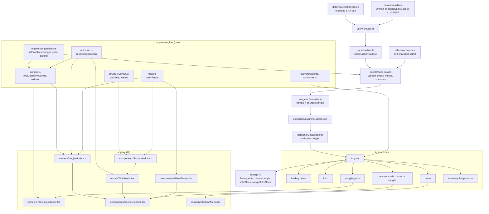
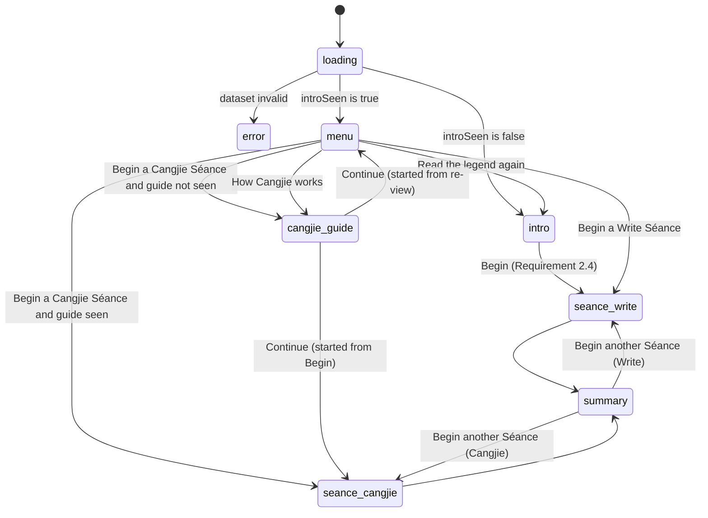

# Design Document: cangjie-seance

## Overview

The cangjie-seance feature adds a second way to lay a ghost to rest: typing the character's Cangjie code instead of drawing it. It has five parts, each traced to `requirements.md`:

1. **Pipeline (Requirement 1).** Cangjie codes enter `characters.json` from the Unicode 18.0.0 Unihan `kCangjie` field, read from a committed, hash-verified file `data/raw/unihan/Unihan_DictionaryLikeData.txt` (Unicode License V3). All 300 characters have a code; every code matches `^[A-Y]{1,5}$`; each character has a single value.
2. **Cangjie mode (Requirements 2, 4, 5).** A pure engine (`cangjie.ts`) and a UI (`CangjieMode.tsx`) with Code slots, an On-screen Cangjie keyboard, a Key hint and Give up. 298 of 300 characters are Playable; 别 (`XRSLN`) and 错 (`XCTA`) are excluded because their codes start with X.
3. **"How Cangjie works" screen (Requirement 3).** A one-time guide whose only historical claims are the four whitelisted in content-accuracy.md, each cited to two English Wikipedia articles.
4. **Structure hint (Requirement 6).** A pure IDS-to-layout function and a `StructureHint` component behind a "Reveal its shape" button in Write mode. 259 of 300 characters are eligible.
5. **Masking and storage (Requirements 7, 8).** One masking helper used in both modes, and storage schema version 2 with one Review history per Mode.

The design reuses the ghost-game-core engine unchanged where possible: `selectSession`, `applyReview`, `learningOrder`, `EngineConfig`, and the Séance flow. Game logic stays in `app/src/engine/` (pure, injected clock, no I/O); UI stays in `app/src/components/` and `app/src/modes/`. TypeScript is `strict: true` with no `any`. The shipped app makes no network request for Cangjie codes or stroke data (Requirement 9.1).

### Key design decisions

| # | Decision | Rationale | Requirements |
| --- | --- | --- | --- |
| D1 | `parseUnihanCangjie` returns `Map<string, string[]>` (every value per character). | The build can detect duplicates; the parser itself validates nothing and never infers a code. | 1.3, 1.4 |
| D2 | The committed file's SHA-256 is checked before it is parsed. | Pins the exact data; a changed file stops the build with no output. | 1.1, 1.10 |
| D3 | `isPlayableInCangjie` lives in `app/src/engine/cangjieRules.ts`, imported by both the app engine and `scripts/` by relative path (as `scripts/` already imports `app/src/data/types.ts`). | One definition of "Playable" for the build summary and the session filter. | 1.11, 4.2 |
| D4 | `resolveCompletion` moves to `app/src/engine/outcome.ts`. | Write and Cangjie modes classify Outcomes with one function. | 5.8, 6.4, 9.2 case 4 |
| D5 | The Cangjie reducer is a pure state machine with no ambient time or I/O. | Property-testable. | 5.12, 9.2 |
| D6 | Masking is one helper, `maskTarget`, in `app/src/engine/mask.ts`. | One rule for every displayed string; one place to test. | 7.1, 7.2 |
| D7 | Storage schema v2 stores `history: { write, cangjie }` and moves v1 history under `write`. | Separate scheduling per Mode. | 4.5, 8.2 |
| D8 | The key-face rule is "letters only when the target is any key's face" (`KEY_FACE_CHARACTERS`), not a list of 14 characters. | Correct for any dataset; the 14 current characters are one instance. | 7.3 |
| D9 | `BuildOptions` gains `unihanPath` and `unihanSha256`; `main()` reads the hash from `data/raw/SOURCES.md`. | `buildDataset` stays free of repository paths, so tests pass fixture files and hashes. | 1.10 |

---

## Architecture



### Screen flow



### Directory layout of new and changed files

```
data/raw/unihan/
├── Unihan_DictionaryLikeData.txt        NEW  committed (4.1 MB), pinned
└── LICENSE                              NEW  Unicode License V3 text, fetched from unicode.org
data/raw/SOURCES.md                      CHANGED  Unihan section
README.md                                CHANGED  "Data and licences"
kiro-log.md                              CHANGED  (steering rule)
scripts/
├── build-data.ts                        CHANGED
└── lib/
    ├── parse-unihan.ts                  NEW
    ├── verify-sha256.ts                 NEW
    ├── merge.ts                         CHANGED
    └── serialise.ts                     CHANGED
app/src/
├── data/{types,charDataLoader}.ts       CHANGED
├── engine/
│   ├── cangjieRules.ts                  NEW  (shared with scripts/)
│   ├── cangjie.ts                       NEW
│   ├── outcome.ts                       NEW
│   ├── structureLayout.ts               NEW
│   └── mask.ts                          NEW
├── storage/storage.ts                   CHANGED
├── modes/
│   ├── CangjieMode.tsx                  NEW
│   └── WriteMode.tsx                    CHANGED
├── components/
│   ├── CangjieGuide.tsx                 NEW
│   ├── StructureHint.tsx                NEW
│   ├── GhostPrompt.tsx                  CHANGED  (re-exports maskTarget)
│   ├── StartMenu.tsx                    CHANGED
│   └── SeanceSession.tsx                CHANGED
└── App.tsx                              CHANGED
tests/fixtures/unihan/                   NEW  small fixture Unihan files
```

---

## Components and Interfaces

### Pipeline

#### `scripts/lib/parse-unihan.ts` (Requirements 1.1, 1.3, 1.4)

```typescript
/** Parses Unihan_DictionaryLikeData.txt. Keeps only `kCangjie` lines. */
export function parseUnihanCangjie(rawText: string): Map<string, string[]>;
```

Lines are `U+XXXX<TAB>kCangjie<TAB>value`. Lines starting with `#` and lines for other fields are skipped. The codepoint is converted to its character with `String.fromCodePoint`. Values are collected per character in source order. The parser does no validation and never infers a value.

#### `scripts/lib/verify-sha256.ts` (Requirement 1.10)

```typescript
export function sha256Hex(bytes: Uint8Array): string;

/** Reads the hash recorded for `label` in SOURCES.md; null when absent or malformed. */
export function readRecordedSha256(sourcesMd: string, label: string): string | null;

/** Throws Sha256MismatchError when the file's hash differs from `expected`. */
export async function verifyFileSha256(path: string, expected: string): Promise<void>;

export class Sha256MismatchError extends Error {
  readonly path: string;
  readonly expected: string;
  readonly actual: string;
}
```

`SOURCES.md` records two hashes in the Unihan section: the original `Unihan.zip` (`4c93ea9c1f636451729a840978f1667a53886af37ba854fdcce109721c63d43e`) and the committed file. `readRecordedSha256` matches a line of the form `- **SHA-256 (<label>):** <64 hex digits>`. The committed file's hash is computed when the file is added; it is not stated in this design.

#### `app/src/engine/cangjieRules.ts` (shared by the app and `scripts/`)

```typescript
export const CANGJIE_CODE_PATTERN: RegExp;           // /^[A-Y]{1,5}$/
export function isValidCangjieCode(value: string): boolean;
/** Playable in Cangjie mode: non-null and does not start with "X". */
export function isPlayableInCangjie(code: string | null): boolean;
```

The module imports nothing. `cangjie.ts` re-exports `isPlayableInCangjie`.

#### `scripts/lib/merge.ts` (Requirement 1.3)

```typescript
export function mergeCharacter(
  char: string,
  hanziWriter: HanziWriterEntry | undefined,
  makeMeAHanzi: MakeMeAHanziEntry | undefined,
  ccCedict: CcCedictEntry | undefined,
  prompt: Prompt,
  cangjie: string | null,      // validated single value, or null
): MergeResult;
```

`cangjie` is not a required field: `null` never produces a failure. The record gets `cangjie` and `sources.cangjie = cangjie === null ? 'missing' : 'unihan'`.

#### `scripts/lib/serialise.ts` (Requirement 1.6)

`OrderedRecord` gains `cangjie: string | null` between `prompt` and `sources`. Record key order is `character, pinyin, meanings, strokeCount, strokeData, decomposition, prompt, cangjie, sources`. `sources` key order is `pinyin, meanings, strokeCount, strokeData, decomposition, cangjie`.

#### `scripts/build-data.ts` (Requirements 1.1, 1.4, 1.5, 1.10, 1.11)

```typescript
interface BuildOptions {
  // existing fields unchanged
  unihanPath: string;      // data/raw/unihan/Unihan_DictionaryLikeData.txt
  unihanSha256: string;    // expected hash; main() reads it from data/raw/SOURCES.md
}

type BuildResult =
  | { ok: true; output: string; promptReviewCsv: string;
      cangjieMissing: string[];       // characters whose cangjie is null
      notPlayable: string[] }         // characters for which isPlayableInCangjie is false
  | { ok: false; errors: MissingFieldError[]; cangjieErrors: CangjieError[] };

interface CangjieError {
  character: string;
  values: string[];
  reason: 'invalid-format' | 'multiple-values';
}
```

Changes to `buildDataset`:

1. The input-presence check includes `unihanPath`. A missing file throws, like the other inputs.
2. `verifyFileSha256(opts.unihanPath, opts.unihanSha256)` runs before the file is read. A mismatch throws `Sha256MismatchError`; `main()` reports it on stderr, sets a non-zero exit code, and writes nothing.
3. `parseUnihanCangjie` runs on the verified text.
4. In the per-character pass (fail-slow, aggregated with the other errors), `values = unihan.get(char) ?? []`:
   - more than one value gives `multiple-values`;
   - a value failing `isValidCangjieCode` gives `invalid-format`;
   - no value gives `cangjie = null`.
5. Any `MissingFieldError` or `CangjieError` returns `{ ok: false, … }` and writes no output.
6. On success the result includes `cangjieMissing` and `notPlayable`.

`main()` prints on success: the count of characters with a code (for example "300 of 300"), every character without one (or "none"), the count Playable in Cangjie mode, and every character that is not (in the current data: 别 错). On failure it prints each `CangjieError` as `character: values (reason)` to stderr.

### Engine

#### `app/src/engine/outcome.ts` (Requirements 5.8, 6.4)

```typescript
import type { EngineConfig } from './config';
import type { Outcome } from './scheduler';

/** clean iff no hint of any kind was shown AND mistakes <= config.cleanMistakeThreshold. */
export function resolveCompletion(
  anyHintUsed: boolean,
  mistakes: number,
  config: Pick<EngineConfig, 'cleanMistakeThreshold'>,
): Outcome;
```

`WriteMode.tsx` imports it and re-exports it (`export { resolveCompletion } from '../engine/outcome'`), so existing imports and tests keep working.

#### `app/src/engine/mask.ts` (Requirements 7.1, 7.2)

```typescript
/** Replaces every occurrence of `char` in `text` with "～" (U+FF5E). Display only. */
export function maskTarget(text: string, char: string): string;
```

The body moves unchanged from `GhostPrompt.tsx`. `GhostPrompt.tsx` imports it and re-exports it so `GhostPrompt.test.tsx` keeps passing.

#### `app/src/engine/cangjie.ts` (Requirements 5.2, 5.4–5.8, 5.10, 5.12)

```typescript
export type CangjieKey =
  | 'A' | 'B' | 'C' | 'D' | 'E' | 'F' | 'G' | 'H' | 'I' | 'J' | 'K' | 'L' | 'M'
  | 'N' | 'O' | 'P' | 'Q' | 'R' | 'S' | 'T' | 'U' | 'V' | 'W' | 'X' | 'Y';

export interface CangjieKeyInfo { readonly key: CangjieKey; readonly shape: string }

/** 25 entries, A–Y. A日 B月 C金 D木 E水 F火 G土 H竹 I戈 J十 K大 L中 M一 N弓 O人 P心 Q手 R口 S尸 T廿 U山 V女 W田 X難 Y卜. */
export const CANGJIE_KEYS: readonly CangjieKeyInfo[];

/** Every key face: the 24 base shapes plus 難. */
export const KEY_FACE_CHARACTERS: ReadonlySet<string>;

export { isPlayableInCangjie } from './cangjieRules';

export interface KeyEventLike {
  readonly key: string;
  readonly ctrlKey: boolean;
  readonly altKey: boolean;
  readonly metaKey: boolean;
  readonly repeat: boolean;
  readonly isComposing: boolean;
}

/** A single letter A–Y (case-insensitive); null for everything else (Z, "Process", modifiers, repeat, composition). */
export function parseKeyEvent(e: KeyEventLike): CangjieKey | null;

export type CangjieStatus = 'active' | Outcome;   // 'clean' | 'struggled' | 'gave-up'

export interface CangjieState {
  readonly code: string;             // the target code
  readonly filled: number;           // slots filled, 0..code.length
  readonly mistakes: number;         // total wrong entries
  readonly missesOnSlot: number;     // consecutive wrong entries for the current slot
  readonly hintShown: boolean;       // true once any Key hint has appeared (sticky)
  readonly status: CangjieStatus;
}

export function startCangjie(code: string): CangjieState;
export function nextExpectedKey(state: CangjieState): CangjieKey | null;   // null once resolved
export function isKeyHintVisible(state: CangjieState, config: Pick<EngineConfig, 'strokeHintAfterConsecutiveMisses'>): boolean;

export function applyKeyEntry(
  state: CangjieState,
  key: CangjieKey,
  config: Pick<EngineConfig, 'cleanMistakeThreshold' | 'strokeHintAfterConsecutiveMisses'>,
): CangjieState;

/** Composition of parseKeyEvent and applyKeyEntry; returns `state` itself when the event is ignored. */
export function applyKeyEvent(state: CangjieState, e: KeyEventLike, config: …same as applyKeyEntry…): CangjieState;

export function giveUp(state: CangjieState): CangjieState;
export function pickGuideExample(dataset: ReadonlyMap<string, CharacterRecord>): { character: string; code: string } | null;
```

Reducer rules for `applyKeyEntry`:

- When `status !== 'active'`, return `state` unchanged (Requirement 5.10).
- Correct key (equals `code[filled]`): `filled + 1`, `missesOnSlot = 0`. When `filled + 1 === code.length`, `status = resolveCompletion(hintShown, mistakes, config)` (Requirement 5.8).
- Wrong key: `mistakes + 1`, `missesOnSlot + 1`, `hintShown = hintShown || missesOnSlot + 1 >= config.strokeHintAfterConsecutiveMisses`. Slots are unchanged (Requirements 5.6, 5.7).
- `isKeyHintVisible` is true while `status === 'active'` and `missesOnSlot >= config.strokeHintAfterConsecutiveMisses`; the visible hint disappears when the slot is filled, but `hintShown` stays true for classification.
- `giveUp` sets `status = 'gave-up'` when active, else returns `state`.

`pickGuideExample` returns the first character in `learningOrder(dataset)` that is Playable and whose code has at least two keys, with its code taken from `record.cangjie`; it returns `null` when none exists. Nothing is hard-coded.

#### `app/src/engine/structureLayout.ts` (Requirements 6.3, 6.6)

```typescript
export type LayoutNode =
  | { kind: 'leaf'; component: string }
  | { kind: 'compose'; idc: string; children: LayoutNode[] };

export interface IdcInfo {
  readonly arity: 2 | 3;
  readonly groupLabel: string;                 // e.g. "left and right"
  readonly childLabels: readonly string[];     // e.g. ['left', 'right']
}

/** ⿰ ⿱ ⿲ ⿳ ⿴ ⿵ ⿶ ⿷ ⿸ ⿹ ⿺ ⿻ (U+2FF0–U+2FFB). ⿲ and ⿳ have arity 3; the other ten have arity 2. */
export const IDC_INFO: Readonly<Record<string, IdcInfo>>;
export const IDC_ARITY: Readonly<Record<string, 2 | 3>>;

/** Prefix-notation parse. null for atomic "？", any interior "？", an unknown IDC, leftover input, or missing operands. */
export function parseIds(ids: string): LayoutNode | null;

/** Leaf components in reading order (repeats kept). */
export function leaves(node: LayoutNode): string[];

/** Not atomic AND the IDS string contains no "？" (U+FF1F) AND parseIds succeeds. */
export function isStructureHintEligible(record: Pick<CharacterRecord, 'decomposition'>): boolean;
```

`parseIds` iterates `Array.from(ids)` (codepoints). A codepoint in `IDC_INFO` consumes `arity` child nodes recursively; `？` or any codepoint in U+2FF0–U+2FFF that is not in `IDC_INFO` returns `null`; any other codepoint is a leaf. After parsing, remaining codepoints return `null`. The ⿲ layout is supported even though the data does not use it.

#### `app/src/engine/cangjieRules.ts` and session selection

`buildSession` in `App.tsx` becomes:

```typescript
export type Mode = 'write' | 'cangjie';   // defined in storage.ts, imported here

export function buildSession(
  dataset: CharacterDataset,
  history: ReviewHistory,        // the history of `mode` only
  now: number,
  config: EngineConfig,
  mode: Mode,
): CharacterRecord[] {
  const all = learningOrder(dataset);
  const order = mode === 'cangjie'
    ? all.filter((c) => isPlayableInCangjie(dataset.get(c)?.cangjie ?? null))
    : all;
  // selectSession(history, order, now, config) then map to records, as today
}
```

### Storage (`app/src/storage/storage.ts`, Requirement 8)

```typescript
export const CURRENT_SCHEMA_VERSION = 2;
export type Mode = 'write' | 'cangjie';

export interface PersistedState {
  readonly schemaVersion: number;
  readonly introSeen: boolean;
  readonly cangjieIntroSeen: boolean;
  readonly history: { readonly write: ReviewHistory; readonly cangjie: ReviewHistory };
}

export interface Store {
  readonly defaultState: PersistedState;
  loadState(): PersistedState;
  saveState(state: PersistedState): void;
  recordOutcome(mode: Mode, char: string, entry: ReviewEntry): PersistedState;
  getIntroSeen(): boolean;
  setIntroSeen(seen: boolean): void;
  getCangjieIntroSeen(): boolean;
  setCangjieIntroSeen(seen: boolean): void;
  resetToDefaults(): void;
}
```

- `SHIPPED_MIGRATIONS[1]` takes `{ schemaVersion: 1, introSeen, history }` and returns `{ introSeen, cangjieIntroSeen: false, history: { write: history, cangjie: {} } }`; the loader sets `schemaVersion: 2` after the call, as it does today.
- `validateState` checks `cangjieIntroSeen` is a boolean and that both histories pass `isValidHistory` (including the forbidden-key rule).
- `recordOutcome` writes `history[mode] = { ...prior.history[mode], [char]: entry }` and leaves the other history and both flags unchanged.
- `saveState`, `defaultState`, and the module-level wrappers (`recordOutcome`, `getCangjieIntroSeen`, `setCangjieIntroSeen`) follow the same pattern. All reset rules are unchanged (Requirement 8.3).

### Data loader (`app/src/data/charDataLoader.ts`, Requirement 1.8)

`isCharacterRecord` adds `isCangjieOrNull(v.cangjie)`: `v.cangjie === null || (typeof v.cangjie === 'string' && isValidCangjieCode(v.cangjie))`. A failing record gives `{ ok: false, reason: 'invalid-shape' }`, as for any other field. `CharacterRecord`, `DatasetId`, and `FieldSources` in `app/src/data/types.ts` change as in the Data Models section.

### UI

#### `app/src/modes/CangjieMode.tsx` (Requirements 5, 7)

```typescript
export interface CangjieModeProps {
  record: CharacterRecord;
  dataset: CharacterDataset;
  config: EngineConfig;
  /** Called exactly once per record, at the moment the outcome is reached. */
  onOutcome: (outcome: Outcome) => void;
}
export function CangjieMode(props: CangjieModeProps): JSX.Element;
```

SeanceSession renders it with `key={record.character}`, so state resets per ghost. The component keeps the `CangjieState` in a ref plus React state (so handlers never read a stale value) and a `resolvedRef` guard.

- **Slots (5.1, 5.5).** One box per key of `record.cangjie`. An empty box shows nothing visible and has the accessible name "Slot N, empty". A filled box shows the key's letter and shape (難 for X) with `lang="zh"` on the shape. Before resolution each shape string passes through `maskTarget`, so a shape equal to the target shows "～".
- **Physical keyboard (5.2).** While unresolved, a `keydown` listener on `window` calls `applyKeyEvent`. It skips events whose `target` is an `input`, `textarea`, `select`, or `contenteditable` element, and calls `preventDefault` only for accepted entries. Z and every other ignored event leave the state untouched.
- **On-screen keyboard (5.4).** 25 `<button type="button">` elements in QWERTY rows without Z: `Q W E R T Y U I O P`, `A S D F G H J K L`, `X C V B N M`. Each has `aria-label` "Key A" (shape added to the label unless letters-only), a minimum size of 44 × 44 px, and the shape with `lang="zh"`. A click calls the same entry function as the physical keyboard. When `KEY_FACE_CHARACTERS.has(record.character)`, every button shows its letter only and its label has no shape (Requirement 7.3).
- **Feedback (5.5, 5.6, 5.11).** A `role="status"` `aria-live="polite"` element shows text with a symbol, for example "✓ Key accepted" or "✗ Not that key". It also shows the mistake count.
- **Key hint (5.7).** While `isKeyHintVisible` is true, the next slot gets a highlighted outline, the matching on-screen key gets a highlighted outline, and the status text says "Hint: press X" (the letter, with its shape unless letters-only). No control requests a hint.
- **IME note (5.3).** A visible note: "If typed letters do not appear, turn off your system Chinese input method."
- **Give up (5.9).** A "Give up" button, enabled only while unresolved. Its handler: (a) calls `giveUp`, so later entries are ignored; (b) shows the full code in the slots; (c) calls `onOutcome('gave-up')` once; (d) creates a hanzi-writer instance with `makeCharDataLoader(dataset)` and `showCharacter: false`, then calls `animateCharacter()`. If creation or animation throws or rejects, the outcome stands (Error Handling).
- **Completion (5.8).** On `clean` or `struggled`, the component calls `onOutcome` once, shows the full code, and shows the character in ink with a hanzi-writer instance created with `makeCharDataLoader(dataset)` and `showCharacter()`. It never advances by itself; `SeanceSession` owns the "Next ghost" control.
- **Unplayable record.** If `record.cangjie` is `null` or not Playable, the component renders an alert and reports `gave-up` once (SeanceSession already filters these out).

#### `app/src/components/StructureHint.tsx` (Requirements 6.3, 7.1)

```typescript
export interface StructureHintProps { layout: LayoutNode; target: string }
export function StructureHint(props: StructureHintProps): JSX.Element;
```

Renders `layout` recursively as nested CSS-grid boxes. For `⿰ ⿲` the box is a row of 2 or 3 columns; for `⿱ ⿳` a column of 2 or 3 rows; for the surround IDCs `⿴ ⿵ ⿶ ⿷ ⿸ ⿹ ⿺` an outer box (`childLabels[0]`) containing an inner box (`childLabels[1]`) placed according to the opening direction; for `⿻` two stacked, offset boxes with the visible text "overlapping". Each compose box is `role="group"` with `aria-label` from `IDC_INFO[idc].groupLabel`. Each leaf box has an accessible text label `"<position>: <component>"` (for example "left: 女"), shows the component with `lang="zh"`, and passes the component through `maskTarget(component, target)`. The component never renders `target`. System fonts only (Requirement 6.7).

#### `app/src/modes/WriteMode.tsx` changes (Requirements 6.1, 6.2, 6.4, 6.5, 6.8)

- `resolveCompletion` moves to `outcome.ts` and is re-exported; `isHintTriggered` and `surfaceSize` stay.
- New React state `strokeHintShown` (set when `isHintTriggered` is true) and `structureHintUsed`, plus a ref mirror for `structureHintUsed` so the `onComplete` closure reads the current value. Both reset when the record changes.
- `layout = useMemo(() => parseIds(record.decomposition.decomposition))` and `eligible = isStructureHintEligible(record)`.
- While `status === 'writing'`:
  - eligible and `!strokeHintShown` and `!structureHintUsed`: a "Reveal its shape" button;
  - eligible and `structureHintUsed`: `<StructureHint>` stays visible until resolution;
  - not eligible: a text note "This ghost's shape cannot be revealed." with no active control;
  - `strokeHintShown`: the button is withdrawn.
- `onComplete` calls `resolveCompletion(hintShown || structureHintRef.current, total, config)`.
- Existing `WriteMode.test.tsx` cases keep passing because the new behaviour only adds a button and one more input to `resolveCompletion`.

#### `app/src/components/CangjieGuide.tsx` (Requirement 3)

```typescript
export interface CangjieGuideProps {
  dataset: CharacterDataset;
  onContinue: () => void;
}
```

Shows: the 25 keys from `CANGJIE_KEYS` (24 base-shape keys plus the X key with its explanation), an explanation that a code is one to five keys typed in order, an explanation that each key stands for a family of related shapes of which only the base shape is shown, an example from `pickGuideExample(dataset)` (character, code, and shapes; omitted when `null`), the four whitelisted claims (invented in 1976 by Chu Bong-Foo; named after Cangjie, the legendary inventor of Chinese writing; the first Chinese input method to use the standard QWERTY keyboard; released to the public in 1982), and a visible citation listing the article titles and URLs as text: "Cangjie input method" `https://en.wikipedia.org/wiki/Cangjie_input_method` and "Chu Bong-Foo" `https://en.wikipedia.org/wiki/Chu_Bong-Foo`. A "Continue" button has an accessible label; shapes carry `lang="zh"`. No other claims, statistics, or "dying" language.

#### `app/src/components/StartMenu.tsx` (Requirement 2)

```typescript
export interface StartMenuProps {
  onStartSeance: (mode: Mode) => void;
  onReviewLegend: () => void;
  onReviewCangjieGuide: () => void;
}
```

Four buttons, each at least 44 px high with the existing focus ring: "Begin a Write Séance", "Begin a Cangjie Séance", "Read the legend again", "How Cangjie works".

#### `app/src/components/SeanceSession.tsx` and `App.tsx` (Requirements 2, 3, 4)

- `SeanceSessionProps` gains `mode: Mode`. It renders `WriteMode` or `CangjieMode` (with `key={record.character}`) after `GhostPrompt`; the rest of the flow (dedupe, one Outcome per ghost, "Next ghost", summary) is unchanged.
- `View` gains `{ screen: 'cangjie-guide'; dataset; origin: 'start' | 'review' }`. The seance and summary views carry `mode`.
- `startSeance(dataset, mode)` calls `buildSession(dataset, loadState().history[mode], Date.now(), DEFAULT_CONFIG, mode)`.
- Menu "Begin a Cangjie Séance": if `getCangjieIntroSeen()` is false, show the guide with `origin: 'start'`; its continue calls `setCangjieIntroSeen(true)` and `startSeance(dataset, 'cangjie')`. Menu "How Cangjie works" shows the guide with `origin: 'review'`; its continue calls `setCangjieIntroSeen(true)` and returns to the menu.
- The legend intro's begin control calls `startSeance(dataset, 'write')` (Requirement 2.4).
- `handleOutcome(mode, char, outcome, now)` reads `priorEntry(loadState().history[mode], char)`, computes `applyReview(prior, outcome, now, DEFAULT_CONFIG)`, and calls `recordOutcome(mode, char, entry)`.
- `SessionSummary` is unchanged; its "Begin another Séance" calls `startSeance(dataset, mode)` with the summary view's `mode`.

---

## Data Models

### `CharacterRecord` and sources (Requirement 1.3)

```typescript
export type DatasetId = 'cc-cedict' | 'hanzi-writer-data' | 'make-me-a-hanzi' | 'unihan';

export interface FieldSources {
  pinyin: DatasetId; meanings: DatasetId; strokeCount: DatasetId;
  strokeData: DatasetId; decomposition: DatasetId;
  cangjie: DatasetId | 'missing';      // 'unihan' iff cangjie !== null
}

export interface CharacterRecord {
  // existing fields …
  prompt: Prompt;
  cangjie: string | null;              // verbatim kCangjie, ^[A-Y]{1,5}$
  sources: FieldSources;
}
```

`BuildOptions` gains `unihanPath: string` and `unihanSha256: string`. `BuildResult` and `CangjieError` are shown in the Pipeline section.

### Storage schema v2 (Requirement 8)

```json
{
  "schemaVersion": 2,
  "introSeen": true,
  "cangjieIntroSeen": false,
  "history": {
    "write":   { "我": { "step": 1, "lastOutcome": "clean", "nextDue": 0 } },
    "cangjie": {}
  }
}
```

The v1 blob `{ schemaVersion: 1, introSeen, history }` migrates to `{ schemaVersion: 2, introSeen, cangjieIntroSeen: false, history: { write: history, cangjie: {} } }`.

### `LayoutNode` and `CangjieState`

Defined with their modules in Components and Interfaces. A `LayoutNode` is a tree whose leaves are components; a `CangjieState` is the immutable reducer state with `status: 'active' | 'clean' | 'struggled' | 'gave-up'`.

---

## Correctness Properties

*A property is a characteristic or behavior that should hold true across all valid executions of a system — essentially, a formal statement about what the system should do. Properties serve as the bridge between human-readable specifications and machine-verifiable correctness guarantees.*

Properties 1–8 are the eight cases of Requirement 9.2, in order. The remaining properties cover the pipeline, storage, selection, and input parsing. Property reflection: the "mistake count" and "Z ignored" cases stay separate because one counts wrong entries and the other proves ignored events change nothing; the `sources`-iff and format checks are merged into Property 10; masking of the DOM is an example test (Testing Strategy), while Property 8 covers the pure function.

### Property 1: Entering the code completes the ghost, and nothing shorter does

*For any* valid Cangjie code `c` and config, applying the keys of `c` in order from `startCangjie(c)` SHALL leave `filled === c.length` and a non-`active` status, and *for any* proper prefix of `c` the status SHALL still be `active` with `filled` equal to the prefix length.

**Validates: Requirements 5.5, 5.8, 9.2**

### Property 2: Mistake count equals the number of wrong key entries

*For any* code and *any* sequence of keys A–Y applied until resolution, `state.mistakes` SHALL equal the number of entries that differed from the next expected key at the moment of entry.

**Validates: Requirements 5.6, 9.2**

### Property 3: The Key hint appears exactly after the configured consecutive misses, and resets on a filled slot

*For any* code, config, and sequence of key entries, `isKeyHintVisible(state)` SHALL be true exactly when the current slot has received at least `config.strokeHintAfterConsecutiveMisses` consecutive wrong entries, and `missesOnSlot` SHALL be 0 immediately after the slot is filled.

**Validates: Requirements 5.7, 5.11, 9.2**

### Property 4: Cangjie Outcome classification matches the shared rule

*For any* code, config, and sequence of entries that fills every slot, the final status SHALL equal `resolveCompletion(hintShown, mistakes, config)`, that is `clean` exactly when no Key hint was shown and `mistakes <= config.cleanMistakeThreshold`, else `struggled`; and *for any* `anyHintUsed`, `mistakes`, and config, `resolveCompletion` SHALL return `struggled` when `anyHintUsed` is true.

**Validates: Requirements 5.8, 6.4, 9.2**

### Property 5: Nothing changes after resolution

*For any* resolved state (`clean`, `struggled`, or `gave-up`) and *for any* key entry, key event, or `giveUp`, the returned state SHALL equal the input state.

**Validates: Requirements 5.10, 9.2**

### Property 6: Z and non-letter keys never change the state

*For any* state and *for any* key event whose `key` is Z or z, a non-letter, a multi-character key name (for example `"Process"`, `"Enter"`, `"Shift"`), or any other key outside A–Y, `applyKeyEvent` SHALL return a state equal to the input (no slot filled, no mistake counted).

**Validates: Requirements 5.2, 5.6, 9.2**

### Property 7: The structure layout's leaves equal the IDS leaf codepoints

*For any* well-formed IDS tree over the supported IDCs (generated), `leaves(parseIds(ids))` SHALL equal the non-IDC codepoints of `ids` in order; and *for any* character in the shipped dataset that is Eligible, removing repeats from `leaves(parseIds(decomposition.decomposition))` (first occurrences kept) SHALL equal `decomposition.components`, and the leaves SHALL NOT include the character itself.

**Validates: Requirements 6.3, 6.6, 9.2**

### Property 8: Masked display strings never contain the target

*For any* target character and *for any* text, `maskTarget(text, target)` SHALL contain no occurrence of `target`, SHALL replace each occurrence with "～" (U+FF5E), and SHALL leave every other codepoint unchanged.

**Validates: Requirements 7.1, 7.2, 9.2**

### Property 9: Unihan parsing round trip

*For any* generated map from characters to lists of `kCangjie` values, formatting it as Unihan lines (with interleaved comment lines and lines for other fields) and parsing the text with `parseUnihanCangjie` SHALL return the same map.

**Validates: Requirements 1.1, 1.3, 1.4**

### Property 10: Every non-null code is well-formed, and `sources.cangjie` is `unihan` exactly when the code is non-null

*For any* `CharacterRecord` in the built dataset, `cangjie` SHALL be `null` or match `^[A-Y]{1,5}$`, and `sources.cangjie` SHALL be `"unihan"` when `cangjie` is non-null and `"missing"` when it is null.

**Validates: Requirements 1.3, 1.9**

### Property 11: Every non-null code equals the raw Unihan value

*For any* character in the built dataset with a non-null `cangjie`, the value SHALL equal the single `kCangjie` value for that character in the committed Unihan file, and *for any* character with `cangjie === null`, the raw file SHALL have no `kCangjie` value for it.

**Validates: Requirements 1.3, 1.9**

### Property 12: Build determinism with Unihan input

*For any* valid pipeline inputs including a Unihan file, running `buildDataset` twice SHALL produce byte-identical output.

**Validates: Requirements 1.6**

### Property 13: Invalid or duplicate Unihan values fail the build

*For any* set of characters whose Unihan values are malformed (not matching `^[A-Y]{1,5}$`) or duplicated, `buildDataset` SHALL return a failure listing every such character with its values and reason, and SHALL produce no output; *for any* character with no value, the build SHALL still succeed with `cangjie: null`.

**Validates: Requirements 1.4, 1.5**

### Property 14: The loader accepts exactly null or well-formed codes

*For any* otherwise-valid record with a `cangjie` value `v`, `loadDataset` SHALL accept the dataset exactly when `v` is `null` or a string matching `^[A-Y]{1,5}$`.

**Validates: Requirements 1.8**

### Property 15: Migrating a v1 blob preserves history under `write`

*For any* valid v1 persisted blob, loading it with the shipped migration SHALL produce a valid v2 state in which `history.write` equals the v1 history, `history.cangjie` is empty, `introSeen` is unchanged, and `cangjieIntroSeen` is false.

**Validates: Requirements 8.2, 8.3**

### Property 16: Recording an Outcome in one Mode leaves the other Mode's history unchanged

*For any* state, Mode, character, and entry, `recordOutcome(mode, char, entry)` SHALL change only `history[mode][char]`, and the other Mode's history and both seen flags SHALL be unchanged.

**Validates: Requirements 4.4, 4.5**

### Property 17: `isPlayableInCangjie` excludes exactly the null and X-prefixed codes

*For any* string code, `isPlayableInCangjie(code)` SHALL be true exactly when the code is non-null and does not start with `X`; `isPlayableInCangjie(null)` SHALL be false. Over the shipped dataset the non-Playable characters SHALL be exactly 别 and 错, giving 298 Playable characters.

**Validates: Requirements 1.11, 4.2**

### Property 18: A Cangjie session contains only Playable, distinct ghosts

*For any* Cangjie-mode history and clock, `buildSession(…, 'cangjie')` SHALL contain no duplicate characters, no more than `config.sessionSize` ghosts, and only characters for which `isPlayableInCangjie` holds.

**Validates: Requirements 4.1, 4.2**

### Property 19: `parseKeyEvent` accepts exactly single unmodified A–Y letters

*For any* key event, `parseKeyEvent(e)` SHALL return the upper-case letter when `e.key` is a single letter A–Y in either case, `ctrlKey`, `altKey`, and `metaKey` are false, `repeat` is false, `isComposing` is false, and `key` is not `"Process"`; otherwise it SHALL return `null`.

**Validates: Requirements 5.2**

### Property 20: The On-screen Cangjie keyboard shows letters only for key-face characters

*For any* target character in `KEY_FACE_CHARACTERS` (including each of 一 中 人 十 口 大 女 山 手 日 月 木 水 火), the rendered keyboard SHALL show no base shape on any key; *for any* other target, every key SHALL show its base shape.

**Validates: Requirements 7.3**

---

## Error Handling

| Situation | Behaviour | Requirements |
| --- | --- | --- |
| Committed Unihan file missing | `buildDataset` throws a missing-input error naming the path; `main()` writes it to stderr and exits non-zero; no output. | 1.2 |
| Committed file's SHA-256 differs from the value in `SOURCES.md`, or no hash is recorded | `Sha256MismatchError` (or a missing-hash error) is thrown before the file is parsed; stderr shows expected and actual hashes; non-zero exit; no output. | 1.10 |
| A `kCangjie` value does not match `^[A-Y]{1,5}$` | Recorded as `CangjieError { reason: 'invalid-format' }`; aggregated with all other per-character errors; stderr lists character and value; non-zero exit; no output. | 1.4 |
| A character has more than one `kCangjie` value | `CangjieError { reason: 'multiple-values' }`, handled the same way. | 1.4 |
| A character has no `kCangjie` value | Not an error: `cangjie: null`, `sources.cangjie: "missing"`; listed in the success summary. | 1.5 |
| Dataset record has a malformed `cangjie` | `loadDataset` returns `{ ok: false, reason: 'invalid-shape' }`; the App shows its existing error screen. | 1.8 |
| Record is null or not Playable when `CangjieMode` renders | Alert text "This ghost could not be summoned" and one `gave-up` Outcome. | 4.2 |
| hanzi-writer fails while revealing the character (clean/struggled) or animating (Give up) in Cangjie mode | The Outcome has already been reported once and stands. The character is shown as text instead (allowed after resolution), together with the full code. | 5.8, 5.9, 5.10 |
| Event from an editable element, composition event, `key === 'Process'`, Z, or a modified/repeated key | Ignored; no mistake counted. The IME note stays visible. | 5.2, 5.3 |
| Stored blob is v1 | Migrated by `SHIPPED_MIGRATIONS[1]`. | 8.2 |
| Migration throws, returns a non-object, or the result fails v2 validation; unknown, newer, zero, negative, or non-integer version; corrupt JSON; forbidden keys in either history | State resets to defaults; nothing is repaired; no exception escapes. | 8.3 |
| `localStorage` unavailable or full | The App keeps working in memory; progress is not persisted. | 8.3 |
| Structure hint requested for an ineligible or unparsable IDS | No active control; the text "This ghost's shape cannot be revealed." is shown. | 6.2 |

---

## Testing Strategy

Property-based tests use **fast-check**, with at least 100 runs per property and one test per property. Each test carries a tag comment `// Feature: cangjie-seance, Property N: <title>`. Unit and component tests use Vitest and Testing Library; `hanzi-writer` is mocked in component tests. Pipeline tests live in `tests/` (node project); app tests live under `app/src/` (jsdom project). The root `npm test` (`vitest run`, workspaces `./vitest.config.ts` and `./app`) continues to run every suite; no config change is needed.

### Property tests

| Property | Location | Notes |
| --- | --- | --- |
| 1–6 | `app/src/engine/cangjie.*.property.test.ts` | Generators: codes `^[A-Y]{1,5}$`, key sequences over A–Y, key events including Z, `Process`, modifiers, `repeat`, composition; configs with small thresholds. |
| 4 | same | Also exercises `outcome.ts` directly. |
| 7 | `app/src/engine/structureLayout.property.test.ts` | Generated IDS trees for all 12 IDCs (including ⿲ and ⿳); a second test reads `app/public/data/characters.json` and checks all 259 Eligible characters. |
| 8 | `app/src/engine/mask.property.test.ts` | Unicode strings and targets. |
| 9, 11–13 | `tests/property/cangjie-*.test.ts` | Generated Unihan fixtures; Property 11 also reads the committed raw file. |
| 10 | `tests/property/character-record-schema.test.ts` (extended) and a check on `characters.json` | |
| 14 | `app/src/data/charDataLoader.cangjie.property.test.ts` | |
| 15, 16 | `app/src/storage/storage.cangjie.property.test.ts` | Fake storage backend. |
| 17, 18 | `app/src/engine/cangjieRules.property.test.ts`, `app/src/App.session.property.test.ts` | Property 17 also checks the shipped dataset (298 Playable; 别, 错 excluded). |
| 19 | `app/src/engine/cangjie.parseKeyEvent.property.test.ts` | |
| 20 | `app/src/modes/CangjieMode.keyboard.property.test.tsx` | Renders with a generated target drawn from the key-face set and from other characters. |

### Unit and component tests

- **Pipeline:** `parseUnihanCangjie` examples (comments, other fields, duplicate lines); `verifyFileSha256` passes for a matching hash and throws for a one-byte change; `readRecordedSha256`; `mergeCharacter` with and without a code; `serialiseDataset` key order; the success summary text (coverage, characters without a code, Playable count, excluded list); a smoke check that `data/raw/unihan/LICENSE` and the SOURCES.md Unihan section exist.
- **Engine:** key-table checks (25 entries, X → 難); the verified examples 我 `HQI`, 口 `R`, 爱 `BBKE`, 们 `OLS`, 车 `JQ` read from the dataset; `parseIds` null cases (atomic, interior `？`, unknown IDC, leftover, missing operands); `pickGuideExample`.
- **Components (hanzi-writer mocked):** `CangjieMode` (slots count, on-screen and physical entry, Key hint text, Give up animation and animation failure, exactly-once `onOutcome`, IME note, listener skips editable targets); `StructureHint` for each of the 12 IDCs; `WriteMode` (button shown only while unresolved, eligible, and without a stroke hint; stroke hint withdraws it; use forces `struggled`; ineligible note); `CangjieGuide` (25 keys, citation text and URLs, example from the dataset, continue control); `StartMenu` (four labelled buttons).
- **Masking test (Requirement 7.4):** for every character in the shipped dataset that is playable in the mode, render the ghost unresolved in Write mode and in Cangjie mode, then again after a structure hint (Write) or after three consecutive wrong keys (Cangjie), and assert the target character appears in no DOM text, attribute, accessible name, or `document.title`.

### Updates to existing tests

See "Impact on existing code and tests". Dataset tests change to six `sources` keys and the new key order; StartMenu, App, SeanceSession, and storage tests change as listed there.

---

## Impact on existing code and tests

### Existing source files that change

| File | Change |
| --- | --- |
| `scripts/build-data.ts` | `unihanPath`, `unihanSha256`, hash check, Unihan parse and validation, `cangjieMissing`, `notPlayable`, summary output. |
| `scripts/lib/merge.ts` | `cangjie` parameter; `sources.cangjie`. |
| `scripts/lib/serialise.ts` | `cangjie` in record order; `cangjie` last in `sources`. |
| `app/src/data/types.ts` | `DatasetId`, `FieldSources.cangjie`, `CharacterRecord.cangjie`, `BuildOptions`, `BuildResult`, `CangjieError`. |
| `app/src/data/charDataLoader.ts` | Validate `cangjie`. |
| `app/src/storage/storage.ts` | Schema v2, `Mode`, `cangjieIntroSeen`, per-Mode history, `migrations[1]`, new accessors, `recordOutcome(mode, …)`. |
| `app/src/modes/WriteMode.tsx` | Import and re-export `resolveCompletion`; structure hint state and UI. |
| `app/src/components/GhostPrompt.tsx` | Import and re-export `maskTarget` from `engine/mask.ts`. |
| `app/src/components/StartMenu.tsx` | New props and four buttons. |
| `app/src/components/SeanceSession.tsx` | `mode` prop; renders `CangjieMode`. |
| `app/src/App.tsx` | `buildSession(…, mode)`, `cangjie-guide` screen, per-Mode outcome saving, summary keeps the Mode. |
| `README.md` | Unihan in "Data and licences"; statement that `characters.json` also contains data under the Unicode License V3. |
| `data/raw/SOURCES.md` | Unihan section (version 18.0.0, file date 2026-07-31, URL, both SHA-256 values, file and field, licence `Unicode-3.0`). |
| `kiro-log.md` | Entry for this spec. |

### Existing test files that change

The first group was found by searching for the changed symbols; the implementation tasks confirm the list with `tsc` and a full test run.

| File | Change |
| --- | --- |
| `tests/unit/merge.test.ts` | New `cangjie` argument; `sources.cangjie` cases. |
| `tests/unit/serialise.test.ts` | Six `sources` keys; key order with `cangjie`. |
| `tests/property/character-record-schema.test.ts` | Record has nine keys; `sources` has six keys with `cangjie` allowed to be `"missing"`. |
| `tests/property/record-fields.test.ts`, `tests/property/output-count.test.ts`, `tests/property/prompt-same-entry.test.ts`, `tests/property/pipeline-determinism.test.ts`, `tests/property/pipeline-errors.test.ts`, `tests/property/hanzi-writer-parser.test.ts` | Fixtures and `BuildOptions` gain `unihanPath` and `unihanSha256`; records gain `cangjie`. |
| `tests/helpers/arbitraries.ts` | `cangjie` and `sources.cangjie` arbitraries. |
| `tests/integration/full-pipeline.test.ts`, `tests/smoke/dataset-files.test.ts` | Unihan input and `cangjie` field; Unihan files present. |
| `app/src/App.test.tsx` | `buildSession` with `mode`; menu with two Begin buttons; guide gating; summary keeps the Mode. |
| `app/src/components/StartMenu.test.tsx` | New props and four controls. |
| `app/src/components/SeanceSession.test.tsx` | `mode` prop; Cangjie rendering. |
| `app/src/components/GhostPrompt.test.tsx` | Keeps importing `maskTarget` from `GhostPrompt` (re-export). |
| `app/src/modes/WriteMode.test.tsx` | Keeps importing `resolveCompletion` (re-export); adds structure-hint cases. |
| `app/src/storage/storage.test.ts` | Version 2, per-Mode history, `cangjieIntroSeen`, migration. |
| `app/src/data/charDataLoader.test.ts`, `app/src/data/charDataLoader.hanziwriter.integration.test.ts` | Record fixtures gain `cangjie`; `cangjie` validation cases. |

New fixtures: `tests/fixtures/unihan/` with small Unihan files (valid, malformed value, duplicate value, missing character).
