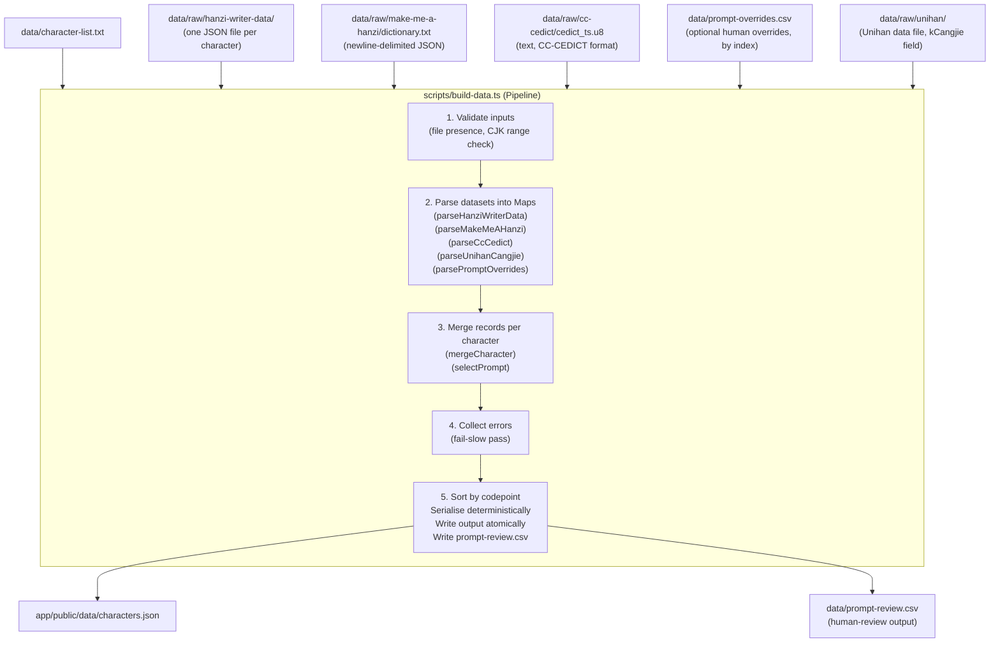

# Design Document: character-dataset

## Overview

The character-dataset feature is a Node.js + TypeScript data pipeline that transforms four open-source raw datasets (hanzi-writer-data, Make Me a Hanzi, CC-CEDICT, and Unihan for Cangjie codes; amended by cangjie-seance Requirement 1) into a single `app/public/data/characters.json` file consumed by the Ghost Script app and the Cangjie Oracle MCP server. The pipeline is offline-first, fully deterministic, and validates every record before writing any output. No AI-generated data is ever introduced at any stage.

The pipeline is invoked once (or whenever the source data changes) via `npm run build:data` from the repository root. The app itself never calls any external API at runtime.

---

## Architecture



*(Amended by cangjie-seance Requirement 1)* The Unihan input is read by `scripts/lib/parse-unihan.ts`; the merge step adds the `cangjie` field. A malformed or duplicated `kCangjie` value is a build-level failure (stderr, non-zero exit, no output), while an absent value is not: it yields `cangjie: null` and `sources.cangjie: "missing"`.

The build also reads `data/prompt-overrides.csv` when present (an absent file means no overrides), calls `selectPrompt` per character during the merge/assembly pass, and treats a prompt-selection failure (and an out-of-range override index) exactly like a missing-required-field failure: fail-slow, aggregated across all characters, no output written, non-zero exit. On full success it writes `data/prompt-review.csv` next to `data/` as an output artefact for human spot-checking; `app/public/data/characters.json` remains the primary output.

### Design decisions

- **Fail-slow, fail-complete**: the pipeline processes every character before deciding to abort. This ensures a single run surfaces all missing-field problems rather than just the first one.
- **No output on failure**: the pipeline writes to a temporary file and renames it atomically only on full success, so a partially built `characters.json` is never left on disk.
- **Offline after download**: the pipeline reads only local files; no network requests are made.
- **Strict TypeScript**: `strict: true`, no `any`, `unknown` + type guards at raw-data parse boundaries.

---

## Components and Interfaces

### Entry point: `scripts/build-data.ts`

The file exports a `main()` function (called on execution) and a pure `buildDataset()` function (used in tests).

```typescript
// Public API for tests
export async function buildDataset(opts: BuildOptions): Promise<BuildResult>

interface BuildOptions {
  characterListPath:    string;   // path to character-list.txt
  hanziWriterDataDir:   string;  // path to hanzi-writer-data directory
  makeMeAHanziPath:     string;    // path to dictionary.txt
  ccCedictPath:         string;        // path to cedict_ts.u8
  unihanPath:           string;        // path to the Unihan data file under data/raw/unihan/ (amended by cangjie-seance Requirement 1)
  promptOverridesPath?: string;  // path to prompt-overrides.csv (optional; absent = no overrides)
  promptReviewPath?:    string;  // path to write prompt-review.csv on success
}

type BuildResult =
  | { ok: true;  output: string; cangjieMissing: string[] }  // serialised JSON string; characters with cangjie === null (for the summary)
  | { ok: false; errors: MissingFieldError[]; cangjieErrors?: CangjieError[] }

interface CangjieError {            // amended by cangjie-seance Requirement 1
  character: string;
  values: string[];                 // every kCangjie value found for the character
  reason: 'invalid-format' | 'multiple-values';
}

interface MissingFieldError {
  character: string;
  missingFields: RequiredField[];
  promptFailure?: 'no-usable-meaning' | 'no-usable-reading';  // prompt-selection failure reason
}

type RequiredField = 'pinyin' | 'meanings' | 'strokeCount' | 'strokeData' | 'decomposition';
```

### `scripts/lib/parse-character-list.ts`

```typescript
export function parseCharacterList(raw: string): ParseCharacterListResult

type ParseCharacterListResult =
  | { ok: true;  characters: string[] }
  | { ok: false; errors: CharacterListError[] }

interface CharacterListError {
  line: number;
  character: string;
  reason: 'not-cjk' | 'duplicate';
}
```

Reads lines, strips `#`-prefixed comment lines, trims whitespace, validates each remaining character is a single codepoint in U+4E00–U+9FFF, and checks for duplicates.

### `scripts/lib/parse-hanzi-writer-data.ts`

```typescript
export function parseHanziWriterData(
  dataDir: string
): Map<string, HanziWriterEntry>

interface HanziWriterEntry {
  strokes:    string[];    // SVG path data, one per stroke
  medians:    number[][][]; // stroke medians (same order as strokes)
  radStrokes: number[];    // indices of radical strokes (may be absent)
}
```

For each character in the list, reads `<dataDir>/<char>.json`. The file for character `我` is loaded as `data/raw/hanzi-writer-data/我.json`. Each JSON file has the shape shown in the live data (`{ strokes, medians, radStrokes }`). Values are kept verbatim.

### `scripts/lib/parse-make-me-a-hanzi.ts`

```typescript
export function parseMakeMeAHanzi(
  rawText: string
): Map<string, MakeMeAHanziEntry>

interface MakeMeAHanziEntry {
  decomposition: string;          // IDS string, verbatim from source
  radical:       string;
  etymology:     Etymology | null;
  matches:       (number[] | null)[] | null;
  atomic:        boolean;         // true when decomposition starts with ？
  components:    string[];        // leaf components from CJK Unified Ideographs (U+4E00–U+9FFF),
                                  // CJK Ext A (U+3400–U+4DBF), CJK Radicals Supplement (U+2E80–U+2EFF),
                                  // Kangxi Radicals (U+2F00–U+2FDF), or CJK Strokes (U+31C0–U+31EF);
                                  // [character] for atomic
}

type Etymology =
  | { type: 'ideographic' | 'pictographic'; hint: string }
  | { type: 'pictophonetic'; hint: string | null; phonetic: string | null; semantic: string | null }
```

Parses each `\n`-delimited JSON line from `dictionary.txt`. Uses `unknown` + a type guard `isMakeMeAHanziLine(value: unknown): value is MakeMeAHanziEntry` at the parse boundary.

After parsing the raw JSON, the module computes `atomic` and `components` for each entry before inserting it into the returned Map:

**Atomic case** (`decomposition` starts with `？`): set `atomic = true`, set `components = [character]`. The `？` is the full entry; no leaf components are extracted.

**Non-atomic case**: set `atomic = false`, extract leaf components by iterating the IDS string codepoint-by-codepoint, keeping only codepoints that fall within one of the following blocks: CJK Unified Ideographs (U+4E00–U+9FFF), CJK Extension A (U+3400–U+4DBF), CJK Radicals Supplement (U+2E80–U+2EFF), Kangxi Radicals (U+2F00–U+2FDF), or CJK Strokes (U+31C0–U+31EF). Skip IDCs U+2FF0–U+2FFB, skip `？` U+FF1F, and skip any other codepoints not in those five blocks. Preserve order of first occurrence. Store the result in `components`.

```typescript
function extractLeafComponents(idsString: string): string[]
// Returns codepoints in U+4E00–U+9FFF, U+3400–U+4DBF, U+2E80–U+2EFF, U+2F00–U+2FDF, U+31C0–U+31EF
// in left-to-right order, skipping IDCs (U+2FF0–U+2FFB) and ？ (U+FF1F)
```

### `scripts/lib/parse-cc-cedict.ts`

```typescript
export function parseCcCedict(
  rawText: string
): Map<string, CcCedictEntry>

export interface CcCedictSense {
  reading:  string;    // numbered pinyin for this entry, e.g. "liao3"
  meanings: string[];  // this entry's glosses, in source order
}

export interface CcCedictEntry {
  pinyin:   string[];        // distinct pinyin strings in source order (flat, record field)
  meanings: string[];        // distinct meaning strings in source order (flat, record field)
  entries:  CcCedictSense[]; // per-entry senses in source order (reading + its glosses) — used for prompts
}
```

Parses the CC-CEDICT format line by line. A data line has the structure:
```
Traditional Simplified [pin1 yin1] /meaning1/meaning2/
```
Lines starting with `#` are comment lines and skipped. For each simplified character, all matching entries are collected; `pinyin` and `meanings` are deduplicated (preserving first-occurrence order). In addition to building the flat deduplicated `pinyin`/`meanings`, the parser pushes one `CcCedictSense { reading, meanings }` per source line (in file order, no dedup across entries) into `entries`. The flat lists are unchanged for the record; `entries` is what prompt selection consumes so a meaning and its reading stay paired.

### `scripts/lib/parse-unihan.ts` *(Added by cangjie-seance Requirement 1)*

```typescript
export function parseUnihanCangjie(rawText: string): Map<string, string[]>
```

Parses the Unihan data file (tab-separated `U+XXXX<TAB>field<TAB>value` lines; `#` lines skipped), keeps only lines whose field is `kCangjie`, converts the `U+XXXX` codepoint to its character, and collects ALL `kCangjie` values per character in source order (a `string[]`, not a single string) so the build can detect duplicates. The parser does no validation of the values; the build checks each collected value against `^[A-Y]{1,5}$` and fails on a mismatch or when a character has more than one value. A character absent from the map yields `cangjie: null`. The parser never infers or derives a code.

### `scripts/lib/merge.ts`

```typescript
export function mergeCharacter(
  char: string,
  hanziWriter: HanziWriterEntry | undefined,
  makeMeAHanzi: MakeMeAHanziEntry | undefined,
  ccCedict: CcCedictEntry | undefined,
  cangjie: string | null,           // validated single kCangjie value, or null (amended by cangjie-seance Requirement 1)
): MergeResult

type MergeResult =
  | { ok: true;  record: CharacterRecord }
  | { ok: false; missingFields: RequiredField[] }
```

Pure function. Assembles a `CharacterRecord` from the parsed entries. Returns a failure result listing every missing required field rather than throwing. `cangjie` is not a required field: a `null` input never causes a failure and yields `cangjie: null` with `sources.cangjie: "missing"`; a non-null input yields `sources.cangjie: "unihan"`.

### `scripts/lib/prompt.ts`

```typescript
export function selectPrompt(
  char: string,
  ccCedict: CcCedictEntry,
  override: PromptOverride | undefined,
): PromptSelectionResult

export function numberedToToneMarks(numberedPinyin: string): string

export interface PromptOverride {
  character:    string;
  entryIndex:   number;   // index into ccCedict.entries
  meaningIndex: number;   // index into ccCedict.entries[entryIndex].meanings
  reviewedBy:   string;
}

export interface PromptChoice {
  meaning:      string;   // after (bound form) stripping
  pinyin:       string;   // tone-mark form of the chosen entry's reading
  entryIndex:   number;   // index into ccCedict.entries
  meaningIndex: number;   // index into that entry's meanings
  fromOverride: boolean;
}

type PromptSelectionResult =
  | { ok: true;  choice: PromptChoice }
  | { ok: false; reason: 'no-usable-sense' }
```

`selectPrompt` chooses the ghost clue for a character. The default rule walks `ccCedict.entries` in source order; for each entry it skips the entry when its reading is a proper-noun reading (capitalised first syllable), otherwise it scans that entry's glosses in order, applies `(bound form) ` stripping, and skips glosses beginning with a skipped prefix; the first entry yielding a usable gloss fixes BOTH the meaning (that gloss) and the reading (that entry's reading, converted by `numberedToToneMarks`). When an override is supplied, the entry and gloss are taken by index from `ccCedict.entries[entryIndex].meanings[meaningIndex]` and the reading from that same entry (override index validity is checked upstream in the build). The failure reason collapses to a single `'no-usable-sense'` (no entry yielded a usable gloss).

`numberedToToneMarks` converts a numbered-pinyin reading (tone digits 1–5) to the tone-mark form. It places the diacritic using the standard vowel-priority rule: `a` or `e` always takes the mark; in the sequence `ou` the `o` takes it; otherwise the last vowel takes it. Tone 5 (neutral) produces no mark.

Both functions are pure. `selectPrompt` never throws on a selection failure — it returns `{ ok: false, reason }` so the build can aggregate the failure like a missing required field.

### `scripts/lib/parse-prompt-overrides.ts`

```typescript
export function parsePromptOverrides(rawCsv: string): ParsePromptOverridesResult

type ParsePromptOverridesResult =
  | { ok: true;  overrides: Map<string, PromptOverride> }
  | { ok: false; errors: PromptOverrideError[] }

export interface PromptOverrideError {
  line: number;
  character: string;
  reason: 'unknown-character' | 'entry-index-out-of-range' | 'meaning-index-out-of-range' | 'missing-reviewer' | 'malformed-row' | 'duplicate-character';
}
```

Parses `data/prompt-overrides.csv` (header `character,entryIndex,meaningIndex,reviewedBy`). The parser validates row shape (`malformed-row`), non-empty `reviewedBy` (`missing-reviewer`), and duplicate characters (`duplicate-character`). Range validation that depends on a character's parsed CC-CEDICT entry (`unknown-character`, `entry-index-out-of-range`, `meaning-index-out-of-range`) happens during the build, because it needs the merged data; the error type enumerates all reasons the build may report. The build-time range checks are now entry-index (into `ccCedict.entries`) and meaning-within-entry (into the selected entry's glosses). `data/prompt-overrides.csv` is an INPUT to the build; `data/prompt-review.csv` is an OUTPUT written on success and is never read back.

### `scripts/lib/serialise.ts`

```typescript
export function serialiseDataset(
  records: Map<string, CharacterRecord>
): string
```

Sorts records by Unicode codepoint (`char.codePointAt(0)`) ascending, then serialises to JSON with a fixed key order per record (`character`, `pinyin`, `meanings`, `strokeCount`, `strokeData`, `decomposition`, `prompt`, `cangjie`, `sources`), and a fixed key order within `sources` (`pinyin`, `meanings`, `strokeCount`, `strokeData`, `decomposition`, `cangjie` last). *(Amended by cangjie-seance Requirement 1)* Uses `JSON.stringify(sorted, null, 2)` for a human-readable, deterministic output.

---

## Data Models

### `CharacterRecord` (canonical TypeScript type)

```typescript
// app/src/data/types.ts  (shared by app, scripts, and oracle)
export interface CharacterRecord {
  character:    string;          // single CJK codepoint, e.g. "我"
  pinyin:       string[];        // ["wo3"] — always non-empty in a built record
  meanings:     string[];        // ["I", "me", "my"] — always non-empty
  strokeCount:  number;          // integer >= 1
  strokeData:   StrokeData;      // verbatim hanzi-writer path object
  decomposition: Decomposition;  // always non-null; atomic=true when character is indivisible
  prompt:       Prompt;          // always non-null; chosen ghost clue (see Requirement 6)
  cangjie:      string | null;   // verbatim Unihan kCangjie, matches ^[A-Y]{1,5}$; the only nullable field (amended by cangjie-seance Requirement 1)
  sources:      FieldSources;
}

export interface StrokeData {
  strokes:    string[];
  medians:    number[][][];
  radStrokes: number[];
}

export interface Decomposition {
  decomposition: string;          // IDS string from Make Me a Hanzi (verbatim)
  radical:       string;
  etymology:     Etymology | null;
  matches:       (number[] | null)[] | null;
  atomic:        boolean;         // true if decomposition starts with ？ (U+FF1F)
  components:    string[];        // leaf components from CJK Unified Ideographs (U+4E00–U+9FFF),
                                  // CJK Ext A (U+3400–U+4DBF), CJK Radicals Supplement (U+2E80–U+2EFF),
                                  // Kangxi Radicals (U+2F00–U+2FDF), or CJK Strokes (U+31C0–U+31EF);
                                  // for atomic records, [character]
}

export interface Prompt {
  meaning: string;   // chosen English gloss, "(bound form) " prefix stripped; non-empty
  pinyin:  string;   // chosen reading rendered with tone marks, e.g. "shàng"; non-empty
}

export type DatasetId = 'cc-cedict' | 'hanzi-writer-data' | 'make-me-a-hanzi' | 'unihan';  // 'unihan' added by cangjie-seance Requirement 1

export interface FieldSources {
  pinyin:        DatasetId;   // always "cc-cedict"
  meanings:      DatasetId;   // always "cc-cedict"
  strokeCount:   DatasetId;   // always "hanzi-writer-data"
  strokeData:    DatasetId;   // always "hanzi-writer-data"
  decomposition: DatasetId;   // always "make-me-a-hanzi"
  cangjie:       DatasetId | 'missing';  // "unihan" when cangjie is non-null, else "missing" (the only key that may be "missing")
}
```

The `Prompt` interface is a canonical type shared in `app/src/data/types.ts` alongside `CharacterRecord`, `StrokeData`, `Decomposition`, and `FieldSources`, so the app, scripts, and oracle all import the same definition. Both fields originate from the same CC-CEDICT entry (see Requirement 6.12).

### `characters.json` schema

The top-level value is a JSON object:

```json
{
  "我": {
    "character": "我",
    "pinyin": ["wo3"],
    "meanings": ["I", "me", "my"],
    "strokeCount": 7,
    "strokeData": {
      "strokes": ["M 350 571 Q ..."],
      "medians": [[[458, 627], ...]],
      "radStrokes": [1, 4, 5, 6]
    },
    "decomposition": {
      "decomposition": "⿻戈㇒",
      "radical": "戈",
      "etymology": { "type": "ideographic", "hint": "..." },
      "matches": [[0], [1], null, null, [2], [2], [2]],
      "atomic": false,
      "components": ["戈"]
    },
    "prompt": { "meaning": "I; me; my", "pinyin": "wǒ" },
    "cangjie": "HQI",
    "sources": {
      "pinyin": "cc-cedict",
      "meanings": "cc-cedict",
      "strokeCount": "hanzi-writer-data",
      "strokeData": "hanzi-writer-data",
      "decomposition": "make-me-a-hanzi",
      "cangjie": "unihan"
    }
  },
  "口": {
    "character": "口",
    "pinyin": ["kou3"],
    "meanings": ["mouth", "classifier for people, wells, pigs etc"],
    "strokeCount": 3,
    "strokeData": { "strokes": ["..."], "medians": [...], "radStrokes": [] },
    "decomposition": {
      "decomposition": "？",
      "radical": "口",
      "etymology": { "type": "pictographic", "hint": "A mouth" },
      "matches": [],
      "atomic": true,
      "components": ["口"]
    },
    "prompt": { "meaning": "mouth", "pinyin": "kǒu" },
    "cangjie": "R",
    "sources": {
      "pinyin": "cc-cedict",
      "meanings": "cc-cedict",
      "strokeCount": "hanzi-writer-data",
      "strokeData": "hanzi-writer-data",
      "decomposition": "make-me-a-hanzi",
      "cangjie": "unihan"
    }
  }
}
```

When Unihan has no `kCangjie` value for a character, `cangjie` is `null` and `sources.cangjie` is `"missing"`; in the current data all 300 characters have a value.

Keys are sorted by Unicode codepoint ascending. Key order within each record is fixed: `character`, `pinyin`, `meanings`, `strokeCount`, `strokeData`, `decomposition`, `prompt`, `cangjie`, `sources`; within `sources` it is `pinyin`, `meanings`, `strokeCount`, `strokeData`, `decomposition`, `cangjie` (amended by cangjie-seance Requirement 1). This guarantees byte-for-byte determinism across runs.

### `data/character-list.txt` format

```
# Derived from HSK 1-4 + TOCFL A1-B2 frequency list, https://example.com/source, CC0
我
你
他
...
```

- First line: `#`-prefixed comment with source name, URL, SPDX licence identifier.
- Subsequent lines: one simplified Chinese character per line.
- Blank lines and additional `#` comment lines are skipped.
- All characters must be in U+4E00–U+9FFF.

---

## Correctness Properties

*A property is a characteristic or behavior that should hold true across all valid executions of a system — essentially, a formal statement about what the system should do. Properties serve as the bridge between human-readable specifications and machine-verifiable correctness guarantees.*

### Property 1: CJK range validation rejects non-CJK codepoints

*For any* Unicode string that contains at least one codepoint outside U+4E00–U+9FFF, the character-list parser SHALL return a failure result identifying each offending character, and the pipeline SHALL not produce an output file.

**Validates: Requirements 1.4**

---

### Property 2: Pipeline determinism

*For any* set of valid pipeline inputs (character list + raw dataset content), running the `buildDataset` function twice with identical inputs SHALL produce byte-for-byte identical output strings.

**Validates: Requirements 3.4, 5.7**

---

### Property 3: Fail-slow error aggregation

*For any* set of characters where a random subset has one or more missing required fields (`pinyin`, `meanings`, `strokeCount`, `strokeData`, `decomposition`), the pipeline SHALL process every character before returning a failure, and the failure result SHALL list every character with every missing field — not just the first failing character.

**Validates: Requirements 3.6**

---

### Property 4: CharacterRecord schema completeness

*For any* `CharacterRecord` produced by the pipeline, the record SHALL contain exactly the fields `character`, `pinyin`, `meanings`, `strokeCount`, `strokeData`, `decomposition`, `prompt`, `cangjie`, and `sources`, with `cangjie` either `null` or a string and every other field non-null, and no unrecognised keys SHALL be present. *(Amended by cangjie-seance Requirement 1)*

**Validates: Requirements 4.2**

---

### Property 5: CC-CEDICT multi-entry deduplication preserves order

*For any* sequence of CC-CEDICT entries for the same simplified character, the parsed `pinyin` array SHALL equal the list of distinct pinyin strings in first-occurrence order, and the parsed `meanings` array SHALL equal the list of distinct meaning strings in first-occurrence order.

**Validates: Requirements 4.3**

---

### Property 6: Stroke data extraction round-trip

*For any* hanzi-writer-data JSON object with a non-empty `strokes` array, the pipeline extractor SHALL set `strokeCount` to exactly `strokes.length` and `strokeData` to an object equal in value to the original input (verbatim pass-through, no modification).

**Validates: Requirements 4.5**

---

### Property 7: Decomposition verbatim pass-through

*For any* Make Me a Hanzi `dictionary.txt` line that parses successfully, the pipeline SHALL store the `decomposition` field as an object structurally equal to the original parsed value, with no fields added, removed, or modified.

**Validates: Requirements 4.7**

---

### Property 8: No placeholder in components array

*For any* `CharacterRecord` in a successfully built `characters.json`, no element of `decomposition.components` SHALL be the placeholder codepoint `？` (U+FF1F) or any Ideographic Description Character (U+2FF0–U+2FFB); every element SHALL be a single codepoint whose value falls within one of: CJK Unified Ideographs U+4E00–U+9FFF, CJK Extension A U+3400–U+4DBF, CJK Radicals Supplement U+2E80–U+2EFF, Kangxi Radicals U+2F00–U+2FDF, or CJK Strokes U+31C0–U+31EF.

**Validates: Requirements 5.5**

---

### Property 9: Atomic record has exactly one component equal to the character

*For any* `CharacterRecord` where `decomposition.atomic` is `true`, `decomposition.components` SHALL have exactly one element and that element SHALL equal `record.character`.

**Validates: Requirements 5.6**

---

### Property 10: sources object has exactly the required keys with valid values

*For any* `CharacterRecord`, the `sources` object SHALL have exactly six keys (`pinyin`, `meanings`, `strokeCount`, `strokeData`, `decomposition`, `cangjie`) and each value SHALL be one of the four dataset ids `"cc-cedict"`, `"hanzi-writer-data"`, `"make-me-a-hanzi"`, or `"unihan"`, except that `sources.cangjie` MAY instead be `"missing"`; no other key SHALL ever have the value `"missing"`. *(Amended by cangjie-seance Requirement 1)*

**Validates: Requirements 4.11**

---

### Property 11: Output record count equals character-list entry count

*For any* `character-list.txt` with N valid (non-empty, non-comment) lines, a successful pipeline run SHALL produce a `characters.json` containing exactly N top-level keys.

**Validates: Requirements 4.11**

---

### Property 12: Every list character is a key in the output, exactly once

*For any* `character-list.txt`, every character on a non-comment line SHALL appear as a key in `characters.json` exactly once. No key in `characters.json` SHALL be absent from the character list.

**Validates: Requirements 5.1**

---

### Property 13: Non-null pinyin contains at least one non-empty string

*For any* `CharacterRecord` in a successfully built `characters.json`, the `pinyin` array SHALL have length ≥ 1 and every element SHALL be a non-empty string.

**Validates: Requirements 5.2**

---

### Property 14: Non-null meanings contains at least one non-empty string

*For any* `CharacterRecord` in a successfully built `characters.json`, the `meanings` array SHALL have length ≥ 1 and every element SHALL be a non-empty string.

**Validates: Requirements 5.3**

---

### Property 15: strokeCount is a positive integer

*For any* `CharacterRecord` in a successfully built `characters.json`, `strokeCount` SHALL be an integer greater than zero.

**Validates: Requirements 5.4**

---

### Property 16: Decomposition IDS string contains only valid codepoints

*For any* `CharacterRecord` whose `decomposition.decomposition` string is not a question-mark sentinel (`？`), every codepoint in that string SHALL be one of: (a) a codepoint in one of the five recognised component blocks (CJK Unified Ideographs U+4E00–U+9FFF, CJK Extension A U+3400–U+4DBF, CJK Radicals Supplement U+2E80–U+2EFF, Kangxi Radicals U+2F00–U+2FDF, CJK Strokes U+31C0–U+31EF), (b) an Ideographic Description Character in U+2FF0–U+2FFB, or (c) the recognised placeholder `？` (U+FF1F). (Corrected Nov 9: the real data contains 11 CJK Radicals Supplement codepoints in IDS strings, so the earlier three-category wording would have rejected valid data.)

**Validates: Requirements 5.5**

---

### Property 17: Hint sequence is a subsequence of decomposition leaf components

*For any* `CharacterRecord` with a valid `decomposition`, the sequence of component strings returned by the hint engine (`getHintSequence(record)` in `src/engine/hints.ts`) SHALL be a subsequence of the leaf-component list extracted from `record.decomposition` by `getLeafComponents(record.decomposition)`.

**Validates: Requirements 5.6**

---

### Property 18: prompt.meaning is a source meaning (after prefix stripping)

*For any* `CharacterRecord` in a successfully built `characters.json`, `prompt.meaning` SHALL equal one of that record's `meanings` entries, OR that entry with a single leading `(bound form) ` removed; and `prompt.meaning` SHALL be non-empty.

**Validates: Requirements 6.2**

---

### Property 19: prompt.pinyin is the tone-mark form of a source reading

*For any* `CharacterRecord` in a successfully built `characters.json`, `prompt.pinyin` SHALL equal `numberedToToneMarks(r)` for some reading `r` in that record's `pinyin` array, namely the reading of the entry the chosen meaning belongs to.

**Validates: Requirements 6.3**

---

### Property 20: no default prompt begins with a skipped prefix

*For any* `CharacterRecord` whose prompt was chosen by the default rule (no override), `prompt.meaning` SHALL NOT begin (case-insensitively, after `(bound form) ` stripping) with any skipped prefix (`surname `, `variant of`, `old variant of`, `used in`, `see `, `abbr.`, `CL:`, `also pr.`, `Taiwan pr.`).

**Validates: Requirements 6.4**

---

### Property 21: every override index is in range and reviewer-attributed

*For any* parsed prompt-override applied in a successful build, `meaningIndex` SHALL be a valid index into the character's `meanings`, `readingIndex` SHALL be a valid index into the character's `pinyin`, and `reviewedBy` SHALL be non-empty.

**Validates: Requirements 6.6, 6.7**

---

### Property 22: prompt meaning and reading come from the same entry

*For any* `CharacterRecord` in a successfully built `characters.json`, there SHALL exist a single CC-CEDICT entry for that character such that `prompt.meaning` is one of that entry's glosses (after optional `(bound form) ` stripping) AND `prompt.pinyin` equals `numberedToToneMarks(entry.reading)`.

**Validates: Requirements 6.12**

---

### Property 23: Cangjie codes are well-formed, attributed, and verbatim from Unihan

*For any* `CharacterRecord` in a successfully built `characters.json`: (a) if `cangjie` is non-null, it SHALL match `^[A-Y]{1,5}$`; (b) `sources.cangjie` SHALL equal `"unihan"` if and only if `cangjie` is non-null (otherwise it SHALL equal `"missing"`); and (c) if `cangjie` is non-null, it SHALL equal the single raw Unihan `kCangjie` value for that character as returned by `parseUnihanCangjie`. *(Added by cangjie-seance Requirement 1)*

**Validates: Requirements 4.13, 5.10, 5.11, 5.12**

---

## Error Handling

### Input validation errors (before processing)

| Condition | Behaviour |
|---|---|
| Any required raw dataset file (including the Unihan data file) is absent | Emit path(s) to stderr, exit non-zero, no output file written |
| `character-list.txt` is absent | Emit path to stderr, exit non-zero |
| A character in the list is not a CJK codepoint | Emit character + line number to stderr, exit non-zero after validating all lines |
| Duplicate character in the list | Emit character + duplicate line number to stderr, exit non-zero |

### Per-character processing errors (fail-slow)

| Condition | Behaviour |
|---|---|
| CC-CEDICT has no entry for a character | Record `pinyin` and `meanings` as missing; continue |
| hanzi-writer-data has no file for a character | Record `strokeCount` and `strokeData` as missing; continue |
| Make Me a Hanzi has NO entry for a character | Record `decomposition` as missing; continue |
| Make Me a Hanzi entry has `decomposition` starting with `？` | Classify as atomic: `atomic=true`, `components=[character]`; NOT a missing-field error |
| Make Me a Hanzi IDS string contains interior `？` (e.g. `⿱逢？`) | Strip `？` from leaf extraction; keep other recognised CJK components |
| Unihan has no `kCangjie` value for a character *(amended by cangjie-seance Requirement 1)* | Set `cangjie: null` and `sources.cangjie: "missing"`; NOT a build failure; the character is listed in the success summary |
| A `kCangjie` value does not match `^[A-Y]{1,5}$`, or a character has more than one value *(amended by cangjie-seance Requirement 1)* | Write each affected character and value to stderr, exit non-zero, write no output file |
| One or more characters have missing required fields | After processing all characters, emit full missing-field report to stderr, exit non-zero, do not write output file |

### Output integrity errors

| Condition | Behaviour |
|---|---|
| Record count in output ≠ line count in character-list.txt | Emit counts to stderr, exit non-zero, delete partial output file |
| JSON serialisation throws | Emit error to stderr, exit non-zero |

### Atomic write strategy

The pipeline writes to a temporary file (e.g. `characters.json.tmp`) in the same directory as the intended output, then renames it to `characters.json` only on full success. This prevents a partially written file from being read by the app.

---

## Testing Strategy

The test suite lives in `tests/` and uses **Vitest** as the runner and **fast-check** as the property-based testing library. All tests must pass with `npm test` from the repository root. No network access is required after the raw datasets are present.

### Unit tests (`tests/unit/`)

Concrete example-based tests for:
- `parseCharacterList`: rejects non-CJK characters, handles comment lines, rejects duplicates, accepts valid input.
- `parseCcCedict`: correctly parses a sample multi-entry block; deduplicated output matches expected arrays; and that `entries` preserves per-source-line reading+glosses in order (e.g. 了 yields a `liao3` entry and a `le` entry, each with its own glosses).
- `parseMakeMeAHanzi`: correctly parses a sample `dictionary.txt` line with and without etymology.
- `parseUnihanCangjie` *(added by cangjie-seance Requirement 1)*: collects every `kCangjie` value per character in source order, ignores other fields and comment lines, and returns two values for a character that appears twice. Fixture lines are taken from the real Unihan file under `data/raw/unihan/` (for example 别 `XRSLN`, 错 `XCTA`, 身 `HXH`); no invented entries. Build-level tests cover a malformed value, a duplicate value, and a missing value (null, build succeeds, summary lists the character).
- `parseHanziWriterData`: correctly extracts `strokeCount` from a known JSON fixture.
- `mergeCharacter`: returns failure when any required field is missing; returns success with correct `sources` when all fields present.
- `selectPrompt`: entry-based selection — real cases such as 三 (skips the `San` proper-noun entry), 后 (walks to a usable entry), 号, 了 (picks a usable entry whose reading pairs with its gloss), and 中; override precedence over the default rule (override selects an entry + a gloss within it); the single `no-usable-sense` failure result; and that the chosen meaning and reading share an entry. Fixture lines are taken from the real CC-CEDICT data in `data/raw/cc-cedict/cedict_ts.u8`; no invented entries.
- `numberedToToneMarks`: example-based tests — `shang3` → `shǎng`, `hao3` → `hǎo`, `lu:4`/`lv4` handling if present, tone 5 (neutral) → no mark.
- `parsePromptOverrides`: valid rows produce the override map; malformed row, missing reviewer, and duplicate character each produce the correct `PromptOverrideError`. Fixture lines in `data/prompt-overrides.csv` reference real characters (e.g. 三, 后, 号).
- Fixtures for 三, 后, 号, 了, 中 come from the real `data/raw/cc-cedict/cedict_ts.u8`.
- Pipeline missing-file errors: `buildDataset` with a non-existent dataset path returns an error result listing the missing path.

### Property-based tests (`tests/property/`)

Each property corresponds to a design correctness property. All property tests run with a minimum of **100 iterations** per `fast-check` run.

| Test file | Properties covered |
|---|---|
| `character-list.test.ts` | Property 1 (CJK validation) |
| `pipeline-determinism.test.ts` | Property 2 (determinism) |
| `pipeline-errors.test.ts` | Property 3 (fail-slow error aggregation) |
| `character-record-schema.test.ts` | Properties 4, 10, 13, 14, 15 (4 and 10 amended by cangjie-seance Requirement 1) |
| `cangjie.test.ts` | Property 23 (Cangjie format, attribution, and verbatim match with raw Unihan; added by cangjie-seance Requirement 1) |
| `cc-cedict-parser.test.ts` | Property 5 (deduplication preserves order) |
| `hanzi-writer-parser.test.ts` | Property 6 (stroke data round-trip) |
| `make-me-a-hanzi-parser.test.ts` | Property 7 (decomposition verbatim pass-through) |
| `output-count.test.ts` | Properties 11, 12 (count invariant, every list char is a key) |
| `decomposition-components.test.ts` | Property 8 (no placeholder in components), Property 9 (atomic record component invariant), Property 16 (IDS string valid codepoints) |
| `hint-engine.test.ts` | Property 17 (hint sequence is a subsequence) |
| `prompt-selection.test.ts` | Properties 18 (meaning is a source meaning), 19 (pinyin is tone-mark of a source reading), 20 (no default prompt starts with a skipped prefix), 22 (meaning and reading come from the same entry) |
| `prompt-overrides.test.ts` | Property 21 (override index in range and reviewer-attributed) |

Each test is tagged with a comment referencing its design property:

```typescript
// Feature: character-dataset, Property 2: Pipeline determinism
it.prop([arbitraryBuildInputs])('determinism', (inputs) => {
  const a = buildDataset(inputs);
  const b = buildDataset(inputs);
  expect(a).toEqual(b);
}, { numRuns: 100 });
```

### Smoke tests (`tests/smoke/`)

- `dataset-files.test.ts`: asserts that all required raw dataset files and licence files exist on disk, including the Unihan data file and its Unicode License V3 text under `data/raw/unihan/` (amended by cangjie-seance Requirement 1).
- `character-list-bounds.test.ts`: asserts character-list.txt has 280–320 non-comment lines, no duplicates, first line is a `#` comment.
- `npm-script.test.ts`: asserts `package.json` has a `build:data` script entry.

### Integration test (`tests/integration/`)

- `full-pipeline.test.ts`: runs `buildDataset` with the actual files in `data/raw/` and `data/character-list.txt`, asserts the result is `ok: true`, and spot-checks a small sample of well-known characters for expected field shapes.

### fast-check arbitraries (shared helpers)

```typescript
// tests/helpers/arbitraries.ts
arbitraryCharacter()      // fc.char() filtered to U+4E00–U+9FFF
arbitraryCharacterList()  // fc.uniqueArray(arbitraryCharacter(), { minLength: 1, maxLength: 320 })
arbitraryCcCedictEntry()  // random pinyin syllables + meanings
arbitraryStrokeData()     // random strokes array with at least one entry
arbitraryDecomposition()  // random IDS strings using valid CJK codepoints (U+4E00–U+9FFF,
                          // U+3400–U+4DBF, U+2E80–U+2EFF, U+2F00–U+2FDF, U+31C0–U+31EF) + IDCs
arbitraryCharacterRecord() // full record with all fields present (cangjie either null or ^[A-Y]{1,5}$, with matching sources.cangjie)
```

The Cangjie fixtures and the raw-value comparison in Property 23 use lines from the real Unihan file in `data/raw/unihan/`, not hand-written codes (amended by cangjie-seance Requirement 1).
