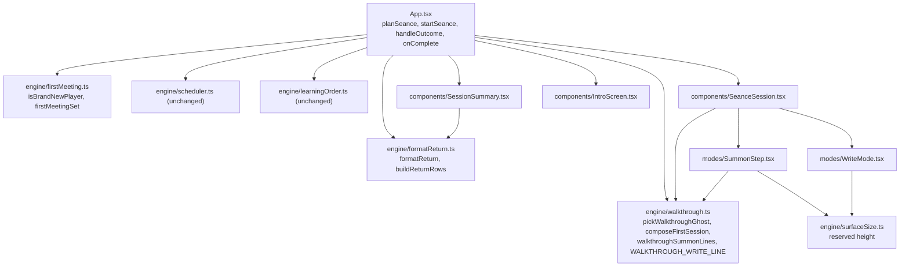
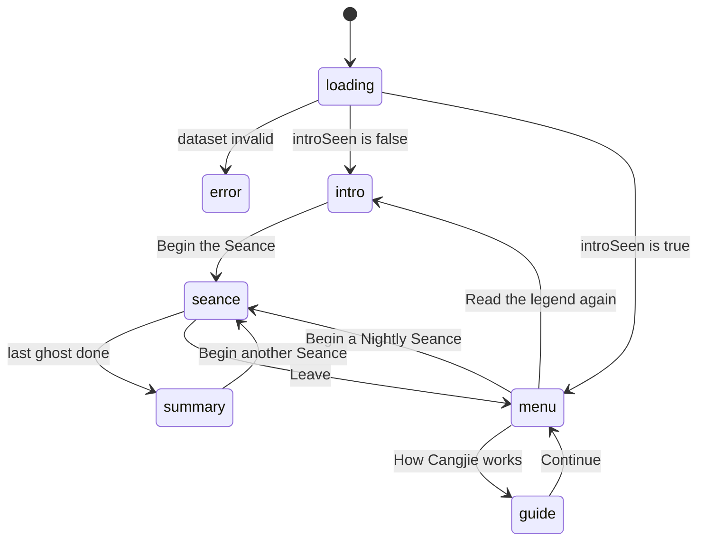
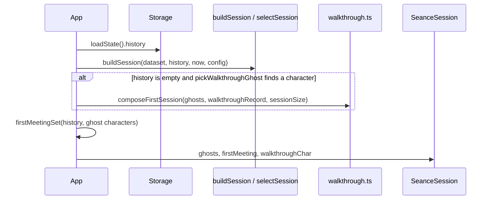
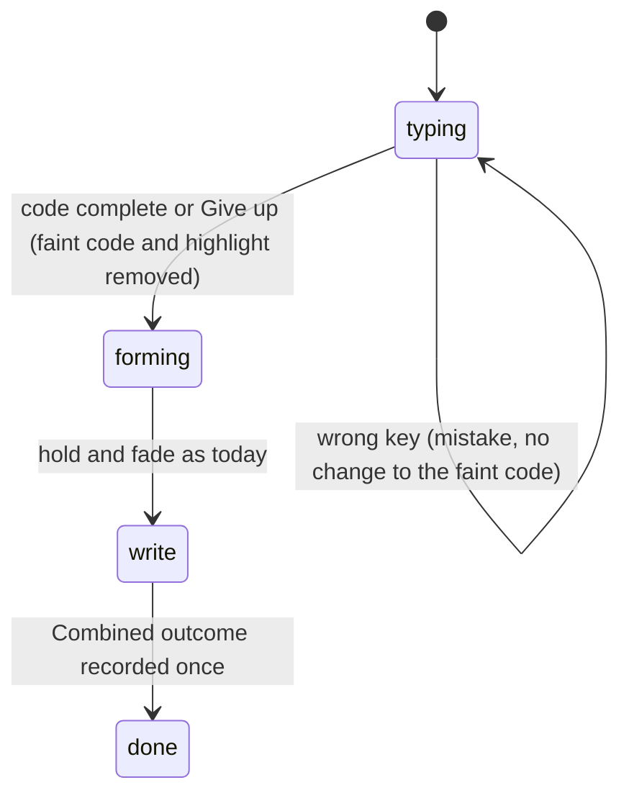

# Design Document: first-meeting

## Overview

The feature has four parts and touches the App, the Summon step, the Séance session, the summary and the intro. It adds three small pure modules to `app/src/engine/` and leaves the scheduler, the Summon reducer, the outcomes, the storage module and the dataset unchanged.

1. **Teach on first meeting, test on return.** The App reads the Review history once when a Séance starts and derives a `firstMeeting` set (characters with no saved entry). The Summon step receives a boolean for its ghost. When true it shows the code as faint letters in the empty slots and highlights the next slot and key. The reducer is not involved: the display is a view over `state.code` and `state.filled`, so no hint is recorded and the outcome rules stay as they are.
2. **A guided first ghost.** For a player whose history is empty, the App prepends the Walkthrough_Ghost (picked by a pure rule over the Learning order and the dataset) to the scheduler's selection and cuts the list back to ten. The Summon and Write screens show one instruction line each, built from the dataset.
3. **No forced guide.** The `before-seance` path of the `cangjie-guide` view is deleted. The menu entry stays.
4. **The haunting in the summary.** The App keeps, in memory, the Review entry that `applyReview` returns for each ghost of the Séance, and passes the rows plus the finish time to the summary. A pure formatter turns each `nextDue` into "returns in 10 minutes", "returns tomorrow" or "returns in 3 days".

### Kiro features used

- **Specs**: this requirements-first spec (`.kiro/specs/first-meeting/`), with a task list and a wave plan.
- **Steering**: the four steering files shaped the design (`tech.md` stack, the no-new-property-tests decision and the accessibility rule; `structure.md` layout, names and the rule that new features get a spec first; `product.md` never-reveal, "teach structure" and "works on every device"; `content-accuracy.md` the never-reveal and not-an-answer-leak lists, which this feature amends in a task).
- **Custom agent**: `accuracy-reviewer` reviews every new line of copy (task 6.2).
- **Playwright e2e**: the existing `e2e/` suite is extended with `first-meeting.spec.ts`.
- **Hook**: `data-check-on-save` stays untouched, because this feature changes no data input.

### Facts the design relies on

- Learning order (current data, class then stroke count then code point): 一 二 人 下 女 干 从 天 手 本 早 里 明 朋 果 …. 从 is position 7 with equal keys (OO), 明 is position 13 (AB, ⿰日月, `keyStrokes` `[[0,1,2,3],[4,5,6,7]]`).
- With an empty history, the scheduler's session is the first ten of that list (no character is due, so the new-character cap does not apply). 明 is not among them.
- `SeanceSession` already de-duplicates ghosts, so no character is presented twice in one Séance.
- The existing e2e `seedState()` has an empty history, so after this feature the e2e specs that use it start on the Walkthrough_Ghost.

## Decisions

| # | Decision | Reason |
|---|---|---|
| D1 | First meeting is decided from the Review history alone, with an own-property check, once when the Séance starts, and passed down as `ReadonlySet<string>`. No schema change. | Saved history is the only record of "met before". A snapshot cannot flip when an Outcome is recorded mid-Séance, and sessions never repeat a ghost, so a ghost met earlier in the same Séance never needs a second decision. |
| D2 | Brand-new means an empty Review history. `introSeen` and `cangjieIntroSeen` are ignored. | A player who cleared storage, or whose version-1 data was reset, has met no ghost, so the walkthrough helps. A player who leaves before finishing a ghost has recorded nothing and sees the walkthrough again, which is wanted. |
| D3 | The Walkthrough_Rule gains one clause the approved wording does not state: the code must be Playable in Cangjie mode (`isPlayableInCangjie`). It does not change the result on today's data. | A two-key code that starts with X would skip the Summon step and make the walkthrough meaningless. This only narrows the rule where it would be broken. |
| D4 | The session keeps its size of ten: the walkthrough ghost goes first and the last ghost of the scheduler's list is cut. | ghost-game-core AC 3.1 says ten. The dropped ghost (本 today) is a new character with no history, so it comes in the next Séance with nothing lost. |
| D5 | The composition is a pure function `composeFirstSession` in `engine/walkthrough.ts`; `planSeance` in `App.tsx` calls `buildSession` and then it. `buildSession` and `selectSession` stay as they are. | Keeps the scheduler untouched and makes the composition testable without React. |
| D6 | Walkthrough lines are built by `walkthroughSummonLines` from `CANGJIE_KEYS` and `prompt.meaning`. "the" is used only when the cleaned meaning is one plain word (Meaning_Word); otherwise the line is "Press Q: 手 (hand)". | Prompt meanings can be "person; people" or "mountain; hill (CL:座[zuo4])", and "the person; people 人" would read wrongly. The rule is data-driven and typed by no one. The key-shape pairs in the lines come from `CANGJIE_KEYS`, which is the key-to-radical table of the English Wikipedia article "Cangjie input method" (https://en.wikipedia.org/wiki/Cangjie_input_method), the same citation the Cangjie guide shows; the meanings come from the dataset (CC-CEDICT). |
| D7 | Faint style is a dashed border, no shape glyph and a smaller letter, with the `muted` text token (contrast checked in the existing theme tests at 4.5:1 or more). No exemption. | "Faint" is a style cue; the letters must stay readable. |
| D8 | The highlight is a ring plus a bold underlined key letter, `aria-current="true"` on the slot and ", next" at the end of the key's accessible name. | Colour is never the only signal (tech.md). The suffix keeps `^Key A(,|$)` matches in the e2e helpers working. |
| D9 | `cangjieIntroSeen` stays in the schema and is still written when the player continues from the guide; nothing reads it for navigation. | No migration, no storage change, and the visual-identity rule that the App re-reads Saving_Works after the guide-flag write stays true. |
| D10 | "Tomorrow" is a local calendar-day rule: a ghost due 24 hours or more ahead is "tomorrow" when its local calendar day is the day after `now`, and "in N days" when N ≥ 2 days later. Minutes and hours cover everything under 23 hours. | The ladder steps are whole days, so a clean ghost due exactly 24 hours later reads "tomorrow", 3 days later "in 3 days". Taking day numbers from local year, month and day through `Date.UTC` keeps the count correct across a daylight-saving change, and tests build timestamps from local fields so they pass in any time zone. |
| D11 | The summary's `now` is the time the Séance finished, and each row's `nextDue` comes from the entry `applyReview` returned, kept in an App ref for the Séance. | The summary must work when the browser cannot save, so it does not re-read storage. A struggled ghost recorded earlier in a long Séance may read "returns in 7 minutes" or "returns now"; that is accurate at the moment the player reads it. |
| D12 | The summary shows each ghost's glyph. | Every ghost in the summary has finished its Rite and the Write step has revealed the character (cangjie-seance AC 5.7), so nothing is hidden any more. The never-reveal rule is checked before the summary only. |
| D13 | The Walkthrough_Line takes 24 px from the drawing surface through a reserved-height argument on `summonPaperSize` and `writeSurfaceSize`. | The Summon step's height budget at 1024 × 768 has about 8 px of slack (600 + 160 = 760 of 768). Adding a line without reserving would push the last keyboard row out of view. |
| D14 | The summary has no one-screen rule. It must not overflow sideways. | The list length varies; the one-screen rule covers the Rite screens (visual-identity Requirements 25 and 26). |
| D15 | The intro sentence is used word for word as approved. Its "it" now follows the plural "characters ... are ghosts", which reads slightly loosely. | The human approved the wording; the mismatch is reported as an open point rather than changed. |
| D16 | The e2e summary test completes a whole Séance with "Give up" and reduced motion. Its timeout is raised for that test only. | Ten ghosts at about 1.5 s hold plus write give-up each fit well under four minutes; the component tests cover the list exactly. |

## Architecture



### Screen flow (replaces the flow in cangjie-seance design)



### Starting a Séance



### One ghost, first meeting



## Components and Interfaces

### `app/src/engine/firstMeeting.ts` (new, pure)

```ts
import type { ReviewHistory } from './scheduler';

/** True when the history has no entry at all (own properties only). */
export function isBrandNewPlayer(history: ReviewHistory): boolean;

/** The characters from `characters` that have no own-property entry in `history`. */
export function firstMeetingSet(
  history: ReviewHistory,
  characters: readonly string[],
): ReadonlySet<string>;
```

Both use `Object.prototype.hasOwnProperty.call`, so a character key such as "constructor" never reads the prototype (the same care as `priorEntry` in `App.tsx`).

### `app/src/engine/walkthrough.ts` (new, pure)

```ts
import type { CharacterRecord } from '../data/types';
import type { CharacterDataset } from '../data/charDataLoader';

export const WALKTHROUGH_WRITE_LINE = 'Now write it from memory';

/**
 * The first character of `order` with: summonInk.class 'transparent'; a code of exactly
 * two different keys A-Y that is Playable in Cangjie mode; and an IDS string whose parse
 * tree has the top operator ⿰. Null when none exists.
 */
export function pickWalkthroughGhost(
  order: readonly string[],
  dataset: CharacterDataset,
): string | null;

/** Walkthrough ghost first, then `ghosts` without it, cut to `size` (a non-finite or non-positive size gives []). */
export function composeFirstSession(
  ghosts: readonly CharacterRecord[],
  walkthrough: CharacterRecord,
  size: number,
): CharacterRecord[];

/** One line per key of record.cangjie, see Requirement 4.1. maskTarget is applied to every line. */
export function walkthroughSummonLines(
  record: CharacterRecord,
  dataset: CharacterDataset,
): string[];
```

The line for key K with Key_Shape S, where `shapeRecord = dataset.get(S)`:

| Case | Line |
|---|---|
| `shapeRecord` exists and `cleanupMeaning(shapeRecord.prompt.meaning)` matches `/^[A-Za-z]+$/` | `Press K: the {meaning} S` |
| `shapeRecord` exists, meaning is anything else | `Press K: S ({meaning})` |
| `shapeRecord` is missing (for example X, 難) | `Press K: S` |

`pickWalkthroughGhost` imports `parseIds` and `isPlayableInCangjie`; it reads `record.decomposition.decomposition` for the IDS string. The module imports `cleanupMeaning`, `maskTarget` and `CANGJIE_KEYS` and nothing from React.

### `app/src/engine/formatReturn.ts` (new, pure)

```ts
import type { CharacterRecord } from '../data/types';
import type { ReviewEntry } from './scheduler';

export function formatReturn(nextDue: number, now: number): string;

export interface ReturnRow {
  readonly character: string;
  readonly pinyin: string;
  readonly meaning: string;   // cleanupMeaning(prompt.meaning), not masked: the ghost is finished
  readonly nextDue: number;   // nextDue(entry) of the saved entry
}

/** One row per ghost, in the order given, skipping ghosts without an entry. */
export function buildReturnRows(
  ghosts: readonly CharacterRecord[],
  entries: ReadonlyMap<string, ReviewEntry>,
): ReturnRow[];
```

`formatReturn` algorithm (`d = nextDue - now`):

1. `!Number.isFinite(nextDue) || !Number.isFinite(now)` gives "returns soon".
2. `d <= 0` gives "returns now".
3. `m = Math.ceil(d / 60000)`; `m < 60` gives "returns in 1 minute" or "returns in {m} minutes".
4. `h = Math.ceil(d / 3600000)`; `h < 24` gives "returns in 1 hour" or "returns in {h} hours".
5. `days = dayNumber(nextDue) - dayNumber(now)` where `dayNumber(ts) = Math.floor(Date.UTC(y, m, d) / 86400000)` for the local `getFullYear()`, `getMonth()`, `getDate()` of `new Date(ts)`. `days <= 1` gives "returns tomorrow"; otherwise "returns in {days} days".

Worked examples on a local clock of 20 Nov 2026 22:00:

| `nextDue` (local) | Result |
|---|---|
| 22:10 the same night | returns in 10 minutes |
| 21 Nov 06:00 | returns in 8 hours |
| 21 Nov 22:00 (exactly 24 h) | returns tomorrow |
| 22 Nov 01:00 (27 h) | returns in 2 days |
| 23 Nov 22:00 | returns in 3 days |

### `app/src/engine/surfaceSize.ts` (change)

```ts
export const WALKTHROUGH_LINE_PX = 24;
export function summonPaperSize(width: number, height: number, reservedPx = 0): number;
export function writeSurfaceSize(width: number, height: number, reservedPx = 0): number;
```

Both subtract `reservedPx` from `height` before the existing formula; `reservedPx = 0` returns today's values (160 at 1024 × 768 and 150 at 375 × 812 for the Summon paper). With the reserve, 144 and 150 (the width term at 375 × 812 is 0.4 × 375 = 150, and 812 − 600 − 24 = 188, so 150 stays).

### `app/src/modes/SummonStep.tsx` (change)

New optional props:

```ts
export interface SummonStepProps {
  // ...existing props
  /** True when the ghost has no saved history: show the faint code and the next-key highlight. Default false. */
  firstMeeting?: boolean;
  /** One line per key (Walkthrough_Ghost only); the line for state.filled shows while typing. */
  walkthroughLines?: readonly string[];
}
```

Changes:

- The paper side is `summonPaperSize(innerWidth, innerHeight, walkthroughLines ? WALKTHROUGH_LINE_PX : 0)`.
- `const teach = firstMeeting && phase === 'typing' && state.status === 'active'`; `nextIndex = state.filled`.
- Empty slot `i` with `teach`: `aria-label="Slot {i+1}, type {code[i]}"`, dashed border, a `<span aria-hidden="true">` with the letter. Without `teach`: unchanged (`Slot {i+1}, empty`, no letter).
- The slot at `nextIndex` and the key `code[nextIndex]` get `isNext`: `ring-2 ring-ghost` plus, on the slot, `aria-current="true"` and a solid border; on the key, a bold underlined letter span and the accessible name `Key {K}, {shape}, next` (or `Key {K}, next` for letters-only keyboards). `isNext` is a separate flag from `isHint`, so a Key hint (after three wrong keys) still sets the existing hint text and `hintShown` in the reducer.
- Initial feedback text: `teach` gives "Copy the faint letters, one key at a time", otherwise "Type the first key of the code".
- A `<p data-testid="walkthrough-line" className="min-h-6 whitespace-nowrap text-sm text-ink">` above the slots shows `walkthroughLines[state.filled]` while `phase === 'typing'` and `state.filled < walkthroughLines.length`.

Contrast: the faint letter uses the `text-muted` class. `contrastRatio(theme.muted, theme.surface)` is asserted at 4.5 or more in the SummonStep tests, using the existing `contrastRatio` helper exported from `app/src/styles/theme.ts`.

`maskTarget` stays in force on every shape string. The faint letter is `code[i]`, a letter A–Y, so it cannot equal a target character.

### `app/src/modes/WriteMode.tsx` (change)

One new optional prop `reservedPx?: number` (default 0), passed to `writeSurfaceSize(window.innerWidth, window.innerHeight, reservedPx)`. Nothing else changes.

### `app/src/components/SeanceSession.tsx` (change)

New optional props:

```ts
firstMeeting?: ReadonlySet<string>;   // default: empty set, every ghost is a Returning_Ghost
walkthroughChar?: string | null;      // default: null
```

- `isWalkthrough = record.character === walkthroughChar`.
- Passes `firstMeeting={firstMeeting.has(record.character)}` and, when `isWalkthrough`, `walkthroughLines={useMemo(() => walkthroughSummonLines(record, dataset))}` to `SummonStep`.
- In the write step of the walkthrough ghost with `result === null`, renders `<p data-testid="walkthrough-write-line" className="text-center text-ink">{WALKTHROUGH_WRITE_LINE}</p>` between the step label and `WriteMode`, and passes `reservedPx={WALKTHROUGH_LINE_PX}` to `WriteMode`.
- Everything else (the Leave prompt, the outcome combination, "Next ghost") is unchanged.

### `app/src/components/SessionSummary.tsx` (change)

```ts
export interface SessionResults {
  readonly total: number;
  readonly laidToRest: number;
  readonly returns?: readonly ReturnRow[];   // new
  readonly finishedAt?: number;              // new
}
```

When `returns` is non-empty and `finishedAt` is finite, below the count line the component renders `<h2>Ghosts that will return</h2>` and `<ul aria-label="Ghosts that will return">` with one `<li>` per row: the glyph in `<span lang="zh">`, the pinyin in `<span lang="zh-Latn-pinyin">` (the value `GhostPrompt` uses), the meaning, and `formatReturn(row.nextDue, finishedAt)`. Long text gets the existing wrap utility used elsewhere (`break-words`, `min-w-0`). With no rows the list and heading are absent, so existing summary tests that pass only `total` and `laidToRest` keep passing.

### `app/src/components/IntroScreen.tsx` (change)

Second paragraph: "In this game, characters you have forgotten how to write are ghosts. Type its shapes to summon it, then write it from memory." The Huainanzi block and the button are unchanged.

### `app/src/App.tsx` (change)

```ts
export interface SeancePlan {
  readonly ghosts: CharacterRecord[];
  readonly firstMeeting: ReadonlySet<string>;
  readonly walkthroughChar: string | null;
}

/** Pure: buildSession, then the walkthrough composition for a brand-new player. */
export function planSeance(
  dataset: CharacterDataset,
  history: ReviewHistory,
  now: number,
  config: EngineConfig,
): SeancePlan;
```

- `planSeance` calls `buildSession` unchanged. When `isBrandNewPlayer(history)` and `pickWalkthroughGhost(learningOrder(dataset), dataset)` returns a character present in the dataset, it returns `composeFirstSession(base, record, config.sessionSize)` and that character; otherwise `base` and `null`. `firstMeeting` is `firstMeetingSet(history, ghosts.map(g => g.character))`.
- The `seance` view stores the plan beside `sessionId`. `SeanceSession` receives `firstMeeting` and `walkthroughChar`.
- `View` loses `origin` on `cangjie-guide`; `beginSeance` is removed. The intro's `onBegin`, the menu's `onStartSeance` and the summary's `onPlayAgain` call `startSeance(dataset)`. The guide's `onContinue` still calls `setCangjieIntroSeen(true)` and shows the menu.
- `returnsRef = useRef(new Map<string, ReviewEntry>())` is cleared in `startSeance`. `handleOutcome` keeps `const entry = applyReview(prior, outcome, now, DEFAULT_CONFIG)`, calls `recordOutcome(char, entry)` and `returnsRef.current.set(char, entry)`.
- `onComplete(results)` becomes: `setView({ screen: 'summary', dataset, results: { ...results, returns: buildReturnRows(ghosts, returnsRef.current), finishedAt: Date.now() } })`.
- `getCangjieIntroSeen` is no longer imported by the App.

### Steering and spec files

Task 1.1 adds to `content-accuracy.md`, under "What is not an answer leak": the first-meeting display (faint code letters, the next-key highlight and the walkthrough lines show key letters and key shapes, never the target character, for a ghost met for the first time, approved by the human; for a Returning_Ghost and for the character itself as text the never-reveal rule holds). Task 1.2 edits the core loop in `product.md`. Task 1.3 applies the amendments listed in the requirements.

## Data Models

No stored data changes. The saved state stays `{ schemaVersion: 2, introSeen, cangjieIntroSeen, history }`. New in-memory shapes:

| Shape | Where | Fields |
|---|---|---|
| `SeancePlan` | `App.tsx` | `ghosts: CharacterRecord[]`, `firstMeeting: ReadonlySet<string>`, `walkthroughChar: string \| null` |
| `ReturnRow` | `engine/formatReturn.ts` | `character`, `pinyin`, `meaning`, `nextDue` |
| `SessionResults` | `SessionSummary.tsx` | `total`, `laidToRest`, optional `returns`, optional `finishedAt` |

Expected values on the current data: the Walkthrough_Ghost is 明, its lines are "Press A: the sun 日" and "Press B: the moon 月", and the first séance for an empty history is 明 followed by 一 二 人 下 女 干 从 天 手.

## Error Handling

| Situation | Behaviour |
|---|---|
| `loadState()` fails or storage is off | The history reads as empty, so every Séance starts with the walkthrough and every ghost is a First_Meeting. The existing Leave prompt text already warns that progress may not be saved. |
| `pickWalkthroughGhost` returns `null` or the character is missing from the dataset | The App uses the scheduler's ghosts unchanged. |
| A key's shape character is not in the dataset | The walkthrough line falls back to "Press K: S". |
| `firstMeeting` or `walkthroughChar` props are missing | `SeanceSession` treats every ghost as a Returning_Ghost and shows no walkthrough. |
| `formatReturn` gets NaN or Infinity | Returns "returns soon". |
| A ghost has no entry in the in-memory map | `buildReturnRows` skips it; the summary shows the rows it has. |
| The player leaves mid-Séance | No summary is shown, nothing is recorded for the current ghost (visual-identity Requirement 18), and the map is cleared by the next `startSeance`. |
| hanzi-writer cannot load a character | Unchanged: the step resolves as `gave-up`. |

## Testing Strategy

This feature has no Correctness Properties section. The new logic is small pure functions with a handful of boundaries (a rule over an ordered list, string formatting, one composition), plus UI and flow behaviour. tech.md records the decision of Nov 15 that no new property-based tests are added (its one exception, the summon-ink classification, does not apply), so the boundaries are covered by example tests. Existing property tests stay unchanged and must stay green.

### Unit tests (Vitest)

| File | Cases |
|---|---|
| `app/src/engine/firstMeeting.test.ts` | empty history is brand-new; one entry is not; a character key "constructor" or "__proto__" is not found on the prototype; `firstMeetingSet` keeps characters without an entry and drops those with one; the input is not mutated |
| `app/src/engine/walkthrough.test.ts` | hand-built datasets: each clause of the rule fails alone (class `partial`, three keys, equal keys, ⿱ top operator, an atomic `？` string, code starting with X) and the first match in `order` wins; `null` when nothing matches; the real dataset: `pickWalkthroughGhost(learningOrder(dataset), dataset)` returned character equals the literal 明 (the only place the literal appears); `composeFirstSession` (prepends, removes the duplicate, cuts to size, size 1, size 0, non-finite size); `walkthroughSummonLines` (the three forms, `maskTarget` when a shape or meaning contains the target, one line per key, "Press A: the sun 日" and "Press B: the moon 月" for the walkthrough record); an exhaustive loop that builds a line for every key A–Y against the real dataset and checks the key letter and shape text come from `CANGJIE_KEYS` and the meaning from the dataset; `WALKTHROUGH_WRITE_LINE` |
| `app/src/engine/formatReturn.test.ts` | every bucket and boundary with local-field timestamps: 0 and negative (now), 1 ms (1 minute), 59 min 59 s (ceil gives 60, so "in 1 hour"), 23 h (hours), just over 23 h (day rule), exactly 24 h (tomorrow), 27 h across midnight ("in 2 days"), 3 days, 60 days; singular and plural; non-finite input; `buildReturnRows` order, skipped ghosts, cleaned meaning |
| `app/src/engine/surfaceSize.test.ts` (extend) | reserved height 0 gives the present values (160 and 150, and the write sizes); 24 gives 144 at 1024 × 768 and 150 at 375 × 812; the floors still hold |

### Component tests (hanzi-writer mocked)

| File | Cases |
|---|---|
| `app/src/modes/SummonStep.test.tsx` (extend) | First meeting: slots named "Slot 1, type A" etc., letters visible, the first slot `aria-current`, the first key's name ends ", next"; after a correct key the slot shows letter and shape and the highlight moves; at completion and at Give up the faint letters and highlight are gone; wrong key counts a mistake and the Step result thresholds are the same; typed without error gives `clean` and `hintShown` is never set; three wrong keys still show the Key hint. Returning: "Slot 1, empty", no letters, no highlight. The faint letter's contrast: `contrastRatio(theme.muted, theme.surface) >= 4.5` and the letter has the `text-muted` class. Walkthrough: the line for key 1, then key 2, then none after completion; none when `walkthroughLines` is absent |
| `app/src/modes/SummonStep.neverReveal.test.tsx` (update) | every Playable ghost rendered as First_Meeting and as Returning, unresolved and after a Key hint, with the target character absent from text, attributes and the document title; also with `walkthroughLines` built for each ghost |
| `app/src/modes/WriteMode.test.tsx` (extend) | `reservedPx` changes the surface size passed to hanzi-writer; absent gives today's size |
| `app/src/components/SeanceSession.test.tsx` (extend) | defaults (no props: no letters, no line); the First_Meeting_Set controls each ghost's display across ghosts; the walkthrough ghost shows the Summon line, then the Write line, and the Write line disappears when the result appears; the Write line is not shown for other ghosts; the outcome handling and the Leave tests keep passing |
| `app/src/components/SessionSummary.test.tsx` (extend) | rows in order with glyph (`lang`), pinyin, meaning and Return_Text for each of gave-up, struggled and clean; no list and no heading when `returns` is empty or absent; existing tests unchanged |
| `app/src/components/IntroScreen.test.tsx` (update) | the new sentence is present, "You lay each one to rest by writing it." is gone, other copy unchanged |
| `app/src/App.test.tsx` and `app/src/App.leaveSaved.test.tsx` (update) | see "Existing tests to update" |

### End-to-end tests (Playwright, Chromium, outside `npm test`)

New `e2e/first-meeting.spec.ts`, with helpers added to `e2e/helpers.ts`:

- New player from the intro (`seedState({ introSeen: false, cangjieIntroSeen: false })`): "Begin the Séance" leads straight to the Summon step, with no "How Cangjie works" heading; the clue shows the pinyin of the character `pickWalkthroughGhost` returns; each Code_Slot is named "Slot {n}, type {letter}" with letters read from `characters.json`; the line "Press {K}: ..." is visible with the first key's letter.
- Returning ghost: seed history with that character (due), the first ghost shows "Slot 1, empty" and no `type` slots.
- Typing the code of the walkthrough ghost (letters read from the dataset) moves the line to the second key and ends it at completion.
- Fit at 1024 × 768 and 375 × 812: for the Walkthrough_Ghost's Summon step and Write step, the Leave button, step label, clue card, slots, line, surface, last key row and Give up are inside the viewport with no vertical scroll; the same for a First_Meeting ghost that is not the walkthrough ghost (seed with `seedBefore`).
- Summary: a full Séance with "Give up" in both steps and reduced motion emulated, with a raised test timeout, then the summary shows ten Return_Rows, each with "returns in N minutes", and the width check passes at 375 × 812.

Existing specs (`fits-one-screen.spec.ts`, `summon-ink.spec.ts`, `no-horizontal-overflow.spec.ts`): their seeded `seedState()` now starts on the Walkthrough_Ghost, and `seedBefore(...)` ghosts are First_Meetings with a Faint_Code; both still hold the controls they assert. The key-press helper regex `^Key A(,|$)` still matches ", next". The status text expectation "Type the first key of the code", if any spec reads it, is updated.

### Existing tests to update

| File | Change |
|---|---|
| `app/src/App.test.tsx` | `beginFirstVisit` no longer clicks "Continue" on a guide (the intro leads straight to the Séance); test "1.4" expects "Ghost 1 of 10" right after Begin and `cangjieIntroSeen` unchanged; the "guide unseen" test now expects a direct start; the guide-from-menu test stays; tests that assert the first ghost or the ten presented ghosts for an empty history expect the Walkthrough_Ghost first and the last scheduler ghost dropped |
| `app/src/App.leaveSaved.test.tsx` | the same first-visit change if it clicks through the guide |
| `app/src/components/SeanceSession.test.tsx`, `.resultLine.test.tsx` | none expected, because the new props are optional |
| `app/src/modes/SummonStep.test.tsx` | tests that read the initial status text keep it for Returning ghosts (the default) |
| `app/src/components/IntroScreen.test.tsx` | the premise test checks the new sentence |

## Impact summary

| Area | Files |
|---|---|
| New | `app/src/engine/firstMeeting.ts`, `walkthrough.ts`, `formatReturn.ts` (and `.test.ts` for each), `e2e/first-meeting.spec.ts` |
| Changed | `app/src/App.tsx`, `components/SeanceSession.tsx`, `components/SessionSummary.tsx`, `components/IntroScreen.tsx`, `modes/SummonStep.tsx`, `modes/WriteMode.tsx`, `engine/surfaceSize.ts`, the tests above, `e2e/helpers.ts`, `README.md` |
| Steering and specs | `.kiro/steering/content-accuracy.md`, `.kiro/steering/product.md`, amendment notes in ghost-game-core, cangjie-seance, visual-identity and summon-ink |
| Untouched | `engine/config.ts`, `scheduler.ts`, `outcome.ts`, `cangjie.ts`, `learningOrder.ts`, `app/src/storage/`, `app/public/data/characters.json`, `scripts/`, `oracle/` |
