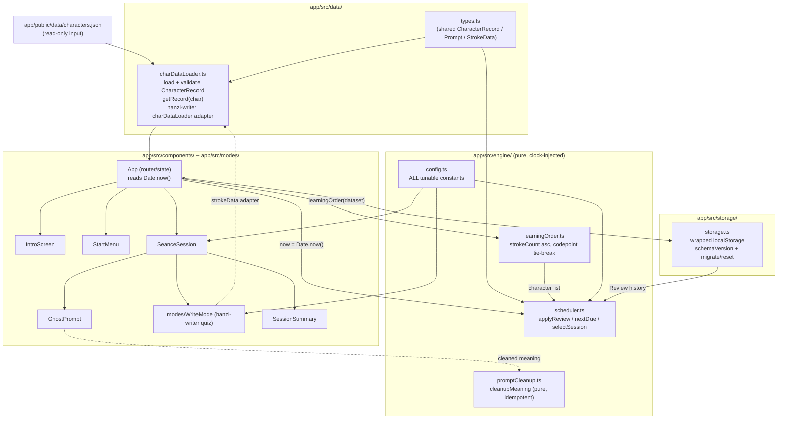

# Design Document: ghost-game-core

## Overview

The ghost-game-core feature is the first playable version of Ghost Script: a React + Vite single-page web app living in `app/`. It reads the pre-generated, read-only `app/public/data/characters.json` (produced by the character-dataset spec) and turns forgotten characters into ghosts the player lays to rest by writing them from memory.

This feature delivers five things: the legend intro screen (Requirement 1), a 10-ghost Nightly Séance selected by a pure spaced-repetition haunting scheduler (Requirements 3, 6), Write mode with live per-stroke checking via hanzi-writer quiz mode (Requirement 5), a display-only prompt cleanup rule (Requirement 4), and local progress persistence through a wrapped Storage module (Requirement 7). The app is a fully offline static SPA: once assets and `characters.json` are loaded it makes no network calls, uses no paid APIs, holds no API keys, and performs no runtime LLM calls (Requirement 2.1, 8.3).

The design keeps all game logic as pure functions in `app/src/engine/` (deterministic, clock-injected, no I/O) and all rendering in `app/src/components/` + `app/src/modes/`, so every scheduler invariant and cleanup invariant is unit- and property-testable in isolation (Requirements 6.1, 6.11, 8.1, 8.6).

### Build & install

The repository is a single npm workspace. The ROOT `package.json` declares `"workspaces": ["app"]`, so one `npm install` at the repo root installs both the root (data-pipeline + test) dependencies and the `app/` (React/Vite) dependencies in a single pass. `app/package.json` still exists and lists the app's own runtime/dev dependencies (React, Vite, `hanzi-writer` pinned exact at `3.7.3`, and the testing-library packages), but it is resolved and installed through the workspace rather than by a separate `npm install` inside `app/`. Because the workspace is wired up at the root, `npm test` from the repo root runs the whole suite (both projects) with no extra setup (Requirements 8.6, 8.9).

### Key design decisions

The design incorporates six deliberate technical decisions, each traced to the requirements:

1. **Single root Vitest workspace** running two projects — the existing 129 Node data tests under `tests/` (unchanged) and the new jsdom app tests under `app/` — so one `npm test` verifies the whole repository (Requirement 8.6, 8.7, 8.9).
2. **Pinned hanzi-writer `3.7.3`** wired to load stroke data from OUR dataset via a `charDataLoader`, never the CDN, keeping the app offline and on verified data (Requirements 2.1, 5.1, 8.3).
3. **Writing surface with `touch-action: none`** and Pointer-Event input, responsive 375px→1440px+ (Requirements 5.2, 8.4).
4. **Injected clock**: the engine takes `now: number` on every time-dependent function and never reads `Date.now()`; only the UI reads the real clock (Requirements 6.1, 6.6, 8.7).
5. **One engine config module** (`app/src/engine/config.ts`) holding every tunable constant; nothing hard-codes them (Requirements 5.8, 6.2, 6.3, 6.5).
6. **Minimal Tailwind dark theme** with a small, contrast-checked token set where colour is never the only signal (Requirement 8.5).

---

## Architecture



**Reading the diagram.** The data loader reads and validates `characters.json`. The App layer owns all state and side effects: it reads the real clock (`Date.now()`), reads/writes the Storage module, and passes `now` plus the loaded Review history into the pure scheduler. The scheduler, cleanup, and config modules are pure and side-effect free. React screens flow Intro → Start/Menu → Séance (which hosts WriteMode per ghost) → Summary. The config module feeds both the engine and the UI, so thresholds live in exactly one place. Storage talks only to the App layer; the engine never touches `localStorage` (Requirement 6.1).

The App builds the session character list with the pure `learningOrder(dataset)` and passes it to `selectSession`: `selectSession(history, learningOrder(dataset), Date.now(), DEFAULT_CONFIG)`. The scheduler therefore never sees the dataset's JSON key order; NEW characters and ties follow the Learning order.

### Directory layout (`app/src/`, consistent with the structure steering doc)

```
<repo root>
├── package.json             # "workspaces": ["app"]; root test deps; "test": "vitest run"
├── vitest.config.ts         # NODE project: include ['tests/**/*.test.ts'], environment 'node'
├── vitest.workspace.ts      # references BOTH projects (root node + app jsdom)
├── tests/                   # 129 data tests (unchanged; collected only by the node project)
└── app/
    ├── package.json         # app React/Vite + test deps (installed via the root workspace)
    ├── vite.config.ts
    ├── vitest.config.ts     # APP project (root = app/): include ['**/*.test.{ts,tsx}'], environment 'jsdom'
    └── ...

app/
├── package.json             # app React/Vite + test deps (installed via the root workspace)
├── vite.config.ts
├── vitest.config.ts         # jsdom project config, referenced by root workspace
├── src/
│   ├── engine/              # pure game logic (clock-injected, no I/O)
│   │   ├── config.ts        # ALL tunable constants (Decision 5)
│   │   ├── scheduler.ts     # haunting scheduler: applyReview / nextDue / selectSession
│   │   ├── promptCleanup.ts # display-only cleanupMeaning (pure, idempotent)
│   │   └── learningOrder.ts # pure learningOrder(dataset): strokeCount asc, codepoint tie-break
│   ├── data/
│   │   ├── types.ts         # existing shared types (CharacterRecord, Prompt, StrokeData)
│   │   └── charDataLoader.ts# load + validate characters.json; hanzi-writer adapter
│   ├── storage/
│   │   └── storage.ts       # wrapped localStorage, schemaVersion, migrate/reset
│   ├── components/          # UI: IntroScreen, StartMenu, SeanceSession, GhostPrompt, SessionSummary
│   ├── modes/               # WriteMode.tsx (Build/Type modes land later)
│   └── styles/              # Tailwind entry + theme tokens
└── test/
    └── setup.ts             # @testing-library/jest-dom + jsdom setup (Decision 1)
```

The existing `app/src/data/types.ts` is reused as-is; this feature does not redefine `CharacterRecord`, `Prompt`, or `StrokeData`.

---

## Components and Interfaces

All signatures are TypeScript `strict: true` with no `any` (Requirement 8.1, 8.2).

### `app/src/engine/config.ts` (Decision 5)

A single module holds every tunable constant. UI and engine both import from here; nothing hard-codes these values (Requirements 5.8, 6.2, 6.3, 6.5).

```typescript
/** Milliseconds in one day, used to express the interval ladder. */
export const DAY_MS = 24 * 60 * 60 * 1000;

/** All tunable game constants. Nothing in engine or UI hard-codes these. */
export interface EngineConfig {
  /** Max total mistakes for a clean outcome (default 2). Req 5.5, 5.8. */
  readonly cleanMistakeThreshold: number;
  /** Consecutive misses of the same stroke before a stroke hint (default 3). Req 5.4, 5.8. */
  readonly strokeHintAfterConsecutiveMisses: number;
  /** Interval ladder in ms: [1,3,7,14,30,60] days (steps 0–5). Req 6.2. */
  readonly intervalLadderMs: readonly number[];
  /** Delay applied on a missed review, in ms (10 minutes). Req 6.3. */
  readonly relearnDelayMs: number;
  /** Max NEW characters per session when something is due (default 5). Req 6.5. */
  readonly newPerSessionCap: number;
  /** Target ghosts per Nightly Séance (default 10). Req 3.1, 6.7. */
  readonly sessionSize: number;
}

export const DEFAULT_CONFIG: EngineConfig = {
  cleanMistakeThreshold: 2,
  strokeHintAfterConsecutiveMisses: 3,
  intervalLadderMs: [1 * DAY_MS, 3 * DAY_MS, 7 * DAY_MS, 14 * DAY_MS, 30 * DAY_MS, 60 * DAY_MS],
  relearnDelayMs: 10 * 60 * 1000,
  newPerSessionCap: 5,
  sessionSize: 10,
};
```

### `app/src/engine/scheduler.ts` (Decision 4: injected clock)

Pure functions only. Every function that needs time takes `now: number` (ms); the module never calls `Date.now()` and performs no I/O. This makes the scheduler deterministic and testable (Requirements 6.1, 6.6, 6.11, 8.7).

```typescript
import type { EngineConfig } from './config';

/** Outcome of a ghost in Write mode. `clean` = correct; the other two = missed. Req 5. */
export type Outcome = 'clean' | 'struggled' | 'gave-up';

/** One past attempt, kept for auditing/analysis (optional). */
export interface AttemptRecord {
  readonly outcome: Outcome;
  readonly at: number; // timestamp (ms) supplied by UI
}

/** Persisted per-character scheduler state. Req 6, Req 7. */
export interface ReviewEntry {
  /** Current index into the interval ladder (0–5). */
  readonly step: number;
  /** The most recent outcome recorded for this character. */
  readonly lastOutcome: Outcome;
  /** Next-due timestamp (ms). Always >= the review time it was computed from. Req 6.4. */
  readonly nextDue: number;
  /** Optional attempt history (newest last). */
  readonly history?: readonly AttemptRecord[];
}

/**
 * Apply a review outcome to an entry at time `now`, returning a NEW entry.
 * - clean after a miss (prior last Outcome struggled/gave-up) or for a new character → step 0 (1-day rung);
 *   otherwise step advances by exactly one (capped at ladder top). nextDue = now + ladder[newStep]. Req 6.2.
 * - missed → step resets to 0, nextDue = now + relearnDelayMs (10 min). Req 6.3.
 * `prior` may be undefined for a first-ever review (new character). Pure.
 */
export function applyReview(
  prior: ReviewEntry | undefined,
  outcome: Outcome,
  now: number,
  config: EngineConfig,
): ReviewEntry;

/** The entry's next-due timestamp (ms). Never negative. Req 6.4. */
export function nextDue(entry: ReviewEntry): number;

/**
 * Deterministically select up to `config.sessionSize` distinct characters for a
 * Nightly Séance given the Review history, the full character list (the App
 * passes `learningOrder(dataset)`), the injected clock `now`, and config. Implements the
 * ordering of Req 6.5 (due-overdue-first → new capped → soonest-due → extra new
 * uncapped), with all ties broken by list (Learning) order. Pure. Req 6.5–6.7, 6.10.
 */
export function selectSession(
  history: ReviewHistory,
  characterList: readonly string[],
  now: number,
  config: EngineConfig,
): string[];
```

### `app/src/data/charDataLoader.ts` (Decision 2: offline hanzi-writer)

Loads and validates `characters.json`, exposes typed record access, and provides the hanzi-writer `charDataLoader` adapter so hanzi-writer never touches its CDN (Requirements 2.1, 2.3, 2.5, 5.1, 8.3).

```typescript
import type { CharacterRecord, StrokeData } from './types';

/** In-memory dataset keyed by character. */
export type CharacterDataset = ReadonlyMap<string, CharacterRecord>;

/** Shape hanzi-writer quiz mode expects from its charDataLoader. */
export interface HanziWriterCharData {
  readonly strokes: string[];
  readonly medians: number[][][];
  readonly radStrokes?: number[];
}

export type LoadResult =
  | { ok: true; dataset: CharacterDataset }
  | { ok: false; reason: 'fetch-failed' | 'parse-failed' | 'invalid-shape' };

/**
 * Fetch and validate characters.json. Validates each record against the shared
 * CharacterRecord type before use. Never throws on load/parse failure — returns
 * a failure result so the App can show a non-technical error state. Req 2.1–2.4.
 */
export async function loadDataset(url?: string): Promise<LoadResult>;

/**
 * Default dataset URL, built from Vite's BASE_URL (`${import.meta.env.BASE_URL}data/characters.json`)
 * so the app also works when hosted under a sub-path (e.g. GitHub Pages).
 */
export function defaultDatasetUrl(): string;

/** Typed lookup. Returns undefined when the character is absent. */
export function getRecord(dataset: CharacterDataset, char: string): CharacterRecord | undefined;

/**
 * Map a CharacterRecord's strokeData into the object hanzi-writer quiz mode
 * expects. Pure; no modification of the record. Req 2.5, 5.1.
 */
export function toHanziWriterData(strokeData: StrokeData): HanziWriterCharData;

/**
 * Build hanzi-writer 3.7.3's own `CharDataLoaderFn` (type imported from 'hanzi-writer'),
 * whose real signature is
 *   (char: string, onLoad: (data: CharacterJson) => void, onError: (err?: unknown) => void) => ...
 * For a KNOWN char it calls `onLoad(toHanziWriterData(record.strokeData))` synchronously
 * (no network). For an UNKNOWN char it does NOT call `onLoad`; it calls
 * `onError(new Error(...))` so hanzi-writer fails cleanly and never falls back to the CDN. Req 8.3.
 */
export function makeCharDataLoader(dataset: CharacterDataset): CharDataLoaderFn;
// import type { CharDataLoaderFn } from 'hanzi-writer';
```

`loadDataset` reads the response body with `response.text()` and then `JSON.parse`s it (a body that is not valid JSON yields `parse-failed`). It validates EVERY record deeply against `CharacterRecord`, requires `record.character === key` for each entry, and rejects the keys `__proto__`, `constructor`, and `prototype`; any violation yields `invalid-shape`.

**hanzi-writer quiz wiring (Decision 2).** `WriteMode` creates the writer with `HanziWriter.create(targetEl, char, { charDataLoader: makeCharDataLoader(dataset), showCharacter: false, showOutline: false, ... })` and calls `writer.quiz({ ... })`. Quiz callbacks map onto our outcome/threshold model:

- `onMistake({ strokeNum, mistakesOnStroke })` → increment the total mistake count by one per rejected stroke (Req 5.3); track consecutive misses of the same `strokeNum`. hanzi-writer quiz mode has NO dedicated "hint shown" callback, so `hintShown` is DERIVED here: hanzi-writer passes `mistakesOnStroke` to `onMistake`, and when `mistakesOnStroke >= config.strokeHintAfterConsecutiveMisses` (default 3) `WriteMode` sets `hintShown = true` — that threshold is exactly the point at which hanzi-writer's `showHintAfterMisses` reveals the next stroke. Once `hintShown` is `true` the ghost can no longer resolve as `clean`.
- `showHintAfterMisses: config.strokeHintAfterConsecutiveMisses` → the quiz option that actually triggers the reveal: hanzi-writer shows the next expected stroke after that many consecutive misses of the same stroke, one stroke at a time, never the whole glyph (Req 5.4). The `onMistake` handler above mirrors this same threshold to set `hintShown`.
- `onComplete({ totalMistakes })` → resolve the ghost: `clean` when `hintShown` is `false` AND `totalMistakes <= config.cleanMistakeThreshold`, else `struggled` (Req 5.5, 5.6).

### `app/src/engine/promptCleanup.ts` (display-only, pure)

```typescript
/**
 * Remove dictionary-style notes from a prompt meaning for DISPLAY ONLY.
 * Pure, idempotent, and additive-free: every character in the output was present
 * in the input (aside from removing notes and trimming/collapsing whitespace a
 * removal leaves behind). Falls back to the original string when cleanup would
 * otherwise yield empty/whitespace-only output. Never mutates characters.json,
 * the loaded record, or persisted data. Req 4.2–4.6.
 */
export function cleanupMeaning(raw: string): string;
```

Note patterns removed (Req 4.2): classifier notes `(CL:...)` and `CL:...`; bracketed pinyin references `[pin1 yin1]`; example clauses `(e.g. ...)`; and pronunciation notes `Taiwan pr. [...]`, `(Taiwan pr. ...)`, and `also pr. [...]`; and a note of a single word followed by `pr. [...]`, with or without parentheses (e.g. `colloquial pr. [nei4]`, `(colloquial pr. [nei4])`). After removals, surrounding whitespace is trimmed and internal runs collapsed to a single space. `prompt.pinyin` is displayed as stored and is never passed through cleanup (Req 4.7).

### `app/src/engine/learningOrder.ts` (pure, Req 6.12)

```typescript
import type { CharacterRecord } from '../data/types';

/**
 * The Learning order: the dataset's keys sorted by `strokeCount` ascending, ties broken
 * by `codePointAt(0)` ascending. Pure; does not mutate the input; independent of the
 * Map's insertion order. A `CharacterDataset` is assignable to the parameter type.
 * Req 6.12.
 */
export function learningOrder(
  dataset: ReadonlyMap<string, Pick<CharacterRecord, 'strokeCount'>>,
): string[];
```

The App passes `learningOrder(dataset)` as the character list to `selectSession`, so NEW characters are introduced, and ties broken, from the fewest-strokes characters upward.

### `app/src/storage/storage.ts` (wrapped localStorage, Req 7)

A small typed API; the rest of the app never touches `localStorage` keys directly. Every read/write is wrapped in `try/catch` and degrades gracefully (Req 7.3, 7.5, 7.7).

```typescript
import type { ReviewHistory } from '../engine/scheduler';

/** Current persisted-data schema version. Bump when the blob shape changes. Req 7.2. */
export const CURRENT_SCHEMA_VERSION = 1;

/** The persisted blob. Req 7.1, 7.2. */
export interface PersistedState {
  readonly schemaVersion: number;
  readonly introSeen: boolean;
  readonly history: ReviewHistory;
}

/** Safe default used on first run, disabled storage, corruption, or reset. */
export const DEFAULT_STATE: PersistedState;

/**
 * Load persisted state. On a known older schemaVersion with a defined migration,
 * migrate to CURRENT_SCHEMA_VERSION. On unknown/newer schemaVersion, corrupt data,
 * shape mismatch, or any read/parse failure, return DEFAULT_STATE. Never throws. Req 7.4, 7.5.
 */
export function loadState(): PersistedState;

/** Persist full state. On any write failure (quota, disabled) performs a no-op. Never throws. Req 7.5, 7.6. */
export function saveState(state: PersistedState): void;

/**
 * Record one character's entry immediately and persist. Returns the new state. Req 3.4, 7.6.
 * No time argument: the caller already computed `entry` with `applyReview` using the UI-injected clock.
 */
export function recordOutcome(char: string, entry: ReviewEntry): PersistedState;

export function getIntroSeen(): boolean;      // Req 1.1, 1.5
export function setIntroSeen(seen: boolean): void; // Req 1.4
export function resetToDefaults(): void;      // Req 7.4 — removes the storage key

/** localStorage key used by the module. */
export const STORAGE_KEY = 'ghost-script:state';

/** Minimal storage surface (getItem/setItem/removeItem) so a fake backend can be injected in tests. */
export interface StorageLike {
  getItem(key: string): string | null;
  setItem(key: string, value: string): void;
  removeItem(key: string): void;
}

/** migrations[v] migrates a blob FROM schema version v TO version v + 1. */
export type MigrationMap = Readonly<Record<number, (old: unknown) => unknown>>;

export interface StoreOptions {
  /** A backend, or a thunk resolving one lazily (may return undefined when unavailable). */
  backend?: StorageLike | (() => StorageLike | undefined);
  currentVersion?: number;
  migrations?: MigrationMap;
  key?: string;
}

export interface Store {
  defaultState: PersistedState;
  loadState(): PersistedState;
  saveState(state: PersistedState): void;
  recordOutcome(char: string, entry: ReviewEntry): PersistedState;
  getIntroSeen(): boolean;
  setIntroSeen(seen: boolean): void;
  resetToDefaults(): void;
}

/** Factory behind the module-level API; exists so migration/failure paths are testable with a fake backend. */
export function createStore(options?: StoreOptions): Store;
```

**`createStore` and the default store.** The module-level functions (`loadState`, `saveState`, `recordOutcome`, `getIntroSeen`, `setIntroSeen`, `resetToDefaults`) and `DEFAULT_STATE` are thin wrappers over a default store created by `createStore()`, which resolves `window.localStorage` lazily inside `try/catch` (so merely importing the module, or running with storage disabled, never throws). `createStore` exists so tests can exercise migration and failure paths with a fake backend, a custom `currentVersion`, and a custom `migrations` map.

**Migrations.** `migrations[v]` migrates a blob FROM version `v` TO `v + 1`; `loadState` applies them in sequence until `currentVersion`. The SHIPPED migrations map is EMPTY because schema version 1 is the first version, so in production every non-current `schemaVersion` resets to defaults. Unknown, newer, zero, negative, or non-integer `schemaVersion` values always reset to defaults and are never migrated. A history object containing the keys `__proto__`, `constructor`, or `prototype` is treated as corrupt and the whole blob is reset to defaults. `resetToDefaults()` removes the storage key.

### UI components (`app/src/components/` + `app/src/modes/`)

These hold no game logic; they read `Date.now()` and delegate to the engine (Requirements 6.11, 8.1). App wiring: when a Séance starts, the App calls `selectSession(history, learningOrder(dataset), Date.now(), DEFAULT_CONFIG)`. When a ghost reaches a terminal Outcome, the App reads `now = Date.now()`, computes `entry = applyReview(history[char], outcome, now, DEFAULT_CONFIG)`, and persists it with `recordOutcome(char, entry)` (no time argument; the clock was already applied by `applyReview`). Colour is never the only signal and all interactive controls carry accessible labels (Requirements 5.9, 5.10, 8.5).

- **`components/IntroScreen.tsx`** — props `{ onBegin: () => void }`. Renders the legend copy (Cangjie invented writing; legend of wailing ghosts; forgotten characters are ghosts laid to rest by writing), attributes the wailing-ghosts line to the Huainanzi (天雨粟，鬼夜哭), and nothing else historical (Req 1.2, 1.7, 1.8). A labelled "Begin the Séance" button fires `onBegin`; operable by touch and mouse/keyboard (Req 1.3, 1.6).
- **`components/StartMenu.tsx`** — props `{ onStartSeance: () => void; onReviewLegend: () => void }`. The legend re-view entry point lives here (outside any active session) so it never interrupts a Séance (Req 1.5, 3.6).
- **`components/SeanceSession.tsx`** — props `{ ghosts: readonly CharacterRecord[]; onOutcome: (char: string, outcome: Outcome, now: number) => void; onComplete: (results: SessionResults) => void }`. Presents ghosts one at a time, advances only on a terminal Outcome, prevents repeats within the session, and reports each Outcome immediately (Req 3.2, 3.4, 3.5).
- **`components/GhostPrompt.tsx`** — props `{ record: CharacterRecord }`. Displays `cleanupMeaning(record.prompt.meaning)` and `record.prompt.pinyin` (as stored), hiding the glyph (Req 4.1, 5.1).
- **`modes/WriteMode.tsx`** — props `{ record: CharacterRecord; dataset: CharacterDataset; config: EngineConfig; onOutcome: (outcome: Outcome) => void }`. State: `mistakeCount`, `consecutiveMissesByStroke`, `hintShown`, `status`. `hintShown` is not reported directly by hanzi-writer; it is derived inside the `onMistake` handler when `mistakesOnStroke >= config.strokeHintAfterConsecutiveMisses` (the point at which `showHintAfterMisses` reveals the next stroke), and once `true` it rules out a `clean` outcome. Hosts the hanzi-writer quiz on a `touch-action: none` surface (Decision 3) and wires `onMistake`/`showHintAfterMisses`/`onComplete` to the outcome/threshold model. The clearly labelled "Give up" control resolves `gave-up` with a strict ordering: it SHALL call `writer.cancelQuiz()` FIRST (so no further `onMistake`/`onComplete` events are counted during the reveal), THEN `writer.animateCharacter()` to play the animated stroke-order reveal, THEN resolve the `gave-up` Outcome (cancelQuiz → animateCharacter → resolve `gave-up`) (Req 5.3–5.10). Non-colour cues (text/icon) accompany accept/reject feedback (Req 5.9).
- **`components/SessionSummary.tsx`** — props `{ results: SessionResults; onPlayAgain: () => void }`. Shows how many ghosts were laid to rest and offers another Séance (Req 3.3, 3.6).

```typescript
export interface SessionResults {
  readonly total: number;
  readonly laidToRest: number; // clean + struggled (both revealed in ink)
}
```

### Writing surface sizing (Decision 3)

The hanzi-writer target element sits inside a square container that sets CSS `touch-action: none`, so drawing never scrolls or zooms the page; all input arrives via Pointer Events (Req 5.2, 8.4). The container sizes responsively (e.g. `min(80vw, 420px)`) from 375px phones to 1440px+ laptops. A single hanzi-writer target element is retained across ghosts; between ghosts `WriteMode` tears down the previous quiz and calls `HanziWriter.create` for the next character rather than remounting the DOM node, keeping sizing stable.

---

## Data Models

Reuses `CharacterRecord`, `Prompt`, and `StrokeData` from `app/src/data/types.ts` verbatim — not redefined here.

```typescript
// Outcome union (app/src/engine/scheduler.ts)
export type Outcome = 'clean' | 'struggled' | 'gave-up';

// Per-character scheduler state (app/src/engine/scheduler.ts)
export interface ReviewEntry {
  readonly step: number;                 // 0–5 ladder index
  readonly lastOutcome: Outcome;
  readonly nextDue: number;              // ms, never negative
  readonly history?: readonly AttemptRecord[];
}

// Full history: character → entry (app/src/engine/scheduler.ts)
export type ReviewHistory = Readonly<Record<string, ReviewEntry>>;

// Persisted blob (app/src/storage/storage.ts)
export interface PersistedState {
  readonly schemaVersion: number;        // Req 7.2
  readonly introSeen: boolean;           // Req 1.4, 1.5
  readonly history: ReviewHistory;       // Req 6, 7.1
}

// hanzi-writer quiz adapter data shape (app/src/data/charDataLoader.ts)
export interface HanziWriterCharData {
  readonly strokes: string[];
  readonly medians: number[][][];
  readonly radStrokes?: number[];
}
```

`ReviewHistory` is a plain character-keyed map so it serialises directly to JSON inside `PersistedState`. The hanzi-writer adapter shape is a projection of `StrokeData` (`{ strokes, medians, radStrokes }`), produced by `toHanziWriterData` without mutating the record.

---

## Correctness Properties

*A property is a characteristic or behavior that should hold true across all valid executions of a system — essentially, a formal statement about what the system should do. Properties serve as the bridge between human-readable specifications and machine-verifiable correctness guarantees.*

The scheduler and prompt-cleanup functions are pure (no I/O, injected clock), which makes them ideal for property-based testing. The following twelve properties restate the targets of Requirement 8.7 as named design properties. Each is implemented by a single fast-check property test running at least 100 iterations.

### Property 1: Cleanup never returns an empty string

*For any* input meaning string, `cleanupMeaning` SHALL return a non-empty string, falling back to the original `prompt.meaning` whenever cleanup would otherwise produce an empty or whitespace-only result.

**Validates: Requirements 4.4, 8.7**

### Property 2: Cleanup never adds text

*For any* input meaning string, every character in `cleanupMeaning`'s output SHALL have been present in the input, aside from the removal of notes and the trimming/collapsing of whitespace a removal leaves behind.

**Validates: Requirements 4.5, 8.7**

### Property 3: Cleanup is idempotent

*For any* input meaning string, `cleanupMeaning(cleanupMeaning(x))` SHALL equal `cleanupMeaning(x)`.

**Validates: Requirements 4.6, 8.7**

### Property 4: A missed character is never scheduled later than a clean one with the same history

*For any* two characters with otherwise-identical prior history reviewed at the same time `now`, the character whose latest Outcome is a miss (`struggled`/`gave-up`) SHALL have a `nextDue` no later than the character whose latest Outcome is `clean`.

**Validates: Requirements 6.9, 8.7**

### Property 5: Intervals and next-due offsets are never negative

*For any* prior entry, outcome, clock `now`, and config, `applyReview` SHALL produce a `nextDue` such that `nextDue - now >= 0`, and the chosen ladder interval SHALL be non-negative.

**Validates: Requirements 6.4, 8.7**

### Property 6: Session selection is deterministic

*For any* Review history, character list, and clock `now`, calling `selectSession` twice with identical inputs SHALL produce identical selections in identical order.

**Validates: Requirements 6.6, 8.7**

### Property 7: The interval ladder never skips a step on a clean review

*For any* prior entry at step `s` below the top whose last Outcome was NOT a miss, a `clean` review SHALL set the new step to exactly `min(s + 1, topStep)` — advancing by exactly one and never skipping a step. *For any* character with no history, or whose prior last Outcome was a miss (`struggled`/`gave-up`), a `clean` review SHALL set step 0 (the 1-day rung). The resulting ladder-interval sequence over consecutive clean reviews SHALL remain non-decreasing.

**Validates: Requirements 6.2, 6.8, 8.7**

### Property 8: A missed review resets to step 0 with a 10-minute delay

*For any* prior entry, a `struggled` or `gave-up` review SHALL set the new step to 0 and `nextDue` to `now + config.relearnDelayMs` (10 minutes).

**Validates: Requirements 6.3, 8.7**

### Property 9: The new-per-session cap holds whenever something is due, unless band (d) was needed to fill the session

*For any* Review history and character list where at least one character is due at `now`, the count of NEW (no-history) characters in the selected session SHALL NOT exceed `config.newPerSessionCap`, UNLESS band (d) of Requirement 6.5 was needed to fill the session — in which case the session SHALL contain every non-new character of the list and have length min(sessionSize, distinct list length).

**Validates: Requirements 6.5, 8.7**

### Property 10: Ties are broken by character-list order

*For any* set of candidate characters that tie on their primary ordering key, `selectSession` SHALL order the tied characters by their position in the character list passed to it (which the App supplies in Learning order).

**Validates: Requirements 6.5, 6.6, 8.7**

### Property 11: A full dataset always yields exactly 10 distinct ghosts

*For any* Review history and character list with at least 10 characters, `selectSession` SHALL return exactly 10 characters with no duplicates; with fewer than 10 characters it SHALL return all of them, still without duplicates.

**Validates: Requirements 3.1, 6.7, 8.7**

### Property 12: The learning order is a deterministic, stroke-count-sorted permutation of the dataset

*For any* dataset, `learningOrder` SHALL return a permutation of the dataset's keys (same elements, no duplicates), identical for identical input regardless of the Map's insertion order, with non-decreasing `strokeCount` along the list and ties in strokeCount ordered by Unicode codepoint ascending.

**Validates: Requirements 6.12, 8.7**

---

## Error Handling

### Dataset load/parse (Requirement 2.4)

| Condition | Behaviour |
|---|---|
| `characters.json` fetch fails | `loadDataset` returns `{ ok: false, reason: 'fetch-failed' }`; App renders a clear, non-technical error screen (no blank page, no crash). |
| `characters.json` is not valid JSON | Returns `{ ok: false, reason: 'parse-failed' }`; same non-technical error screen. |
| A record fails `CharacterRecord` shape validation | Returns `{ ok: false, reason: 'invalid-shape' }`; same non-technical error screen. |

### localStorage (Requirement 7.4, 7.5)

| Condition | Behaviour |
|---|---|
| Storage disabled / private mode | `try/catch` catches the throw; `loadState` returns `DEFAULT_STATE`, `saveState` is a no-op; App keeps running (progress simply not persisted). |
| Quota exceeded on write | `saveState` catches the throw and no-ops; App keeps running. |
| Corrupt or shape-mismatched blob | `loadState` returns `DEFAULT_STATE` (reset, no migration). |
| Unknown or newer `schemaVersion` | `loadState` returns `DEFAULT_STATE` (reset, never migrate forward). Req 7.4. |
| Zero, negative, or non-integer `schemaVersion` | `loadState` returns `DEFAULT_STATE` (reset, never migrate). Req 7.4. |
| History containing `__proto__` / `constructor` / `prototype` keys | Blob treated as corrupt; whole state reset to `DEFAULT_STATE`. |
| Known older `schemaVersion` with a defined migration | `loadState` migrates to `CURRENT_SCHEMA_VERSION` via `migrations[v]` (v → v+1). The shipped map is empty (version 1 is the first), so this path is exercised in tests via `createStore`. Req 7.4. |

### hanzi-writer init (Requirement 5, offline guarantee)

| Condition | Behaviour |
|---|---|
| `charDataLoader` cannot resolve a character from the dataset | `makeCharDataLoader` invokes `onError` (never `onLoad`, never the CDN); treat quiz init as failed for that ghost; skip it with a `gave-up`-style fallback (record a missed review, continue to the next ghost) without crashing. |
| hanzi-writer throws during `create`/`quiz` | Caught in `WriteMode`; the ghost falls back to `gave-up`, the character is revealed, and the session continues. |
| Player taps "Give up" mid-quiz | `WriteMode` calls `writer.cancelQuiz()` BEFORE `writer.animateCharacter()`, so cancelling the quiz first stops any further `onMistake`/`onComplete` events from being counted during the reveal; the ordering is strictly cancelQuiz → animateCharacter → resolve `gave-up`. |

---

## Testing Strategy

`npm test` from the repository root is the single command that verifies the whole project (Requirement 8.9).

### Root Vitest workspace (Decision 1)

There are three config files, and the two projects use mutually exclusive include globs so neither ever collects the other's tests.

The ROOT `vitest.config.ts` defines the NODE project. Its `include` is scoped to `tests/` only, so the node project NEVER collects app tests:

```typescript
// vitest.config.ts (repo root) — NODE project
import { defineConfig } from 'vitest/config';

export default defineConfig({
  test: {
    include: ['tests/**/*.test.ts'],
    environment: 'node',
  },
});
```

The APP project config (`app/vitest.config.ts`) scopes `include` to app tests only and runs them under jsdom, so it collects ONLY app tests:

```typescript
// app/vitest.config.ts — APP project
import { defineConfig } from 'vitest/config';

export default defineConfig({
  test: {
    include: ['**/*.test.{ts,tsx}'], // relative to app/ (the project root)
    exclude: ['node_modules/**'],
    environment: 'jsdom',
    setupFiles: ['test/setup.ts'],
  },
});
```

The root `vitest.workspace.ts` references BOTH projects — the root `vitest.config.ts` (node project) and the `app/` project — so one invocation runs both suites:

```typescript
// vitest.workspace.ts (repo root)
export default [
  './vitest.config.ts', // project A (NODE): include ['tests/**/*.test.ts'], environment 'node' — the 129 data tests (unchanged)
  './app',              // project B (APP): app/vitest.config.ts → include ['**/*.test.{ts,tsx}'] relative to app/, environment 'jsdom'
];
```

App tests may live anywhere under `app/`. The app project's vitest `include` is `**/*.test.{ts,tsx}` relative to `app/`; an earlier glob text `app/**/*.test.{ts,tsx}` is stale, because the `./app` workspace entry makes `app/` the project root. Also, `app/test/setup.ts` installs jsdom's `Storage` on the global when Node's own experimental `localStorage` shadows it (Node >= 22), so storage tests see jsdom's implementation.

Because project A's glob (`tests/**/*.test.ts`) and project B's glob (`**/*.test.{ts,tsx}`, resolved from the `app/` project root) share no paths, the two projects are mutually exclusive: the node project collects only the data tests, the app project collects only the app tests.

- **Project A (`tests/`, `environment: 'node'`)** — the existing 129 character-dataset tests, collected only by the root `vitest.config.ts`. They are NOT moved or modified; they keep passing exactly as before. The root `package.json` `test` script stays `vitest run` (now workspace-aware).
- **Project B (`app/`, `environment: 'jsdom'`)** — new app tests. `app/vitest.config.ts` sets `environment: 'jsdom'`, registers a setup file (`app/test/setup.ts`) importing `@testing-library/jest-dom/vitest`, and uses `@testing-library/react` for component tests. The app has its OWN `app/package.json` (React/Vite deps) and `app/vite.config.ts` / `app/vitest.config.ts`; the root workspace references them.

Dependencies install through the npm workspace: the root `package.json` declares `"workspaces": ["app"]`, so a single `npm install` at the repo root installs both the root (pipeline/test) dev deps and the app deps, and `npm test` works from the root. New dev dependencies are pinned (exact versions, no caret): `jsdom`, `@testing-library/react`, `@testing-library/jest-dom`, `@testing-library/user-event`, plus the pinned runtime dep `hanzi-writer@3.7.3` (exact) listed in `app/package.json`. fast-check (already pinned at the root) is reused for property tests.

### Unit tests

Example-based tests, kept lean because property tests cover broad input ranges:

- **`promptCleanup`** — each note pattern (`(CL:...)`, `CL:...`, `[pin1 yin1]`, `(e.g. ...)`, `Taiwan pr. [...]`, `(Taiwan pr. ...)`, `also pr. [...]`) removed on representative real meanings; whitespace collapse; the empty-result fallback.
- **`scheduler`** — `applyReview`: clean for a new character or after a miss lands on step 0, clean after a clean advances one step (capped at 5), and missed resets to step 0 + 10 min; `selectSession` ordering across the four bands of Req 6.5 with concrete fixtures.
- **`storage`** — uses `createStore` with a fake backend (and a custom `currentVersion`/`migrations` map, since the shipped map is empty): migration from a known older `schemaVersion`; reset on unknown/newer/zero/negative/non-integer `schemaVersion` and on corrupt blobs, including histories with `__proto__`/`constructor`/`prototype` keys; no-op on simulated write failure; `recordOutcome(char, entry)` persists immediately; `resetToDefaults` removes the key.
- **`charDataLoader`** — `toHanziWriterData` projection; `loadDataset` failure results for fetch/parse/shape (including `record.character !== key` and `__proto__`/`constructor`/`prototype` keys); `makeCharDataLoader` calls `onLoad` for known chars and `onError` (never `onLoad`) for unknown.
- **`learningOrder`** — a small hand-built dataset (equal and different stroke counts, tie-break by codepoint); a real-data check against `app/public/data/characters.json` (first entry has the minimum `strokeCount`, last has the maximum, length 300); the empty dataset; the input Map is not mutated.

### Property tests (Vitest + fast-check, ≥100 iterations each)

One property test per design property (Properties 1–12; Property 12 covers `learningOrder`), each tagged with the feature and property number. Tag format:

```
// Feature: ghost-game-core, Property 7: The interval ladder never skips a step on a clean review
```

Property tests target the pure engine (`scheduler`, `promptCleanup`) with generated histories, character lists, clock values, and meaning strings — no DOM, no network.

### Component tests (jsdom + testing-library)

- **IntroScreen** — renders the legend copy and Huainanzi attribution; the begin control is labelled and keyboard-operable; `onBegin` fires.
- **SeanceSession** — advances only on a terminal Outcome; never repeats a character; reports each Outcome immediately.
- **WriteMode** — hanzi-writer is mocked so stroke callbacks (`onMistake`, `showHintAfterMisses`, `onComplete`) can be simulated: verify mistake counting, the stroke-hint threshold, `clean` vs `struggled` resolution, and that "Give up" yields `gave-up`. Accessible labels and non-colour cues are asserted.

### Real-hanzi-writer integration test (jsdom, library NOT mocked)

Distinct from the mocked WriteMode component tests above, one integration test in the app jsdom project exercises the REAL `hanzi-writer` library end-to-end against OUR offline data. It calls `HanziWriter.create` wired with `makeCharDataLoader(dataset)` built from the loaded `characters.json`, for three real characters — 我, 口, 爱 — and asserts that the stroke data loads successfully from our dataset: the `charDataLoader` resolves each character to a non-empty `strokes` array (and the writer reaches a ready state). This proves the offline `charDataLoader` wiring works with the actual library rather than a stub, closing the gap that mocked tests leave open.

jsdom caveat: hanzi-writer renders to SVG, which jsdom does not paint, so this test asserts data loading / `charDataLoader` resolution (and reaching a ready state) rather than pixel-level rendering. Verifying the resolved `strokes` data is sufficient to prove the dataset → library wiring is correct offline.

### Confirming the data tests still run

The node project continues to execute the 129 `tests/` cases under the same `npm test`. Adding the app project does not remove or alter them (Requirement 8.9).
