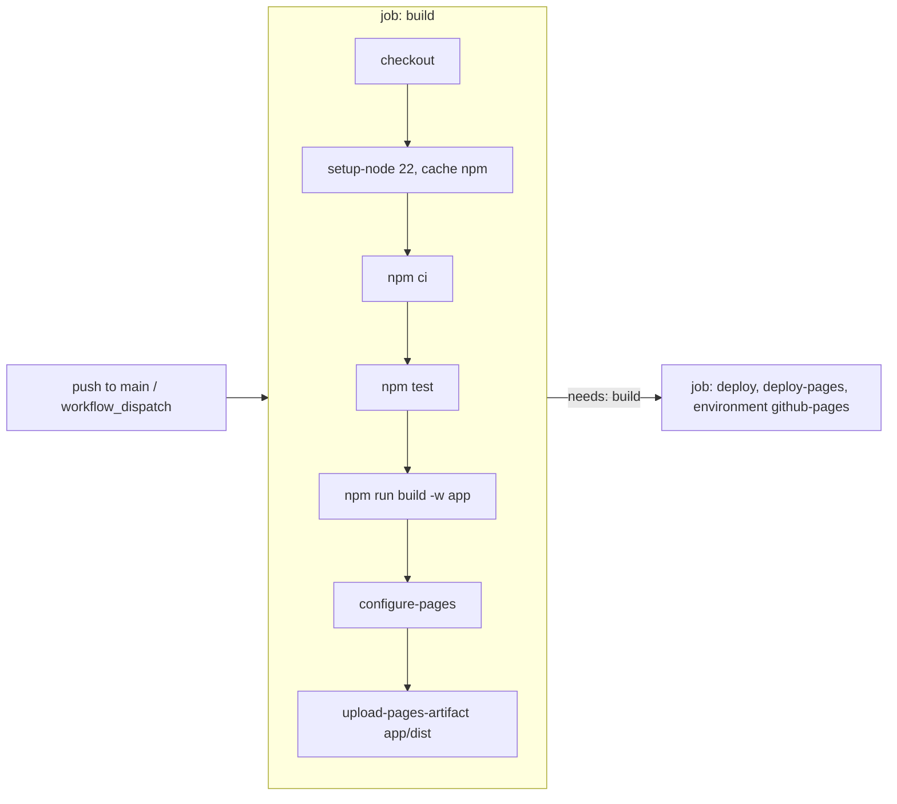

# Design Document: github-pages-deploy

## Overview

This feature publishes the existing static app to GitHub Pages with a test-gated GitHub Actions workflow. It changes build configuration, adds a favicon, adjusts legend wording and extends the README. No game logic changes.

Property-based testing does not apply: the work is CI configuration, build configuration, a static asset and text edits. Verification uses the existing test suite, type checks, and inspection of the built `app/dist`. The Correctness Properties section is therefore omitted.

## Architecture

A failing step in `build` stops the run, so `deploy` never starts (Requirement 1.2).

## Components and Interfaces

- **`.github/workflows/deploy.yml`**: triggers `push` on `main` and `workflow_dispatch`. Top-level `permissions` of `contents: read`, `pages: write`, `id-token: write`. `concurrency: { group: pages, cancel-in-progress: false }`. Uses `actions/checkout@v4`, `actions/setup-node@v4` (`node-version: 22`, `cache: npm`), `actions/configure-pages@v5`, `actions/upload-pages-artifact@v3` (`path: app/dist`), `actions/deploy-pages@v4`. Job `build` runs `npm ci`, `npm test`, `npm run build -w app`, then uploads. Job `deploy` has `needs: build` and `environment: github-pages`.
- **`app/vite.config.ts`**: `defineConfig(({ command }) => ({ plugins: [react()], base: command === 'build' ? '/ghost-script/' : '/' }))`. Vitest uses the serve command, so tests keep base `/`.
- **Dataset URL**: `defaultDatasetUrl` in `app/src/data/charDataLoader.ts` already uses `import.meta.env.BASE_URL`, so it resolves to `/ghost-script/data/characters.json` in production with no code change.
- **Favicon**: `app/public/favicon.svg`, a ghost silhouette from basic `path` and `circle` elements. `app/index.html` gains `<link rel="icon" type="image/svg+xml" href="/favicon.svg" />`; Vite rewrites it with the base (verified in `app/dist/index.html`).
- **Wording**: edit the IntroScreen test name and regex to `/ghosts\s+wept/i`, and the legend text in the ghost-game-core spec files and the `product.md` legend line. Dictionary_Data (`app/public/data/characters.json`, `tests/fixtures/**`, `tests/unit/prompt.test.ts`, `data/prompt-review.csv`) is not touched.
- **README**: new "Play it" and "Run it locally" sections and the Pages setting note.

## Data Models

None. The only data artifact is the unchanged `app/public/data/characters.json`.

## CI prerequisites

CI starts from a clean checkout, so the following must be tracked by git: root `package-lock.json`, the `data/raw/` datasets, `data/character-list.txt`, `data/prompt-overrides.csv`, and `app/public/data/characters.json`. Implementation checks each and reports any untracked file instead of committing it.

## Error Handling

- Any failing test or build step fails the `build` job and blocks `deploy`.
- A missing Pages source setting makes `configure-pages` fail; the README documents the one-time setting.
- Overlapping pushes queue behind an in-progress deployment instead of cancelling it.

## Testing Strategy

- Run the root `npm test` (node `tests/` project plus jsdom `app/` project), `tsc` for root and `app/`, and `npm run build -w app`.
- Inspect `app/dist/index.html` for `/ghost-script/` asset and favicon paths, and confirm `app/dist/data/characters.json` exists.
- Search the repository to confirm "wailed"/"wailing" no longer appear outside Dictionary_Data, and "wail" remains in Dictionary_Data.
- The workflow itself runs only on GitHub after a human pushes to `main` and enables Pages.
