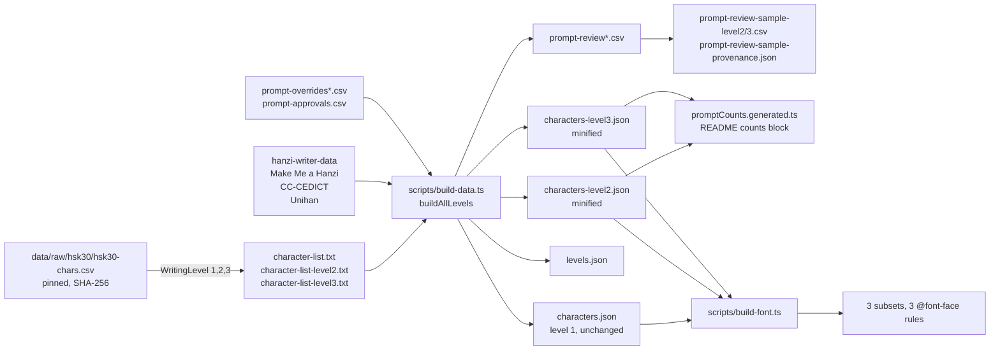
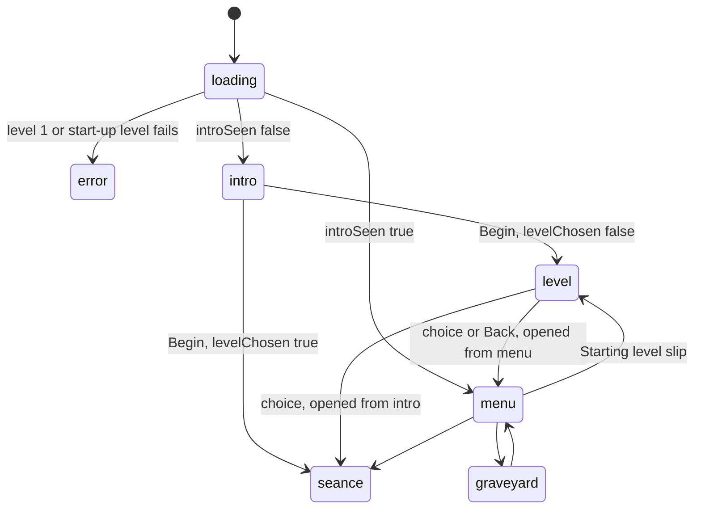

# Design Document: harder-ghosts

## Overview

The feature adds HSK 3.0 writing level 2 (400 characters) and level 3 (500 characters) to the 300 of level 1, and lets the player choose where to start. It touches four areas:

- **Data pipeline** (`scripts/`): one build produces three Level_Datasets, a small Level_Manifest, per-level Review_Files and per-level font subsets. Level 1 stays byte-identical.
- **Loading** (`app/src/data`, `App.tsx`): level 1 loads at start as today, other levels load on demand.
- **Engine** (`app/src/engine`): one new pure module for level logic (session pool, finished level, start-up level loading plan). The scheduler is untouched.
- **UI** (`app/src/components`): one new screen (`LevelScreen`), a menu slip, a Graveyard level switcher, README and Sources text.

Testing is unit, component and e2e only. The Correctness Properties section is omitted on purpose (see Testing Strategy).

Decisions in this design are approved by the human; there are no open questions. Level 2 and 3 prompts may ship unreviewed. A seeded 50-row sample per level is generated for the human to review, and the reviewed and unreviewed counts are generated from the data.

### What the investigation found

Read-only findings, each with the file it comes from.

| Finding | Source | Consequence |
|---|---|---|
| `buildDataset(opts)` builds one list into one JSON string, fail-slow, never writes. `main()` writes `app/public/data/characters.json` and `data/prompt-review.csv`. | `scripts/build-data.ts` | Keep `buildDataset`; add a multi-level driver around it. All levels build before any file is written. |
| The record key order is fixed in `orderRecord`; `serialiseDataset` sorts by codepoint and pretty-prints with 2 spaces. | `scripts/lib/serialise.ts` | A new optional last key `promptReview` leaves level 1 bytes unchanged. |
| The exclusion rule is `isPlayableInCangjie` (null or starts with X), applied in `build-data.ts` as `notPlayable`; such characters stay in the dataset and skip the Summon step. | `app/src/engine/cangjieRules.ts`, `build-data.ts` | "Same exclusion rules" means this rule; nothing is dropped from a level. |
| `summonInk` is set in `mergeCharacter` by `classifySummonInk`. | `scripts/lib/merge.ts` | New records get it for free. |
| The prompt rule is `selectPrompt` with index-only overrides from a CSV; the review CSV has the header `character,chosenMeaning,chosenPinyin,source,reviewedBy,alternatives`. | `scripts/lib/prompt.ts`, `build-data.ts` (`buildPromptReviewCsv`), `data/prompt-review.csv` | Reuse as is, one overrides file and one review file per level. |
| `data/raw/hsk30/` holds only `LICENSE`. The CSV is not committed. The pinned upstream CSV has 300, 400 and 500 rows for `WritingLevel` 1, 2, 3, and its level 1 rows equal `character-list.txt` in order. | `data/raw/SOURCES.md`, upstream commit `4ff9e39…` | Commit the pinned CSV with its SHA-256 and derive the two new lists from it. |
| `App.tsx` loads the whole dataset before any screen, starts a séance straight from the intro, and calls `learningOrder(dataset)` in `buildSession`, `planSeance`. `Graveyard` and `CangjieGuide` also call `learningOrder(dataset)`. | `app/src/App.tsx`, `Graveyard.tsx`, `CangjieGuide.tsx` | Each caller needs a per-level dataset. `CangjieGuide` must keep the level 1 dataset to stay at "position 30 or later". |
| `selectSession(history, characterList, now, config)` treats every list entry without a history entry as NEW. | `app/src/engine/scheduler.ts` | The Session_Pool must not contain never-met characters of other levels. |
| `pickWalkthroughGhost(order, dataset)` takes the first match in `order`; the walkthrough lines look up shape characters (日, 月, …) in the dataset. | `app/src/engine/walkthrough.ts` | Call it over the level 1 dataset; keep level 1 always loaded. |
| Storage is schema 2, `SHIPPED_MIGRATIONS` is empty, `validateState` returns only known fields, and a failed migration or validation resets to defaults. | `app/src/storage/storage.ts` | Add `3`: migration `2 → 3` and two validated fields. |
| `check-bundle-size.ts` excludes exactly `data/characters.json` and counts every other file in `app/dist`. Today 208,748 of 300,000 bytes. | `scripts/check-bundle-size.ts` | Generalise the exclusion to a list; add the lazy fonts to it. |
| `fonts.css` has one `@font-face` with a `unicode-range`; the glyph set is computed from `characters.json` keys, the key shapes and the legend; the subset has 321 glyphs and 66,532 bytes. | `scripts/build-font.ts`, `app/src/styles/fonts.css` | One extra `@font-face` per level with a disjoint range loads lazily. |
| Many tests and the Oracle read `app/public/data/characters.json` directly and assert 300 records. | `tests/unit/*.test.ts`, `oracle/src/dataset.ts`, `e2e/helpers.ts` | Keeping `characters.json` as level 1 leaves all of them valid. |
| The e2e seed type pins `schemaVersion: 2`. | `e2e/helpers.ts` | Seed version 3; keep a v2 seed for the migration test. |
| The README has no "Known limitations" section; the Credits screen has a character-list row that says "the ~300 characters". | `README.md`, `app/src/data/credits.ts` | Both are edited. |
| CI runs `npm test` and `npm run build -w app` only; generated data is committed. | `.github/workflows/deploy.yml` | The three Level_Datasets are committed like `characters.json`. |

## Architecture





### Runtime data flow

1. `App` reads the Save (`level`, `levelChosen`, `history`), then runs the **start-up load plan**: level 1, then the Chosen_Level if not 1, then, while `unplacedHistoryKeys` is non-empty, the next unloaded level in order 2, 3.
2. `App` keeps `levels: Partial<Record<Level, CharacterDataset>>`. It derives `lookup`, one merged `Map` of all loaded levels, for components that look up a character (the séance, the walkthrough lines). Levels are disjoint, so the merge has no conflicts.
3. A séance is planned by `planSeance` with the Chosen_Level's order, the other levels' met characters, and the level 1 dataset for the Walkthrough_Ghost.
4. The Level_Screen and the Graveyard ask `App` to `ensureLevel(level)`, which fetches once, validates, stores, and resolves `ok` or `failed`.

### Design decisions

| Decision | Alternatives | Reason |
|---|---|---|
| Keep `characters.json` as level 1; add `characters-level2.json`, `characters-level3.json`. | Rename to `characters-level1.json`; one directory per level. | No path in tests, e2e helpers, the Oracle or the font build changes, and the "300 records byte-identical" test is a single hash. Approved by the human. |
| Always load level 1 at start. | A small "core" file with 明 and the shape characters. | Level 1 is today's first load, so it is not heavier. A core file adds a build artefact and a second source of the same records. |
| Level membership by trial loading (start-up plan), not a manifest of character lists. | `levels.json` with every character per level (about 3.6 KB raw). | Keeps the first load exactly as today. Costs one or two extra fetches only for players whose history spans levels. |
| The manifest is small (counts, average strokes, three example meanings) and is fetched only for the Level_Screen. | Embed in the JS bundle. | A level 1 player never pays for it (Requirement 5.4, 5.5). |
| `promptReview` is an optional record field on level 2 and 3 only. | A field on every record; a side file. | Level 1 stays byte-identical; the flag travels with the data. |
| One approvals CSV for all levels. | Edit the review CSV. | The review CSV is an output (character-dataset Requirement 6.9) and is never read back. |
| Tapping a level starts the séance; no Primary_Action. | Radio group plus a seal button. | Fewest taps, and fits 320 × 640 more easily. Approved by the human. |
| Lazy font subsets by `unicode-range`. | One larger subset; system fallback only. | Keeps level 1 text and weight unchanged; the browser fetches a level's subset only when its glyphs are drawn. Approved by the human. |
| Level 2 and 3 files are minified; level 1 stays pretty-printed. | Pretty-print all three. | Level 1 must stay byte-identical, so only the new files can shrink. `serialiseDataset` gets a `minify` option used for levels 2 and 3. |
| Prompt counts are generated (a `.ts` file and a README block). | Type the numbers; fetch `levels.json` on the Sources screen. | Numbers typed by hand go stale. A static generated module adds no request and no first-load fetch. |
| Review samples are chosen by a seeded PRNG in the build. | A random pick by the human; `Math.random`. | The human reviews a reproducible list; the same inputs give the same bytes. |
| Levels are not cumulative; the only cross-level never-met ghost is 明 (level 1) for a Brand_New_Player. | Pool every level. | Approved by the human. |
| The Source_Check compares its result with the Expected_Result and exits non-zero on any difference. | Ask the human after every run. | The plan continues on an exact match and stops only when something differs. |

## Components and Interfaces

### Pipeline (`scripts/`)

`BuildOptions` gains two optional fields. Nothing else in `buildDataset` changes for level 1.

```ts
// app/src/data/types.ts (additions)
export type Level = 1 | 2 | 3;
export type PromptReview = 'reviewed' | 'unreviewed';

export interface BuildOptions {
  // ...existing fields...
  /** Level being built. Absent or 1: no promptReview field is written. */
  level?: Level;
  /** Path to prompt-approvals.csv (optional; absent file means no approvals). */
  promptApprovalsPath?: string;
}

export interface CharacterRecord {
  // ...existing fields...
  /** Present on level 2 and 3 records only. Absent means reviewed (level 1 baseline). */
  promptReview?: PromptReview;
}
```

New files:

- `scripts/lib/levels.ts` (pure, Node-free): `LEVEL_FILES`, `exampleMeanings(order, records)`, `averageStrokes(records)`, `buildManifest(...)`, `formatLevelReport(...)`.
- `scripts/lib/parse-prompt-approvals.ts`: parses `character,reviewedBy`, rejects a reviewer that is not exactly `human`, an unknown character and duplicates (same style as `parse-prompt-overrides.ts`).
- `scripts/build-data.ts`: new exported `buildAllLevels(opts: AllLevelsOptions): Promise<AllLevelsResult>` that calls `buildDataset` once per level, merges the per-level failures into one report, and returns `{ ok: true, levels: [...], manifest }` or `{ ok: false, ... }`. `main()` writes every file atomically only after all levels pass.
- `scripts/build-character-lists.ts` is not needed: the lists are committed files, and a unit test proves they equal the CSV rows (Requirement 2.5).

`serialiseDataset(records, opts?: { minify?: boolean })` in `serialise.ts` writes `JSON.stringify(value)` with no whitespace when `minify` is true and the existing 2-space form otherwise; the key order and the codepoint sort are the same, so `JSON.parse` of both forms is equal. `buildAllLevels` passes `minify: true` for levels 2 and 3 only.

`orderRecord` in `serialise.ts` appends `promptReview` after `sources` only when defined.

`merge.ts` is unchanged. `build-data.ts` sets `promptReview` after `mergeCharacter` when `opts.level` is 2 or 3: `reviewed` when the character has an override row or an approval row, otherwise `unreviewed`.

Level_Manifest (`app/public/data/levels.json`):

```json
{
  "levels": [
    { "level": 1, "file": "characters.json", "count": 300, "averageStrokes": 7.0, "exampleMeanings": ["…", "…", "…"] },
    { "level": 2, "file": "characters-level2.json", "count": 400, "averageStrokes": 8.1, "exampleMeanings": ["…", "…", "…"] },
    { "level": 3, "file": "characters-level3.json", "count": 500, "averageStrokes": 8.7, "exampleMeanings": ["…", "…", "…"] }
  ]
}
```

The average strokes above are from the Source_Check numbers (7.04, 8.13, 8.67). The example meanings are chosen by the rule of Requirement 5.2 and are never typed by hand.

Two more pure modules, both in `scripts/lib/`:

- `review-sample.ts`: `fnv1a32(text)`, `mulberry32(seed)`, `sampleRows(rowCount, size, seed)` and `buildReviewSample(reviewCsv, level)`. See "Review samples and prompt counts".
- `prompt-counts.ts`: `computePromptCounts(datasets)`, `renderCountsModule(counts)`, `renderReadmeBlock(counts)` and `replaceReadmeBlock(readme, block)`.

Pipeline stdout, per level: the existing Cangjie lines, the summon-ink line, and one line per written file: `characters-level2.json  400 records  <raw> bytes  <gzip> bytes gzip` (real values, printed for `characters.json`, both level files and `levels.json`).

`scripts/check-bundle-size.ts`: `EXCLUDED_PATH` becomes `LAZY_PATHS`, the three Level_Datasets and the two lazy font files. `summariseBundle` counts everything else. `main()` prints a second block, "Lazy files (not counted)", with each file's raw and gzip bytes.

`scripts/build-font.ts`: `computeRepoGlyphSet(root)` keeps returning the level 1 set (level 1 keys, key shapes, legend), so `glyph-set.txt` and `lxgw-wenkai-subset.woff2` stay byte-identical. A new `computeLevelGlyphSets(root)` returns, for levels 2 and 3, the keys of that level's file minus the glyphs of earlier sets. `renderFontsCss` emits one rule per subset (files `lxgw-wenkai-subset-level2.woff2`, `…-level3.woff2`). The existing coverage check runs on all sets.

### Clue quality (follow-up, approved by the human; Requirement 18)

**Investigation (read-only).**

- The Current_Rule is `selectDefault` in `scripts/lib/prompt.ts` (there is no `select-prompt*` file): first entry whose reading is not capitalised, first gloss that is non-empty after one `(bound form) ` strip and has no skipped prefix. It is why 鸟 shows "penis" (`diao3` is the first entry), 胖 "healthy" (`pan2`), 读 "comma" (`dou4`), 柜 "Salix multinervis" (`ju3`), 叶 "to be in harmony" (`xie2`), 圣 (`ku1`) and 综 "heddle" (`zeng4`).
- `cleanupMeaning` (`app/src/engine/promptCleanup.ts`) only deletes: `(CL:...)`, bare `CL:`, `(e.g. ...)`, `Taiwan pr.`/`also pr.` notes and `[pinyin]` references. It keeps any other Chinese text, such as 的 in "(equivalent to 的 as possessive particle)". `maskTarget` (`app/src/engine/mask.ts`) replaces the target character with `～` (U+FF5E). `GhostPrompt` shows `maskTarget(cleanupMeaning(meaning), character)`; `formatReturn` and `walkthrough` show `cleanupMeaning(meaning)` unmasked.
- Of the stored level 2 and 3 meanings, 29 contain a Chinese character (17 at level 2, 12 at level 3). After cleanup and masking, 13 still show one; after cleanup alone, 16.
- `hsk30-chars.csv` header: `Hanzi,Level,WritingLevel,Traditional,Freq,Examples`. All 3,000 data lines have exactly six comma-separated fields and the file has no double quote. The 1,200 rows with a `WritingLevel` have an `Examples` cell of space-separated simplified words, for example 鸟 → `鸟 鸟巢`, 胖 → `胖 胖子 肥胖`, 读 → `读 读书 读音 读者 阅读`, 叶 → `茶叶 树叶 叶子`, 柜 → `柜子 书柜 柜台 专柜`, 圣 → `圣诞节 神圣 圣贤`, 综 → `综合 错综复杂 综上所述`. Words can be the character alone and can be idioms of four characters.
- `parseCcCedict` (`scripts/lib/parse-cc-cedict.ts`) keys a `Map` by the simplified headword and keeps `entries[]` (reading plus glosses) in file order, one per source line. Readings are numbered pinyin such as `niao3`, with `u:` for ü and capitalised proper-noun readings.
- `buildDataset` calls `selectPrompt(char, cc, override)` in the character loop, and `buildPromptReviewCsv` calls it a second time; both must switch to one shared helper, or the Review_File would disagree with the dataset. `buildAllLevels` passes `level` and the approvals path for levels 2 and 3 only. `defaultPaths` and `filesToWrite` own the generated paths.
- The hook is `.kiro/hooks/data-check-on-save.json`, matcher `(^|/)data/(character-list\\.txt|prompt-overrides\\.csv|raw/.+)$`, tested by `tests/unit/kiro-hook.test.ts` (accepted and rejected path lists). It does not yet watch the level lists, the two level override files or the approvals file. None of the three human files exists today.
- Read-only trial of the rule (a scratch script outside the repository, with the rule as written in Requirement 18): about 63 prompts change, 30 at level 2 and 33 at level 3. For 2 characters no example gave a usable reading and for 9 the top two readings tied; those keep the Current_Rule's reading. One character, 漂, falls back to the Current_Rule because its most frequent reading (`piao4`, from 漂亮) only has the gloss "used in 漂亮[piao4 liang5]". No character was left with a Chinese character in a cleaned meaning, masked or not, so the build would not fail today. The 29 raw Chinese-character prompts are all replaced. These numbers are estimates; the build prints the real ones.

**Where the rule lives.**

- `scripts/lib/prompt.ts` exports three helpers it already has (`stripBoundForm`, `isProperNounReading`, `hasSkippedPrefix`) with no change of behaviour. `selectPrompt` is not edited, so level 1 cannot change.
- New `scripts/lib/parse-hsk-examples.ts` (pure): `parseHskExamples(csvText): Map<string, string[]>`. It splits each line on the first five commas, reads the sixth field as the Examples cell, splits it on whitespace and keeps only rows with a non-empty `WritingLevel`.
- New `scripts/lib/select-prompt-by-examples.ts` (pure, no I/O):

```ts
export function normaliseSyllable(s: string): string;            // lower-case; u: and v -> ü
export function readingCounts(
  char: string,
  exampleWords: readonly string[],
  cc: ReadonlyMap<string, CcCedictEntry>,
): Map<string, number>;                                          // tone 1-4 only
export function topReading(counts: ReadonlyMap<string, number>): string | undefined; // undefined on tie or empty
export function isCrossReferenceGloss(stripped: string): boolean;
export function containsHan(text: string): boolean;              // /\p{Script=Han}/u
export function selectPromptByExamples(
  char: string,
  entry: CcCedictEntry,
  exampleWords: readonly string[],
  cc: ReadonlyMap<string, CcCedictEntry>,
): PromptSelectionResult;
```

  `selectPromptByExamples` calls `selectPrompt(char, entry, undefined)` first; a failure is returned unchanged. The Clue_Rule reading is `topReading(...)` or, when that is undefined, the normalised reading of the Current_Rule's entry. It walks `entry.entries` in order, skips proper-noun readings, keeps entries whose normalised reading equals the Clue_Rule reading, and returns the first gloss that passes `stripBoundForm`, non-empty, `!isCrossReferenceGloss`, `!containsHan(cleanupMeaning(gloss))`. The result has the same `PromptChoice` shape (`entryIndex`, `meaningIndex`, tone-mark `pinyin`, `fromOverride: false`). If nothing passes it returns the Current_Rule result. The reading key compares with `normaliseSyllable` on each syllable of `entry.reading` joined by a space. `isCrossReferenceGloss` lower-cases once: prefix tests for `variant of`, `old variant of`, `see `, `used in`, `surname `, `abbr.`, `cl:`, `also pr.`, `taiwan pr.`; contains tests for `(tw)` and `(archaic)`. `readingCounts` uses the first occurrence of `char` in each word, skips a word that does not contain it, and counts once per matching CC-CEDICT entry of that word.
- Tie rule: `topReading` returns the key with the highest count only when exactly one key has that count.

**How it plugs in (levels 2 and 3 only).**

- `BuildOptions` gains `hskCharsPath?: string`. `buildDataset` reads and parses it only when `level` is 2 or 3 and the path is given. `AllLevelsOptions` gains `hskCharsPath?: string`, passed to levels 2 and 3 only; `main()` passes `data/raw/hsk30/hsk30-chars.csv`. Without the path, the Current_Rule runs, so existing fixtures and level 1 behave as before.
- A private helper `choosePrompt(char, cc, override, ctx)` in `build-data.ts` returns `{ result, current }`: with an override, `selectPrompt` with the override; with `ctx.examples` set (an approval row does not change this branch: the human approved the prompt the dataset shows, so the Clue_Rule's result stays), `selectPromptByExamples`; otherwise `selectPrompt`. The character loop and `buildPromptReviewCsv` both call it, so the dataset, the Review_File and the samples agree. `current` is `selectPrompt(char, cc, undefined)`, used for the changes list.
- The Chinese-character gate runs in the same loop for levels 2 and 3 (also for an override): if `containsHan(cleanupMeaning(prompt.meaning))` the character becomes a `MissingFieldError` with `promptFailure: 'chinese-in-meaning'`. `formatError` prints the character, the level and "add an override row in data/prompt-overrides-levelN.csv". The union type of `promptFailure` gains this value; nothing is written on failure (existing fail-slow behaviour).
- `BuildResult` success gains `ruleChanges: RuleChange[]` (`character, level, oldPinyin, oldMeaning, newPinyin, newMeaning`), listed in Level_List order for characters without an override row (approved characters included) whose result differs from `current`. `LevelBuild` carries it; `AllLevelsOutput` gains `ruleChangesCsv`; `AllLevelsPaths` gains `ruleChanges: data/prompt-rule-changes.csv`; `filesToWrite` adds it to the atomic write. `renderRuleChangesCsv(changes)` is a pure function in `scripts/lib/rule-changes.ts` with the header `character,level,oldPinyin,oldMeaning,newPinyin,newMeaning`, RFC 4180 quoting as the Review_Files, `\n` line ends and one trailing newline. `formatAllLevelsReport` prints `Prompt rule changes: level 2: N, level 3: M, total: T`.

**Displayed Chinese characters.**

- A Han_Character is `\p{Script=Han}` (this includes 〇). Test and gate use the cleaned text. The gate is unmasked, which is stricter than the ghost prompt (masked) and covers the return line and the walkthrough too.
- The Level_Manifest `exampleMeanings` already pass a letters, spaces and hyphens filter (Requirement 5.2), so they are Chinese-free by construction; the test asserts it anyway.
- New test `tests/unit/prompt-displayed-chinese.test.ts` reads the two level files and `levels.json` and asserts Requirement 18.12 for every record (a plain unit test, not a property test; the one-property-test exception stays for summon-ink only).
- Not-a-fallback case: the trial found no character that the Clue_Rule, an override and the Current_Rule all leave with a Chinese character. If one appears later, the build fails naming it, and the human adds an override row.

**Hook.** The matcher becomes `(^|/)data/(character-list(-level[23])?\\.txt|prompt-overrides(-level[23])?\\.csv|prompt-approvals\\.csv|raw/.+)$`. `tests/unit/kiro-hook.test.ts` accepts the five new paths (relative and absolute) and still rejects the generated files, including `data/prompt-rule-changes.csv`, `data/prompt-review-level2.csv` and `app/public/data/characters-level2.json`, so a build never triggers itself.

**Regeneration.** `npm run build:data` rewrites the two level files, `levels.json`, the two Review_Files, both Review_Samples (same seed strings and the same row positions; the row text can differ), the Sample_Provenance (unchanged unless counts change), the generated counts module, the README block and the new changes CSV. Level 1 files do not change. The glyph sets come from record keys, which do not change, so the font subsets stay; `build:font` is run only to confirm that. Tests that pin a level 2 or level 3 prompt value are updated to the new value and nothing else.

### Engine (`app/src/engine/levels.ts`, new, pure)

```ts
import type { Level } from '../data/types';
import type { ReviewHistory } from './scheduler';

export const LEVELS: readonly Level[] = [1, 2, 3];
export function isLevel(value: unknown): value is Level;

/** Chosen level's order, then met characters of the other levels (ascending level, each in its own order). No duplicates. */
export function sessionCharacterList(
  chosenOrder: readonly string[],
  history: ReviewHistory,
  otherOrders: readonly (readonly string[])[],
): string[];

/** True when `order` is non-empty and every character has an own-property history entry. */
export function isLevelFinished(order: readonly string[], history: ReviewHistory): boolean;

/** History keys that no loaded dataset contains (own keys only). */
export function unplacedHistoryKeys(
  history: ReviewHistory,
  loaded: readonly ReadonlySet<string>[],
): string[];

/** The next level to load at start-up, or null. */
export function nextLevelToLoad(
  chosen: Level,
  loaded: ReadonlySet<Level>,
  unplaced: readonly string[],
): Level | null;

/** Level after `level`, or null for level 3. */
export function nextLevel(level: Level): Level | null;
```

`nextLevelToLoad` returns 1 if level 1 is not loaded, then the Chosen_Level if not loaded, then, when `unplaced` is non-empty, the lowest unloaded level, otherwise `null`. Own-property checks only, so keys such as `constructor` never reach the prototype.

`learningOrder`, `selectSession`, `buildGraveyard`, `applyReview` are unchanged.

### Data layer (`app/src/data/`)

- `types.ts`: `Level`, `PromptReview`, `LevelManifest`, `LevelInfo`.
- `charDataLoader.ts`: `defaultDatasetUrl()` stays (level 1). New `levelUrl(level)` returns `${BASE_URL}data/characters.json`, `…/characters-level2.json`, `…/characters-level3.json`. `loadDataset(url)` is unchanged; it accepts the optional `promptReview` (`'reviewed' | 'unreviewed'`) and rejects any other value. New `loadLevel(level): Promise<LoadResult>` calls `loadDataset(levelUrl(level))`. New `loadManifest(url?)` returns `{ ok: true, manifest } | { ok: false }` after shape validation.
- `credits.ts`: the character-list row and counts (Requirement 16.6), plus the limitation line and the unreviewed-prompts sentence as exported constants.

### Storage (`app/src/storage/storage.ts`)

```ts
export const CURRENT_SCHEMA_VERSION = 3;
export interface PersistedState {
  readonly schemaVersion: number;
  readonly introSeen: boolean;
  readonly cangjieIntroSeen: boolean;
  /** Added in schema 3. The starting level. */
  readonly level: Level;
  /** Added in schema 3. True once the player has chosen a level (or had a save before levels existed). */
  readonly levelChosen: boolean;
  readonly history: ReviewHistory;
}
const SHIPPED_MIGRATIONS: MigrationMap = {
  2: (old) => {
    const b = old as Record<string, unknown>;
    return { ...b, level: 1, levelChosen: b.introSeen === true };
  },
};
```

`validateState` also checks `isLevel(blob.level)` and `typeof blob.levelChosen === 'boolean'`. `saveState`, `recordOutcome`, `setIntroSeen`, `setCangjieIntroSeen` copy `level` and `levelChosen` forward. New `getLevel`, `getLevelChosen`, `setLevel(level)` (sets `levelChosen` true, leaves `history`, `introSeen`, `cangjieIntroSeen`). The migration receives a version 2 blob; if it is not an object the existing code resets.

The comment above `SHIPPED_MIGRATIONS` is updated: a version 1 blob still has no path (`migrations[1]` is missing) and resets.

### UI

**`LevelScreen`** (`app/src/components/LevelScreen.tsx`, new):

```ts
export interface LevelScreenProps {
  manifest: LevelManifest | null;       // null: not loaded or failed
  manifestFailed: boolean;
  currentLevel: Level | null;           // null on first run
  status: { kind: 'idle' } | { kind: 'loading'; level: Level } | { kind: 'failed'; level: Level };
  onChoose: (level: Level) => void;
  onBack?: () => void;                  // present when opened from the menu
}
```

Layout (all screens: `Shell`, centred column `max-w-3xl`, Moon room kept):

```
        Where will you begin?                      (h1, font-display)
   Choose the level you want to write from.        (one sentence)

  ┌──────────────────────────────────────────┐
  │ Level 1                                  │  paper slip, ≥ 44 px
  │ 300 characters, about 7 strokes each.    │
  │ For example: "eight", "father", "white". │
  └──────────────────────────────────────────┘
  ┌ Level 2 … ┐   ┌ Level 3 … ┐
  [ Back to menu ]   (only from the menu)
  status / alert line (role="status" / role="alert")
```

Each choice is a `<button>` whose accessible name is `Level N` followed by its line; the current level adds "Current level" text and `aria-current="true"`. While loading, the three buttons are `disabled`. Slips are `slip` class (paper, ink label). The screen has no `slip-primary`. To fit 320 × 640 the description line uses `text-sm`, slips use `py-2`, and the page uses `tight` shell spacing like the intro; the e2e spec measures this.

**`StartMenu`**: new props `level: Level`, `onChooseLevel: () => void`, `finishedNotice: { text: string; moveOn?: { label: string; onClick: () => void } } | null`. The level slip sits directly under the primary button and reads "Starting level: 2". When `finishedNotice` is set, a text line and, for levels 1 and 2, a slip "Move on to level N+1" appear under it.

**`Graveyard`**: props change to `{ dataset: CharacterDataset | null; level: Level; chosenLevel: Level; history; now; status; onChangeLevel(level); onBack }`. A `role="group"` labelled "Level" holds three slips with `aria-pressed`; the shown one also prints "showing". While `dataset` is null the grid is replaced by the status line. `buildGraveyard(learningOrder(dataset), history, now)` already works per level because the dataset it receives is one level; counts add up to that level's count.

**`CangjieGuide`**: unchanged component; `App` passes the level 1 dataset.

**`Credits`**: new rows and sentences from `credits.ts`.

**`App.tsx`** changes:

- `View` gains `{ screen: 'level'; origin: 'intro' | 'menu' }`.
- State: `levels`, `manifest`, `chosenLevel`, `levelChosen`, `levelStatus`.
- `ensureLevel(level)`: returns the cached dataset or fetches via `loadLevel`, stores it, never throws.
- `planSeance(dataset, history, now, config, scope?)`: `scope` is optional so the existing tests and call sites keep working. With `scope = { chosenOrder, otherOrders, walkthrough: { order, dataset } }` the character list is `sessionCharacterList(...)` and the Walkthrough_Ghost comes from `scope.walkthrough`. Without `scope` it behaves as today.
- Intro `onBegin`: `setIntroSeen(true)`; when `levelChosen` is false show the level view, otherwise `startSeance`.

### First-run walkthrough at level 2 or 3

`planSeance` with a Brand_New_Player builds `base` from the level 2 pool, picks 明 (through `pickWalkthroughGhost(learningOrder(level1), level1)`), and `composeFirstSession(base, record, config.sessionSize)` puts it first and drops the last level 2 ghost. `firstMeetingSet` marks all of them as first meetings. The séance receives the merged `lookup`, which contains 日 and 月 for the walkthrough lines.

## Data Models

### Files and weights

Measured by running the real `buildDataset` in memory on the new lists (nothing written). The level 2 and 3 figures are for the 2-space pretty-printed form; those files ship minified, so the real figures are lower. The build and the final checkpoint print the real raw and gzip bytes of `characters.json`, both level files, `levels.json` and every font subset. A `promptReview` line adds about 30 bytes per record (about 12 KB at level 2, 15 KB at level 3). Treat the figures as estimates within 2 percent; the build prints the real ones.

| File | Records | Raw bytes (estimate) | Gzip level 9 (estimate) | Loaded |
|---|---|---|---|---|
| `characters.json` (level 1) | 300 | 1,718,328 (exact today) | about 353,000 | at start, as today |
| `characters-level2.json` (minified) | 400 | pretty-printed about 2,521,000; minified is smaller, the build prints it | at most about 514,000; the build prints it | when chosen or needed |
| `characters-level3.json` (minified) | 500 | pretty-printed about 3,299,000; minified is smaller, the build prints it | at most about 667,000; the build prints it | when chosen or needed |
| `levels.json` | 3 levels | about 1,000 | about 600 | when the Level_Screen opens |
| `lxgw-wenkai-subset.woff2` (level 1) | 321 glyphs | 66,532 (exact today) | about 66,500 | at start, as today |
| `lxgw-wenkai-subset-level2.woff2` | 395 glyphs | about 82,000 | about 82,000 | when a level 2 glyph is drawn |
| `lxgw-wenkai-subset-level3.woff2` | 496 glyphs | about 103,000 | about 103,000 | when a level 3 glyph is drawn |

The font estimates use the current 207 bytes per glyph. WOFF2 is already compressed, so gzip does not shrink it.

Counted bundle: 208,748 bytes today. The new code (screen, engine module, loader, storage) is estimated at 4,000 to 8,000 bytes gzip in the JS bundle, so the counted total stays under 220,000 of 300,000. A single combined font subset would add about 185,000 and push the total to about 394,000, which is why the subsets are lazy and excluded from the count (approved by the human).

### Level 2 and 3 facts (from the Source_Check dry run)

| | Level 1 | Level 2 | Level 3 |
|---|---|---|---|
| Characters | 300 | 400 | 500 |
| Average strokes | 7.04 | 8.13 | 8.67 |
| Not Playable | 别 错 | 广 换 压 灭 | 历 内 敌 锻 镜 宽 亏 杀 贡 |
| summon-ink transparent / partial / opaque | existing | 9 / 116 / 275 | 7 / 140 / 353 |
| Missing in any source | none | none | none |
| Missing glyph in source font | none | none | none |

### Save (schema 3)

```json
{
  "schemaVersion": 3,
  "introSeen": true,
  "cangjieIntroSeen": true,
  "level": 2,
  "levelChosen": true,
  "history": { "…": { "step": 0, "lastOutcome": "clean", "nextDue": 0 } }
}
```

Migration 2 → 3 maps `{ schemaVersion: 2, introSeen, cangjieIntroSeen, history }` to the above with `level: 1` and `levelChosen: introSeen`. A version 2 save with `introSeen` true therefore opens on the Start_Menu at level 1 (Requirement 11.4).

### Records

A level 2 or 3 record has every field of a level 1 record, plus `promptReview` (last key). A level 1 record is unchanged and has no `promptReview`.

### Data files owned by the human

`data/prompt-overrides-level2.csv`, `data/prompt-overrides-level3.csv` and `data/prompt-approvals.csv` are written only by the human. The tasks create none of them. The Pipeline treats an absent file as empty, so the first build marks all 900 prompts `unreviewed`. Unreviewed prompts may ship (approved by the human).

`data/prompt-approvals.csv` format: header `character,reviewedBy`, one row per accepted character of level 2 or 3, `reviewedBy` exactly `human`, no duplicates, the same CSV rules as `data/prompt-overrides.csv`. A row sets `promptReview` to `reviewed` for that character without changing its prompt: the prompt stays the one the dataset shows, the Clue_Rule's result for levels 2 and 3 (amended, approved by the human, Requirement 19.1). An override row of level 2 or 3 does the same and also changes the prompt by index; its `reviewedBy` is exactly `human` too.

### Review samples and prompt counts

**Samples.** After the three Review_Files are rendered, `buildReviewSample(reviewCsv, level)` produces the Review_Sample:

1. `n` is the number of data rows of that level's Review_File (400 or 500). If `n < 50` the build fails.
2. `seedString` is `ghost-script/prompt-review-sample/v1/level2` or `…/level3`. `seed = fnv1a32(seedString)` (FNV-1a, 32 bit, over the ASCII bytes).
3. `rand = mulberry32(seed)`, a float in [0, 1).
4. `positions = [0, …, n-1]`. For `i` from 0 to 49: `j = i + floor(rand() * (n - i))`, swap `positions[i]` and `positions[j]`.
5. The sample is `positions[0..49]` sorted ascending, so rows keep list order. Each output line is the Review_File line byte for byte, under the same header and with the same line endings.

Distinct rows follow from the partial shuffle. The same seed and `n` give the same positions, so the selection does not change when the human adds override or approval rows; only the `reviewedBy` cell of a row can change.

**Provenance.** The CSV format has no comment lines, so `data/prompt-review-sample-provenance.json` carries the record:

```json
{
  "algorithm": "mulberry32 PRNG; partial Fisher-Yates over row positions; sample sorted by list order",
  "seedHash": "FNV-1a 32 bit over the ASCII seed string",
  "sampleSize": 50,
  "levels": {
    "2": { "seedString": "ghost-script/prompt-review-sample/v1/level2", "seed": "<number>", "source": "data/prompt-review-level2.csv", "rows": "<n>" },
    "3": { "seedString": "ghost-script/prompt-review-sample/v1/level3", "seed": "<number>", "source": "data/prompt-review-level3.csv", "rows": "<n>" }
  }
}
```

The script computes and writes the real numbers in place of the `<…>` markers. The README repeats the algorithm and the seed strings in its prompt-review section.

**Counts.** `computePromptCounts` reads the loaded Level_Datasets and returns `{ level2: { reviewed, unreviewed, total }, level3: { … }, reviewed, unreviewed, total }` by counting `promptReview` per record (level 1 is not part of the count). The pipeline writes it to `app/src/data/promptCounts.generated.ts` (`export const PROMPT_COUNTS = {…} as const;`, header comment "generated, do not edit") and replaces the text between `<!-- prompt-counts:start -->` and `<!-- prompt-counts:end -->` in `README.md` with a sentence of the form "Of the T prompts of levels 2 and 3, R are reviewed by a human and U are not (level 2: …; level 3: …). A human reviews a random sample of 50 rows per level." The build fails when the markers are missing. `credits.ts` builds the Sources & licences sentence from `PROMPT_COUNTS`. One unit test ties the displayed numbers to a fresh count over the data, and another ties the README block to the same count.

### Reviewer values

`reviewedBy` is exactly `human` in every new file and row: the Review_Files of levels 2 and 3 (empty on an unreviewed row), both Review_Samples, `data/prompt-approvals.csv`, `data/prompt-overrides-level2.csv`, `data/prompt-overrides-level3.csv`, and any new row of `data/prompt-overrides.csv`. A pure function `checkReviewedBy(file, rows)` in `tests/unit/reviewed-by.test.ts` returns the offending rows. For the two level 1 files the test pins their existing content: `data/prompt-review.csv` may only hold `human-approved` or empty values, and `data/prompt-overrides.csv` rows must equal the pinned existing rows or have `reviewedBy` `human`. No task rewrites those two files.

### Content-accuracy wording (approved by the human)

These are the steering edits (Requirement 15), approved by the human as worded here.

- `content-accuracy.md`, "Sources to use", Character selection: "HSK 3.0 handwriting characters (书写字), writing levels 1, 2 and 3 (exactly 300, 400 and 500), from `ivankra/hsk30` `hsk30-chars.csv`, column `WritingLevel`."
- `content-accuracy.md`, "Required tests": "The Cangjie unit test covers every record of every Level_Dataset."
- `content-accuracy.md`, "Not an answer leak": "The level screen shows English example meanings, never a character. The Graveyard shows the glyph of a character with a Review entry at any level." Amended (approved by the human): see proof-pass Requirement 11. No Han character appears as text; a sample drawn from stroke data is allowed.
- `content-accuracy.md`, new "Prompts of later levels": "Level 2 and 3 prompts come from CC-CEDICT by the same rule as level 1 and carry `promptReview`. They are not human-reviewed until an override or approval row says so. The app says so while any is unreviewed."
- `art-direction.md`, Primary action table: add `| Level screen | none |`.
- `product.md`, Must-have: "about 1,200 checked characters in three levels; the Nightly Séance draws new ghosts from the chosen level".

## Error Handling

| Situation | Behaviour |
|---|---|
| A source lacks a level or a character | The Source_Check stops the plan and reports it to the human. No workaround. |
| Any level fails to build | All levels are processed, all failures are printed grouped by level, exit 1, no file written. |
| Level 1 file fails at start | Existing error screen ("The ghosts could not be summoned"). |
| Start-up level fails (Chosen_Level or a level holding history) | The same error screen. |
| Level fails from the Level_Screen | Alert "Level N could not be loaded. Check your connection and try again."; choices enabled; the choice is not saved. |
| Level fails from the Graveyard | Previous level stays; the same alert. |
| Manifest fails | Level names without descriptions plus an alert; the choices still work. |
| History key in no level | Ignored by the Graveyard and the pool (as today for unknown keys); never deleted. |
| Storage unavailable or write fails | Existing sticky "not saving" notice; the level stays in memory for the page session. |
| Save has a bad `level` | Reset to defaults (existing rule for any failed validation). |
| A level 2 or 3 meaning would show a Chinese character after the Clue_Rule, an override and the fallback | The build fails with no file written, naming the character, its level and the override file where a human adds a row (Requirement 18.11). |
| A Review_File has fewer than 50 rows, or the README markers are missing | The build fails with a message naming the level or the file; nothing is written. |
| Source_Check differs from the Expected_Result | Exit non-zero, print what differs, the plan stops for the human. |
| Font file for a level fails to load | The Chinese font stack falls back to system CJK fonts; nothing breaks. |

## Testing Strategy

**Why there is no Correctness Properties section.** The Nov 15 decision in `tech.md` allows no new property-based tests and no mutation testing. This feature is also mostly data plumbing, UI and storage, where example tests fit. The existing property tests stay and must pass.

### Unit tests (Vitest, root and `app/`)

- Pipeline: `buildAllLevels` with small fixtures in `tests/fixtures` for two levels (all-levels failure report, no file on any failure, per-level counts, `promptReview` rule for override, approval and neither, absence of the field at level 1, determinism of all files, manifest content and the Example_Meaning rule on hand-built records, byte report lines).
- `parse-prompt-approvals`: valid, empty reviewer, unknown character, duplicate.
- Data on disk: three files with 300, 400 and 500 records; lists equal CSV rows; lists disjoint; CSV hash equals `SOURCES.md`; level 1 file hash and `prompt-review.csv` hash equal the recorded values; Cangjie verbatim over all records; named not-Playable sets; summon-ink valid for all; every prompt from its own entry; `promptReview` only on levels 2 and 3 and Credits sentence consistent with data.
- `engine/levels.ts`: pool order, no never-met other-level ghosts, due ghosts of other levels, duplicates, `isLevelFinished`, `unplacedHistoryKeys` with `constructor` and `__proto__`, `nextLevelToLoad` for every state, `nextLevel`.
- `planSeance`: level 1 first session identical to today's; level 2 and 3 first session starts with the Walkthrough_Ghost; level 2 session with due level 1 ghosts.
- Storage: migration cases of Requirement 11.9, `setLevel` keeps history, validation, newer version, unwritable storage.
- Review samples: same seed gives identical bytes on two runs; exactly 50 distinct rows; every row is a row of that level's Review_File; same header; fewer than 50 rows fails; the provenance file equals what the script computes; fixed expected positions for a small fixed `n` and seed.
- Prompt counts: counts equal a fresh count over the three data files; the README block equals the rendered block; the Sources & licences sentence shows the same numbers; the missing-marker failure.
- Reviewer values: `checkReviewedBy` fails on any value other than `human` (or empty on unreviewed rows) in the new files, accepts exactly the existing level 1 values and rows, and fails on a new level 1 override row whose reviewer is not `human`.
- Minified files: `JSON.parse` equals the pretty-printed form, no newline, key order equal; `characters.json` bytes unchanged.
- Clue quality: `parse-hsk-examples` (six fields, empty `WritingLevel`, extra whitespace); `select-prompt-by-examples` on small fixtures (majority, tie, no example, tone 5 ignored, `u:` and `ü`, proper-noun entry skipped, two entries of one word each counted, wrong syllable count ignored, each cross-reference phrase, a Chinese-character gloss skipped, a removable `(CL:...)` note kept eligible, next entry with the same reading, fallback); `renderRuleChangesCsv` (header, quoting, order, determinism); `buildAllLevels` with a fixture CSV (level 2 changes and level 1 does not, override and approval precedence, the Chinese-character failure, `promptReview` unchanged by the rule, Review_File equals dataset); the displayed-meaning test over every level 2 and 3 record and `levels.json`; the changes file agrees with the datasets; the level 1 hash test stays; the hook matcher test with the new paths.
- Source_Check: the pure comparison reports every difference from the Expected_Result and nothing when equal.
- Loader: `promptReview` accepted and rejected values, manifest validation, `levelUrl`.
- Bundle check: lazy paths listed but not counted; budget unchanged.
- Fonts: disjoint glyph sets, union covers all keys, CSS rules disjoint, level 1 subset unchanged.
- Existing tests whose assertions name the schema version or the default state change that value only.

### Component tests (Testing Library)

- `LevelScreen`: three choices in order, lines from a manifest, no CJK anywhere in the DOM, loading status and disabled choices, failure alert, manifest failure, back slip and current-level cue, no `slip-primary`.
- `StartMenu`: level slip, finished notice at levels 1, 2 and 3, one primary button.
- `Graveyard`: default level, switcher states, counts per level, loading, failure keeps the previous level, hidden never-met glyphs, label "Ghost P of T".
- `App`: first run goes intro → level → séance; a saved level 2 loads level 2 at start; history in level 3 with Chosen_Level 1 loads level 3; changing level from the menu keeps history; a failed level shows the alert.
- Never-reveal test of the new screens: no never-met character in any attribute, name or title.

### E2E (Playwright, `e2e/harder-ghosts.spec.ts`)

Level screen fit and no horizontal scroll at 1024 × 768, 375 × 812 and 320 × 640; first-run flow for level 2 with the guided first ghost; change level from the menu; Graveyard switch with counts; version 2 seed opens on the menu at level 1 with history intact. Helpers gain `seedV3`, `seedV2` and level readers. Existing specs run unchanged apart from the seed type.

### Final verification

`npm test`, `tsc --noEmit` at root, `app/` and `oracle/`, `npm run build -w app`, `npm run check:bundle`, `npm run test:e2e`, with the real raw and gzip sizes of every data and font file reported, followed by the first ten ghosts of level 2 and level 3 in Learning_Order (character, meaning, pinyin, summon-ink class) printed by `npm run report:ghosts` from the generated data.

## Sample review (approved by the human; Requirement 19)

- `choosePrompt` no longer reads the approvals for the prompt; approvals only set `promptReview`. Precedence: override, then Clue_Rule (with its Current_Rule fallback). This supersedes the earlier "approval keeps the Current_Rule's prompt" text.
- `data/prompt-rule-changes.csv` leaves out override characters only. An approved character whose Clue_Rule prompt differs from the Current_Rule's stays listed, because it is still a rule change; its clue is unchanged by the approval.
- `tests/unit/build-clue-rule.test.ts` checks the precedence on fixtures (override, approval with the Clue_Rule prompt, neither). `tests/unit/rule-changes-agree.test.ts` expects one row per record without an override row whose prompt differs from the Current_Rule's choice.
- Data rows (written by Kiro on the human's behalf, for these rows only): seven override rows (愿 台 层 项 布 修 装) matched against the meaning with a leading `(bound form) ` removed, and an approvals file with the other sample characters, except 苹, which stays unreviewed because no clue without Chinese characters fits it. The before and after prompts of every approved character are compared to confirm that no clue changed.
- No new property test is added.
