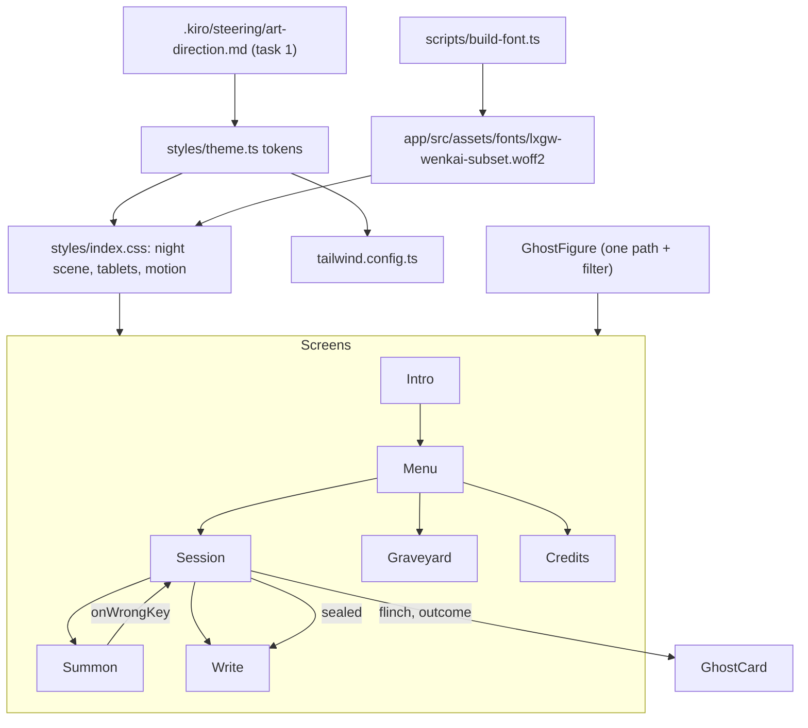

# Design Document: ink-and-candlelight

## Overview

One art direction for every screen: a séance at a writing desk, ink and paper by candlelight. The design changes presentation only. It touches the theme tokens, `index.css`, the Tailwind config, six components, the two modes, the favicon, one font pipeline and the e2e suite. It changes no engine file, no dataset and no storage.

The design makes these decisions, each with a default that the human can reverse (see "Open questions"):

- Seal red is the only accent. Amber survives only as light.
- The ghost is one SVG path with a displacement filter, reused at every size. The favicon uses an unfiltered copy.
- The night is made of pseudo-element backgrounds: sky, moon, two mist bands, grain, vignette.
- The legend line is written by a CSS mask wipe, not by hanzi-writer, because four of its six glyphs are not in the dataset.
- LXGW WenKai is subset to 316 characters and bundled. The measured cost is 64,746 bytes of gzip.
- Causal motion stays within 200 to 600 ms. Ambient motion and the rite timings are named exemptions until the human decides.

## Research findings

### Fonts (measured in /tmp, Nov 17 2026)

Method: each candidate was downloaded at a pinned location, its glyph coverage was checked with `opentype.js` 1.3.4 against the 316-character Glyph_Set, and it was subset to WOFF2 with `subset-font` 2.9.0 (harfbuzz-subset, wasm). `pyftsubset` is installed on this machine but its fontTools build has the wrong CPU architecture and pip could not reach PyPI, so it was not used. Two subset runs gave the same SHA-256, so the output is deterministic.

| Candidate | Source | Licence | Missing glyphs | Subset WOFF2 | Fit |
|---|---|---|---|---|---|
| **LXGW WenKai Regular v1.530** | `lxgw/LxgwWenKai` release v1.530 (2026-10-17), file 25,928,940 bytes | OFL 1.1 (GitHub API: `OFL-1.1`), RFN 霞鹜 / LXGW with a web-subset permission, derived from Klee One (Klee Project) | none | **64,708 bytes** | Kai style, readable, full coverage, stable |
| Ma Shan Zheng | `google/fonts` `ofl/mashanzheng` | OFL 1.1 | 難 | 119,716 bytes | brush, heavy, missing a key face |
| Long Cang | `google/fonts` `ofl/longcang` | OFL 1.1 | 難 | 104,900 bytes | cursive, hard to read for learners |
| Zhi Mang Xing | `google/fonts` `ofl/zhimangxing` | OFL 1.1 | 難 | 87,440 bytes | cursive, hard to read for learners |
| Liu Jian Mao Cao | `google/fonts` `ofl/liujianmaocao` | OFL 1.1 | 難 | 87,840 bytes | cursive, hard to read for learners |

The four Google Fonts brush faces lack 難, the key face of X, and are 34 to 83 percent larger. A cursive hand also hurts a game whose aim is to teach how a character is built. LXGW WenKai is the proposed font.

Facts for the LXGW WenKai record:

- Source file: `LXGWWenKai-Regular.ttf`, SHA-256 `2d73eea94ad808999d90c0000c239a84a33b09d4bc6ab6c5b8bbf1eda8a7fc8b`.
- Licence file: `OFL.txt` of tag v1.530. Its first line is "Copyright 2021-2026 LXGW (https://github.com/lxgw/LxgwWenKai), with Reserved Font Name '霞鹜', '霞鶩', '落霞孤鹜', '落霞孤鶩' and 'LXGW'". It adds a permission: the Reserved Font Names may continue in versions subsetted or converted to WOFF/WOFF2 solely for web delivery, if they are not offered as installable desktop fonts. Our subset is web-only and is served from the site, so it stays inside that permission. The file's second line carries a second copyright: "Copyright 2020 The Klee Project Authors (https://github.com/fontworks-fonts/Klee)". Both lines go in every font record.
- Glyph set: 316 characters: the 300 dataset characters; 11 key shapes that are not dataset characters (金 土 竹 戈 弓 心 尸 廿 田 難 卜; the other 14 key shapes are dataset characters); and 粟 鬼 夜 哭 and the fullwidth comma ， of the legend line (天 and 雨 are dataset characters). The set was computed from `characters.json`, `CANGJIE_KEYS` and the legend line, and a scan of every CJK character in non-test `app/src` files found no other character shown in the UI. The scan also found CJK characters in code comments and type documentation (么 第 我 米 字 格 ？ ～); these are not shown, and the Font_Pipeline strips comments before it scans (see "Font pipeline").
- Subset: 64,708 bytes WOFF2; gzip of that file 64,746 bytes (WOFF2 is already compressed, so gzip adds 38 bytes). SHA-256 of this subset: `ae374b26…0e39`; the pipeline task records the full value..
- Bundle: the current total is 136,755 bytes. Projected total with the font: 136,755 + 64,746 = **201,501 bytes**, under the 300,000-byte budget with 98,499 bytes spare. Added CSS and SVG are expected to add under 5,000 bytes, so the total stays under 210,000.
- Risk to check in a task: LXGW WenKai draws some simplified characters with forms that differ from the hanzi-writer stroke data (Make Me a Hanzi). A human compares the Graveyard glyphs with the Write-step strokes for a sample of 20 characters. The font is used only for display of characters that are already revealed, never to check strokes.

### Favicon and SVG filters

SVG favicons are supported by Chromium browsers and Firefox, and by Safari 26 and later; older Safari ignores them for the tab ([lambdatest](https://www.lambdatest.com/web-technologies/link-icon-svg), [css-tricks](https://css-tricks.com/favicons-how-to-make-sure-browsers-only-download-the-svg-version/)). I found no source that documents `feTurbulence` or `feDisplacementMap` inside a favicon, and a favicon is rendered as an isolated image with limited features. Content was rephrased for compliance with licensing restrictions. Decision: the favicon is an unfiltered path whose ragged edge is drawn into the path itself. No browser support question remains for it.

### hanzi-writer 3.7.3 options

Read from `node_modules/hanzi-writer/dist/types/hanzi-writer.d.ts` and `index.esm.js`:

- Possible without new data: `strokeColor`, `radicalColor`, `highlightColor`, `highlightCompleteColor`, `outlineColor`, `drawingColor`, `drawingWidth` (the player's line, drawn with round caps and round joins, which already looks brush-like), `outlineWidth`, `strokeFadeDuration` (default 400 ms), `drawingFadeDuration` (default 300 ms), `strokeHighlightSpeed` (default 2), `strokeAnimationSpeed`, `delayBetweenStrokes`.
- Stroke animation time per stroke is `(strokeLength + 600) / (3 * speed)` ms. At `SUMMON_INK_SPEED` 2 and stroke lengths of about 100 to 1000 units, one stroke takes about 120 to 270 ms. Some are below the 200 ms floor. At speed 1 every stroke takes about 230 to 530 ms.
- Not possible without new data or a custom renderer: a width that varies along a stroke, a pressure taper, a bristle texture. Finished strokes are filled outline paths from the stroke data.
- Possible with CSS only: one `filter: url(#ink-bleed)` on the hanzi-writer container, which applies a small `feDisplacementMap` to the finished strokes. This is the brush look the design uses, with `drawingWidth` of 6 or more.

### The legend line and hanzi-writer

The Legend_Line is 天雨粟，鬼夜哭. A check of `characters.json` found 天 and 雨 in the dataset and 粟 鬼 夜 哭 missing. `charDataLoader` serves only dataset characters, so a hanzi-writer reveal of the line would need new stroke data, which is a data change. The design uses a CSS mask wipe (a `mask-image` linear gradient whose position moves over 600 ms). The text is real text in the DOM from the first render, so screen readers and tests see it.

## Architecture



Layers:

- **Tokens** (`theme.ts`, `index.css` custom properties, `tailwind.config.ts`): one source of colours, checked equal by tests.
- **Scene** (`index.css`): pseudo-element backgrounds, no DOM.
- **Components** (`components/`): `GhostFigure`, `GhostPrompt`, `SealStamp` (new), `Tablet` markup inside `Graveyard`, button style helpers.
- **Modes** (`modes/`): `SummonStep` gains one optional callback; `WriteMode` gains one optional prop; neither changes a rule.
- **Pipeline** (`scripts/build-font.ts`): reproducible subset.
- **E2E** (`e2e/screenshots.spec.ts`): screenshot artefacts.

## Components and Interfaces

### Palette tokens (`theme.ts`)

| Token | Value (proposed) | Role | Contrast (computed) |
|---|---|---|---|
| `background`, `surface` | unchanged `#0e0f13`, `#181a21` | ink black | unchanged |
| `nightTop`, `nightMid`, `nightLow` | unchanged | sky | unchanged |
| `paper`, `inkOnPaper`, `drawing` | unchanged | paper and ink | unchanged |
| `ink` | unchanged `#ece6d6` | aged paper text on dark | unchanged |
| `ghost` | `#bdb7a6` (was blue `#9fc4d6`) | neutral secondary text, pinyin | 9.57 on background, 8.68 on surface, 8.04 on nightLow |
| `muted` | unchanged | | unchanged |
| `seal` | `#b3361f` | Primary_Action fill, Seal_Stamp | 5.05 with `paperLabel`; 2.66 against nightLow, so the button gets a paper border |
| `paperLabel` | `#f3ead2` | label on seal | 5.05 on `seal` |
| `sealLight` | `#ec7a64` | Success_Marks on dark | 6.87 on background, 6.23 on surface, 7.17 on nightTop, 5.78 on nightLow |
| `success` | alias of `sealLight` | | as `sealLight` |
| `error` | `#e6dcc3` (Aged_Paper) | error text, with text and shape cues | 12.73 on surface |
| `gridLine` | `#7a6a4f` at opacity 0.25 | grid, outline | decorative, not text |
| `hintInk` | `#2c3e5a` | hanzi-writer highlight on paper | 7.92 on paper; 1.62 against `inkOnPaper`, so it reads as a different tone |
| `candle` | unchanged `#f0b866` | inside glows only | rule-checked by grep test, not by contrast |

`seal` on paper is 4.44:1 (computed), under 4.5:1. The seal is a graphic mark with no text, so 3:1 applies; the theme test checks 3:1 for `seal` on `paper` and does not claim 4.5:1. Old `seal` (`#a3301f`, 5.13 on paper) is replaced; no text uses `seal` on paper.

Computed contrast values come from `/tmp/ink/c.mjs` (the same WCAG formula as `theme.ts`); the tasks re-check them with `contrastRatio` in `theme.test.ts`.

### GhostFigure

```ts
export interface GhostFigureProps { className?: string }
export const GHOST_PATH: string;       // exported so the favicon test can compare
export const GHOST_EYE_PATHS: readonly string[];
export function GhostFigure({ className }: GhostFigureProps): JSX.Element;
```

- `viewBox="0 0 64 80"`, one `path` for the body (drawn with uneven edges and a dry-brush tail), two small eye paths, no `text`.
- Filter per instance: `const id = useId()`; `<filter id={...} x="-20%" y="-20%" width="140%" height="140%">` with `feTurbulence type="fractalNoise" baseFrequency="0.035" numOctaves="2" seed="7"` feeding `feDisplacementMap scale="5"` in viewBox units, so the edge scales with the rendered size. The `seed` is fixed, so the shape is identical every time.
- `aria-hidden="true"`, `focusable="false"`, no props derived from a character.
- `index.html` favicon: `app/public/favicon.svg` holds `GHOST_PATH` with the rough edge baked into the path. A unit test reads the file and compares its path data to `GHOST_PATH`, and rejects any `filter`.
- Existing test `GhostFigure.test.tsx` asserts two `circle` elements; it is amended to count the eye paths and the single filter.

### Ghost states and outcome motions (CSS)

Existing: `data-ghost-state` on the Ghost_Card with `haunting`, `faded`, `flickering`, `drifted`, set by `ghostStateFor`. Kept unchanged.

New end states (static, outside the media block) and motions (inside it):

| State | End state | Motion (inside no-preference) | Duration |
|---|---|---|---|
| `haunting` | visible | idle float, 6 px, 4 s (Ambient_Motion) | ambient |
| `faded` (clean) | opacity 0, translated up 14 px, blurred 2 px | `ghost-smoke`: rises, blurs and fades | 600 ms ease-out |
| `flickering` (struggled) | opacity 0.5, translated right to the card edge | `ghost-linger`: moves to the right edge, keeps 0.5 | 600 ms |
| `drifted` (gave-up) | opacity 0, translated right 16 px and down 12 px | `ghost-slip`: slides and fades | 600 ms ease-in |

The Flinch is a separate attribute, `data-ghost-flinch="n"` on the Ghost_Card, which changes with each wrong key. The inner figure's `key` changes with `n`, so the 400 ms `ghost-flinch` animation restarts. The Flinch never writes `data-ghost-state`.

### GhostPrompt

New optional prop `flinch?: number` (count of wrong keys this ghost, default 0). It renders `data-ghost-flinch`. Existing props and the never-reveal behaviour are unchanged.

### SummonStep

New optional prop `onWrongKey?: () => void`. It is called once in the same handler that the Summon engine uses to count a miss (`missesOnSlot` or `mistakes` increases), after the state update, and never for hints, accepted keys, blocked keys or invalid keys. `SeanceSession` passes `() => setFlinch(n => n + 1)` and resets `flinch` to 0 when the ghost changes. The Rite_Timings stay as they are by default. Keycap styling is CSS classes only (`keycap`, `keycap-next`), with no change to heights, widths or accessible names.

Keycap style: `background: linear-gradient(180deg, #e9dfc6, #d4c8aa)`, inner highlight `inset 0 1px 0 rgba(255,250,235,.6)`, lower edge `inset 0 -3px 0 rgba(60,40,20,.35)`, a scuff made from two low-alpha radial gradients, and an outer `box-shadow` for depth. Label colour `inkOnPaper`: 11.1:1 or better on the lightest cap stop (checked in tests). The next-key marker keeps its underline and bold, and adds a Candle_Light glow.

### WriteMode and InkSurface

- `WriteMode` options: `strokeColor: inkOnPaper`, `drawingColor: drawing`, `highlightColor: hintInk`, `outlineColor: gridLine`, `drawingWidth: 6`. Other quiz options stay.
- New optional prop `sealed?: boolean`, passed by `SeanceSession` when the combined Outcome is `clean`. `InkSurface` gets `overlay?: ReactNode`, drawn after the container, absolutely placed, `pointer-events: none`.
- `InkSurface` renders its own hidden `<svg width="0" height="0" aria-hidden="true">` with one `<filter>` (id from `useId`): a small `feTurbulence` (`baseFrequency` 0.9) feeding `feDisplacementMap` with `scale` 1.2. Only one surface is on screen at a time, so there is no id collision.
- The filter is applied to the character group that hanzi-writer draws inside its SVG (finished strokes), not to the whole SVG, so the stroke the player is drawing stays sharp and hit testing is untouched (a CSS `filter` does not change event targets). If a selector for that group is brittle in hanzi-writer 3.7.3, the filter is dropped and `drawingWidth` of 6 alone gives the look (open question Q6).
- Risk: a filter can slow rendering on old iPads. The filter applies to a static group, not to the live stroke, so the cost is paid at stroke completion only.

### SealStamp

```ts
export interface SealStampProps { className?: string }
export function SealStamp(props: SealStampProps): JSX.Element;
```

An `aria-hidden` inline SVG, `viewBox="0 0 48 48"`, a rotated (-6°) red square with rough edges (the same displacement filter idea as the ghost), an inner paper-toned border at 70% opacity, and no text. Positioned `absolute bottom-2 right-2 h-12 w-12` over the `InkSurface`. The motion `seal-stamp` (300 ms, scale 1.3 to 1, opacity 0 to 1) runs only inside the no-preference block. The stamp renders only when `sealed` is true, which is after the Outcome, so the never-reveal rule is not touched.

### Night scene (`index.css`)

No new DOM. Three existing pseudo-elements get more backgrounds:

- `body::before` (fixed, behind all): Sky_Gradient, then the Moon as two `radial-gradient`s (a disc with a hard edge at 3.2 rem and a halo to 9 rem, placed at `82% 12%`), then the Vignette as a radial gradient that darkens to 55% at the corners, then the Paper_Grain as a `data:` SVG `feTurbulence` tile at 0.04 alpha.
- `body::after` and `#root::before`: the two Mist_Bands, each 200% wide, as horizontal elliptical gradients with a peak alpha of 0.09 (was 0.05), drifting with `mist-drift-a` (120 s) and `mist-drift-b` (180 s) as Ambient_Motion.
- The moon halo peak alpha stays at or below 0.10. The disc is a deliberate brighter object placed top right; the new text-contrast test composites the disc colour against each text token at the disc's position and requires 4.5:1 only for text that can overlap it (no text is placed in the disc region at the Rite_Viewports; the e2e screenshot task checks this by bounding boxes).

### Intro and Start_Menu

- IntroScreen: `GhostFigure` (h-24), `h1` in `font-display` at `text-5xl`, the two paragraphs (new second sentence), the legend figure with `ink-reveal` (a `mask-image: linear-gradient(90deg, #000 var(--wipe), transparent calc(var(--wipe) + 8%))` whose `--wipe` animates from 0% to 100% over 600 ms via `@property`; where `@property` is unsupported, the `mask-position` of a 200%-wide gradient is animated instead), and the Primary_Action "Begin the Séance".
- The reveal sits inside the no-preference block. Outside it, the line is fully visible. A test checks that the line text is in the DOM with no `mask` inline style.
- Start_Menu: the main button uses the Primary_Action class; its glow uses `box-shadow` with `candle` at alpha, which is light.

### Buttons and cards

CSS component classes in `@layer components`: `.slip` (Paper_Slip button: paper gradient, ink label, 1 px darker border, soft shadow), `.slip-primary` (seal fill, `paperLabel` label, paper 1 px border, candle glow shadow), `.card-slip` (paper card with ink text). All keep `min-h-[44px]`. The class names are used by the components in place of the current `bg-surface border-muted` strings.

Primary_Action per screen:

| Screen | Primary_Action | Secondary slips |
|---|---|---|
| IntroScreen | Begin the Séance | none |
| Start_Menu | Begin a Nightly Séance | Read the legend again, How Cangjie works, Graveyard, Sources & licences |
| Cangjie_Guide | its continue button | none |
| Seance_Session, summoning | none | Leave séance, Give up |
| Seance_Session, writing | none | Leave séance, Give up |
| Seance_Session, after an Outcome | Next ghost / Finish the séance | Leave séance |
| Leave_Prompt | Stay | Leave |
| SessionSummary | Begin another Séance | none |
| Graveyard_Screen | none | Back to menu |
| Sources & licences | none | Back to menu |

Note: the Leave_Prompt is shown inside the Seance_Session. While it is open after an Outcome, "Stay" and "Next ghost" would both be primary. Default: while the Leave_Prompt is open, "Next ghost" is drawn as a Paper_Slip. A component test covers it.

### Graveyard

- Each Tablet keeps the three outline shapes, now as stone tablets: `at-rest` an arched top with a solid edge, `restless` a chipped top with a dashed lower edge and a wisp, `unmet` a plain blank slab with a dotted edge. The shapes differ in outline, so shape is a signal as before. The markers `·`, `!`, `✓` and the accessible names stay.
- Glow and wisp are pseudo-elements: `.tablet-rest::after` is a small Candle_Light `radial-gradient` at the foot; `.tablet-restless::before` is a thin vertical wisp gradient, animated inside the no-preference block with `wisp-rise`.
- The hillside is a CSS `linear-gradient` and an SVG `data:` path silhouette behind the grid. No image file.
- `Graveyard.tsx` changes class names and the `MARKER`/`SHAPE` tables only; `buildGraveyard` and the type that omits the character for `unmet` are untouched. `✓` is drawn in `sealLight` and keeps its text role.

### Font integration

```css
@font-face {
  font-family: 'LXGW WenKai Subset';
  src: url('../assets/fonts/lxgw-wenkai-subset.woff2') format('woff2');
  font-display: swap;
  unicode-range: /* generated from glyph-set.txt, written by build-font.ts into fonts.css */;
}
[lang='zh'] { font-family: 'LXGW WenKai Subset', "PingFang SC", "Hiragino Sans GB", "Songti SC", "Microsoft YaHei", "Noto Sans CJK SC", "Noto Serif CJK SC", sans-serif; }
```

The `@font-face` rule lives in a generated `app/src/styles/fonts.css` imported by `main.tsx`, so `index.css` keeps only `data:` URIs. Vite hashes the font file and rewrites the URL with the base path, so the GitHub Pages path `/ghost-script/` works. The `[lang='zh']` stack and the Tailwind `hanzi` family are updated together and kept equal by the existing test.

### Font pipeline (`scripts/build-font.ts`)

```ts
export function collectGlyphSet(input: { dataset: string[]; keyShapes: string[]; legend: string; uiText: string[] }): string[];  // pure, sorted by codepoint, unique
export function missingGlyphs(set: readonly string[], hasGlyph: (cp: number) => boolean): string[]; // pure
export function unicodeRange(set: readonly string[]): string; // pure, e.g. "U+4E00,U+4E2D-4E3F"
export async function buildFont(opts: { sourcePath: string; outPath: string }): Promise<{ bytes: number; sha256: string }>;
```

Steps: (1) download the pinned URL to `data/raw/fonts/cache/` (gitignored) if the file is missing; (2) check SHA-256; (3) compute the Glyph_Set; (4) check coverage with `subset-font` or the cmap; (5) subset to WOFF2; (6) write `lxgw-wenkai-subset.woff2`, `data/fonts/glyph-set.txt` and `fonts.css`; (7) print bytes, gzip bytes and SHA-256. The 26 MB source is not committed. The committed files are the subset, the glyph set, `fonts.css`, `data/raw/fonts/lxgw-wenkai/OFL.txt` and `data/raw/fonts/SOURCES.md`.

Glyph set computation: the pipeline scans every non-test `.ts` and `.tsx` file under `app/src` and `app/index.html`, strips `//` and `/* */` comments, and collects the CJK characters and fullwidth punctuation that remain. Comment-only CJK (么 第 我 米 字 格 ？ ～ in `mask.ts`, `types.ts` and `PracticeGrid.tsx`) is therefore excluded. It adds the dataset characters and the `CANGJIE_KEYS` shapes. A unit test passes a fixture to prove that comment text is excluded and string text is included.

### Credits, README and notices

- `FONTS` in `credits.ts` gains the WenKai entry (name, `SIL Open Font License 1.1`, both copyright lines, release v1.530, source URL). The existing test that checks `FONTS` against the README table is extended.
- `Credits.tsx` replaces the sentence "Chinese text is drawn with fonts already installed on the device." with: "Chinese characters are drawn with LXGW WenKai (subset to the characters in this game). Any other Chinese text uses fonts already installed on the device."
- `build-notices.ts` appends one section "Fonts not installed through npm" with the verbatim `data/raw/fonts/lxgw-wenkai/OFL.txt`, after the packages, in a fixed position. The determinism test stays.
- `README.md`: the Fonts bullet is rewritten; a "build:font" usage line and the screenshots note are added.

## Data Models

No dataset or storage change. New static data:

```ts
// theme.ts additions
export const theme = { /* existing */, paperLabel: '#f3ead2', sealLight: '#ec7a64', hintInk: '#2c3e5a' } as const;

// data/fonts/glyph-set.txt: one line, the 316 characters in codepoint order, no newline inside.
// data/raw/fonts/SOURCES.md: fields below.
interface FontSourceRecord {
  name: 'LXGW WenKai Regular';
  release: 'v1.530';
  url: string;
  sourceSha256: '2d73eea94ad808999d90c0000c239a84a33b09d4bc6ab6c5b8bbf1eda8a7fc8b';
  subsetSha256: string;       // filled by the pipeline
  licence: 'SIL Open Font License 1.1';
  copyright: readonly string[]; // two lines, as in OFL.txt
  tool: 'subset-font 2.9.0';
}
```

## Conflicts with existing requirements

Each row names the existing requirement, how the direction conflicts, the proposed resolution, and the open question that decides it. Nothing here is applied until the human approves it.

| # | Existing requirement or decision | Conflict | Proposed resolution (default) | Question |
|---|---|---|---|---|
| C1 | `visual-identity` 21.3: mist drift of at least 90 s; mist at 120 s and 180 s | Direction rule: every animation shows cause and effect and runs 200 to 600 ms. Ambient drift has no cause. | Name Ambient_Motion as an exempt class in the Steering_File: mist, idle ghost float, idle glow, restless wisp. All stay behind Reduced_Motion. | Q2 |
| C2 | `visual-identity` 3.5 and 22.5: ghost float 4 s, 6 px | Same as C1. | Ambient exemption; keep 4 s and 6 px. | Q2 |
| C3 | `visual-identity` 4.1: fade within 1500 ms; 4.2: flicker 1200 ms; 4.3: drift within 2000 ms | Outcome motions are caused, so they must run 200 to 600 ms. | Change all three to 600 ms and new shapes (smoke, linger, slip). State names stay. Amend 4.1 to 4.3 with a note. | Q12a |
| C4 | `visual-identity` 4.4 (end states under reduced motion) | None; the new end states are static too. | Keep; update the static end states in CSS. | none |
| C5 | `cangjie-seance` `SUMMON_HOLD_MS` = 1500 and `SUMMON_FADE_MS` = 1500 (tested) | The 1500 ms fade is a 1500 ms animation; the hold is a pause. | Treat both as Rite_Timings, exempt, unchanged. Hold is memorisation time, not decoration. Option: shorten the fade to 600 ms (changes a tested constant). | Q12b |
| C6 | `summon-ink` `SUMMON_INK_SPEED` = 2 | Strokes take about 120 to 270 ms each, partly under 200 ms; drawn by hanzi-writer. | Treat as Rite_Timing, exempt, unchanged. Option: speed 1 (230 to 530 ms) changes a tested constant and slows the typing feedback. | Q12c |
| C7 | hanzi-writer `strokeFadeDuration` 400, `drawingFadeDuration` 300, `strokeHighlightSpeed` 2 | Inside or near the window. | No change; the design only sets `drawingWidth`. | none |
| C8 | `visual-identity` 21.5: main button uses candle as its background | Amber is light only, never a flat fill. | Seal-red Primary_Action; amber only in its glow. | none (direction) |
| C9 | `visual-identity` 21.5 and `index.css`: every focus ring is candle | A ring is a flat line. | Ring in Aged_Paper with a Candle_Light glow around it. Option: keep an amber ring and call it light. | Q3 |
| C10 | `visual-identity` 21.7 and 21.8: candle at 3:1 and background-on-candle at 4.5:1 tests | Candle is no longer a fill or ring. | Replace with tests for `seal`/`paperLabel` and the paper ring; keep the candle test only as a glow-usage grep test. | none |
| C11 | `visual-identity` 12.1 to 12.3: only Cormorant Garamond bundled, no CJK file, Chinese_Font_Stack in that order; approved by the human | The direction asks for a Kai or brush font. | Amend: one added font, LXGW WenKai subset, stack placed first, old stack kept as fallback. Fallback if rejected: keep system fonts. | Q1 |
| C12 | `visual-identity` 12.5, 9.6 and README font record | New font needs a record; the sentence "no Chinese font is bundled" becomes false. | Update README, `FONTS`, the Credits sentence and the notices file; the sync test covers it. | Q1 |
| C13 | `visual-identity` 21.12 and its test: every `url()` is a `data:` URI | `@font-face` needs a file URL. | Put the font rule in a generated `fonts.css` and allow exactly that one URL there; `index.css` keeps its test. | Q1 |
| C14 | `index.css.test.ts`: "exactly one no-preference block and no other media block" | New motion and the font rule must follow it. | Keep one block; put all new animation inside it; `fonts.css` has no media block. | none |
| C15 | `visual-identity` Ink_Palette: `seal` red as hint highlight and `gridLine` red | Seal red only for the primary action and success. | `gridLine` becomes ink-brown; highlight becomes indigo ink (`hintInk`). Option: keep red for the highlight as a hint stamp. | Q5 |
| C16 | `theme.ts`: `success` green `#8fd19e`, `error` coral `#f19188`, `ghost` blue `#9fc4d6` | Three more hues than "one accent". | `success` is `sealLight`; `error` and `ghost` become paper neutrals; every error keeps its text cue. | Q4 |
| C17 | Night blues (`nightTop` to `nightLow`, `mist`, `moon`) | Blue hue against "ink black, aged paper, one accent". | Keep. They are dark ink-wash tints of the background, not accents; the moon and mist are dim. Listed so the human can reject it. | Q8 |
| C18 | `visual-identity` 21.4: moon glow peak opacity at most 0.10 | A moon that is "clearly visible in a screenshot" needs a brighter disc. | Keep 0.10 for the halo; add a disc as a separate object kept clear of text. | Q8 |
| C19 | `visual-identity` 21.6: text contrast against the worst-case composite | New grain, vignette, brighter mist and moon change the composite. | The test is extended to the new layers; mist peak 0.09 is checked. | none |
| C20 | Ghost states and tests (`ghostVisual.test.ts`, `GhostPrompt.test.tsx`, `index.css.test.ts`) | New outcome motions replace the CSS; names and attributes unchanged. | Tests for `ghostStateFor` and `data-ghost-state` stay as they are; the CSS tests for duration and the 0.5 end state are replaced (Requirement 14.8). | Q12a |
| C21 | `visual-identity` 4.6: result text shown without waiting for the animation | Unchanged by the new motions. | Keep; tested again. | none |
| C22 | Graveyard shapes `grave-wisp`, `grave-restless`, `grave-rest` and markers `·`, `!`, `✓` | Tablets need arched stone shapes; the signals must stay. | Keep three distinct outlines and the three markers and the accessible names; only the drawing changes. | none |
| C23 | `visual-identity` 7.5 and 13.4: colour never the only signal | The at-rest border changes from green to a glow. | Shape and marker carry the state; the glow and `sealLight` are extra. | none |
| C24 | `GhostFigure.test.tsx` and `visual-identity` 22.4 (no text element, same shape) | New shape and filter. | Keep the rules; replace the two-circle assertion. | none |
| C25 | `visual-identity` 12.6 and 12.7: bundle budget 300,000 bytes | Adds a font. | Measured projected total 201,501 bytes; fits. If a later measurement exceeds the budget, fall back to system fonts. | none |
| C26 | `visual-identity` 25 to 26 and the e2e fit specs: one-screen fit | Taller keycaps would break the fit. | Keycaps keep 44 px height; the seal and glows are overlays with no layout space; no new row or margin on the Summon or Write step. | none |
| C27 | Intro copy "Type its shapes to summon it, then write it from memory." | Direction fixes the copy. | New sentence "Type a ghost's shapes to summon it, then write it from memory."; the old one is searched for and removed in `IntroScreen.test.tsx`. | none |
| C28 | `product.md`: "Spooky but calm. Ink-wash, candlelight" | Consistent. | No change. | none |
| C29 | `visual-identity` 9.6: "Chinese text is drawn with fonts already installed on the device" | False once the font ships. | New sentence (see Credits). | Q1 |
| C30 | `content-accuracy.md`: legend line shown as 天雨粟，鬼夜哭 | The font needs the comma and four glyphs outside the dataset. | They are in the Glyph_Set. No change to the legend rules. | none |
| C31 | `tech.md`: "Handwriting: hanzi-writer ... Fonts: open-licensed only" and "Record each font's licence in the README" | The new font must be recorded. | Done by Requirement 16.8. | none |
| C32 | `.gitignore` rule for `test-results/` | Screenshots need a place. | `e2e/screenshots/` is added to `.gitignore` by default. | Q13 |

## Error Handling

- **Font download or checksum failure:** `build-font.ts` exits non-zero, names the expected and actual SHA-256, and writes nothing.
- **Missing glyph:** the pipeline exits non-zero and lists the missing characters.
- **Font file fails to load in the browser:** `font-display: swap` shows the fallback stack; the layout does not depend on glyph widths because the keycaps and tablets have fixed boxes.
- **Filter unsupported or slow:** the ghost and the ink-bleed filter are decoration. If `filter: url()` is ignored, the ghost shows as a plain silhouette and strokes show unblurred; nothing else changes.
- **`onWrongKey` is absent:** `SummonStep` calls it only when defined, so existing callers and tests work.
- **Reduced motion:** every animation sits behind the no-preference block; end states are static.
- **Screenshot spec cannot write a file:** the spec fails with the path.

## Testing Strategy

Property-based testing does not apply. The feature is presentation: tokens, CSS, SVG markup, copy and a build script with fixed inputs. The tech rule of Nov 15 also forbids new property tests, and the one approved exception (summon ink classification) is untouched. So there is no Correctness Properties section and no prework. The tests are unit and component tests:

- **Tokens:** `theme.test.ts` adds `paperLabel` on `seal` (4.5), `sealLight` on every dark background (4.5), `hintInk` on paper (4.5), `ghost` and `error` on every dark background (4.5), `seal` on `paper` (3), and the border of the primary on `nightLow` (3). `index.css.test.ts` extends the equality, the single no-preference block, the animation durations (each Causal_Motion between 200 and 600 ms, read from the CSS), the `url()` rule, the worst-case composite with new layers, and the focus ring.
- **Candle usage:** a test scans `app/src` and `index.css` for `bg-candle`, `border-candle`, `text-candle` and a flat `candle` colour outside gradients and shadows.
- **GhostFigure:** one path, a filter with `feTurbulence` and `feDisplacementMap`, a unique id per instance, no `text`, `aria-hidden`; the favicon file matches the path and has no filter.
- **GhostPrompt and SeanceSession:** `data-ghost-state` mapping stays; `data-ghost-flinch` changes only on `onWrongKey`; the Flinch never changes the state; the stamp renders only for `clean`; Primary_Action classes appear only on the listed buttons.
- **SummonStep:** `onWrongKey` is called once per counted miss and not for accepted keys, hints or blocked keys. The existing never-reveal and hint tests run unchanged.
- **WriteMode and InkSurface:** the hanzi-writer options passed are the ones listed; the overlay slot renders the stamp; hanzi-writer is mocked as in the existing tests.
- **Graveyard:** the shapes, markers, accessible names, never-reveal and legend counts; glow and wisp classes by state.
- **IntroScreen and StartMenu:** the new sentence, the old sentence absent, the title class, the Legend_Line text in the DOM without a mask style.
- **Font pipeline:** `collectGlyphSet`, `missingGlyphs` and `unicodeRange` as pure functions with fixtures; the committed `glyph-set.txt` equals the set computed from the repo; the committed subset's SHA-256 equals the Font_Sources_File; `FONTS` equals the README entry; the notices file contains the OFL text.
- **E2E:** `fits-one-screen` and `no-horizontal-overflow` keep their thresholds; `screenshots.spec.ts` writes four views at two viewports.
- **Accuracy:** the `accuracy-reviewer` agent runs over copy, cultural-care rules and the font licence text.

## Open questions

Defaults are in brackets. Each is decision-ready.

1. **Q1. Bundle the WenKai font?** Amends the approved system-CJK-fonts decision. [Yes: 64,746 bytes gzip, total 201,501 of 300,000.] The alternative keeps system fonts and drops Requirement 16.
2. **Q2. Ambient motion exemption.** Mist (120 s, 180 s), idle ghost float (4 s), idle candle glow and the restless wisp have no cause. [Exempt and named in the steering file, all behind reduced motion.] The alternative makes them static.
3. **Q3. Focus ring.** [Aged-paper ring with an amber glow.] The alternative keeps an amber ring and calls it light.
4. **Q4. Success and error colours.** [Success is light seal red; error is a paper neutral with a text cue and a shape cue; `ghost` blue becomes neutral.] The alternative keeps coral for errors.
5. **Q5. Grid and hint on paper.** [Grid in ink-brown, hint in indigo ink, no red on paper except the stamp.] The alternative keeps red for the hint highlight only.
6. **Q6. Ink-bleed filter on the writing surface.** [Apply to finished strokes only; drop the filter if the selector is brittle in hanzi-writer 3.7.3.] The alternative skips the filter and relies on `drawingWidth` 6.
7. **Q7. Extra icon files.** [Only `favicon.svg`.] The alternative adds an `apple-touch-icon` PNG made from the same path.
8. **Q8. Night blues and the moon.** [Keep the blue-black sky and dim mist as ink tints; moon disc is a separate brighter object.] The alternative uses neutral black and grey for the sky.
9. **Q9. Primary actions per screen.** [As in the table; "Back to menu" is a slip; "Stay" is primary in the Leave_Prompt.] The alternative makes "Leave séance" the primary of nothing and "Back to menu" primary on its two screens.
10. **Q10. Seal content.** [Empty seal shape, no text.] The alternative holds the ghost's own character, which is revealed by then and is in the font subset.
11. **Q11. Stamp on struggled?** [Stamp only on `clean`.] The alternative stamps `struggled` too, since it is also "laid to rest" in the result text.
12. **Q12. Rite timings and outcome durations.** (a) [Outcome motions 600 ms; amends `visual-identity` 4.1 to 4.3.] (b) [Keep `SUMMON_HOLD_MS` and `SUMMON_FADE_MS` at 1500 ms, exempt as rite timings.] Alternative: fade 600 ms. (c) [Keep `SUMMON_INK_SPEED` 2.] Alternative: speed 1.
13. **Q13. Screenshots in git.** [`e2e/screenshots/` is gitignored; the human copies chosen images into the README.] The alternative commits them.
