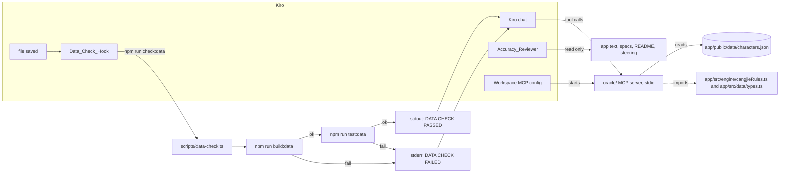

# Design Document: kiro-tooling

## Overview

This feature adds three developer tools built on Kiro features, plus an optional Power package:

1. **Data check hook.** A `PostFileSave` agent hook runs `npm run check:data` when `data/character-list.txt`, `data/prompt-overrides.csv` or `data/raw/**` is saved. The command rebuilds the dataset and runs the dataset tests, then prints a clear pass or fail line for the Kiro chat.
2. **Accuracy reviewer.** A custom agent with the `read` tool category only, and `deny` rules for writes and shell, reviews app text, specs and the README against `content-accuracy.md`.
3. **Cangjie Oracle.** A stdio MCP server in `oracle/` with three tools (`lookup`, `verify`, `decompose`) that read the committed `app/public/data/characters.json` and nothing else.
4. **Oracle Power (later task).** A Power folder in `oracle/power/` that bundles the Oracle with a skill.

The Build_Script already fails the build on an out-of-range override index (see "Existing behaviour" below), so the code change is small: a clearer command-line message and unit tests that pin the behaviour.

Property-based testing does not apply. The work is configuration files, a thin MCP wrapper over lookups in a committed JSON file, and message formatting, and the project decided on Nov 15 to add no new property tests. The Correctness Properties section is therefore omitted on purpose (the format validator's warning about it is expected), and the Oracle's accuracy is checked by exhaustive unit tests over all 300 dataset records.

### Kiro features used

| Part | Kiro feature | Why this feature |
| --- | --- | --- |
| Data check | Agent hooks, command action, `PostFileSave` | Deterministic command, no model call needed to run it; the result goes back into the chat. |
| Content review | Custom agent (`.kiro/agents/`) with `tools` and `permissions` | Restricts the reviewer to reading, so a review can never change a file. |
| Character lookups | MCP server in `.kiro/settings/mcp.json` | Gives the chat verified data instead of model memory. |
| Packaging (later) | Powers (`plugin.json`, `mcp.json`, `skills/`) | Makes the Oracle installable and demoable as one unit. |
| Rules checked | Steering (`content-accuracy.md`) | The reviewer loads the same rules the specs already follow. |
| Plan | Specs | This document set. |

### Documentation consulted

Formats below were read from the official Kiro docs on the day this spec was written (pages carry "updated" dates of Oct 8 to Nov 12, 2026):

- Hooks overview and file format: https://kiro.dev/docs/hooks/
- Hook triggers (`PostFileSave`, exit-code behaviour): https://kiro.dev/docs/hooks/types/
- Hook actions (command vs agent prompt, stdout and stderr handling): https://kiro.dev/docs/hooks/actions/
- Custom agents, creating and location: https://kiro.dev/docs/custom-agents/creating/
- Custom agent configuration reference (`tools`, `permissions`, `resources`, `prompt`): https://kiro.dev/docs/custom-agents/configuration-reference/
- MCP configuration (`.kiro/settings/mcp.json`, fields, hot reload): https://kiro.dev/docs/mcp/configuration/
- Create powers (`plugin.json`, `mcp.json`, `skills/`): https://kiro.dev/docs/powers/create/
- Steering and custom agents: https://kiro.dev/docs/steering/

### Facts the docs do not confirm

The design picks the documented approach in each case. Implementation and the demo must check these.

1. **Human saves.** The hook types page says `PostFileSave` "triggers when the agent saves or modifies files matching specific patterns". It does not say whether a save made by a person in the editor fires it. Verified by a human (approved by the human): after a window reload, a person's save of `data/prompt-overrides.csv` with a bad 吧 entryIndex made the Kiro chat report `DATA CHECK FAILED: build:data` with the entry-index message, and reverting the row reported `DATA CHECK PASSED`. So human and agent saves of the Watched_Inputs both fire the hook once hooks are loaded, and a window reload may be needed after the hook file is first created. Observation from the build session: no hook output came back to the agent after its own `str_replace` saves. This is recorded as an observation only; no requirement depends on it.
2. **Pass or fail "in the chat".** The docs say a command hook's stdout goes into the agent's context on exit 0, and stderr is sent to the agent with a notice that the hook returned an error on any other exit code. They do not describe a separate banner. The chat therefore shows the result because the agent reports it. The command prints a fixed first line (`DATA CHECK PASSED` or `DATA CHECK FAILED`) so that the report is unambiguous. A hook can run a shell command directly (confirmed), so no agent-prompt action is used.
3. **Matcher path form.** The docs say file-event matchers are a regex against the file path, and do not say whether the path is absolute or relative. The regex accepts both.
4. **MCP working directory.** The MCP config documents `command`, `args`, `env`, `disabled`, `autoApprove` and `disabledTools`, and no `cwd`. The design assumes Kiro starts the server with the workspace root as working directory and uses a workspace-relative entry path. The dataset path does not depend on the working directory.
5. **What `read` covers.** The docs say the `read` category holds "all built-in file read tools". The list of tools inside it (for example whether text search is included) is not on the pages read. The agent also lists no other tools, so the worst case is that the reviewer has fewer search tools, not that it can write.
6. **Steering in custom agents.** One page says custom agents inherit steering by default, another says steering files are not automatically included. The agent therefore lists `content-accuracy.md` as an explicit `file://` resource.
7. **Power installed from a folder or GitHub.** The docs do not say what working directory the power's `mcp.json` command runs in after installation. The Power task checks this and records the result; if relative paths fail, the Power documents that it must be installed from a clone of this repository.

## Architecture



### Module boundary decision: Oracle imports from `app/src`

Options:

| Option | Correctness | Simplicity | Reversibility |
| --- | --- | --- | --- |
| A. Oracle imports `cangjieRules.ts` and `types.ts` by relative path (as `scripts/build-data.ts` already does) | One copy of each rule | No file moves, no new package | Easy |
| B. New shared workspace package for rules and types | One copy | Moves files, touches app, scripts and tests | Costly |
| C. Oracle copies the rules | Two copies can drift | Simple | Easy, but breaks Requirement 4.8 |

**Chosen: A.** `cangjieRules.ts` is documented as import-free so that `scripts/` and others can import it by relative path, and `types.ts` is documented as shared by the app, the pipeline and the Oracle. The Oracle's `tsconfig.json` includes those two files explicitly. Only these two files are imported from `app/`; nothing React-related is reachable from them.

### Oracle runs from TypeScript source

The server starts with `tsx` (already a root dev dependency): `tsx oracle/src/index.ts`. There is no build step and no `dist/` to keep in sync. The Dataset_File is located from `import.meta.url` (`../../app/public/data/characters.json`), so it does not depend on the working directory.

## Components and Interfaces

### 1. Pipeline change: `scripts/build-data.ts`

**Existing behaviour (checked in the code).** `validateOverrideRange` returns `entry-index-out-of-range` or `meaning-index-out-of-range`; the main loop records a `MissingFieldError` with `overrideError`; unknown characters are collected as `unknown-character`; `buildDataset` then returns `{ ok: false, errors, cangjieErrors }` and no output; `main()` writes nothing and sets `process.exitCode = 1`. So a bad index already fails the build. Two gaps remain: the command-line message is only `比: override: entry-index-out-of-range`, with no hint about which file or column to fix, and no unit test builds a full dataset with a bad override index (the existing coverage is `prompt.test.ts` for `selectPrompt` and a property test in `tests/property/prompt-overrides.test.ts`).

**Change.** Export `formatError` and extend it so an override error line reads, for example:

```
比: override entry-index-out-of-range: entryIndex is larger than the number of CC-CEDICT entries for this character. Fix this row in data/prompt-overrides.csv (column entryIndex).
```

The three messages are held in a `const OVERRIDE_ERROR_HELP: Record<PromptOverrideFailure, string>` map so that a new reason added to `PromptOverrideFailure` fails to compile until it has a message. No change to `buildDataset`, the types, or the written files.

### 2. `scripts/data-check.ts` and npm scripts

```ts
export interface CheckStep { name: string; command: string; args: string[] }
export interface StepResult { status: number | null; output: string } // output = stdout + stderr
export type StepRunner = (step: CheckStep) => StepResult
export interface CheckOutcome { exitCode: 0 | 1; stdout: string; stderr: string }

export const DATA_CHECK_STEPS: readonly CheckStep[]   // build:data, then test:data
export function runDataCheck(steps: readonly CheckStep[], run: StepRunner): CheckOutcome
export function tailLines(text: string, count: number): string
```

- `runDataCheck` runs steps in order and stops at the first step whose `status` is not `0` (including `null`, which covers a command that cannot start or is killed). Success returns `stdout = "DATA CHECK PASSED: build:data and test:data succeeded\n"`. Failure returns `stderr = "DATA CHECK FAILED: <step name>\n" + tailLines(output, 40)`.
- The real runner uses `spawnSync('npm', ['run', ...], { encoding: 'utf8', cwd: repoRoot })` and joins stdout and stderr. This matters because Vitest prints failures on stdout, while the hook forwards only stderr on failure.
- `main()` runs only when the file is executed directly, using the same ESM guard as `build-data.ts`.

`package.json` (root) gains:

```json
"test:data": "vitest run --project node",
"check:data": "tsx scripts/data-check.ts",
"oracle": "tsx oracle/src/index.ts"
```

`vitest run --project node` was run against the repo during design and selects only the `node` project (`tests/**/*.test.ts`), which holds the dataset tests and their existing property tests.

### 3. Hook: `.kiro/hooks/data-check-on-save.json`

```json
{
  "version": "v1",
  "hooks": [
    {
      "name": "Data check on save",
      "description": "Rebuilds the dataset and runs the dataset tests when the build inputs are saved.",
      "trigger": "PostFileSave",
      "matcher": "(^|/)data/(character-list\\.txt|prompt-overrides\\.csv|raw/.+)$",
      "action": { "type": "command", "command": "npm run check:data --silent" },
      "timeout": 300
    }
  ]
}
```

- The matcher requires `data/` followed by one of the three watched locations. `app/public/data/characters.json` does not match, because after `data/` comes `characters.json`. `data/prompt-review.csv` does not match. The build's own outputs therefore never retrigger the hook.
- `timeout` is 300 seconds because the default of 60 may be too short for a build plus the full node test project.
- Hook files are standalone JSON in `.kiro/hooks/`, active when a session starts, per the docs.

### 4. Agent: `.kiro/agents/accuracy-reviewer.json` and `accuracy-reviewer.prompt.txt`

```json
{
  "name": "accuracy-reviewer",
  "description": "Read-only reviewer: checks app text, specs and README against content-accuracy.md.",
  "prompt": "file://./accuracy-reviewer.prompt.txt",
  "tools": ["read"],
  "includeMcpJson": false,
  "permissions": {
    "rules": [
      { "capability": "fs_write", "match": ["**"], "effect": "deny" },
      { "capability": "shell", "match": ["*"], "effect": "deny" }
    ]
  },
  "resources": [
    "file://.kiro/steering/content-accuracy.md",
    "file://.kiro/steering/product.md",
    "file://data/raw/SOURCES.md"
  ],
  "welcomeMessage": "Accuracy reviewer ready. I only read files; I never change them."
}
```

- Read-only is enforced twice: the `tools` list gives the agent no write or shell tool, and `deny` rules win over any allow ("a deny in any scope wins"). `includeMcpJson: false` keeps the Oracle's or any other server's tools out of this agent.
- The prompt is a `.txt` file so that Kiro does not treat it as an agent definition (Markdown files in `.kiro/agents/` are agent definitions).
- Prompt content (the checklist):
  1. Scope: `app/src/**` strings and `app/index.html`, `.kiro/specs/**`, `README.md`.
  2. Rule 1, sourced claims: any factual claim about Chinese, Cangjie, statistics or exams needs a source in the Accuracy_Rules or `SOURCES.md`.
  3. Rule 2, History_Claims: only the four claims, each citing the two Wikipedia articles.
  4. Rule 3: report any "dead" or "dying" said of Cangjie (case-insensitive, also "obsolete", "extinct").
  5. Rule 4, licences: the README names CC-CEDICT (CC BY-SA 4.0), hanzi-writer-data (Arphic Public License), Make Me a Hanzi (LGPL-3.0-or-later), HSK 3.0 list (MIT), Unihan (Unicode License V3).
  6. Rule 5, Answer_Leak: a hidden character rendered as text, `aria-label`, `title`, `alt`, `data-*` or a test id before it is written.
  7. Output: one line per finding as `path:line  [rule]  "quoted text"`, then a one-line fix hint that quotes no new character data; or `No findings` followed by the list of files checked.
- The agent reports; it never edits. A human or the main agent applies fixes.

### 5. Oracle: `oracle/`

```
oracle/
├── package.json        # workspace "ghost-script-oracle", exact-pinned deps
├── tsconfig.json       # strict; include oracle/src, oracle/tests, the two app/src files
├── vitest.config.ts    # project name "oracle", environment node, include tests/**/*.test.ts
├── src/
│   ├── dataset.ts      # loadDataset(path): Map<string, CharacterRecord>; throws OracleDataError
│   ├── oracle.ts       # pure lookup / verify / decompose over a dataset
│   ├── server.ts       # createServer(dataset): McpServer with the three tools
│   └── index.ts        # main(): load, connect StdioServerTransport; errors to stderr, exit 1
├── tests/
│   ├── oracle.test.ts
│   ├── server.test.ts
│   └── no-network.test.ts
└── power/              # later task
```

Dependencies (exact versions, as the repo pins): `@modelcontextprotocol/sdk` (v1 line) and `zod` (a version in the SDK's peer range `^3.25 || ^4.0`). The versions are recorded at install time in task 4.1. `oracle` is added to the root `workspaces` array and to `vitest.workspace.ts` as `./oracle`, which makes `npm test` run its tests. This is the one change to the test workspace and it is needed because the root `node` project only includes `tests/**`.

`oracle.ts` (pure, no I/O; all tool logic lives here so it can be unit tested without MCP):

```ts
import { isPlayableInCangjie, isValidCangjieCode } from '../../app/src/engine/cangjieRules';
import type { CharacterRecord } from '../../app/src/data/types';

export type Dataset = ReadonlyMap<string, CharacterRecord>;

export const CANGJIE_SOURCE = { dataset: 'unihan', version: '18.0.0', field: 'kCangjie', provisional: true } as const;
export type CangjieSource = typeof CANGJIE_SOURCE;

export type NotFound = { found: false; character: string; reason: 'not-in-dataset' };
export type LookupResult =
  | { found: true; character: string; cangjie: string | null; source: CangjieSource | null; playable: boolean }
  | NotFound;
export type VerifyResult =
  | { found: true; character: string; normalisedCode: string; matches: boolean; source: CangjieSource | null; reason?: 'no-code-in-source' }
  | NotFound;
export type DecomposeResult =
  | { found: true; character: string; ids: string; atomic: boolean; radical: string; components: string[]; source: { dataset: 'make-me-a-hanzi' } }
  | NotFound;

export class OracleInputError extends Error {}          // invalid input, becomes an MCP tool error

export function parseCharacterInput(value: unknown): string   // throws OracleInputError
export function parseCodeInput(value: unknown): string        // throws OracleInputError
export function lookup(dataset: Dataset, character: unknown): LookupResult
export function verify(dataset: Dataset, character: unknown, code: unknown): VerifyResult
export function decompose(dataset: Dataset, character: unknown): DecomposeResult
```

- `parseCharacterInput` accepts exactly one code point (`[...value].length === 1`) in U+4E00 to U+9FFF, which is the range the character-dataset spec restricts records to. Anything else, including an empty string, several characters, Latin letters and non-strings, throws `OracleInputError` with a message such as `character must be exactly one CJK Unified Ideograph (U+4E00 to U+9FFF), got "ab"`.
- `parseCodeInput` requires a string, converts it with `toUpperCase()`, then validates the result with `isValidCangjieCode` (pattern `^[A-Y]{1,5}$`, not restated) and returns the normalised code. `hqi` becomes `HQI`. `hqz` (Z is outside A to Y) and `abcdef` (six letters) are rejected. The error message names the argument `code` and the pattern `A-Y, 1 to 5 letters`.
- `lookup` returns `source: CANGJIE_SOURCE` only when `record.sources.cangjie === 'unihan'` and `record.cangjie !== null`; otherwise `cangjie: null`, `source: null`, `playable: false`. `playable` is `isPlayableInCangjie(record.cangjie)`.
- `verify` compares the normalised code with `record.cangjie` by strict equality (the dataset stores the verbatim Unihan value) and returns the normalised code as `normalisedCode`. For 我, `verify("我", "hqi")` returns `matches: true, normalisedCode: "HQI"`. A null stored code gives `matches: false, reason: 'no-code-in-source'`. It does not return the stored code, so `verify` stays a yes or no check; `lookup` is the tool that returns it.
- `decompose` copies `decomposition.decomposition`, `atomic`, `radical` and `components` from the record.
- A valid character with no record returns the `NotFound` object, never an error and never a guess.
- `CANGJIE_SOURCE.version` is a constant. A unit test reads `data/raw/SOURCES.md` and checks it still states `Unicode version:** 18.0.0`, so the constant cannot drift from the recorded source silently.

`dataset.ts`: `loadDataset(path = defaultDatasetPath())` reads the file with `node:fs`, parses JSON, and builds a `Map` keyed by `character`. It throws `OracleDataError` (message includes the path) if the file is missing, is not valid JSON, or is not an object of records. The default path is `fileURLToPath(new URL('../../app/public/data/characters.json', import.meta.url))`.

`server.ts`: `createServer(dataset)` builds an `McpServer({ name: 'cangjie-oracle', version })` and registers three tools with `registerTool`, each with a `zod` input shape (`character: z.string()`; `verify` adds `code: z.string()`), a one-sentence description, and a handler that calls the pure function. A handler returns `{ content: [{ type: 'text', text: JSON.stringify(result) }], structuredContent: result }`. If the pure function throws `OracleInputError`, the handler returns `{ isError: true, content: [{ type: 'text', text: error.message }] }`. Input validation lives in `oracle.ts`, not only in zod, so the messages are ours. The exact SDK call signatures are checked against the installed version in task 4.4.

`index.ts`: loads the dataset (on `OracleDataError`, writes `cangjie-oracle: <message>` to stderr and sets exit code 1), then connects `StdioServerTransport`. It never writes to stdout except through the transport. Nothing in `oracle/src` imports `node:http`, `node:https`, `node:net`, `node:dgram` or `node:tls`, or calls `fetch`, and no code reads `process.env`.

### 6. Workspace MCP config: `.kiro/settings/mcp.json`

```json
{
  "mcpServers": {
    "cangjie-oracle": {
      "command": "npx",
      "args": ["--no-install", "tsx", "oracle/src/index.ts"],
      "disabled": false,
      "autoApprove": ["lookup", "verify", "decompose"]
    }
  }
}
```

`--no-install` makes `npx` use the locally installed `tsx` and never download anything. There is no `env`, `url` or `headers`. The file hot-reloads when saved, per the docs. The directory `.kiro/settings/` does not exist yet and is created by the task. `.gitignore` already contains `!.kiro/`, and nothing in it ignores `.kiro/`.

### 7. Oracle Power (later task): `oracle/power/`

```
oracle/power/
├── plugin.json
├── mcp.json
└── skills/cangjie-oracle/SKILL.md
```

- `plugin.json`: `$schema` `https://agent-plugins.org/schemas/1.0.0/plugin.schema.json`, `name` `cangjie-oracle`, `version` `1.0.0`, a one-sentence `description`, `author: { "name": "Ghost Script" }` (a project name, no personal name), `keywords` such as `cangjie`, `chinese`, `character`, `decomposition`, `ghost-script`, and `license` `MIT`.
- `mcp.json`: `$schema` `https://agent-plugins.org/schemas/1.0.0/mcp.schema.json`; one stdio server with the same command and args as the workspace config; no `env`.
- `SKILL.md`: front matter `name` and `description`, then short steps: call `lookup` for the code and playable flag, `verify` to check a code a person typed, `decompose` for IDS parts; report `found: false` as "not in the dataset", never fill the gap from memory.
- Install path for the demo: Kiro → Powers panel → Add Custom Power → Import power from a folder.

## Data Models

No new persisted data. Result types are listed under `oracle.ts`. Example tool results (the code `M` for 一 is the value in the committed dataset):

```json
{ "found": true, "character": "一", "cangjie": "M",
  "source": { "dataset": "unihan", "version": "18.0.0", "field": "kCangjie", "provisional": true },
  "playable": true }
```

```json
{ "found": false, "character": "龘", "reason": "not-in-dataset" }
```

## Error Handling

| Situation | Behaviour |
| --- | --- |
| Override index out of range, or unknown override character | `buildDataset` returns `ok: false`; `main()` prints one line per character with the reason and the CSV file and column to fix; exit code 1; no files written. `check:data` then reports `DATA CHECK FAILED: build:data` plus the last 40 lines. |
| Dataset test fails after a good build | `check:data` reports `DATA CHECK FAILED: test:data` plus the last 40 lines of Vitest output. |
| `npm` cannot start or the step is killed by the timeout | `status` is `null`; treated as a failed step. |
| Oracle: invalid character or code argument | MCP tool result with `isError: true` and a message naming the argument and rule. |
| Oracle: valid character not in the dataset | Normal result with `found: false`, `reason: 'not-in-dataset'`. |
| Oracle: dataset file missing or invalid | Message on stderr naming the file, exit code 1, no tools served. |
| Hook file newly created and not yet loaded | No hook fires until the window is reloaded (see Decisions, item 1). `npm run check:data` is the on-demand fallback and is documented in the README. |

## Testing Strategy

Property-based testing does not apply, and none is added (decision of Nov 15 in `tech.md`). All new tests are Vitest unit tests. The Oracle's accuracy against the dataset is covered by exhaustive loops over the 300 real records, in the same way as `tests/unit/cangjie-dataset.test.ts`.

- `tests/unit/build-override-errors.test.ts` (node project). Builds a minimal fixture set (as `build-summary.test.ts` does with temporary directories) with an override whose `entryIndex` is out of range, then `meaningIndex` out of range, then an unknown character. Asserts `buildDataset` returns `ok: false`, the right `overrideError` for the right character, and that no output is produced. Asserts `formatError` text contains the character, the reason, `data/prompt-overrides.csv` and the column name. Asserts a valid override still builds. Requirements 2.1 to 2.5.
- `tests/unit/data-check.test.ts`. A fake `StepRunner` drives `runDataCheck`: both steps pass → exit 0 and a first line starting `DATA CHECK PASSED`; build fails → exit 1, tests never run, stderr starts with `DATA CHECK FAILED`, names `build:data` and holds at most 40 tail lines; tests fail → names `test:data`; `status: null` → failed. `tailLines` edge cases (fewer lines than the count, empty text). Requirements 1.4 to 1.7.
- `tests/unit/kiro-hook.test.ts`. Parses `.kiro/hooks/data-check-on-save.json`: `version` `v1`, trigger `PostFileSave`, action type `command`, command runs `check:data`, timeout 300. Compiles the matcher and checks it matches `data/character-list.txt`, `data/prompt-overrides.csv`, `data/raw/unihan/Unihan_DictionaryLikeData.txt` as relative and as absolute paths, and does not match `app/public/data/characters.json`, `data/prompt-review.csv` or `app/src/App.tsx`. Checks the root `package.json` has the scripts `check:data` and `test:data`. Requirements 1.1 to 1.3.
- `tests/unit/accuracy-reviewer-agent.test.ts`. Parses `.kiro/agents/accuracy-reviewer.json`: `tools` equals `["read"]`; `deny` rules exist for `fs_write` and `shell`; no `allow` rule for either; `content-accuracy.md` is in `resources`; the prompt file exists and mentions the four History_Claims topics, "dead", "dying", "licence", "answer", `path:line` and `No findings`. Requirements 3.1 to 3.8 (file contents only; the agent's live behaviour is shown in the demo).
- `oracle/tests/oracle.test.ts` (oracle project). With a small in-memory dataset: `lookup` for a coded character, a character with an X-prefixed code (the real 别 has `XRSLN` and 错 has `XCTA`: the code is returned and `playable` is false), a character with a null code (in-memory fixture only), a not-in-dataset character; `verify` match, mismatch, and no-code; `decompose` atomic and composite; `verify` cases: `("我", "hqi")` → `matches: true` with `normalisedCode: "HQI"`; a wrong valid code → `matches: false`; `("我", "hqz")` and `("我", "abcdef")` → `OracleInputError` (invalid after normalising); a valid but unknown character → `found: false, reason: 'not-in-dataset'`. Every invalid input (empty, two characters, Latin, hiragana, non-string character; non-string, empty, `Z`-containing or six-letter code) throws `OracleInputError`. An exhaustive loop over the real `characters.json`: for each of the 300 records, `lookup` returns the record's code verbatim, `source` is non-null exactly when `sources.cangjie === 'unihan'`, `playable` equals `isPlayableInCangjie(code)`, `verify(char, code)` is `matches: true`, and `decompose` returns the stored fields. A check that `SOURCES.md` still states Unicode version 18.0.0. Requirements 4.3 to 4.8, 5.1 to 5.4.
- `oracle/tests/server.test.ts`. Connects an SDK `Client` to `createServer(dataset)` through the SDK's in-memory transport pair. Asserts `listTools` returns exactly `lookup`, `verify`, `decompose`; a call returns the same JSON as the pure function; an invalid argument returns `isError: true`. A second test runs `loadDataset` on a missing path and on a file with invalid JSON and expects `OracleDataError` naming the path (the process-exit path in `index.ts` is a three-line wrapper checked by hand in the demo). Requirements 4.1, 4.2, 5.3, 5.4, 5.6.
- `oracle/tests/no-network.test.ts`. Reads every file in `oracle/src` and asserts none imports `node:http`, `node:https`, `node:net`, `node:tls`, `node:dgram` or `node:dns`, none calls `fetch(`, none references `process.env`, and `console.log` is not used (stdout is reserved for the protocol). Requirements 5.5, 5.7.
- `tests/unit/mcp-config.test.ts`. Parses `.kiro/settings/mcp.json`: server `cangjie-oracle`, `command` and `args` present, no `env`, `url`, `headers`; `autoApprove` equals the three tool names; and the file named in `args` exists. Requirements 6.1 to 6.3.
- Power (later task): `tests/unit/oracle-power.test.ts` parses `plugin.json`, `mcp.json` and the `SKILL.md` front matter for the required fields, and checks no `env` or `url`. Requirements 7.1 to 7.3.
- Final gate (Requirement 9): root `npm test`, `tsc` for root (`npx tsc -p tsconfig.json`), for `app/` (`npx tsc -p app/tsconfig.json`) and for `oracle/` (`npx tsc -p oracle/tsconfig.json`), and `npm run build -w app`.

## Demo-video notes

| Feature | How to show it (about 30 seconds each) |
| --- | --- |
| Hook, pass | Ask Kiro to add a harmless trailing blank line to `data/prompt-overrides.csv`, or save it by hand. The hook fires on either save; the chat reports `DATA CHECK PASSED`. |
| Hook, fail | Change the first override row `比,2,0` to `比,9,0` and save. The chat reports `DATA CHECK FAILED: build:data` and the line `比: override entry-index-out-of-range ... Fix this row in data/prompt-overrides.csv`. Revert the row and the hook reports a pass again. `characters.json` is never changed in the failing run. |
| Accuracy reviewer | Switch to `accuracy-reviewer` in the agent picker, ask "review the README and app text". Show it reading files and listing findings with `path:line`. Then ask it to edit a file and show it refusing because writes are denied. |
| Oracle | In chat ask "what is the Cangjie code for 一, and is it playable?" and show the `lookup` tool call with the source `unihan 18.0.0 kCangjie`. Ask about a rare character outside the 300 and show `found: false`, with no guess. Call `verify` with a wrong code. |
| Power (if built) | Powers panel → Add Custom Power → import `oracle/power/`, then repeat one Oracle question. |

## Decisions

All decisions below are approved by the human.

1. **Hook fires on human and agent saves.** Verified by a human (approved by the human): a person's editor save fires `PostFileSave` once hooks are loaded; a window reload may be needed after the hook file is first created.
2. **No manual-trigger hook.** The official hook types page (https://kiro.dev/docs/hooks/types/, updated Nov 12, 2026) lists a Manual trigger only as legacy in the IDE, runnable for old IDE 0.x `userTriggered` hooks, and states that a new Manual-trigger hook cannot be created in the IDE. It is creatable only in Kiro Web, and CLI V3 lists it but cannot run it. The page gives no JSON shape for a v1 manual hook. So no second hook file is added. The README documents `npm run check:data` as the on-demand fallback (Requirement 8.5), and the demo can run it in a terminal.
3. **`verify` normalises the code.** The code is converted to upper case, then validated with `isValidCangjieCode`, and the result reports `normalisedCode`.
4. **The Power task stays** (task 6, last and skippable).
5. **`@modelcontextprotocol/sdk` stays on v1 (1.32.2).** The v2 SDK uses a different package name (`@modelcontextprotocol/server`) and is not used.
6. **`kiro-log.md` task stays** (task 8.1). It is written by the human this time rather than executed by Kiro.
