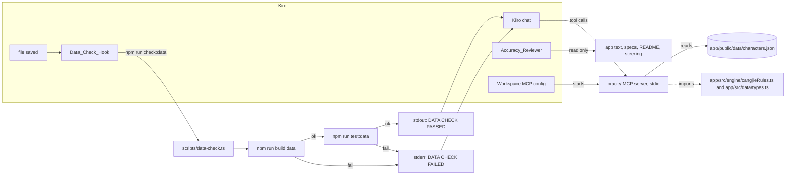

# Design Document: kiro-tooling

## Overview

This feature adds three developer tools built on Kiro features, plus an optional Power package:

1. **Data check hook.** A `PostFileSave` agent hook runs `npm run check:data` when `data/character-list.txt`, `data/prompt-overrides.csv` or `data/raw/**` is saved. The command rebuilds the dataset and runs the dataset tests, then prints a clear pass or fail line for the Kiro chat.
2. **Accuracy reviewer.** A custom agent with the `read` tool category only, and `deny` rules for writes and shell, reviews app text, specs and the README against `content-accuracy.md`.
3. **Cangjie Oracle.** A stdio MCP server in `oracle/` with three tools (`lookup`, `verify`, `decompose`) that read the committed `app/public/data/characters.json` and nothing else.
4. **Oracle Power (later task).** A Power folder in `oracle/power/` that bundles the Oracle with a skill.

The Build_Script already fails the build on an out-of-range override index (see "Existing behaviour" below), so the code change is small: a clearer command-line message and unit tests that pin the behaviour.

Property-based testing does not apply. The work is configuration files, a thin MCP wrapper over lookups in a committed JSON file, and message formatting, and the project decided on Nov 15 to add no new property tests. The Correctness Properties section is therefore omitted on purpose (the format validator's warning about it is expected), and the Oracle's accuracy is checked by exhaustive unit tests over all 300 dataset records.

### Kiro features used

| Part | Kiro feature | Why this feature |
| --- | --- | --- |
| Data check | Agent hooks, command action, `PostFileSave` | Deterministic command, no model call needed to run it; the result goes back into the chat. |
| Content review | Custom agent (`.kiro/agents/`) with `tools` and `permissions` | Restricts the reviewer to reading, so a review can never change a file. |
| Character lookups | MCP server in `.kiro/settings/mcp.json` | Gives the chat verified data instead of model memory. |
| Packaging (later) | Powers (`plugin.json`, `mcp.json`, `skills/`) | Makes the Oracle installable and demoable as one unit. |
| Rules checked | Steering (`content-accuracy.md`) | The reviewer loads the same rules the specs already follow. |
| Plan | Specs | This document set. |

### Documentation consulted

Formats below were read from the official Kiro docs on the day this spec was written (pages carry "updated" dates of Oct 8 to Nov 12, 2026):

- Hooks overview and file format: https://kiro.dev/docs/hooks/
- Hook triggers (`PostFileSave`, exit-code behaviour): https://kiro.dev/docs/hooks/types/
- Hook actions (command vs agent prompt, stdout and stderr handling): https://kiro.dev/docs/hooks/actions/
- Custom agents, creating and location: https://kiro.dev/docs/custom-agents/creating/
- Custom agent configuration reference (`tools`, `permissions`, `resources`, `prompt`): https://kiro.dev/docs/custom-agents/configuration-reference/
- MCP configuration (`.kiro/settings/mcp.json`, fields, hot reload): https://kiro.dev/docs/mcp/configuration/
- Create powers (`plugin.json`, `mcp.json`, `skills/`): https://kiro.dev/docs/powers/create/
- Steering and custom agents: https://kiro.dev/docs/steering/

### Facts the docs do not confirm

The design picks the documented approach in each case. Implementation and the demo must check these.

1. **Human saves.** The hook types page says `PostFileSave` "triggers when the agent saves or modifies files matching specific patterns". It does not say whether a save made by a person in the editor fires it. Verified by a human (approved by the human): after a window reload, a person's save of `data/prompt-overrides.csv` with a bad 吧 entryIndex made the Kiro chat report `DATA CHECK FAILED: build:data` with the entry-index message, and reverting the row reported `DATA CHECK PASSED`. So human and agent saves of the Watched_Inputs both fire the hook once hooks are loaded, and a window reload may be needed after the hook file is first created. Observation from the build session: no hook output came back to the agent after its own `str_replace` saves. This is recorded as an observation only; no requirement depends on it.
2. **Pass or fail "in the chat".** The docs say a command hook's stdout goes into the agent's context on exit 0, and stderr is sent to the agent with a notice that the hook returned an error on any other exit code. They do not describe a separate banner. The chat therefore shows the result because the agent reports it. The command prints a fixed first line (`DATA CHECK PASSED` or `DATA CHECK FAILED`) so that the report is unambiguous. A hook can run a shell command directly (confirmed), so no agent-prompt action is used.
3. **Matcher path form.** The docs say file-event matchers are a regex against the file path, and do not say whether the path is absolute or relative. The regex accepts both.
4. **MCP working directory.** The MCP config documents `command`, `args`, `env`, `disabled`, `autoApprove` and `disabledTools`, and no `cwd`. The design assumes Kiro starts the server with the workspace root as working directory and uses a workspace-relative entry path. The dataset path does not depend on the working directory.
5. **What `read` covers.** The docs say the `read` category holds "all built-in file read tools". The list of tools inside it (for example whether text search is included) is not on the pages read. The agent also lists no other tools, so the worst case is that the reviewer has fewer search tools, not that it can write.
6. **Steering in custom agents.** One page says custom agents inherit steering by default, another says steering files are not automatically included. The agent therefore lists `content-accuracy.md` as an explicit `file://` resource.
7. **Power installed from a folder or GitHub.** The docs do not say what working directory the power's `mcp.json` command runs in after installation. The Power task checks this and records the result; if relative paths fail, the Power documents that it must be installed from a clone of this repository.

## Architecture



### Module boundary decision: Oracle imports from `app/src`

Options:

| Option | Correctness | Simplicity | Reversibility |
| --- | --- | --- | --- |
| A. Oracle imports `cangjieRules.ts` and `types.ts` by relative path (as `scripts/build-data.ts` already does) | One copy of each rule | No file moves, no new package | Easy |
| B. New shared workspace package for rules and types | One copy | Moves files, touches app, scripts and tests | Costly |
| C. Oracle copies the rules | Two copies can drift | Simple | Easy, but breaks Requirement 4.8 |

**Chosen: A.** `cangjieRules.ts` is documented as import-free so that `scripts/` and others can import it by relative path, and `types.ts` is documented as shared by the app, the pipeline and the Oracle. The Oracle's `tsconfig.json` includes those two files explicitly. Only these two files are imported from `app/`; nothing React-related is reachable from them.

### Oracle runs from TypeScript source

The server starts with `tsx` (already a root dev dependency): `tsx oracle/src/index.ts`. There is no build step and no `dist/` to keep in sync. The Dataset_File is located from `import.meta.url` (`../../app/public/data/characters.json`), so it does not depend on the working directory.

## Components and Interfaces

### 1. Pipeline change: `scripts/build-data.ts`

**Existing behaviour (checked in the code).** `validateOverrideRange` returns `entry-index-out-of-range` or `meaning-index-out-of-range`; the main loop records a `MissingFieldError` with `overrideError`; unknown characters are collected as `unknown-character`; `buildDataset` then returns `{ ok: false, errors, cangjieErrors }` and no output; `main()` writes nothing and sets `process.exitCode = 1`. So a bad index already fails the build. Two gaps remain: the command-line message is only `比: override: entry-index-out-of-range`, with no hint about which file or column to fix, and no unit test builds a full dataset with a bad override index (the existing coverage is `prompt.test.ts` for `selectPrompt` and a property test in `tests/property/prompt-overrides.test.ts`).

**Change.** Export `formatError` and extend it so an override error line reads, for example:

```
比: override entry-index-out-of-range: entryIndex is larger than the number of CC-CEDICT entries for this character. Fix this row in data/prompt-overrides.csv (column entryIndex).
```

The three messages are held in a `const OVERRIDE_ERROR_HELP: Record<PromptOverrideFailure, string>` map so that a new reason added to `PromptOverrideFailure` fails to compile until it has a message. No change to `buildDataset`, the types, or the written files.

### 2. `scripts/data-check.ts` and npm scripts

```ts
export interface CheckStep { name: string; command: string; args: string[] }
export interface StepResult { status: number | null; output: string } // output = stdout + stderr
export type StepRunner = (step: CheckStep) => StepResult
export interface CheckOutcome { exitCode: 0 | 1; stdout: string; stderr: string }

export const DATA_CHECK_STEPS: readonly CheckStep[]   // build:data, then test:data
export function runDataCheck(steps: readonly CheckStep[], run: StepRunner): CheckOutcome
export function tailLines(text: string, count: number): string
```

- `runDataCheck` runs steps in order and stops at the first step whose `status` is not `0` (including `null`, which covers a command that cannot start or is killed). Success returns `stdout = "DATA CHECK PASSED: build:data and test:data succeeded\n"`. Failure returns `stderr = "DATA CHECK FAILED: <step name>\n" + tailLines(output, 40)`.
- The real runner uses `spawnSync('npm', ['run', ...], { encoding: 'utf8', cwd: repoRoot })` and joins stdout and stderr. This matters because Vitest prints failures on stdout, while the hook forwards only stderr on failure.
- `main()` runs only when the file is executed directly, using the same ESM guard as `build-data.ts`.

`package.json` (root) gains:

```json
"test:data": "vitest run --project node",
"check:data": "tsx scripts/data-check.ts",
"oracle": "tsx oracle/src/index.ts"
```

`vitest run --project node` was run against the repo during design and selects only the `node` project (`tests/**/*.test.ts`), which holds the dataset tests and their existing property tests.

### 3. Hook: `.kiro/hooks/data-check-on-save.json`

```json
{
  "version": "v1",
  "hooks": [
    {
      "name": "Data check on save",
      "description": "Rebuilds the dataset and runs the dataset tests when the build inputs are saved.",
      "trigger": "PostFileSave",
      "matcher": "(^|/)data/(character-list\\.txt|prompt-overrides\\.csv|raw/.+)$",
      "action": { "type": "command", "command": "npm run check:data --silent" },
      "timeout": 300
    }
  ]
}
```

- The matcher requires `data/` followed by one of the three watched locations. `app/public/data/characters.json` does not match, because after `data/` comes `characters.json`. `data/prompt-review.csv` does not match. The build's own outputs therefore never retrigger the hook.
- `timeout` is 300 seconds because the default of 60 may be too short for a build plus the full node test project.
- Hook files are standalone JSON in `.kiro/hooks/`, active when a session starts, per the docs.

### 4. Agent: `.kiro/agents/accuracy-reviewer.json` and `accuracy-reviewer.prompt.txt`

```json
{
  "name": "accuracy-reviewer",
  "description": "Read-only reviewer: checks app text, specs and README against content-accuracy.md.",
  "prompt": "file://./accuracy-reviewer.prompt.txt",
  "tools": ["read"],
  "includeMcpJson": false,
  "permissions": {
    "rules": [
      { "capability": "fs_write", "match": ["**"], "effect": "deny" },
      { "capability": "shell", "match": ["*"], "effect": "deny" }
    ]
  },
  "resources": [
    "file://.kiro/steering/content-accuracy.md",
    "file://.kiro/steering/product.md",
    "file://data/raw/SOURCES.md"
  ],
  "welcomeMessage": "Accuracy reviewer ready. I only read files; I never change them."
}
```

- Read-only is enforced twice: the `tools` list gives the agent no write or shell tool, and `deny` rules win over any allow ("a deny in any scope wins"). `includeMcpJson: false` keeps the Oracle's or any other server's tools out of this agent.
- The prompt is a `.txt` file so that Kiro does not treat it as an agent definition (Markdown files in `.kiro/agents/` are agent definitions).
- Prompt content (the checklist):
  1. Scope: `app/src/**` strings and `app/index.html`, `.kiro/specs/**`, `README.md`.
  2. Rule 1, sourced claims: any factual claim about Chinese, Cangjie, statistics or exams needs a source in the Accuracy_Rules or `SOURCES.md`.
  3. Rule 2, History_Claims: only the four claims, each citing the two Wikipedia articles.
  4. Rule 3: report any "dead" or "dying" said of Cangjie (case-insensitive, also "obsolete", "extinct").
  5. Rule 4, licences: the README names CC-CEDICT (CC BY-SA 4.0), hanzi-writer-data (Arphic Public License), Make Me a Hanzi (LGPL-3.0-or-later), HSK 3.0 list (MIT), Unihan (Unicode License V3).
  6. Rule 5, Answer_Leak: a hidden character rendered as text, `aria-label`, `title`, `alt`, `data-*` or a test id before it is written.
  7. Output: one line per finding as `path:line  [rule]  "quoted text"`, then a one-line fix hint that quotes no new character data; or `No findings` followed by the list of files checked.
- The agent reports; it never edits. A human or the main agent applies fixes.

### 5. Oracle: `oracle/`

```
oracle/
├── package.json        # workspace "ghost-script-oracle", exact-pinned deps
├── tsconfig.json       # strict; include oracle/src, oracle/tests, the two app/src files
├── vitest.config.ts    # project name "oracle", environment node, include tests/**/*.test.ts
├── src/
│   ├── dataset.ts      # loadDataset(path): Map<string, CharacterRecord>; throws OracleDataError
│   ├── oracle.ts       # pure lookup / verify / decompose over a dataset
│   ├── server.ts       # createServer(dataset): McpServer with the three tools
│   └── index.ts        # main(): load, connect StdioServerTransport; errors to stderr, exit 1
├── tests/
│   ├── oracle.test.ts
│   ├── server.test.ts
│   └── no-network.test.ts
└── power/              # later task
```

Dependencies (exact versions, as the repo pins): `@modelcontextprotocol/sdk` (v1 line) and `zod` (a version in the SDK's peer range `^3.25 || ^4.0`). The versions are recorded at install time in task 4.1. `oracle` is added to the root `workspaces` array and to `vitest.workspace.ts` as `./oracle`, which makes `npm test` run its tests. This is the one change to the test workspace and it is needed because the root `node` project only includes `tests/**`.

`oracle.ts` (pure, no I/O; all tool logic lives here so it can be unit tested without MCP):

```ts
import { isPlayableInCangjie, isValidCangjieCode } from '../../app/src/engine/cangjieRules';
import type { CharacterRecord } from '../../app/src/data/types';

export type Dataset = ReadonlyMap<string, CharacterRecord>;

export const CANGJIE_SOURCE = { dataset: 'unihan', version: '18.0.0', field: 'kCangjie', provisional: true } as const;
export type CangjieSource = typeof CANGJIE_SOURCE;

export type NotFound = { found: false; character: string; reason: 'not-in-dataset' };
export type LookupResult =
  | { found: true; character: string; cangjie: string | null; source: CangjieSource | null; playable: boolean }
  | NotFound;
export type VerifyResult =
  | { found: true; character: string; normalisedCode: string; matches: boolean; source: CangjieSource | null; reason?: 'no-code-in-source' }
  | NotFound;
export type DecomposeResult =
  | { found: true; character: string; ids: string; atomic: boolean; radical: string; components: string[]; source: { dataset: 'make-me-a-hanzi' } }
  | NotFound;

export class OracleInputError extends Error {}          // invalid input, becomes an MCP tool error

export function parseCharacterInput(value: unknown): string   // throws OracleInputError
export function parseCodeInput(value: unknown): string        // throws OracleInputError
export function lookup(dataset: Dataset, character: unknown): LookupResult
export function verify(dataset: Dataset, character: unknown, code: unknown): VerifyResult
export function decompose(dataset: Dataset, character: unknown): DecomposeResult
```

- `parseCharacterInput` accepts exactly one code point (`[...value].length === 1`) in U+4E00 to U+9FFF, which is the range the character-dataset spec restricts records to. Anything else, including an empty string, several characters, Latin letters and non-strings, throws `OracleInputError` with a message such as `character must be exactly one CJK Unified Ideograph (U+4E00 to U+9FFF), got "ab"`.
- `parseCodeInput` requires a string, converts it with `toUpperCase()`, then validates the result with `isValidCangjieCode` (pattern `^[A-Y]{1,5}$`, not restated) and returns the normalised code. `hqi` becomes `HQI`. `hqz` (Z is outside A to Y) and `abcdef` (six letters) are rejected. The error message names the argument `code` and the pattern `A-Y, 1 to 5 letters`.
- `lookup` returns `source: CANGJIE_SOURCE` only when `record.sources.cangjie === 'unihan'` and `record.cangjie !== null`; otherwise `cangjie: null`, `source: null`, `playable: false`. `playable` is `isPlayableInCangjie(record.cangjie)`.
- `verify` compares the normalised code with `record.cangjie` by strict equality (the dataset stores the verbatim Unihan value) and returns the normalised code as `normalisedCode`. For 我, `verify("我", "hqi")` returns `matches: true, normalisedCode: "HQI"`. A null stored code gives `matches: false, reason: 'no-code-in-source'`. It does not return the stored code, so `verify` stays a yes or no check; `lookup` is the tool that returns it.
- `decompose` copies `decomposition.decomposition`, `atomic`, `radical` and `components` from the record.
- A valid character with no record returns the `NotFound` object, never an error and never a guess.
- `CANGJIE_SOURCE.version` is a constant. A unit test reads `data/raw/SOURCES.md` and checks it still states `Unicode version:** 18.0.0`, so the constant cannot drift from the recorded source silently.

`dataset.ts`: `loadDataset(path = defaultDatasetPath())` reads the file with `node:fs`, parses JSON, and builds a `Map` keyed by `character`. It throws `OracleDataError` (message includes the path) if the file is missing, is not valid JSON, or is not an object of records. The default path is `fileURLToPath(new URL('../../app/public/data/characters.json', import.meta.url))`.

`server.ts`: `createServer(dataset)` builds an `McpServer({ name: 'cangjie-oracle', version })` and registers three tools with `registerTool`, each with a `zod` input shape (`character: z.string()`; `verify` adds `code: z.string()`), a one-sentence description, and a handler that calls the pure function. A handler returns `{ content: [{ type: 'text', text: JSON.stringify(result) }], structuredContent: result }`. If the pure function throws `OracleInputError`, the handler returns `{ isError: true, content: [{ type: 'text', text: error.message }] }`. Input validation lives in `oracle.ts`, not only in zod, so the messages are ours. The exact SDK call signatures are checked against the installed version in task 4.4.

`index.ts`: loads the dataset (on `OracleDataError`, writes `cangjie-oracle: <message>` to stderr and sets exit code 1), then connects `StdioServerTransport`. It never writes to stdout except through the transport. Nothing in `oracle/src` imports `node:http`, `node:https`, `node:net`, `node:dgram` or `node:tls`, or calls `fetch`, and no code reads `process.env`.

### 6. Workspace MCP config: `.kiro/settings/mcp.json`

```json
{
  "mcpServers": {
    "cangjie-oracle": {
      "command": "npx",
      "args": ["--no-install", "tsx", "oracle/src/index.ts"],
      "disabled": false,
      "autoApprove": ["lookup", "verify", "decompose"]
    }
  }
}
```

`--no-install` makes `npx` use the locally installed `tsx` and never download anything. There is no `env`, `url` or `headers`. The file hot-reloads when saved, per the docs. The directory `.kiro/settings/` does not exist yet and is created by the task. `.gitignore` already contains `!.kiro/`, and nothing in it ignores `.kiro/`.

### 7. Oracle Power (later task): `oracle/power/`

```
oracle/power/
├── plugin.json
├── mcp.json
└── skills/cangjie-oracle/SKILL.md
```

- `plugin.json`: `$schema` `https://agent-plugins.org/schemas/1.0.0/plugin.schema.json`, `name` `cangjie-oracle`, `version` `1.0.0`, a one-sentence `description`, `author: { "name": "Ghost Script" }` (a project name, no personal name), `keywords` such as `cangjie`, `chinese`, `character`, `decomposition`, `ghost-script`, and `license` `MIT`.
- `mcp.json`: `$schema` `https://agent-plugins.org/schemas/1.0.0/mcp.schema.json`; one stdio server with the same command and args as the workspace config; no `env`.
- `SKILL.md`: front matter `name` and `description`, then short steps: call `lookup` for the code and playable flag, `verify` to check a code a person typed, `decompose` for IDS parts; report `found: false` as "not in the dataset", never fill the gap from memory.
- Install path for the demo: Kiro → Powers panel → Add Custom Power → Import power from a folder.
- **Superseded by section 8.** The `mcp.json` described here (same `npx --no-install tsx oracle/src/index.ts` as the workspace config) failed after a real import: Kiro reported `MCP server "power-power-cangjie-oracle" failed to connect: Connection closed`, because `oracle/src/index.ts` is a repository-relative path that does not exist where an installed Power runs. Section 8 replaces the command with a bundled server.

### 8. Self-contained Power (follow-up, approved by the human)

#### What the investigation found (read-only, checked in the repository)

| Question | Finding |
| --- | --- |
| Current `oracle/power/mcp.json` | `$schema` `https://agent-plugins.org/schemas/1.0.0/mcp.schema.json`, one server `cangjie-oracle` with `"type": "stdio"`, `"command": "npx"`, `"args": ["--no-install", "tsx", "oracle/src/index.ts"]`. No `env`, no `cwd`. The `$schema` and `type` are already present and are kept. |
| Current `.kiro/settings/mcp.json` | Same `npx --no-install tsx oracle/src/index.ts` command, `"disabled": true` (set by the human for the import test only, uncommitted; the human sets `disabled: false` again after the test) and `autoApprove` for the three tools. No task edits it. |
| Server entry | `oracle/src/index.ts` calls `loadDataset()` with no argument; `oracle/src/dataset.ts` `defaultDatasetPaths()` resolves `../../app/public/data/{characters,characters-level2,characters-level3}.json` from `import.meta.url`. `loadDataset(paths)` accepts any list of paths and validates the shape of each record (`isRecordLike`). |
| Fields the tools read | `lookup` and `verify` read `record.cangjie` and `record.sources.cangjie`; `lookup` also calls `isPlayableInCangjie(record.cangjie)`. `decompose` reads `record.decomposition.decomposition`, `.atomic`, `.radical` and `.components`. The input check uses only the key. `loadDataset` additionally requires `character` and an object `sources`. Nothing else (pinyin, meanings, strokes, `strokeData`, `prompt`, `summonInk`, the other `sources` keys, `decomposition.etymology` and `decomposition.matches`) is read. |
| Data size | The three Level_Datasets hold 1,200 records and are 4,548,339 bytes raw, 1,397,753 bytes gzip (level 9), because `strokeData` dominates. The derived file with only the fields above, written with `JSON.stringify` and no spaces, measured 193,855 bytes raw and 26,890 bytes gzip for the same 1,200 records. |
| esbuild | Installed. `node_modules/esbuild` is 0.25.12 (hoisted from `tsx` 4.19.3, listed in `package-lock.json`); `app` has its own `vite` copy 0.21.5 under `app/node_modules`. It is not a direct dependency of the repository, so the plan adds it to the root `devDependencies` pinned to `0.25.12`, which changes no installed version. |
| Probe bundle | `esbuild` of `oracle/src/index.ts` (`bundle`, `platform: node`, `format: esm`, `target: node20`, `legalComments: eof`): 1,368,355 bytes unminified (230,191 gzip) and 735,246 bytes minified (170,105 gzip). The unminified probe contained no `/Users/` path. These are estimates; the checkpoint reports the real numbers. |
| Existing oracle tests | `oracle/tests/oracle.test.ts`, `server.test.ts`, `no-network.test.ts` (in-process, read the Level_Datasets). Root: `tests/unit/oracle-power.test.ts` asserts that the Power `mcp.json` has the same `command` and `args` as the workspace config (this assertion must change) and `tests/unit/mcp-config.test.ts`. |
| Test that already fails | `tests/unit/mcp-config.test.ts` case "is enabled" expects `disabled === false`, but the human set `disabled: true` for the import test, so it fails now (checked by running it: 1 failed, 7 passed). It is a known, expected failure until the human re-enables the server; the test is not changed and the config is not edited by this work. |
| Root scripts | Workspaces `app` and `oracle`; scripts `build:data`, `test`, `test:e2e`, `check:data`, `check:bundle`, `oracle` and others, no `build:power`. `check:bundle` gzips only `app/dist`, so files in `oracle/power/` do not count against the app budget. |
| Licences on disk | `data/raw/unihan/LICENSE` (Unicode License V3) and `data/raw/make-me-a-hanzi/LICENSE` and `LGPL` (GNU LGPL v3.0 or later), as listed in the README table. |

#### Official reference for `mcp.json`

Source: the Kiro Powers reference, `power-builder/skills/agent-plugins-reference/SKILL.md` in https://github.com/kirodotdev/powers (read by the human). Facts used: the variable is `${PLUGIN_ROOT}`, the absolute path of the plugin directory; expansion applies to `args` elements, `env` values and `cwd`, not to `command`; `command` is a single token and a bare name is found through the executable search path; `cwd` must start with `./`, `${PLUGIN_ROOT}` or `${PLUGIN_DATA}`; the file should carry `"$schema": "https://agent-plugins.org/schemas/1.0.0/mcp.schema.json"` and `"type": "stdio"` per server.

#### Layout

```
oracle/power/
├── plugin.json            # unchanged
├── mcp.json               # rewritten (below)
├── server.mjs             # GENERATED: the Power_Bundle (committed)
├── data/oracle-data.json  # GENERATED: the Power_Data (committed)
├── NOTICE.md              # GENERATED licence note (below), committed
├── licenses/              # GENERATED copies of the licence files named in NOTICE.md, committed
└── skills/cangjie-oracle/SKILL.md   # one paragraph updated: the Power reads its own data copy
```

The generated files (`server.mjs`, `data/oracle-data.json`, `NOTICE.md` and `licenses/`) are written only by `npm run build:power`, never by hand, in the same way `characters.json` is written only by `scripts/`. They are committed because Kiro imports the Power from the folder.

#### Power entry point and data location

A new file `oracle/src/power.ts` is the only entry point of the bundle. It differs from `index.ts` in one place: it loads `new URL('./data/oracle-data.json', import.meta.url)` through `loadDataset`, so the path is resolved against the bundle file, which sits in the Power root next to `data/`. `dataset.ts` gains one exported function, `powerDatasetPath(): string`, that returns that path; `loadDataset`, `OracleDataError` and the record validation are reused unchanged, so a missing or corrupt data file still produces the stderr message and exit code 1 of Requirement 5.7. `index.ts`, `defaultDatasetPaths` and the workspace registration are not changed. The working directory is never read: `process.cwd()` is not used, and the `cwd` of `mcp.json` is set to the Power root only to keep the process in a known place.

`server.ts`, `oracle.ts` and `dataset.ts` need no other change. The bundle contains `oracle.ts`, which imports `cangjieRules.ts` and `types.ts` from `app/src`, so the code that decides `playable` and code validity is the same code the app uses (Requirement 4.8 stays true).

#### Data format: derived file with only the fields the tools read (chosen)

| Option | Answers identical | Size | Cost |
| --- | --- | --- | --- |
| A. Copy the three Level_Datasets | Yes, trivially | 4.5 MB raw, 1.4 MB gzip in the repo | Large generated file; two more copies of `strokeData` |
| B. Derived file with the fields the tools read (chosen) | Yes, proved by the Power_Staleness_Test over all 1,200 characters and all three tools | about 194 kB raw, about 27 kB gzip | One small pure function; the test guards it |

Chosen: B. Shape (the same shape `isRecordLike` validates, so `loadDataset` reads it without change):

```json
{"明":{"character":"明","cangjie":"AB","sources":{"cangjie":"unihan"},"decomposition":{"decomposition":"⿰日月","atomic":false,"radical":"日","components":["日","月"]}}}
```

Rules for `deriveOracleData(levelDatasets)` in `scripts/build-power.ts`: take the three Level_Datasets in the order level 1, 2, 3 and keep each file's key order; copy exactly the fields listed in Requirement 10.3 and no others; `JSON.stringify(object)` with no indentation, followed by one `\n`. The value of `sources.cangjie` is copied as it is, so the `source` result of `lookup` and `verify` stays identical. A character that appears in two files fails the build, as `loadDataset` already does. All values are copied from the Level_Datasets and none is typed or generated, so Hard rule 1 of `content-accuracy.md` holds.

The type of a Power_Data record is `Pick<CharacterRecord, 'character' | 'cangjie'>` plus `sources: Pick<CharacterRecord['sources'], 'cangjie'>` and a `decomposition` with the four fields. The type is declared in `scripts/build-power.ts` and checked against `CharacterRecord`, so a rename of a source field fails `tsc`.

#### Licence record (Requirement 10.6)

Power_Data copies Unihan `kCangjie` codes (Unicode License V3) and Make Me a Hanzi decomposition fields (LGPL-3.0-or-later), so it is data derived from those sources and keeps their terms, as `characters.json` does. The Power records this in three places:

1. `oracle/power/NOTICE.md` (generated by `npm run build:power` from a template in `scripts/build-power.ts`, committed): says what `data/oracle-data.json` and `server.mjs` are and how to rebuild them; names the two sources with version or commit, field, licence and URL (held as constants in the script, and a test checks that each licence name and version also appears in the README table, which the README states come from `data/raw/SOURCES.md`); states that the data copy stays under those licences and the code under MIT; lists every npm package that ends up in the bundle (the SDK, `zod` and their runtime dependencies) with name, version and licence read from each package's own `package.json`; and lists no CC-CEDICT, Arphic or HSK data, because the Power_Data contains no field from them. The README states the same.
2. `oracle/power/licenses/`: byte copies of `data/raw/unihan/LICENSE` as `unihan-LICENSE.txt`, and of `data/raw/make-me-a-hanzi/LICENSE` and `LGPL` as `make-me-a-hanzi-LICENSE.txt` and `make-me-a-hanzi-LGPL.txt`, plus the licence files of the bundled npm packages as `npm-<name>-LICENSE.txt`. The build script writes these copies so that they cannot drift, and the Power_Staleness_Test compares them with their originals.
3. The bundle itself keeps the packages' own licence comments (`legalComments: 'eof'`), which the esbuild documentation describes as moving legal comments to the end of the output file.

The existing `app/public/THIRD_PARTY_NOTICES.txt` covers the app's runtime dependencies only and is unchanged. Its test (`tests/unit/third-party-notices.test.ts`) is unaffected because the Power adds no app dependency. The README "Data and licences" section gains one sentence naming `oracle/power/data/oracle-data.json` as a further derived file with the same terms.

#### `scripts/build-power.ts` and the deterministic build

```ts
export interface PowerFile { path: string; contents: string | Uint8Array }  // path relative to the repo root
export function deriveOracleData(levels: readonly Record<string, CharacterRecord>[]): string
export async function buildPowerFiles(): Promise<PowerFile[]>   // reads inputs, writes nothing
export async function main(): Promise<void>                      // writes every PowerFile; direct-execution guard as in build-data.ts
```

`buildPowerFiles` is pure with respect to the repository: it reads inputs and returns the exact bytes of `oracle/power/server.mjs`, `oracle/power/data/oracle-data.json`, `oracle/power/NOTICE.md` and the files under `oracle/power/licenses/`. It writes nothing. `main()` is the only writer, so the command writes only those paths (Requirement 10.7).

esbuild is called through its JavaScript API with `write: false`, so the output is held in memory:

| Option | Value | Reason |
| --- | --- | --- |
| `entryPoints` | `['oracle/src/power.ts']` | The one entry. |
| `absWorkingDir` | the repository root, resolved from the script's `import.meta.url` | Comment paths such as `// ../node_modules/zod/...` are relative to it, so no machine-specific path enters the file. |
| `bundle`, `platform` | `true`, `'node'` | Dependencies included; Node built-ins stay external. |
| `format`, `outExtension` | `'esm'`, `.mjs` | The bundle uses `import.meta.url` to find its data, which needs ESM; the `.mjs` extension makes plain `node` treat it as ESM with no `package.json` or `"type"` field in the Power folder. |
| `target` | `'node20'` | Fixed. |
| `banner.js` | `import{createRequire as __cr}from"node:module";const require=__cr(import.meta.url);` | Some bundled CommonJS dependencies call `require` for Node built-ins, which fails in an ES module bundle without it. The probe bundle used the same banner. |
| `minify` | `true` | Smaller file (about 735 kB against 1.37 MB). The source stays readable in `oracle/src`; the bundle is a build artefact. |
| `legalComments` | `'eof'` | Keeps the packages' licence notices (MIT requires them) in one place at the end. |
| `metafile` | `true`, read in memory only | Lists the `node_modules` packages in the bundle, in sorted order, for NOTICE.md and `licenses/`; never written to disk. |
| `sourcemap`, `splitting`, `define`, `plugins` | none or `false` | No second output, no environment value, no timestamp. |
| `logLevel` | `'silent'` | Warnings are read from `result.warnings` and make the build fail. |
| `tsconfig` | `oracle/tsconfig.json` | Same compiler settings as the type check. |

Determinism: esbuild output depends only on the inputs and options, and no option above injects a time, a random value or an absolute path. The script normalises line endings to `\n` and the test also asserts that the output contains no `/Users/` or `C:\\` path and no ISO date. The same `esbuild` version (0.25.12) and the exact-pinned `@modelcontextprotocol/sdk` and `zod` versions are fixed in `package.json` and `package-lock.json`, so a different machine produces the same bytes. If the esbuild version is changed on purpose, the bundle changes and the Power_Staleness_Test asks for a rebuild, which is the intended behaviour.

#### How the tests build and compare

The Power_Staleness_Test calls `buildPowerFiles()` in the same process and compares each returned file with the committed file byte by byte. No temporary directory is needed, because `write: false` keeps the fresh build in memory and nothing under the repository is touched. Failure message: `oracle/power/server.mjs is out of date. Run npm run build:power and commit the result.` It then checks the answers: it loads the Power_Data through `loadDataset` and the Level_Datasets through `loadDataset`, and for each of the 1,200 characters compares `lookup`, `verify` (the stored code, and a wrong valid code taken from another record) and `decompose` results with `toEqual`; it asserts the key sets are equal and the count is 1,200. This second check explains a data difference in plain terms even if the byte comparison also fails.

The Power_Standalone_Test (the only test that needs a temporary directory) does the following:

1. `mkdtemp` under `os.tmpdir()`, assert the path does not start with the repository root, copy `oracle/power/` into it with `cpSync(..., { recursive: true })`.
2. Assert that no ancestor directory of the copy holds a `node_modules` directory and that `NODE_PATH` is unset in the child environment.
3. Start `process.execPath` with `[<copy>/server.mjs]` through the SDK `StdioClientTransport` with `cwd` set to the copy and an environment holding only the SDK's default variables (no repository path). This is the same launch Kiro performs from `mcp.json` (`command: node`, `args: [${PLUGIN_ROOT}/server.mjs]`, `cwd: ${PLUGIN_ROOT}`), with `${PLUGIN_ROOT}` replaced by the copy. The test reads `oracle/power/mcp.json` and asserts that `command`, `args` and `cwd` are exactly that form, and builds the launch from the file, so the test and the file cannot disagree.
4. `listTools` returns exactly the three tools. For 明, and for one character of level 1, one of level 2 and one of level 3 (the first record with a non-null code in each file, chosen by the test), the expected values are computed from the record in the app dataset: `lookup` gives `cangjie`, `source` and `playable` (using `isPlayableInCangjie`); `verify` with the stored code gives `matches: true`; `decompose` gives the stored four fields. 明 also asserts that the stored code is `AB`, which is the value of its Unihan record.
5. `verify` for 明 with a valid wrong code (`A`, which differs from `AB`) gives `matches: false`; `verify` with `hqz` and with a six-letter code gives `isError: true`; a valid character outside the dataset gives `found: false`.
6. In `finally`, close the client and remove the temporary directory (`rmSync`, `force: true`).

The test has a 30 second timeout. It spawns one Node process.

#### Workspace config check (Requirement 10.13)

`.kiro/settings/mcp.json` is not edited by this work, and no task edits it. There is no digest and no byte-comparison test, because such a pin would break as soon as the human re-enables the server. The final checkpoint runs `git diff -- .kiro/settings/mcp.json` and `git status` and confirms that this work did not change the file. The only difference allowed is the human's own change of the `disabled` key.

The human disabled the server (`disabled: true`) only for the import test, and re-enables it (`disabled: false`) after that test. `tests/unit/mcp-config.test.ts` is not changed: its case "is enabled" keeps expecting `disabled === false`, so it fails while the server is disabled. That one failure is known and expected; the final checkpoint reports it by name and every other test must pass. After the import test the human sets `disabled: false` and runs `npx vitest run tests/unit/mcp-config.test.ts`, which then passes. No test is weakened.

#### Keeping the generated files in sync

The Power_Staleness_Test lives in `tests/unit/`, which the root `node` project includes, so it runs in `npm test`, in `npm run test:data`, and therefore in `npm run check:data` and in the Data_Check_Hook. A save of a Watched_Input rebuilds `characters.json`; the next test step then fails with "run `npm run build:power`" if the Power_Data now differs. The hook is not changed and does not run the build for the person, because a hook that rewrites committed files on every save would hide a data change from review. The same test also fails when a file under `oracle/src` that the bundle includes, `app/src/engine/cangjieRules.ts`, `app/src/data/types.ts` or a pinned dependency changes.

#### Repository-wide checks with a large generated file

- `tests/unit/no-personal-names.test.ts` reads every tracked text file with `readFileSync` and a regular expression. A 735 kB bundle and a 194 kB data file add well under 1 MB, so no exclusion is planned. The Power_Staleness_Test asserts the bundle has no absolute path, so it cannot contain a home directory name. If the scan is found to be slow or to match, the fallback is to exempt exactly `oracle/power/server.mjs` in `isExempt`, and the exemption is stated in the README.
- `check:bundle` gzips `app/dist` only; the Power files are not copied into `app/dist` (`app/public` is the only folder Vite copies), so the app budget of 300,000 bytes is unaffected. The checkpoint runs the check and reports the number.
- `tsc` for the root includes `scripts/**/*.ts`, so `scripts/build-power.ts` is type-checked. The generated `.mjs` file is not part of any `tsconfig` `include`.

## Data Models

No new persisted data. Result types are listed under `oracle.ts`. Example tool results (the code `M` for 一 is the value in the committed dataset):

```json
{ "found": true, "character": "一", "cangjie": "M",
  "source": { "dataset": "unihan", "version": "18.0.0", "field": "kCangjie", "provisional": true },
  "playable": true }
```

```json
{ "found": false, "character": "龘", "reason": "not-in-dataset" }
```

## Error Handling

| Situation | Behaviour |
| --- | --- |
| Override index out of range, or unknown override character | `buildDataset` returns `ok: false`; `main()` prints one line per character with the reason and the CSV file and column to fix; exit code 1; no files written. `check:data` then reports `DATA CHECK FAILED: build:data` plus the last 40 lines. |
| Dataset test fails after a good build | `check:data` reports `DATA CHECK FAILED: test:data` plus the last 40 lines of Vitest output. |
| `npm` cannot start or the step is killed by the timeout | `status` is `null`; treated as a failed step. |
| Oracle: invalid character or code argument | MCP tool result with `isError: true` and a message naming the argument and rule. |
| Oracle: valid character not in the dataset | Normal result with `found: false`, `reason: 'not-in-dataset'`. |
| Oracle: dataset file missing or invalid | Message on stderr naming the file, exit code 1, no tools served. |
| Hook file newly created and not yet loaded | No hook fires until the window is reloaded (see Decisions, item 1). `npm run check:data` is the on-demand fallback and is documented in the README. |

## Testing Strategy

Property-based testing does not apply, and none is added (decision of Nov 15 in `tech.md`). All new tests are Vitest unit tests. The Oracle's accuracy against the dataset is covered by exhaustive loops over the 300 real records, in the same way as `tests/unit/cangjie-dataset.test.ts`.

- `tests/unit/build-override-errors.test.ts` (node project). Builds a minimal fixture set (as `build-summary.test.ts` does with temporary directories) with an override whose `entryIndex` is out of range, then `meaningIndex` out of range, then an unknown character. Asserts `buildDataset` returns `ok: false`, the right `overrideError` for the right character, and that no output is produced. Asserts `formatError` text contains the character, the reason, `data/prompt-overrides.csv` and the column name. Asserts a valid override still builds. Requirements 2.1 to 2.5.
- `tests/unit/data-check.test.ts`. A fake `StepRunner` drives `runDataCheck`: both steps pass → exit 0 and a first line starting `DATA CHECK PASSED`; build fails → exit 1, tests never run, stderr starts with `DATA CHECK FAILED`, names `build:data` and holds at most 40 tail lines; tests fail → names `test:data`; `status: null` → failed. `tailLines` edge cases (fewer lines than the count, empty text). Requirements 1.4 to 1.7.
- `tests/unit/kiro-hook.test.ts`. Parses `.kiro/hooks/data-check-on-save.json`: `version` `v1`, trigger `PostFileSave`, action type `command`, command runs `check:data`, timeout 300. Compiles the matcher and checks it matches `data/character-list.txt`, `data/prompt-overrides.csv`, `data/raw/unihan/Unihan_DictionaryLikeData.txt` as relative and as absolute paths, and does not match `app/public/data/characters.json`, `data/prompt-review.csv` or `app/src/App.tsx`. Checks the root `package.json` has the scripts `check:data` and `test:data`. Requirements 1.1 to 1.3.
- `tests/unit/accuracy-reviewer-agent.test.ts`. Parses `.kiro/agents/accuracy-reviewer.json`: `tools` equals `["read"]`; `deny` rules exist for `fs_write` and `shell`; no `allow` rule for either; `content-accuracy.md` is in `resources`; the prompt file exists and mentions the four History_Claims topics, "dead", "dying", "licence", "answer", `path:line` and `No findings`. Requirements 3.1 to 3.8 (file contents only; the agent's live behaviour is shown in the demo).
- `oracle/tests/oracle.test.ts` (oracle project). With a small in-memory dataset: `lookup` for a coded character, a character with an X-prefixed code (the real 别 has `XRSLN` and 错 has `XCTA`: the code is returned and `playable` is false), a character with a null code (in-memory fixture only), a not-in-dataset character; `verify` match, mismatch, and no-code; `decompose` atomic and composite; `verify` cases: `("我", "hqi")` → `matches: true` with `normalisedCode: "HQI"`; a wrong valid code → `matches: false`; `("我", "hqz")` and `("我", "abcdef")` → `OracleInputError` (invalid after normalising); a valid but unknown character → `found: false, reason: 'not-in-dataset'`. Every invalid input (empty, two characters, Latin, hiragana, non-string character; non-string, empty, `Z`-containing or six-letter code) throws `OracleInputError`. An exhaustive loop over the real `characters.json`: for each of the 300 records, `lookup` returns the record's code verbatim, `source` is non-null exactly when `sources.cangjie === 'unihan'`, `playable` equals `isPlayableInCangjie(code)`, `verify(char, code)` is `matches: true`, and `decompose` returns the stored fields. A check that `SOURCES.md` still states Unicode version 18.0.0. Requirements 4.3 to 4.8, 5.1 to 5.4.
- `oracle/tests/server.test.ts`. Connects an SDK `Client` to `createServer(dataset)` through the SDK's in-memory transport pair. Asserts `listTools` returns exactly `lookup`, `verify`, `decompose`; a call returns the same JSON as the pure function; an invalid argument returns `isError: true`. A second test runs `loadDataset` on a missing path and on a file with invalid JSON and expects `OracleDataError` naming the path (the process-exit path in `index.ts` is a three-line wrapper checked by hand in the demo). Requirements 4.1, 4.2, 5.3, 5.4, 5.6.
- `oracle/tests/no-network.test.ts`. Reads every file in `oracle/src` and asserts none imports `node:http`, `node:https`, `node:net`, `node:tls`, `node:dgram` or `node:dns`, none calls `fetch(`, none references `process.env`, and `console.log` is not used (stdout is reserved for the protocol). Requirements 5.5, 5.7.
- `tests/unit/mcp-config.test.ts`. Parses `.kiro/settings/mcp.json`: server `cangjie-oracle`, `command` and `args` present, no `env`, `url`, `headers`; `autoApprove` equals the three tool names; and the file named in `args` exists. Requirements 6.1 to 6.3.
- Power (later task): `tests/unit/oracle-power.test.ts` parses `plugin.json`, `mcp.json` and the `SKILL.md` front matter for the required fields, and checks no `env` or `url`. Requirements 7.1 to 7.3.
- Self-contained Power (Requirement 10), unit tests only, no property-based tests (Nov 15 decision; the answer comparison is an exhaustive loop over the 1,200 real records, like `tests/unit/cangjie-dataset.test.ts`):
  - `oracle/tests/power.test.ts`: `powerDatasetPath()` ends in `data/oracle-data.json` next to the module and does not depend on `process.cwd()` (the test changes the working directory and compares); `loadDataset` on a missing Power_Data path throws `OracleDataError` naming the path. Requirements 10.2.
  - `tests/unit/oracle-power-build.test.ts` (Power_Staleness_Test): fresh `buildPowerFiles()` equals the committed files byte for byte; answers equal over 1,200 characters and three tools; `deriveOracleData` keeps exactly the seven fields (a record with extra fields loses them); a duplicated character fails; the bundle has no `/Users/` or drive-letter path; `NOTICE.md` names Unicode License V3 and LGPL-3.0-or-later and the README table lists both; `licenses/` copies equal `data/raw/` originals; the bundle runs no `tsx`, `npx` or `node_modules` path (string check). Requirements 10.1, 10.3, 10.4, 10.6, 10.7, 10.8, 10.9, 10.10, 10.14.
  - `tests/unit/oracle-power-standalone.test.ts` (Power_Standalone_Test): as described in section 8. Requirements 10.1, 10.2, 10.5, 10.11, 10.12.
  - `tests/unit/oracle-power.test.ts` (existing): the case "uses the same command and args as the workspace MCP config" is replaced by checks of the new `mcp.json` (`$schema`, `type`, `command` `node`, `args`, `cwd`, no `env`, no `url`, no `npx` and no `tsx`). The other cases stay. Requirements 10.5.
  - `tests/unit/mcp-config.test.ts` (existing): not changed. The case "is enabled" keeps expecting `disabled: false` and fails until the human re-enables the server (known, expected failure, reported by name at the final checkpoint). Requirements 10.13, 10.17.
  - Human check, not automated and never run by Kiro: import `oracle/power/` in the Powers panel with the workspace server disabled and confirm the three tools appear (Requirement 10.16).
- Final gate (Requirement 9): root `npm test`, `tsc` for root (`npx tsc -p tsconfig.json`), for `app/` (`npx tsc -p app/tsconfig.json`) and for `oracle/` (`npx tsc -p oracle/tsconfig.json`), and `npm run build -w app`.

## Demo-video notes

| Feature | How to show it (about 30 seconds each) |
| --- | --- |
| Hook, pass | Ask Kiro to add a harmless trailing blank line to `data/prompt-overrides.csv`, or save it by hand. The hook fires on either save; the chat reports `DATA CHECK PASSED`. |
| Hook, fail | Change the first override row `比,2,0` to `比,9,0` and save. The chat reports `DATA CHECK FAILED: build:data` and the line `比: override entry-index-out-of-range ... Fix this row in data/prompt-overrides.csv`. Revert the row and the hook reports a pass again. `characters.json` is never changed in the failing run. |
| Accuracy reviewer | Switch to `accuracy-reviewer` in the agent picker, ask "review the README and app text". Show it reading files and listing findings with `path:line`. Then ask it to edit a file and show it refusing because writes are denied. |
| Oracle | In chat ask "what is the Cangjie code for 一, and is it playable?" and show the `lookup` tool call with the source `unihan 18.0.0 kCangjie`. Ask about a rare character outside the 300 and show `found: false`, with no guess. Call `verify` with a wrong code. |
| Power (if built) | Powers panel → Add Custom Power → import `oracle/power/`, then repeat one Oracle question. |

## Decisions

All decisions below are approved by the human.

1. **Hook fires on human and agent saves.** Verified by a human (approved by the human): a person's editor save fires `PostFileSave` once hooks are loaded; a window reload may be needed after the hook file is first created.
2. **No manual-trigger hook.** The official hook types page (https://kiro.dev/docs/hooks/types/, updated Nov 12, 2026) lists a Manual trigger only as legacy in the IDE, runnable for old IDE 0.x `userTriggered` hooks, and states that a new Manual-trigger hook cannot be created in the IDE. It is creatable only in Kiro Web, and CLI V3 lists it but cannot run it. The page gives no JSON shape for a v1 manual hook. So no second hook file is added. The README documents `npm run check:data` as the on-demand fallback (Requirement 8.5), and the demo can run it in a terminal.
3. **`verify` normalises the code.** The code is converted to upper case, then validated with `isValidCangjieCode`, and the result reports `normalisedCode`.
4. **The Power task stays** (task 6, last and skippable).
5. **`@modelcontextprotocol/sdk` stays on v1 (1.32.2).** The v2 SDK uses a different package name (`@modelcontextprotocol/server`) and is not used.
6. **`kiro-log.md` task stays** (task 8.1). It is written by the human this time rather than executed by Kiro.
7. **Self-contained Power (follow-up).** After the first import failed with `Connection closed`, the human approved bundling the server with esbuild into `oracle/power/server.mjs`, shipping a derived data file in `oracle/power/data/`, and launching with `node` through `${PLUGIN_ROOT}` (section 8). The Power_Bundle, Power_Data and Power_Notice are committed generated files. The workspace registration stays as it is. No new property-based tests are added (Nov 15 decision).
8. **Workspace server disabled only for the import test.** The human disabled the workspace `cangjie-oracle` server only for the import test and re-enables it (`disabled: false`) afterwards. So `tests/unit/mcp-config.test.ts` is not relaxed, there is no digest pin of `.kiro/settings/mcp.json`, and no task edits that file. The final checkpoint confirms with `git diff` and `git status` that this work did not change it.
9. **`plugin.json` version stays `1.0.0`.** The bundled Power keeps its version.
10. **`server.mjs` is committed minified.** The Power_Bundle is committed as the minified output of the build.
11. **The `kiro-log.md` entry for the import test (task 11.1) is the human's.** Kiro does not write it.
