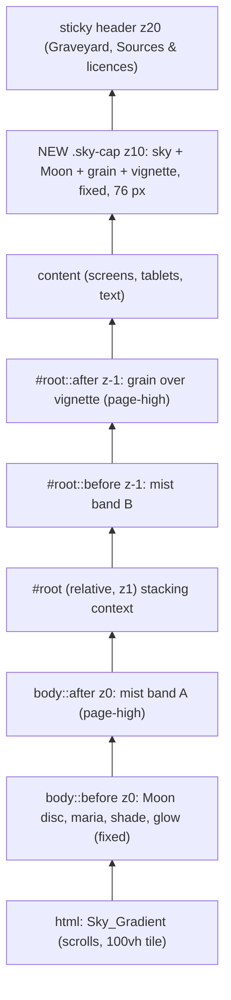

# Design Document: night-polish

## Overview

This design implements `requirements.md` of the same folder: one bug fix (the Sky_Cap) and four pieces of polish (cursors, Grass, Moon, Slips). It changes no game rule, dataset, storage schema or scheduling rule. It adds no image file, no runtime request, no font and no third-party asset, so `README.md` stays unchanged (Requirement 8 AC 20). It touches no steering file and not `kiro-log.md`: Requirement 7 stays "proposed" (see "Proposed steering amendments").

### Status of the open questions

The human has not answered the open questions of `requirements.md` yet. Every choice below that depends on one is written to the recommended answer and marked **"pending the human's answer to Open question N.M"**. Where the recommendation is rejected, the section gives the alternative and its consequence (Requirement 7 AC 7). All questions are listed again, with the consequence of each answer, in "Open questions".

### Reading guide

| Part | Section |
|---|---|
| 1 Sky_Cap (Requirement 1) | "Part 1: Sky_Cap" |
| 2 Cursors (Requirements 2, 3) | "Part 2: Cursors" |
| 3 Grass (Requirement 4) | "Part 3: Grass" |
| 4 Moon (Requirement 5) | "Part 4: Moon" |
| 5 Slips (Requirement 6) | "Part 5: Slips" |
| Tests (Requirement 8) | "Testing Strategy" |
| Steering (Requirement 7) | "Proposed steering amendments" |
| Questions | "Open questions" |

### Requirement gaps found while designing

These are conflicts between `requirements.md` and the existing tests or the existing layout. The design takes the stated resolution and asks the human to confirm. The requirements are not edited by this document.

| # | Gap | Design resolution |
|---|---|---|
| G1 | Requirement 8 AC 5 allows only the Moon assertions to change. `index.css.test.ts` also asserts `css.match(/@media/g)` has length 1 (twice), asserts the whole file has no `transition`, asserts `.slip-primary {` carries the fill and border, asserts `ink` and `error` at 4.5:1 on the lightest and darkest point of the shade (a second disc-contrast test that AC 17 and AC 18 do not name), and its allow-list regex for `rgb(r g b / var(--moon...` names only three triples. Each conflicts with Requirement 2, 5 or 6 as written. | Each assertion is changed so that it still checks the same intent, never loosened. The list is in "Existing assertions that change". The human is asked to approve the list as an addition to Requirement 8 AC 5. |
| G2 | Requirement 4 AC 7 asks that no Grass bounding box meets a Marker or glyph box. Hill tufts sit on the crest of the hillside, behind the first three rows of tablets, so their boxes always overlap tablet boxes. | Tablet-foot tufts keep the geometric check. Hill tufts get a paint-order check instead: they come before the grid in the document and have no `z-index`, so every tablet, glyph and Marker paints above them. |
| G3 | Requirement 6 AC 3 asks for a shortened drop shadow while pressed. On a keyboard press the Tailwind focus ring (`ring-2`, utilities layer) owns `box-shadow` and replaces the whole value. | AC 3 is tested for a pointer press (where `:focus-visible` does not match). A keyboard press keeps the ring and glow and still sinks 1 px. |
| G4 | Requirement 1 AC 12 says no Sky_Cap box is painted at 992 px and wider. The cap is gated by `--moon-room`, which is 0 there (no new `@media` rule, see Part 1). | At 992 px and wider the cap has a computed height of 0 px and paints nothing. The test checks `getBoundingClientRect().height === 0`. |
| G5 | Requirement 6 AC 10 asks that the wax alpha be "declared in one place". A CSS custom property cannot be read inside a `data:` URI. | The single declaration is the `feColorMatrix` alpha inside the wax `data:` URI. The Contrast_Test parses it from there, the same way the existing test reads the grain alpha. There is no `--wax-alpha` property. |

### Research summary

- **Cursor images.** MDN states that the specification sets no size limit, that Firefox and Chromium restrict cursor images to 128 by 128 px by default, that 32 by 32 px is recommended, and that an image larger than the limit is ignored. A fallback keyword is required after a URL. SVG 1.1 with a natural size (explicit `width` and `height`) is required to work. iPadOS shows its own circle for trackpads and only changes it for `text`. ([MDN: cursor](https://developer.mozilla.org/en-US/docs/Web/CSS/cursor); content rephrased for compliance with licensing restrictions.) Consequences: every cursor SVG carries `width` and `height`, has an `auto` or `crosshair` fallback, and stays within 32 by 32 px.
- **Mask layers.** Several `mask-image` layers are combined with `mask-composite`, whose default is `add` (union); each layer can have its own size, position and repeat. ([MDN: mask-composite](https://developer.mozilla.org/en-US/docs/Web/CSS/mask-composite); content rephrased.) Consequence: the Deckled_Edge is a union of an opaque centre block and four edge strips, with no `mask-composite` declaration needed.
- **Repository facts used** (read from the files named in `requirements.md`): `index.css` layers and the clamp `--moon-room`; `#root` is `position: relative; z-index: 1` with `padding-top: var(--moon-room)`; `Graveyard.tsx` line 92 and `Credits.tsx` line 37 carry `sticky sticky-below-moon z-20`; `GhostFigure.tsx` exports `GHOST_PATH` and `GHOST_EYE_PATHS`; `InkSurface.tsx` is used by `SummonStep.tsx` and `WriteMode.tsx`; `e2e/helpers.ts` exports `moonDisc`, `moonIntruders`, `expectMoonInside`, `pixelsAt`, `findOverflow`, `seedGraveyard`.

### Decisions

| # | Decision | Reason |
|---|---|---|
| D1 | The Sky_Cap is a real element rendered inside `#root`, not a pseudo-element. | `#root::before` and `#root::after` are taken by mist band B and by the grain and vignette. Only a layer inside the `#root` stacking context can sit between content and the sticky header. |
| D2 | The cap is gated by the existing `--moon-room` clamp, with no new `@media` rule. | One mechanism for the padding, the `main` min-height, the sticky offset and the cap. The cap and the padding change at the same widths, including between 991.9 px and 992 px, where a separate media query would disagree with the clamp. |
| D3 | The cap repaints the sky, the Moon, the grain and an approximated vignette. | The cap sits above the Moon (`z-index: 0` under `#root`), so it must carry its own copy of the Moon. It also sits above the page grain and vignette, which darken the top corners by up to 0.43 alpha (computed in Part 1). |
| D4 | Cursor SVG strings come from one pure builder and `index.css` stays static. | A unit test rebuilds each declaration from `GHOST_PATH` and compares it with the file. No generated file, no build step. |
| D5 | The Deckled_Edge uses four fixed edge tiles, not one stretched SVG. | A stretched SVG scales the notch size with the button size and breaks the 2 px limit on wide buttons. Fixed-pixel tiles keep the limit at every size. |
| D6 | Slip paper, border and wax move to a masked `::before`. The element keeps the label, the shadow and the focus ring. | Requirement 6 AC 20: no `clip-path`, no `overflow: hidden` on the Slip. |
| D7 | The Moon uses existing tokens only: `ink` for disc and glow, `nightMid` for maria, `nightTop` for the shade. | Open question 5.2 (recommended). No new token, so Requirement 7 AC 10 takes its second option. |

## Architecture

### Layer order at a Narrow_Viewport (after the change)



The cap lives inside the `#root` context. Its `z-index: 10` is above all content (no other `z-index` exists in the app besides the two headers' `z-20`) and below the header.

### New and changed files

| File | Change |
|---|---|
| `app/src/components/SkyCap.tsx` (+ `SkyCap.test.tsx`) | New. One `div.sky-cap`, `aria-hidden`. |
| `app/src/App.tsx` | The default export becomes a thin wrapper that renders `<SkyCap />` before the screen switch. |
| `app/src/styles/cursors.ts` (+ `cursors.test.ts`) | New. Pure cursor builder. |
| `app/src/components/InkSurface.tsx` | New prop `drawable`, sets `data-brush`. |
| `app/src/modes/WriteMode.tsx` | Passes `drawable`. `SummonStep.tsx` is unchanged. |
| `app/src/engine/grassPattern.ts` (+ test) | New. Pure Grass_Pattern. |
| `app/src/components/GrassTuft.tsx` (+ test) | New. One decorative SVG. |
| `app/src/components/Graveyard.tsx` | Renders tablet tufts and hill tufts; imports `FAR_RIDGE_PATH`. |
| `app/src/styles/index.css` | Sky_Cap rules, cursor rules, Moon layers, Slip rules, wax, deckle, scroll padding. |
| `app/src/styles/index.css.test.ts` | New blocks and the changed assertions listed below. |
| `e2e/sky-cap.spec.ts`, `e2e/cursors.spec.ts`, `e2e/grass.spec.ts`, `e2e/slips.spec.ts` | New. |
| `e2e/helpers.ts` | New helpers `discExtent`, `bandPixels`, `reachSummary`. No existing helper changes. |
| `e2e/screenshots.spec.ts` | Adds calls only (Sources & licences and Summary views). |

No `.kiro/steering/*` file, no `kiro-log.md`, no data file and no `README.md` change.

---

## Part 1: Sky_Cap (Requirement 1)

### Cause, in code terms

`#root` has `padding-top: var(--moon-room)` and the header has `top: var(--moon-room)`. The document scrolls, so the 76 px above the header is plain viewport. Content scrolls up into it and is hidden only when it reaches the opaque header (`bg-night-top`) 76 px lower. The sky behind the band also scrolls (the `html` gradient is one `100vh` tile), so the band's colour changes with the offset.

### Element and stacking

```tsx
// app/src/components/SkyCap.tsx
export function SkyCap() {
  return <div className="sky-cap" aria-hidden="true" data-testid="sky-cap" />;
}
```

`App.tsx` renames the current function `AppScreens` and exports:

```tsx
export default function App() {
  return (<><SkyCap /><AppScreens /></>);
}
```

The cap is the first child of `#root`. `#root > main` and `#root:has(> main.no-moon-room)` use child combinators on `main` only, so they are unaffected. There is no `#root > :first-child` rule.

**Scope, pending the human's answer to Open question 1.1 (recommended: every screen at a Narrow_Viewport).** With the recommendation the cap is global as above. Alternative if the human chooses only Graveyard and Sources & licences: `App` does not render `SkyCap`; `Graveyard.tsx` and `Credits.tsx` render `<SkyCap />` as the first child of their `main`. The CSS is the same, because a fixed element inside a non-stacking `main` is still in the `#root` context. Requirement 1 AC 21 and the Summary and Level screens in the e2e test then drop out.

The compact séance shell (`main.no-moon-room`, Summon and Write steps) has no Moon_Room (its `padding-top` is 0), so the cap must not cover its first row:

```css
#root:has(> main.no-moon-room) > .sky-cap { display: none; }
```

This reuses the `:has()` pattern that `index.css` already uses for the same shell.

### CSS

```css
/* Sky_Cap: below 992 px a fixed copy of the Night_Sky covers the Moon_Room, above
   scrolling content and below the sticky header. Gated by --moon-room, which is 0 from 992 px. */
.sky-cap {
  position: fixed;
  top: 0;
  left: 0;
  right: 0;                         /* not width: 100vw, so no horizontal overflow */
  height: var(--moon-room);         /* 76 px below 992 px, 0 from 992 px */
  z-index: 10;                      /* content: auto; sticky header: z-20 */
  pointer-events: none;
  overflow: hidden;
  background-color: var(--sky-hold);
  background-image:
    /* top to bottom, the reverse of paint order */
    <vignette-cap>,
    <grain-url>,
    <the seven Moon layers of body::before, same strings>,
    linear-gradient(180deg, var(--night-top) 0%, var(--night-mid) 55%, var(--sky-hold) 88%, var(--sky-hold) 100%);
  background-size: 100% 200vh, auto, auto, auto, auto, auto, auto, auto, auto, 100% 100vh;
  background-repeat: no-repeat, repeat, no-repeat, no-repeat, no-repeat, no-repeat, no-repeat, no-repeat, no-repeat, no-repeat;
}
```

Layer by layer (this is the exact list; the `<...>` placeholders above are these strings):

| # | Layer | Why it repaints the page at scroll 0 |
|---|---|---|
| 1 | `radial-gradient(ellipse at center, transparent 55%, rgb(0 0 0 / var(--vignette-alpha)) 100%)` with `background-size: 100% 200vh` | The page vignette is one ellipse over the page height `H`. At the top row its vertical distance is always `0.707` of the radius, whatever `H` is. A tile of `200vh` centred `100vh` below the cap top gives `0.707` at `y = 0` and `0.707 x (1 - y/100vh)` further down, which is the page value for `H = 200vh` (error for other heights: at most 0.04 alpha, below 2 per channel on a sky of at most 40). |
| 2 | The grain `url("data:image/svg+xml,...feTurbulence...")` (same string as `#root::after`) | The page grain starts at the `#root` top-left, as does the cap's; with `stitchTiles` both tile identically at scroll 0, so the grain matches pixel for pixel. |
| 3 to 9 | Shade, four maria, disc, halo (Part 4), same strings as `body::before` | The cap is above the real Moon, so it carries the Moon. Positions use `calc(100% - var(--moon-inset-x))` and `var(--moon-inset-y)`, which resolve against the cap box. The cap is full width and starts at `top: 0`, so they land on the same pixels as the fixed Moon. The disc spans `0.5rem` to `4.5rem` from the top, inside the `4.75rem` cap. The halo (7 rem) continues below the cap on the real `body::before`, and both draw the same gradient, so the join is seamless. |
| 10 | The Sky_Gradient with `background-size: 100% 100vh` | The `html` background at scroll 0, top 76 px. Same stops, same tile height. |

`#root::after` is `z-index: -1` in the `#root` context, so the page grain and vignette paint above the real Moon. The cap's order (vignette over grain over Moon over sky) is the same order, so the cap matches.

A unit test keeps the copies equal (see Testing Strategy): the Moon layer substring of `body::before`, the grain URL of `#root::after` and the sky `linear-gradient` of `html` must each appear verbatim in `.sky-cap`. The cap is not built from a custom property, because the existing structural tests parse `body::before` as a literal.

### Moon stays visible above the cap

The cap contains layers 3 to 9, so the Moon disc is painted inside the cap, above the vignette and grain order of the page. Nothing above the cap in the same context except the header (below the cap box, never overlapping it). The real `body::before` Moon below the cap is unchanged, covered only where the cap is.

### Media gating below 992 px

`height: var(--moon-room)` is the gate: `clamp(0px, calc((992px - 100vw) * 1000), 4.75rem)` is 76 px at 991.924 px and narrower, 0 from 992 px. At 992 px and wider the cap box has height 0 and paints nothing (gap G4). No `@media` rule is added for the cap. Alternative considered: `@media (max-width: 991.98px) { .sky-cap { display: block } }` with `display: none` by default. It gives a truly absent box but disagrees with the clamp for widths between 991.924 and 992 px, and it adds a media rule to a file whose tests count them.

### Scroll padding (Requirement 1 AC 20)

Today `html { scroll-padding-top: 5rem }` (80 px), less than 76 px plus the header (min 64 px, up to about 96 px when the title wraps at 320 px). New rule:

```css
html {
  scroll-padding-top: 7rem;                               /* kept: existing test reads the first rem value */
  scroll-padding-top: calc(var(--moon-room) + 7rem);      /* 188 px below 992 px, 112 px from 992 px */
}
```

Seven rem (112 px) covers the tallest header measured by the e2e test with margin. The e2e tab test (below) is the arbiter; if it fails at 320 px the value is raised in the same task. At 992 px and wider the value goes from 80 to 112 px, which only moves where a focused control lands.

### Interaction with sticky header

The header keeps `top: var(--moon-room)`. Nothing changes for Requirement 1 AC 10 and AC 11 (76 px below 992 px, 0 from 992 px). The cap and the header never overlap (cap bottom is 76 px, header top is 76 px), so AC 5 holds by z-order only as a guard.

### New e2e test: `e2e/sky-cap.spec.ts`

Runs for the Graveyard and Sources & licences, at 375 x 812 and 320 x 640 (and for Summary and Level if Open question 1.1 is answered as recommended). It uses `test.use({ reducedMotion: 'reduce' })`, so the mist and the wisp are still.

1. **Open the screen** with the existing openers (`seedGraveyard`, and the Sources opener of `night-scene.spec.ts`; Summary through the new helper `reachSummary`, which reuses the route of `first-meeting.spec.ts`; Level through the start menu).
2. **Scrollable check.** `max = scrollHeight - innerHeight`. If `max < 152` the test fails with `"<screen> at <viewport>: not scrollable (scrollHeight S, innerHeight H); the Moon_Room check needs at least 152 px"`.
3. **Reference capture, "Night_Sky colour at scroll 0".** At scroll 0 the test injects `<style id="no-cap">.sky-cap{display:none!important}</style>`, takes `page.screenshot({ clip: { x: 0, y: 0, width: vw, height: 76 } })`, then removes the style. The reference is therefore the true sky, independent of the cap, and the same code runs on the old build (where `.sky-cap` does not exist and the style is a no-op).
4. **Sample points.** Columns at 10, 30, 50, 70, 90 percent of the viewport width, rows at 15, 50, 85 percent of 76 px, minus the points within 7 rem (112 px) of the Moon centre. Computed: at 375 px the Moon centre is at x 335, so the 70 and 90 percent columns drop and 3 columns by 3 rows remain (9 points). At 320 px the centre is at x 280, the 70 and 90 percent columns (224, 288) drop, 9 points remain. The test asserts at least 3 by 3 remain.
5. **Offsets.** `0`, `round(max/3)`, `round(2*max/3)`, `max`. At each: `window.scrollTo(0, y)`, wait one animation frame, clip screenshot of the band, `pixelsAt` at the sample points, and compare with the reference per channel. A difference above 6 fails with `"<screen> at <viewport>, offset <y>: point (<x>, <y>) is rgb(r, g, b), the Night_Sky is rgb(r, g, b)"`. `document.elementsFromPoint` is used only to name the element beneath in the message (Requirement 1 AC 16).
6. **Moon checks (AC 8, 9, 17).** Helper `discExtent(page, png)` scans the clip row at `y = 40` (the disc centre) from `cx - 3rem` to `cx + 3rem` and returns the first and last x whose luminance exceeds 0.1 (the sky and the glow ring are below 0.02, every disc pixel including shade and maria is above 0.2, see Part 4). The test compares left edge, right edge and the diameter with the scroll-0 values within 1 px, and requires the diameter to be `64 +- 2` px. Luminance ratio of the disc centre and the point 8 rem left of the centre must be at least 1.2.
7. **Header (AC 10, 11).** At each offset the header's `getBoundingClientRect().top` is `76 +- 1` below 992 px, and `document.elementFromPoint` at the header centre returns the header or a descendant. A third describe block at 1024 x 768 expects top `0 +- 1` and `getComputedStyle(cap).height === '0px'` (AC 11, 12).
8. **Hidden and untabbable (AC 13, 14).** `aria-hidden="true"`, no `tabindex`, and the Tab order of the screen equals the order with the cap removed (comparing the sequence of `activeElement` labels across a full Tab loop with and without `#no-cap`-style removal through `page.evaluate(el.remove())` on a fresh load).
9. **Overflow (AC 15).** `findOverflow(page, 320)` and `findOverflow(page, 375)` return `[]`.
10. **Focus clearance (AC 20).** Tab through every focusable control of both screens. For each, `box.top >= header.bottom - 0.5`, except controls inside the header. Failure names the control, the viewport and both values.

### How the test is first shown to fail on the current build

Task order: write `e2e/sky-cap.spec.ts` first and run `npx playwright test e2e/sky-cap.spec.ts` on the current build, before any CSS or component change. Expected result and why it is deterministic:

- At offsets `max/3`, `2*max/3` and `max` the band shows the scrolled sky: the `html` gradient is one `100vh` tile, so at offset 300 of 812 the band lies at 37 to 46 percent of the tile, about rgb(8, 14, 32) against the scroll-0 value rgb(6, 10, 23), a blue difference of 9; at the held sky it is rgb(16, 28, 56), a difference of 33. Both exceed 6, whatever the content under the band. The test also catches content (the `hillNear` ground, tablets, table text) where a sample point lands on it.
- The moon, header and overflow checks pass on the current build, so the failure message names only the sky-colour check.
- The run output (command, the four failing test titles per screen and viewport, and the first failing message of each) is pasted in the task as the evidence of Requirement 1 AC 18. After the fix the same command passes.

---

## Part 2: Cursors (Requirements 2 and 3)

### Builder: `app/src/styles/cursors.ts`

Location: `app/src/styles/` next to `theme.ts`. It may import from `../components/GhostFigure` (`GHOST_PATH`, `GHOST_EYE_PATHS`) and `./theme`. `GhostFigure.tsx` imports `theme`, never `cursors`, so there is no cycle. It is not in `engine/`, because engine code must not import from components.

```ts
export interface Point { readonly x: number; readonly y: number }
export interface Bounds { readonly minX: number; readonly minY: number; readonly maxX: number; readonly maxY: number }
export interface CursorImage {
  readonly svg: string;              // raw SVG text, single-quoted attributes
  readonly width: number;            // CSS px, also in the svg width attribute
  readonly height: number;
  readonly hotspot: Point;           // whole pixels, inside the image
  readonly fallback: 'auto' | 'crosshair';
}
export const GHOST_CURSOR_SCALE = 0.375;           // 64 x 80 viewBox -> 24 x 30 px
export function pathBounds(d: string): Bounds;     // bounding box of all coordinates (control hull) of an M/C/Z path
export function encodeSvg(svg: string): string;    // % -> %25, < -> %3C, > -> %3E, # -> %23
export function ghostCursor(variant: 'default' | 'link'): CursorImage;
export function brushCursor(): CursorImage;
export function cursorDeclaration(image: CursorImage): string;
// -> url("data:image/svg+xml,<encoded>") X Y, <fallback>
```

`pathBounds` reads every number pair of `GHOST_PATH` (the path uses absolute `M`, `C`, `Z` only). For `GHOST_PATH` it returns `minX 7.2, maxX 57.2, minY 3.8, maxY 76.4` (control hull; the curve itself spans x 7.83 to 56.39 and tops out at y 4.53 near x 34.2).

### Sizes and hotspot (pending the human's answer to Open question 2.3)

Requirement 2 AC 4 limits each image to 32 by 32 px. Open question 2.3 recommends 28 by 28 and leaves the exact pixel to this design. The design uses a scale of `0.375` (an exact fraction of the 64 x 80 viewBox) so the image is 24 by 30 px with integer sides and no resampling blur: `width='24' height='30' viewBox='0 0 64 80'`. The silhouette is 21.5 by 27 px. If the human wants the recommended 28 by 28, `GHOST_CURSOR_SCALE` becomes `0.35` (22.4 by 28 px, `width='23' height='28'`); only the constant changes and the unit test follows.

Hotspot from the path's bounding box and scale: `x = round(((minX + maxX) / 2) * scale)`, `y = round(minY * scale)`.

- `x = round(32.2 * 0.375) = round(12.075) = 12`
- `y = round(3.8 * 0.375) = round(1.425) = 1`

The true topmost point of the scaled silhouette is `(34.2, 4.53) * 0.375 = (12.8, 1.7)`. The hotspot is 0.9 px away, inside the 2 px limit (Requirement 2 AC 8). The unit test finds the true top by sampling the Bézier segments and checks `distance <= 2` with the same `12` and `1` the CSS carries.

### SVG text (the default cursor)

```xml
<svg xmlns='http://www.w3.org/2000/svg' width='24' height='30' viewBox='0 0 64 80'>
  <path d='GHOST_PATH' fill='#0e0f13' stroke='#0e0f13' stroke-width='4.8' stroke-linejoin='round'/>
  <path d='GHOST_PATH' fill='#ece6d6'/>
  <path d='EYE_0' fill='#0e0f13'/><path d='EYE_1' fill='#0e0f13'/>
</svg>
```

The first path draws the outline (fill and stroke in `background`, 4.8 viewBox units is 1.8 px, so 0.9 px shows outside the silhouette). The second path is the body. Both use `GHOST_PATH` verbatim. The outline stays inside the image: the path starts 3.8 units (1.4 px) from the top and 7.2 units from the sides, and the half stroke is 2.4 units. No gradient, no filter, no `text`, no `href`, no `url(` inside the SVG (Requirement 2 AC 16).

### Link_Cursor shape variant (pending the human's answer to Open question 2.2)

Same `GHOST_PATH` silhouette, with two differences, one of them a shape:

1. **Shape (the signal that is not colour):** each eye path carries `transform='translate(cx cy) scale(1.4) translate(-cx -cy)'`, where `(cx, cy)` is the centre of the eye's own bounding box: `(23.4, 32.7)` and `(41.5, 32.5)`. The eyes open wider. The `d` strings still equal `GHOST_EYE_PATHS`.
2. **Tone:** body fill `paper` (`#e6dcc3`), outline and eyes `inkOnPaper` (`#1c1914`).

Same size, same hotspot (the silhouette is unchanged). Alternative if the human rejects the recommended variant: a tilt of the whole silhouette by a fixed angle. It changes the topmost point, so the hotspot must be recomputed from the transformed bounds; the builder already derives it from bounds, so only the test constants change. No hand shape in either case.

### Outline colours and contrast numbers

Computed with `contrastRatio` from `theme.ts` (relative luminance: `ink` 0.793, `paper` 0.719, `background` 0.0048, `surface` 0.0104, `inkOnPaper` 0.0099). For each ground, the larger of the fill and outline ratio:

| Cursor | on `background` | on `surface` | on `paper` | on `inkOnPaper` |
|---|---|---|---|---|
| Ghost: fill `ink`, outline `background` | fill 15.4 | fill 13.9 | outline 14.0 | fill 14.1 |
| Link: fill `paper`, outline `inkOnPaper` | fill 14.0 | fill 12.7 | outline 12.8 | fill 12.8 |
| Brush: arms `inkOnPaper` over a `paper` casing | not drawn there | not drawn there | arm 12.8 | casing 12.8 |

All are at least 3:1 (Requirement 2 AC 7, Requirement 3 AC 7). The unit test computes these from the builder's own colour fields and fails below 3.

### CSS (outside the Motion_Block)

```css
/* Pointer: ghost cursors for fine pointers only. Values built by app/src/styles/cursors.ts
   and compared with it in cursors.test.ts. */
@media (hover: hover) and (pointer: fine) {
  body { cursor: url("data:image/svg+xml,...") 12 1, auto; }
  button:not(:disabled):not([aria-disabled='true']),
  a[href],
  [role='button']:not([aria-disabled='true']),
  summary { cursor: url("data:image/svg+xml,...") 12 1, auto; }
  button:disabled,
  [aria-disabled='true'] { cursor: not-allowed; }
  [data-brush='true'],
  [data-brush='true'] * { cursor: url("data:image/svg+xml,...") 10 10, crosshair; }
}
```

- `cursor` is inherited, so one `body` rule reaches the intro, menu and Graveyard (Requirement 2 AC 17) and every child of a button.
- `not-allowed` for disabled controls is kept, and `LevelScreen`'s `disabled:cursor-not-allowed` utility agrees with it (Requirement 2 AC 10).
- No rule sets `outline`, `box-shadow` or `--tw-shadow`, so the focus ring is unchanged (AC 13). No `transition` or `animation` (AC 14).
- Each URL is `data:` with a double-quoted URL and no raw `<`, `>`, `#` or `"` inside, so the existing "no image file" and "every `url(` is followed by `data:`" tests pass (AC 15).
- Media query `(hover: hover) and (pointer: fine)` is the primary-input test (pending the human's answer to Open question 2.4, recommended). A touch tablet reports `pointer: coarse`, so it gets none (Requirement 2 AC 3). Alternative: `any-pointer: fine`, which would give an iPad with a trackpad and a laptop with a touch screen the ghost on the trackpad, at the cost of a cursor that a touch-first device shows only sometimes.

### How `index.css` stays static and verified

`cursors.test.ts` imports the builder, reads `index.css`, strips comments and:

1. extracts every `cursor: url("data:image/svg+xml,...") X Y, FALLBACK;` declaration;
2. asserts the file contains exactly the declarations `cursorDeclaration(ghostCursor('default'))`, `cursorDeclaration(ghostCursor('link'))` and `cursorDeclaration(brushCursor())`;
3. on a mismatch, the failure message prints the expected declaration so the author pastes it in.

### Brush_Cursor artwork (pending the human's answer to Open question 3.2)

A thin crosshair with an open centre, 20 by 20 px, hotspot `(10, 10)` (the exact centre), fallback `crosshair`. Geometry:

```
arms (butt caps, centre line at 10):  left  x 1 to 6    right x 14 to 19
                                      top   y 1 to 6    bottom y 14 to 19      (all at 10 on the other axis)
casing: stroke paper     width 4      (painted first)
arm:    stroke inkOnPaper width 2      (painted second)
```

```xml
<svg xmlns='http://www.w3.org/2000/svg' width='20' height='20' viewBox='0 0 20 20'>
  <g stroke='#e6dcc3' stroke-width='4' fill='none'>
    <path d='M1 10H6M14 10H19M10 1V6M10 14V19'/>
  </g>
  <g stroke='#1c1914' stroke-width='2' fill='none'>
    <path d='M1 10H6M14 10H19M10 1V6M10 14V19'/>
  </g>
</svg>
```

- Open centre: the nearest painted point of any arm casing is the end face at distance 4 from the hotspot. The unit test works on the builder's exported geometry (`BRUSH_ARMS`, `BRUSH_CASING_WIDTH`): it computes the minimum distance from the hotspot to each stroked rectangle and requires at least 3.5 (circle of 6 px diameter plus 0.5 px of antialiasing). Rasterising is not needed. The distance is 4, so it passes (Requirement 3 AC 9, 11).
- Line width: the visible arm is 2 px wide, which is the limit of Requirement 3 AC 2. The `paper` casing under it is 4 px wide (1 px of casing on each side of the arm). The casing exists so the cursor keeps 3:1 over `inkOnPaper` strokes (AC 7): the arm alone matches a finished stroke. This design reads AC 2 as limiting the arm, not the casing. If the human reads it as limiting the casing too, the casing is dropped and the cursor fails AC 7 over finished strokes, so the two would need to be reconciled in the requirements.
- No `GHOST_PATH` (AC 4), no seal red, no candle amber (AC 8).

### How the Write step applies the brush; the Summon step does not

`InkSurface` gains one prop:

```tsx
/** True on the Write step, where the paper takes strokes. Sets data-brush for the Brush_Cursor. */
drawable?: boolean;
// on the surface div:
data-brush={drawable ? 'true' : undefined}
```

`WriteMode.tsx` passes `drawable` to its `InkSurface`. `SummonStep.tsx` does not, so its paper inherits the `body` Ghost_Cursor (and the Link_Cursor over buttons) (Requirement 3 AC 5, pending the human's answer to Open question 3.1, recommended). Alternative: the Brush_Cursor on both papers; then `SummonStep.tsx` passes `drawable` too, and the Summon test of Requirement 3 AC 5 becomes the inverse. The attribute is on the surface div, so the rule reaches the container and every descendant (`[data-brush='true'] *`), including hanzi-writer's `svg`. No box, `touch-action` or handler changes (AC 12). Cursor while a stroke is drawn is unchanged (pending the human's answer to Open question 3.3).

### Tests

- `cursors.test.ts` (unit): the checks of Requirement 2 AC 11 and Requirement 3 AC 9, listed in the Testing Strategy.
- `InkSurface.test.tsx` (component): `data-brush="true"` only with `drawable`; `SummonStep` and `WriteMode` tests check the attribute is absent and present.
- `e2e/cursors.spec.ts`: desktop context reads `getComputedStyle(...).cursor` of `body`, an enabled button, `[data-testid="ink-surface"]` on the Write step (each has `url(`), a disabled button (`not-allowed`), the Summon paper (no brush value: it carries the ghost URL, which is not equal to the Write value), and non-interactive elements of the intro, start menu and Graveyard. A second context with `hasTouch: true, isMobile: true` finds no `url(` on any of them.

---

## Part 3: Grass (Requirement 4)

### Grass_Pattern: `app/src/engine/grassPattern.ts`

Pure, no `Math.random`, no `Date`, no import except types. It follows `tabletTilt.ts`: fixed tables indexed by position modulo the table length (pending the human's answer to Open question 4.3, recommended: five shapes, five offsets, 12 hill slots).

```ts
export interface Tuft {
  readonly shape: number;     // index into TUFT_SHAPES, 0 to 4
  readonly dx: number;        // horizontal offset from the tablet's centre, px
}
export interface HillTuft {
  readonly shape: number;
  readonly xPercent: number;  // across the hillside wrapper, 0 to 100
  readonly crestY: number;    // ridge height at xPercent in the 48-unit hillside viewBox
  readonly scale: number;     // 1.2 to 1.6
}

export const TUFT_WIDTH = 24;            // px, viewBox 0 0 24 9
export const TUFT_HEIGHT = 9;
export const TUFT_SHAPES: readonly string[];            // five path strings, base on y = 9
export const TABLET_TUFTS: readonly Tuft[];             // five entries
export const HILL_SLOTS = 12;
export const HILL_TUFTS: readonly HillTuft[];           // twelve entries
export const FAR_RIDGE_PATH: string;                    // the far ridge `d` used by Graveyard.tsx
export const HILL_REM_PER_UNIT = 0.25;                  // 12 rem over 48 viewBox units

export function tabletTuft(position: number): Tuft;     // TABLET_TUFTS[mod(position, 5)]
export function hillTuft(slot: number): HillTuft;       // HILL_TUFTS[mod(slot, 12)]
```

`mod(n, m)` is `((n % m) + m) % m`, so every integer input, including 0 and negatives, gives a defined tuft (Requirement 4 AC 5 asks for 0 to 500). `Graveyard.tsx` imports `FAR_RIDGE_PATH` instead of the inline string, so the test can evaluate the same curve (a refactor with no change of output).

Tables:

| Position mod 5 | shape | dx (px) |
|---|---|---|
| 0 | 0 | -5 |
| 1 | 3 | 4 |
| 2 | 1 | 0 |
| 3 | 4 | -3 |
| 4 | 2 | 5 |

Hill slots (x in percent; `crestY` is the far-ridge height at that x, computed by solving the two Bézier segments of the ridge, `M0 22 C18 14 34 22 52 16` then `C72 10 88 18 100 14`, rounded to 0.01 and re-checked by a unit test within 0.05):

| slot | 0 | 1 | 2 | 3 | 4 | 5 | 6 | 7 | 8 | 9 | 10 | 11 |
|---|---|---|---|---|---|---|---|---|---|---|---|---|
| xPercent | 7 | 14 | 22 | 30 | 38 | 46 | 54 | 62 | 70 | 78 | 86 | 93 |
| crestY | 19.61 | 18.45 | 18.17 | 18.37 | 18.38 | 17.54 | 15.44 | 14.01 | 13.69 | 14.16 | 14.91 | 15.15 |
| shape | 2 | 0 | 4 | 1 | 3 | 0 | 2 | 4 | 1 | 0 | 3 | 2 |
| scale | 1.4 | 1.2 | 1.5 | 1.3 | 1.6 | 1.2 | 1.4 | 1.3 | 1.5 | 1.2 | 1.4 | 1.3 |

### SVG shapes (viewBox `0 0 24 9`, one `path` each, base on y = 9)

```
TUFT_SHAPES[0] M3 9 C3.4 6 2.6 3.6 1.4 1.6 C4.2 3 5.6 5.8 6 9 Z M9.5 9 C9.5 5.6 10 2.8 11.4 0.4 C13 3 13.4 6 13.2 9 Z M16.5 9 C17 6.6 18.4 4 21 2.4 C19.6 4.8 19.2 7 19.4 9 Z
TUFT_SHAPES[1] M5 9 C5 6 6 3.2 8.6 1 C8 4 8.4 6.6 9.4 9 Z M13 9 C13.4 5.6 15.2 2.8 17.6 1.6 C16.8 4.4 17 6.8 17.6 9 Z
TUFT_SHAPES[2] M2.5 9 C2.6 7 2 5.2 1.2 3.6 C3.4 4.8 4.4 6.8 4.6 9 Z M7 9 C7.2 6 7.8 3.6 9 1.8 C10.2 4 10.4 6.6 10 9 Z M13 9 C13 6.4 13.6 4 15 2.2 C16 4.4 16.2 6.8 15.8 9 Z M18.6 9 C19 7.2 19.8 5.4 21.8 4 C21 6 21 7.6 21.4 9 Z
TUFT_SHAPES[3] M10 9 C10 5 10.8 2.2 12.4 0.2 C13.6 3 14 6 14 9 Z M5 9 C5.2 7 5.8 5.2 7.2 3.8 C7.4 5.6 7.8 7.4 8.2 9 Z M16 9 C16.6 7.4 17.8 6 19.6 5.2 C19 6.6 19 7.8 19.2 9 Z
TUFT_SHAPES[4] M4 9 C4.6 6.4 6.4 3.8 9.4 2 C8.2 4.6 8 6.8 8.4 9 Z M10.5 9 C11.4 6 13.4 3.6 16.6 2.2 C15.2 4.6 14.8 6.8 15 9 Z M17.4 9 C18 7.4 19.4 6 21.6 5.2 C20.6 6.6 20.4 7.8 20.6 9 Z
```

Each shape is blades only (narrow tapered fills), no text and no glyph-like shape (Requirement 8 AC 14). A unit test checks every shape starts with `M`, every blade ends with `Z`, all coordinates lie in `0..24` by `0..9`, and no shape is empty.

### Component: `GrassTuft.tsx`

```tsx
export function GrassTuft({ shape, scale = 1 }: { shape: number; scale?: number }) {
  return (
    <svg aria-hidden="true" focusable="false" viewBox="0 0 24 9"
         width={24 * scale} height={9 * scale} className="block">
      <path d={TUFT_SHAPES[shape]} fill={theme.hillFar} />
    </svg>
  );
}
```

No `title`, no `desc`, no text, no `lang` (AC 1). Fill `theme.hillFar` (`#202c4c`), an existing token (AC 11). No green, no seal red, no candle (colours are blue-grey night tokens).

### Placement

**Tablet foot (every `li` of `[aria-label="Graves"]`, one per tablet, same for the three states):**

```tsx
<li ... className="... relative flex min-h-[56px] ...">
  <span aria-hidden="true" data-grass="tablet"
        className="pointer-events-none absolute bottom-0 -z-10"
        style={{ left: '50%', marginLeft: `${tuft.dx - 12}px` }}>
    <GrassTuft shape={tuft.shape} />
  </span>
  {glyph}{marker}
</li>
```

- **Stacking.** Each `li` carries a `tablet-tilt-N` class, and all five set `transform`, so each `li` is its own stacking context. A child with `z-index: -10` paints above the `li`'s own background and border and below its in-flow text (glyph and Marker spans), which satisfies Requirement 4 AC 6. The unit test checks the class `-z-10` and the DOM order.
- **Box.** The wrapper `span` is 24 by 9 px (the svg is `block`). It is absolutely placed at `bottom: 0`, so its bottom edge equals the `li` bottom (within 2 px, AC 2). It is at most 16 px high (AC 2). Its horizontal extent is `50% + dx - 12` to `+ 12`, with `|dx| <= 5`, so within 17 px of the centre; the narrowest tablet column is 48 px wide (the grid is `repeat(auto-fill, minmax(48px, 1fr))`), so the span stays inside the `li`.
- **Clearance from the glyph and Marker.** The `li` has `min-h-[56px]` and centres a 20 px glyph and a 12 px Marker (32 px), leaving at least 12 px at the bottom. The tuft is 9 px high, which leaves 3 px. Never-met tablets show only the 12 px Marker, centred, which leaves more. This is why the tuft height is 9 and not 12.
- **Overflow safety with tilted tablets.** The tuft is inside the `li` box, so a 3 degree rotation about `50% 100%` moves it by under 1 px at its corners and cannot add overflow. The recommendation of Open question 4.2 says to put `overflow: hidden` on the tablet's box. This design does not, because `overflow: hidden` on the `li` would clip the restless wisp (`.tablet-restless::after` at `top: -12px`) and the at-rest glow. The tuft does not need it: its box lies inside the `li` by construction, and the e2e overflow check (below) proves it. This is a design departure from the recommendation of Open question 4.2, pending the human's answer to it.
- **Pointer and focus.** The wrapper has `pointer-events: none`, the SVG has no `tabindex` and no handler (AC 9). The `li` accessible name and role are unchanged (AC 10); the wrapper is `aria-hidden`.

**Hill crest (12 slots):** tufts are HTML-positioned wrappers, not shapes inside the stretched hillside SVG. The hillside SVG uses `preserveAspectRatio="none"`, so a shape drawn inside it would be stretched differently in x and y. Instead each tuft is a sibling of the SVG inside the `relative isolate overflow-hidden` wrapper:

```tsx
{HILL_TUFTS.map((t, slot) => (
  <span key={slot} aria-hidden="true" data-grass="hill"
        className="pointer-events-none absolute"
        style={{ left: `${t.xPercent}%`,
                 top: `${t.crestY * HILL_REM_PER_UNIT}rem`,
                 transform: `translate(-50%, calc(-100% + 2px))` }}>
    <GrassTuft shape={t.shape} scale={t.scale} />
  </span>
))}
```

They are rendered between the hillside `svg` and the grid `ul`, so the `ul` (relative, later in the document, same stacking level) paints above them. The base of each tuft sits 2 px into the ridge. The wrapper has `overflow-hidden`, so a tuft cannot leave the hillside box (AC 4). The widest tuft is 24 x 1.6 = 38.4 px, so its half width is 19.2 px; at the narrowest wrapper (about 296 px at 320 px) the first slot (6 percent) is 17.8 px from the edge and its tuft's left edge falls 1.4 px outside. Slot 0 therefore uses scale 1.4 (33.6 px wide, half 16.8 px) and is placed at 7 percent, 20.7 px from the edge; slot 11 is mirrored at 93 percent. The unit test asserts `xPercent * 2.96 >= 24 * scale / 2` for the 296 px case. The hill tufts are decorative gap fillers: most lie behind tablets, which is why gap G2 replaces the geometric non-intersection check of Requirement 4 AC 7 with a paint-order check for them.

### Colours and the 3:1 rule

`hillFar` on the stone (`#1d2028`) is 1.2:1 and on the sky about 1.2:1. The Grass is deliberately quiet, as the hillside already is (hillFar on hillNear is 1.2:1). This needs the exemption of the proposed amendment A4 (pending the human's answer to Open question 4.1). Alternative if the human rejects A4: no Grass colour among the allowed night tokens reaches 3:1 against dark stone, and a lighter colour (`ghost`, `ink`) would make the grass loud and break the calm of the scene. The alternative is to drop Requirement 4 (the Graveyard stays as it is).

### Bytes (Requirement 4 AC 14)

Five shapes of about 200 bytes each, two small components and one pure module: about 3 KB of source, below the 20,480 byte limit. A task records `app/dist` JS and CSS sizes before and after (`npm run build -w app`, then the sum of `app/dist/assets/*.js` and `*.css`). No image file is added.

### Motion

None: no `animation`, no `transition` on any tuft (AC 15).

---

## Part 4: Moon (Requirement 5)

### Layers of `body::before` (and the Sky_Cap copy)

Top layer first, as CSS paints. The geometry strings of the disc and halo are the existing ones; only the colours change.

```css
body::before {
  content: '';
  position: fixed;
  inset: 0;
  z-index: 0;
  pointer-events: none;
  background:
    /* 1 shade: unchanged */
    radial-gradient(circle var(--moon-shade-radius) at calc(100% - var(--moon-inset-x) + var(--moon-shade-offset)) calc(var(--moon-inset-y) + var(--moon-shade-offset)), rgb(5 8 19 / var(--moon-shade-alpha)) 0, transparent 100%),
    /* 2 to 5 maria */
    radial-gradient(ellipse 0.6rem 0.5rem at calc(100% - var(--moon-inset-x) - 0.9rem) calc(var(--moon-inset-y) + 0.5rem), rgb(10 17 38 / var(--moon-mare-alpha)) 0, transparent 100%),
    radial-gradient(ellipse 0.5rem 0.4rem at calc(100% - var(--moon-inset-x) + 0.35rem) calc(var(--moon-inset-y) - 0.9rem), rgb(10 17 38 / var(--moon-mare-alpha)) 0, transparent 100%),
    radial-gradient(ellipse 0.55rem 0.4rem at calc(100% - var(--moon-inset-x) - 0.15rem) calc(var(--moon-inset-y) + 1.05rem), rgb(10 17 38 / var(--moon-mare-alpha)) 0, transparent 100%),
    radial-gradient(ellipse 0.35rem 0.5rem at calc(100% - var(--moon-inset-x) + 1rem) calc(var(--moon-inset-y) - 0.25rem), rgb(10 17 38 / var(--moon-mare-alpha)) 0, transparent 100%),
    /* 6 disc */
    radial-gradient(circle calc(var(--moon-size) / 2) at calc(100% - var(--moon-inset-x)) var(--moon-inset-y), rgb(236 230 214 / var(--moon-disc-alpha)) 0, rgb(236 230 214 / var(--moon-disc-alpha)) calc(var(--moon-size) / 2 - 0.2rem), transparent calc(var(--moon-size) / 2)),
    /* 7 glow */
    radial-gradient(circle 7rem at calc(100% - var(--moon-inset-x)) var(--moon-inset-y), rgb(236 230 214 / var(--moon-halo-alpha)) 0, transparent 100%);
}
```

Variables in `:root` (changes in bold):

| Variable | Before | After |
|---|---|---|
| `--moon-disc-alpha` | 0.65 | **0.80** |
| `--moon-halo-alpha` | 0.10 | 0.10 (unchanged) |
| `--moon-mare-alpha` | none | **0.28** (new) |
| `--moon-shade-*`, `--moon-size`, `--moon-inset-*` | | unchanged |
| `--moon`, `--moon-peak-alpha` | | unchanged (`.moon-glow` heading glow keeps the cool tint) |

The colour triples are the tokens in channels: `236 230 214` is `ink`, `10 17 38` is `nightMid`, `5 8 19` is `nightTop`. No new token (pending the human's answer to Open question 5.2; alternative: new tokens `moonDisc`, `moonMaria`, `moonGlow` in `theme.ts`, `index.css`, the Tailwind config, the hex checks and the README together, per Requirement 7 AC 10 option 1).

### Base tone, maria, shade, glow

- **Base tone.** `ink` (`#ece6d6`, aged paper) at alpha 0.80 over the sky and glow. The composite at the lit point is about rgb(196, 191, 180) with the grain, so red 196 is above blue 180 and luminance is 0.524, against 0.119 for today's disc.
- **Maria** (offsets from the disc centre in rem, y down; ellipse radii):

| Mare | dx | dy | rx | ry | farthest edge from centre |
|---|---|---|---|---|---|
| A | -0.90 | +0.50 | 0.60 | 0.50 | 1.03 + 0.60 = 1.63 |
| B | +0.35 | -0.90 | 0.50 | 0.40 | 0.97 + 0.50 = 1.47 |
| C | -0.15 | +1.05 | 0.55 | 0.40 | 1.06 + 0.55 = 1.61 |
| D | +1.00 | -0.25 | 0.35 | 0.50 | 1.03 + 0.50 = 1.53 |

All four lie inside the 2 rem radius minus the 0.2 rem soft edge (1.8 rem), so none can cross the edge (AC 4). Fixed positions, no random number. None covers the two points the existing e2e test samples (lit at `-0.8, -0.8` rem, shaded at `+0.5, +0.5` rem): the nearest mare to the lit point is B, whose left edge is at `dx = -0.15`, 0.65 rem to the right of it, and the gradient is transparent at that edge. A mare centre composite (lit tone mixed with `nightMid` at 0.28) is about rgb(144, 143, 140), luminance 0.273, darker than the lit 0.524 (AC 5).
- **Shade.** Unchanged: `rgb(5 8 19 / 0.35)`, radius 1.25 rem, offset 0.5 rem. Shaded centre about rgb(129, 127, 124), luminance 0.214. Lit to shaded ratio is `(0.524 + 0.05) / (0.214 + 0.05) = 2.17`, above the 1.2 of `night-scene.spec.ts` and the 1.25 of the unit test.
- **Glow.** `ink` at peak alpha 0.10, 7 rem, linear to 0. Unchanged geometry (AC 7).
- **Candle.** None in the Moon (AC 8 allows it only inside gradients; this design uses none).
- **Motion.** None (AC 9).
- **Disc edge luminance floor for the e2e edge scan.** Every disc pixel (shade, maria) is above 0.2; the sky and ring are below 0.02. The scan threshold 0.1 sits between them.

### Contrast numbers for the glow ring (Requirement 5 AC 15, 16)

The ring is the brightest glow outside the disc. At the disc edge (2 rem from the centre of a 7 rem gradient) the glow alpha is `0.10 x (1 - 2/7) = 0.0714`. Paint order: sky at 2 percent of the tile (rgb 5, 8, 20), glow, then the grain (tint 237, 230, 214 at 0.03); the vignette only darkens and is left out as in the existing tests. The composite is about rgb(28, 30, 39), luminance 0.0135.

| Token | Luminance | Ratio on the ring |
|---|---|---|
| `ink` | 0.793 | 13.3 |
| `error` | 0.719 | 12.1 |
| `ghost` | 0.475 | 8.3 |
| `muted` | 0.386 | 6.9 |
| `success` | 0.327 | 5.9 |

For comparison, the existing "halo composite" test takes the full peak alpha 0.10 at 10 percent of the tile (rgb about 35, 38, 47, luminance 0.019): `success` 5.4, `muted` 6.3, `ghost` 7.6, `error` 11.1, `ink` 12.2. All are at least 4.5, so the existing tests pass with the glow now in `ink` instead of `moon`. The lowest ratio in both is `success`.

### Disc contrast test: decision path (Open question 5.1, both ways)

`ink` text needs luminance at most 0.1873 behind it for 4.5:1 and `error` at most 0.1209. The new lit disc is 0.524. So the existing tests "keeps ink and error at 4.5:1 on the disc composite" and, in the `Moon_Shade` block, "keeps ink and error at 4.5:1 at the lightest and the darkest point" (a second test of the same claim, see gap G1) cannot stay with a pale disc.

**Recommended (pending the human's answer to Open question 5.1): replace.**

- Delete both tests.
- Add "no text token has to meet 4.5:1 on the disc because no text lies on it". Its body reads `e2e/screenshots.spec.ts` as text and asserts that it calls `expectMoonInside(` for each of the views: intro, summon, write, graveyard (375), the new Sources & licences and Summary (375), and intro, summon, graveyard, Sources & licences and Summary (320). `expectMoonInside` fails on any `moonIntruders` result, so removing a call fails this test. The Art_Direction amendment A3 records the same sentence.
- Add the new disc tests: lit luminance above the old composite (0.1187, rebuilt inline from the old recipe: `moon` at 0.65 over `moon` halo at 0.10), red above blue at the lit point, four maria with lower centre luminance, shade ratio at least 1.25.

**Alternative (the human wants the disc test kept):** the disc may not exceed luminance 0.1209 (`error` governs), and `--moon-disc-alpha` must stay near 0.65 or below in a cool base. With `ink` as the base, alpha 0.30 gives a lit composite of about rgb(95, 95, 95) (luminance 0.113): ratios hold, but the red-above-blue condition of Requirement 5 AC 3 fails because the cool sky below dominates, and the disc is a dim neutral grey. Satisfying AC 3 then needs a warmer base token (Requirement 7 AC 10 option 1, for example `moonDisc` in a dim sand). That disc is again the flat grey circle the human wanted to leave. The tests then stay as they are, run against the new colours. The Moon amendment A3 loses its second sentence.

### Existing `index.css.test.ts` assertions that change for the Moon

| Assertion | Change | Why |
|---|---|---|
| `keeps the moon halo peak at or below 0.10 and the disc brighter than the halo`: `--moon-disc-alpha` `toBe(0.65)` | Value becomes `0.80`; the other two checks stay | Requirement 5 AC 20 (pinned value the human approves to change) |
| `mist and moon channel triples equal their hex`: the negative regex allows only `91 111 154`, `114 131 171` and the shade triple | Allow-list gains `236 230 214` and `10 17 38`; the positive checks for mist and `moon-peak-alpha` stay | Requirement 5 AC 20 (the cool `--moon` blue no longer colours the disc and halo) |
| `discBg()`, `underShade()`, `haloBg()` helpers | Use `rgb(theme.ink)` for halo and disc, and add the maria layer nowhere (lit point is outside every mare) | Same recipe as the CSS |
| `keeps ink and error at 4.5:1 on the disc composite` | Removed (recommended answer to 5.1) | Gap G1 and AC 17, 18 |
| `Moon_Shade: keeps ink and error at 4.5:1 at the lightest and the darkest point` | Removed (same) | Same claim at two points; not named by AC 17 or 18 (gap G1) |
| `Moon_Shade: defines the three shade properties`, `is the first layer`, `stays inside the disc`, `shades visibly` | Unchanged (the shade string and its position first in the list are kept; `shades visibly` now reads 2.17) | AC 19 |
| `sizes the moon from custom properties` | Unchanged: it matches the disc and halo geometry substrings, which are kept | AC 19 |

New tests in a `describe('moon')` block: lit-point red above blue and luminance above 0.1187; 3 to 4 maria, each inside the disc (offset length plus larger radius at most `size / 2 - 0.2rem`) and each darker than the lit point; glow peak at most 0.10, radius `7rem`; glow ring composite at 4.5:1 for the five text tokens; no `candle` flat fill, no `animation` or `transition` in `body::before`.

### Screens and screenshots (Requirement 5 AC 11 to 13, 22)

`e2e/screenshots.spec.ts` gains, at 375 x 812 and 320 x 640, a `Sources & licences` view and a `Summary` view that call `expectMoonInside` (no PNG for 320). The Summary view uses the new helper `reachSummary(page)`, which extracts the route of the `first-meeting.spec.ts` summary test. The intro screenshot at 375 x 812 already exists and is saved again after the change. A 1440 x 900 intro screenshot is added (pending the human's answer to Open question 5.4, recommended). The human's review of those screenshots is the acceptance test for "reads as a moon".

---

## Part 5: Slips (Requirement 6)

Scope (pending the human's answer to Open question 6.1, recommended): `.slip` and `.slip-primary` only. `.card-slip` and `.keycap` keep their current rules character for character. Alternative: also `.keycap`; then the keyboard rows of the Summon step would lift on hover and the 375 x 812 and 320 x 640 fit tests must be re-run with lifted keys, and the `.keycap` assertions of `index.css.test.ts` change.

### Structure: paper on an inner layer

The Slip element keeps its box, label, border width, shadow and focus ring. Its paper, border colour and (for the Primary_Slip) wax move to `::before`, which is masked. The mask touches only that inner layer, so the `box-shadow` glow and the focus ring are never clipped, and the Slip has no `clip-path` and no `overflow` (Requirement 6 AC 20).

```css
@layer components {
  .slip {
    position: relative;
    isolation: isolate;                 /* ::before at z-index -1 stays above the page, below the label */
    min-height: 44px;
    color: var(--ink-on-paper);
    border: 1px solid transparent;      /* same layout width as before; colour is drawn by ::before */
    border-radius: 6px;
    box-shadow: 0 2px 6px rgba(0, 0, 0, 0.45);
  }
  .slip-primary {
    position: relative;
    isolation: isolate;
    min-height: 44px;
    color: var(--paper-label);
    border: 1px solid transparent;
    border-radius: 6px;
    box-shadow: 0 2px 6px rgba(0, 0, 0, 0.45), 0 0 18px color-mix(in srgb, var(--candle) 40%, transparent);
  }
  .slip::before,
  .slip-primary::before {
    content: '';
    position: absolute;
    inset: -1px;                        /* covers the element's 1 px border area */
    z-index: -1;
    pointer-events: none;
    border-radius: 6px;
    -webkit-mask-image: var(--deckle-top), var(--deckle-bottom), var(--deckle-left), var(--deckle-right), linear-gradient(#000, #000);
    mask-image: var(--deckle-top), var(--deckle-bottom), var(--deckle-left), var(--deckle-right), linear-gradient(#000, #000);
    -webkit-mask-size: 64px 2px, 64px 2px, 2px 64px, 2px 64px, calc(100% - 4px) calc(100% - 4px);
    mask-size: 64px 2px, 64px 2px, 2px 64px, 2px 64px, calc(100% - 4px) calc(100% - 4px);
    -webkit-mask-position: top left, bottom left, top left, top right, center;
    mask-position: top left, bottom left, top left, top right, center;
    -webkit-mask-repeat: repeat-x, repeat-x, repeat-y, repeat-y, no-repeat;
    mask-repeat: repeat-x, repeat-x, repeat-y, repeat-y, no-repeat;
  }
  .slip::before {
    background-color: var(--paper);
    background-image: linear-gradient(160deg, rgba(255, 250, 235, 0.35) 0%, rgba(120, 90, 50, 0.12) 100%);
    border: 1px solid color-mix(in srgb, var(--paper) 55%, var(--ink-on-paper));
  }
  .slip-primary::before {
    background-color: var(--seal);
    background-image: var(--wax-light), var(--wax-dark);
    border: 1px solid var(--paper);
  }
  /* The Graveyard level buttons add border-2 to .slip: the inner layer follows. */
  .slip.border-2::before { inset: -2px; border-width: 2px; }
}
```

No `mask-composite` is declared: the default `add` is the union of the five layers. The existing `.slip:hover { background-image }` and `.slip-primary:hover { filter }` rules are replaced by the state rules below. The `.slip-primary` rest `box-shadow` gains a black drop-shadow layer (it had only the candle glow) so that Requirement 6 AC 3 has a drop shadow to shorten; its `box-shadow` still contains `var(--candle)`, as the existing test requires.

### The deckled edge: four fixed tiles (pending the human's answer to Open question 6.2, recommended: masked inner layer, no turbulence filter)

Custom properties on `:root`, each a `data:` SVG tile of fixed pixel size, painted black (only alpha matters):

| Property | Tile | Covered area | Edge profile (the irregular side) |
|---|---|---|---|
| `--deckle-top` | 64 x 2 | `y` from the profile to 2 | `M0 2 L0 1 L4 .6 L9 1.3 L14 .3 L20 1 L25 .4 L31 1.5 L37 .5 L42 1.1 L48 .2 L54 1.2 L59 .6 L64 1 L64 2 Z` |
| `--deckle-bottom` | 64 x 2 | `y` from 0 to the profile | `M0 0 L0 1 L5 1.5 L11 .7 L17 1.4 L22 .5 L29 1.2 L35 .3 L40 1.3 L46 .7 L52 1.6 L58 .6 L64 1 L64 0 Z` |
| `--deckle-left` | 2 x 64 | `x` from the profile to 2 | `M2 0 L1.2 0 L.6 5 L1.4 10 L.4 17 L1.1 23 L.3 29 L1.5 35 L.6 41 L1.3 47 L.2 53 L1.2 59 L1.2 64 L2 64 Z` |
| `--deckle-right` | 2 x 64 | `x` from 0 to the profile | `M0 0 L1.4 0 L.7 6 L1.5 12 L.5 19 L1.2 26 L.3 32 L1.4 38 L.6 45 L1.6 51 L.4 57 L1.4 64 L0 64 Z` |

Each value is `url("data:image/svg+xml,%3Csvg xmlns='http://www.w3.org/2000/svg' width='64' height='2' viewBox='0 0 64 2'%3E%3Cpath d='...' fill='%23000'/%3E%3C/svg%3E")` (width and height swapped for left and right). The union of the centre block (`calc(100% - 4px)` square, centred) and the four strips fills the box except for the notches in the outer 2 px, so the edge is irregular and never more than 2 px from the rectangle (AC 8; the deepest notch is 1.7 px). The tile ends meet (profile value 1 at both ends of each horizontal strip, 1.2 and 1.4 at the ends of the vertical ones), so the edge repeats without a seam on any width. Sizes are in fixed pixels, so the notch depth does not change with the button size: a stretched SVG would put 8 px notches on a 400 px button. The mask value is the same constant on every Slip (AC 9). A browser without mask support shows the straight edge, which is the current look. `-webkit-` duplicates cover Safari on older iPads.

### Wax texture (Primary_Slip only)

Two `data:` SVG tiles on `:root`, 120 x 120 with `stitchTiles`, drawn as `background-image` layers on `.slip-primary::before` over `background-color: var(--seal)`:

| Property | Filter id | Tint | Alpha row of the colour matrix | Role |
|---|---|---|---|---|
| `--wax-light` | `wl` | `sealLight` `#ec7a64` (`0.925 0.478 0.392`) | `0 0 0 0.12 0` | lightening, **maximum alpha 0.12** |
| `--wax-dark` | `wd` | deep seal (`0.294 0.059 0.031`) | `0 0 0 0.10 0` | darkening |

The alpha row scales the noise alpha (at most 1), so 0.12 is the worst-case lightening alpha, declared once in the `wl` data URI (gap G5). The Contrast_Test reads it from there by the filter id, like the existing grain test reads the grain matrix. Pending the human's answer to Open question 6.3, the recommended value is at most 0.12. The ceiling is the contrast: at 0.14 the rest ratio is 4.5; at 0.15 it is 4.49. 0.12 leaves a margin of 0.10 ratio points.

Both tints are tones of `seal` (lighter and darker), no new hue, no candle. Only `.slip-primary::before` has the property (AC 10, tested by a rule scan).

### States

Rules in `@layer components` so that the Tailwind ring utilities (utilities layer, later) keep control of `box-shadow` on `:focus-visible`: the ring and glow stay and are never replaced by hover (Requirement 6 AC 19). Transform and transition are unlayered and sit in the Motion_Block (AC 5).

```css
@layer components {
  /* hover: only where the device hovers (AC 7) */
  @media (hover: hover) {
    .slip:hover:not(:disabled) {
      box-shadow: 0 4px 10px rgba(0, 0, 0, 0.45), 0 0 18px 2px color-mix(in srgb, var(--candle) 40%, transparent);
    }
    .slip:hover:not(:disabled)::before {
      background-image: linear-gradient(160deg, rgba(255, 250, 235, 0.55) 0%, rgba(120, 90, 50, 0.08) 100%);
    }
    .slip-primary:hover:not(:disabled) {
      box-shadow:
        0 4px 10px rgba(0, 0, 0, 0.45),
        0 0 18px color-mix(in srgb, var(--candle) 40%, transparent),
        0 0 26px 6px color-mix(in srgb, var(--candle) 55%, transparent);
      filter: brightness(1.1);
    }
  }
  /* keyboard focus: same paper as hover; the ring utility supplies box-shadow (ring + candle glow) */
  .slip:focus-visible:not(:disabled)::before {
    background-image: linear-gradient(160deg, rgba(255, 250, 235, 0.55) 0%, rgba(120, 90, 50, 0.08) 100%);
  }
  /* pressed: after hover so it wins at equal specificity */
  .slip:active:not(:disabled) {
    box-shadow: 0 1px 2px rgba(0, 0, 0, 0.5), 0 0 10px color-mix(in srgb, var(--candle) 20%, transparent);
  }
  .slip:active:not(:disabled)::before {
    background-image: linear-gradient(160deg, rgba(255, 250, 235, 0.2) 0%, rgba(120, 90, 50, 0.18) 100%);
  }
  .slip-primary:active:not(:disabled) {
    box-shadow: 0 1px 2px rgba(0, 0, 0, 0.5), 0 0 18px color-mix(in srgb, var(--candle) 40%, transparent);
    filter: none;
  }
}

@media (prefers-reduced-motion: no-preference) {
  .slip, .slip-primary {
    transition: transform 200ms ease-out, box-shadow 200ms ease-out, filter 200ms ease-out;
  }
  @media (hover: hover) {
    .slip:hover:not(:disabled), .slip-primary:hover:not(:disabled) { transform: translateY(-2px); }
  }
  .slip:focus-visible:not(:disabled), .slip-primary:focus-visible:not(:disabled) { transform: translateY(-2px); }
  .slip:active:not(:disabled), .slip-primary:active:not(:disabled) { transform: translateY(1px); }
}
```

- **Lift and sink (pending the human's answer to Open question 6.3, recommended: lift 2 px, sink to 1 px below rest).** Lift is `translateY(-2px)`, press is `translateY(1px)`. A transition from `-2px` to `1px` passes through 0 before going below rest. Layout position (`offsetTop`, `offsetLeft`) and width never change, because `transform` does not affect layout (AC 13).
- **Glow.** Hover adds a candle layer absent at rest: for `.slip` the 18 px layer at 40 percent, for `.slip-primary` a second, wider layer at 55 percent on top of its rest layer (40 percent at 18 px). Candle appears only in `box-shadow`, the existing `*:focus-visible --tw-shadow`, and gradients (AC 15). On keyboard focus the Tailwind ring's `box-shadow` carries `--tw-shadow` (a 14 px, 45 percent candle glow), which is absent at rest in both Slips (the Primary_Slip's rest layer is 18 px, 40 percent, a different layer).
- **Pressed.** The black layer drops from `0 2px 6px` to `0 1px 2px`. The `.slip` candle layer is 20 percent, the Primary_Slip's is its rest 40 percent, both below the hover values (40 and 55). The paper darkens a little. Gap G3: on a keyboard press `:focus-visible` is also set, the ring utility wins `box-shadow`, and only the sink applies. AC 3's shadow check is run on a pointer press.
- **Disabled.** Every state rule has `:not(:disabled)`. A disabled Slip keeps `transform: none` and its rest `box-shadow` (AC 4). The `disabled:opacity-70` utility stays (pending the human's answer to Open question 6.5, recommended).
- **Touch (pending the human's answer to Open question 6.4, recommended).** Hover rules are inside `@media (hover: hover)`, so a tapped Slip shows its rest look afterwards. `:active` is outside the media query and works on every device, but its transform is also in the Motion_Block.
- **Reduced motion.** The `transition` and the three `transform` rules live only in the Motion_Block, so with `prefers-reduced-motion: reduce` the computed `transform` is `none` and the transition duration is `0s` in every state. The glow, the lighter paper and the shortened press shadow are outside the block and still show as static end states (AC 6).
- **Nested media.** The hover query inside the Motion_Block is a conditional group inside a conditional group, which CSS allows. The existing test's `blockAt` brace matcher handles the nesting.

### Contrast numbers (Requirement 6 AC 11, 12)

Luminance (WCAG): `inkOnPaper` 0.00992, `paperLabel` 0.8254, `seal` 0.1232, `paper` 0.719.

**Primary_Slip label (`paperLabel`) on the lightest composite of `seal` and the wax.** Lightest composite: `seal` with `sealLight` at 0.12 gives rgb(186, 62, 39), luminance 0.1402.

| State | Treatment | Background | Label | Ratio |
|---|---|---|---|---|
| Rest | none | rgb(186, 62, 39), L 0.1402 | rgb(243, 234, 210), L 0.8254 | **4.60** |
| Hover | `filter: brightness(1.1)` on bg and label | rgb(204, 68, 43), L 0.1725 | rgb(255, 255, 231), L 0.9855 | **4.65** |
| Keyboard focus | none (no filter) | as rest | as rest | **4.60** |
| Pressed | `filter: none` | as rest | as rest | **4.60** |

The darkening layer only lowers the background luminance, which raises the ratio, so the lightest composite is the worst case. The Contrast_Test builds the composite from the parsed `wl` alpha, the `sealLight` tint and `seal`, applies `brightness` per channel to both colours with clamping to 255, and fails below 4.5 in any of the four cases. At alpha 0.15 the rest ratio is 4.49, which is the ceiling the test protects.

**`.slip` label (`inkOnPaper`) on the lightest and the darkest point of the paper** (paper `#e6dcc3` under the two-stop gradient):

| State | Lightest point | Ratio | Darkest point | Ratio |
|---|---|---|---|---|
| Rest | `rgba(255,250,235,.35)` at 0%: rgb(239, 231, 209), L 0.798 | 14.2 | `rgba(120,90,50,.12)` at 100%: rgb(217, 204, 178), L 0.613 | **11.1** |
| Hover and keyboard focus | `.55` at 0%: rgb(244, 237, 217), L 0.845 | **14.9** | `.08` at 100%: rgb(221, 210, 183), L 0.648 | 11.6 |
| Pressed | `.20` at 0%: rgb(235, 226, 203), L 0.76 | 13.5 | `.18` at 100%: rgb(210, 197, 169), L 0.564 | **10.2** |
| Disabled (opacity 0.7 over `background`) | rest paper composited, L 0.381 | 7.4 | label composited L 0.0081 | 7.4 |

All are at least 4.5 (lowest 7.4 in the disabled state, 10.2 among enabled states). The test evaluates both ends of each gradient from the parsed alpha values.

### `.card-slip` and `.keycap` unchanged

Neither selector appears in any new rule. The existing `.card-slip` and `.keycap` assertions stay as they are, and a new assertion checks that the text of the `.card-slip {` and `.keycap {` blocks is identical to a stored copy (a literal in the test taken from the current file), so an accidental edit fails (AC 16).

### e2e: `e2e/slips.spec.ts`

- Pages: the start menu, the Graveyard and Sources & licences, at 375 and 320 px (the Primary_Slip `Begin a Nightly Séance` on the start menu).
- Boxes at rest, under `locator.hover()` (after 300 ms), and while `page.mouse.down()` is held: width equal; `top` difference at most 2 up and 1 down (tolerance 0.01); `offsetTop` and `offsetLeft` equal; height at least 44 in every state (AC 13, 21).
- Pointer press shadow (AC 3): computed `box-shadow` while pressed has a black layer smaller than at rest.
- Computed styles: `clip-path` is `none`, `overflow` is `visible`, the `::before` mask value equals the same string on every Slip (AC 9, 20).
- Disabled: the Graveyard level buttons while a level loads, or a `LevelScreen` entry, keep `transform: none` on hover (AC 4).
- Focus: `locator.focus()` after a Tab, a screenshot clip around the Slip checks that pixels just outside all four sides differ from the page background (ring not clipped, AC 19).
- Reduced motion (`test.use({ reducedMotion: 'reduce' })`): `transform` is `none` and `transition-duration` is `0s` in hover, focus and press; the hover `box-shadow` differs from rest (AC 6).
- Touch: a context with `hasTouch: true, isMobile: true`; after `tap()` the Slip's computed `box-shadow` equals rest (AC 7).
- `findOverflow` at 375 and 320 on the three screens, at rest and with one Slip hovered (AC 17).

---

## Components and Interfaces

| Unit | Interface |
|---|---|
| `SkyCap` | `() => JSX.Element`, no props. `div.sky-cap[aria-hidden=true][data-testid=sky-cap]`. |
| `ghostCursor(variant)`, `brushCursor()`, `cursorDeclaration(image)`, `pathBounds(d)`, `encodeSvg(svg)` | Pure, `app/src/styles/cursors.ts`. |
| `InkSurface` | New optional prop `drawable?: boolean` sets `data-brush="true"`. |
| `tabletTuft(position)`, `hillTuft(slot)`, `TUFT_SHAPES`, `HILL_TUFTS`, `FAR_RIDGE_PATH` | Pure, `app/src/engine/grassPattern.ts`. |
| `GrassTuft` | `{ shape: number; scale?: number }`, decorative SVG. |
| e2e helpers | `discExtent(page, png)`, `bandPixels(page, offsets)`, `reachSummary(page)`. |

## Data Models

No stored data changes. The storage schema (`schemaVersion: 3`) and the dataset are untouched. The new typed values are the constants above: `CursorImage`, `Tuft`, `HillTuft`, and the CSS custom properties `--moon-mare-alpha`, `--deckle-top`, `--deckle-bottom`, `--deckle-left`, `--deckle-right`, `--wax-light`, `--wax-dark`.

## Error Handling

| Situation | Behaviour |
|---|---|
| A browser ignores a cursor image (too large, SVG not supported) | The keyword after the URL (`auto`, `crosshair`) applies. Images are at most 32 and 24 px with explicit sizes, so they are within every limit named by MDN. |
| `:has()` unsupported | The existing fallback applies: the séance shell keeps its Moon_Room padding. The cap then also covers that top band, which the shell leaves empty by its first-row pad. No new failure mode. |
| `mask-image` unsupported | The Slip shows the straight edge it has today. The label, ring and glow are unaffected. |
| `color-mix()` unsupported | Same as today for the existing glow rules: the declaration is dropped and the rest look remains. |
| Hover not available (touch) | Hover rules do not apply; `:active` still shows the press. |
| `prefers-reduced-motion: reduce` | No transition and no lift; static glow and paper. No Grass or Moon motion exists. |
| Viewport exactly 992 px or wider | The cap height is 0, the Moon_Room is 0, the cursors and Slips are unchanged in logic. |
| Sky_Cap vignette differs from the page at an unusual page height | Error bounded by 0.04 alpha (below 2 per channel); the e2e tolerance is 6. |
| The hotspot or the image fails a unit test | The test prints the expected declaration so the author can paste it. |

## Testing Strategy

### Why there is no Correctness Properties section

Property-based testing does not apply to this feature: the work is CSS, one inline SVG builder with fixed constants, small fixed tables, and screen layout. A statement of the form "for all inputs, P holds" has no meaningful input space here (the cursor builder has two variants, the Grass_Pattern is a fixed table). Also, the project decided on Nov 15 (`tech.md`) that no new property-based test or mutation test is added, and Requirement 8 AC 2 repeats it. The existing property tests stay. All new tests are unit, component or end-to-end tests. The format validator's warning about a missing Correctness Properties section is expected.

### Mapping of requirements to tests

Test files marked (new) are created by the tasks; (existing) are edited as listed.

| Requirement AC group | File and test |
|---|---|
| R1 AC 1, 2, 7, 16, 18 (nothing scrolls above the header; sample grid; fails on the old build) | `e2e/sky-cap.spec.ts` (new): `sky colour of the Moon_Room never changes while scrolling` per screen and viewport |
| R1 AC 3, 4, 5, 6 (fixed, z-order, pointer-events) | `index.css.test.ts` (existing, new `describe('sky cap')`): rule is `position: fixed`, `top: 0`, `left: 0`, `right: 0`, `height: var(--moon-room)`, `z-index: 10` (greater than 0 and less than the header's 20, which the test reads from `Graveyard.tsx` and `Credits.tsx` source), `pointer-events: none`; no `width: 100vw` |
| R1 AC 7 (copies equal the page layers) | `index.css.test.ts`: the Moon layer list of `body::before`, the grain URL of `#root::after` and the sky gradient of `html` each appear verbatim in `.sky-cap`; background lists have equal lengths |
| R1 AC 8, 9, 17 (Moon stays, luminance ratio) | `e2e/sky-cap.spec.ts`: `moon stays in place and visible at every offset` |
| R1 AC 10, 11, 12 (header edge, no cap from 992) | `e2e/sky-cap.spec.ts`: `header stays at the Moon_Room edge`, and a 1024 x 768 block (`top` 0, cap height `0px`) |
| R1 AC 13, 14 | `SkyCap.test.tsx` (new): `aria-hidden`, no `tabindex`, not in `getByRole`; `e2e/sky-cap.spec.ts`: Tab order equal with and without the cap |
| R1 AC 15 | `e2e/sky-cap.spec.ts`: `findOverflow` at 320 and 375 |
| R1 AC 19 | `e2e/graveyard-fit.spec.ts`, `e2e/night-scene.spec.ts`, `e2e/screenshots.spec.ts` (existing): run unchanged |
| R1 AC 20 (focus clearance) | `e2e/sky-cap.spec.ts`: `focused controls clear the sticky header`; `index.css.test.ts`: `scroll-padding-top` effective value is `calc(var(--moon-room) + 7rem)` |
| R1 AC 21 (global scope, pending Q1.1) | `App.test.tsx` (existing): exactly one `.sky-cap` in the tree; `e2e/sky-cap.spec.ts`: Summary and Level screens |
| R2 AC 1, 2, 4, 5, 6, 7, 8, 9, 11, 15, 16 | `app/src/styles/cursors.test.ts` (new): see list below |
| R2 AC 3, 12, 17 | `e2e/cursors.spec.ts` (new): desktop context has `url(` on `body`, an enabled button, the intro, start menu and Graveyard backgrounds; touch context has none |
| R2 AC 10, 13, 14 | `index.css.test.ts`: cursor rules do not set `outline`, `box-shadow`, `--tw-shadow`, `animation`, `transition`; `button:disabled` keeps `not-allowed`; the cursor media block is outside the Motion_Block. `e2e/cursors.spec.ts`: computed `cursor` of a disabled button is `not-allowed` |
| R3 AC 1, 5, 6, 10 | `e2e/cursors.spec.ts`: Write paper has the brush value (and its descendants), Summon paper does not, touch has none |
| R3 AC 2, 3, 4, 7, 8, 9, 11 | `cursors.test.ts`: image at most 24 x 24, `crosshair` fallback, hotspot inside and whole, arm width at most 2, no `GHOST_PATH`, no red or amber, nearest paint at least 3.5 px from the hotspot, contrast at least 3:1 against `paper` and `inkOnPaper` |
| R3 AC 12 | `e2e/cursors.spec.ts`: `touch-action: none`, box sizes of paper and container equal with and without the rule (measured on the Summon paper as a control); `InkSurface.test.tsx` (existing): unchanged assertions pass |
| R3 AC 13 | `index.css.test.ts`: brush rule outside the Motion_Block, `data:` URI |
| `data-brush` plumbing | `InkSurface.test.tsx` (existing): `data-brush` only with `drawable`; `WriteMode` test: present; `SummonStep` test: absent |
| R4 AC 1, 10, 11, 12 | `GrassTuft.test.tsx` (new): `aria-hidden`, `focusable=false`, no `title`, `desc`, text; fill is `hillFar`; `Graveyard.test.tsx` (existing): the list structure, accessible names and counts are unchanged, tablet tufts are `aria-hidden`, and the three tablet states carry the same text and Marker as before |
| R4 AC 2, 6, 9 | `Graveyard.test.tsx`: one `[data-grass="tablet"]` per `li`; `-z-10` and `pointer-events-none`; `e2e/grass.spec.ts` (new): each tablet tuft's layout box (`offsetLeft`, `offsetTop`, `offsetWidth`, `offsetHeight`) lies inside its `li`, bottom within 2 px, height at most 16 |
| R4 AC 3, 4, 5 | `grassPattern.test.ts` (new): same output for the same input, defined output for positions 0 to 500 and every slot, `crestY` within 0.05 of the evaluated far ridge, hill tuft boxes inside the wrapper at 296 px, source has no `Math.random` or `Date`; `Graveyard.test.tsx`: 12 hill tufts |
| R4 AC 7 | `e2e/grass.spec.ts`: no tablet tuft box meets a Marker or `[lang="zh"]` box at 375 x 812 and 320 x 640, naming viewport and position; hill tufts come before the grid in document order and have no `z-index` (gap G2) |
| R4 AC 8 | `e2e/grass.spec.ts`: `findOverflow` at 320, 375, 1024, 1440; tablet boxes equal their size without Grass (a fixture without tufts via `page.addStyleTag('[data-grass]{display:none}')`) |
| R4 AC 13 | `e2e/graveyard-fit.spec.ts` (existing): runs unchanged |
| R4 AC 14 | Task step: measure `app/dist` JS and CSS before and after (`npm run build -w app`), recorded in the task; no new test file |
| R4 AC 15 | `index.css.test.ts`: no `animation` or `transition` selector mentions `grass`; `GrassTuft.test.tsx`: no `style` with animation |
| R5 AC 1, 4, 5, 7, 8, 9 | `index.css.test.ts` (existing file, new `describe('moon')`): see list in Part 4 |
| R5 AC 2, 10 | `e2e/sky-cap.spec.ts` (disc size and position at every offset), `index.css.test.ts` (cap Moon layers equal) |
| R5 AC 3 | `index.css.test.ts`: lit-point red above blue, luminance above 0.1187 |
| R5 AC 6 | `e2e/night-scene.spec.ts` (existing): `intro: the Moon shade is visible` runs unchanged |
| R5 AC 11, 12, 13 | `e2e/screenshots.spec.ts` (existing, calls added): `expectMoonInside` for Sources & licences and Summary at 375 and 320 |
| R5 AC 14, 15, 16 | `index.css.test.ts`: existing text contrast tests (band A, band B, halo, held sky) plus new ring composite test for the five tokens |
| R5 AC 17, 18 (pending Q5.1) | `index.css.test.ts`: replacement test reads `e2e/screenshots.spec.ts` for the `expectMoonInside` calls (recommended); otherwise the two old tests stay |
| R5 AC 19, 20, 21 | `index.css.test.ts`: structural tests kept, two pinned values and the triple allow-list updated, image-file and `will-change` tests unchanged |
| R5 AC 22 | `e2e/screenshots.spec.ts`: intro at 375 x 812 (existing) and 1440 x 900 (added); human review |
| R6 AC 1, 2, 3, 4, 13, 19, 21 | `e2e/slips.spec.ts` (new) |
| R6 AC 5, 6, 7, 10, 15, 18 | `index.css.test.ts` (new `describe('slips')`): every `transition` and `transform` for `.slip` and `.slip-primary` is inside the Motion_Block; every transition is 200 ms; hover rules are inside `@media (hover: hover)`; `--wax-light` is referenced only by `.slip-primary::before`; candle appears only in `box-shadow` and gradients; no `bg-candle`, `border-candle`, `text-candle` in any source file (the existing art-direction check) |
| R6 AC 8, 9, 20 | `index.css.test.ts`: the four deckle tiles exist with 64 x 2 and 2 x 64 sizes, every profile coordinate within 2 px of the box, tile ends equal; `.slip` and `.slip-primary` blocks contain no `clip-path` or `overflow`; `e2e/slips.spec.ts`: computed `clip-path` is `none` |
| R6 AC 11, 12 | `index.css.test.ts`: contrast tables above, built from parsed CSS values and `contrastRatio`, four Primary_Slip cases and four `.slip` states |
| R6 AC 14, 16 | `index.css.test.ts`: `.card-slip` and `.keycap` blocks equal stored copies; existing primary-action-table tests (`App.test.tsx`, `StartMenu.test.tsx`, `SessionSummary.test.tsx`) unchanged |
| R6 AC 17 | `e2e/slips.spec.ts`: `findOverflow` |
| R7 AC 8 | `index.css.test.ts` and `theme.test.ts` (existing): palette values, `theme.ts` and `index.css` parity, no `bg-candle`, `border-candle`, `text-candle`; run unchanged |
| R8 AC 1 to 4, 23, 24 | Commands: `npm test` (root) and `npm run test:e2e`; counts reported in the final task |
| R8 AC 5, 10 | The "Existing assertions that change" list below; `index.css.test.ts` check that fails on an `animation` or `transition` outside the Motion_Block passes unchanged |
| R8 AC 6 | `e2e/fits-one-screen.spec.ts`, `e2e/no-horizontal-overflow.spec.ts`: run unchanged |
| R8 AC 12, 13, 14, 15 | `cursors.test.ts`: no character, no `lang`, no `text` in any cursor SVG; `grassPattern.test.ts`: no Chinese character in any shape; `index.css.test.ts`: no `[\u3400-\u9fff]` in any new `data:` URI |
| R8 AC 18, 19, 20, 21, 22 | `index.css.test.ts`: image-file and `url(` tests unchanged; no change to `README.md` and `kiro-log.md` (checked at the end by `git diff --stat`) |

### `cursors.test.ts` list (Requirement 2 AC 11, Requirement 3 AC 9)

1. The three declarations in `index.css` equal `cursorDeclaration(...)` of the builder.
2. Each URL is double-quoted, begins `data:image/svg+xml,`, and decoding it (`decodeURIComponent`) round-trips to the builder's SVG text; the encoded text has no raw `<`, `>`, `#`, `"`.
3. Ghost and Link images: `width` and `height` attributes at most 32; Brush at most 24.
4. Hotspot is a whole pixel inside the image; for the ghost cursors it is within 2 px of the scaled true top of `GHOST_PATH`.
5. Every silhouette `d` equals `GHOST_PATH`; every eye `d` equals the matching `GHOST_EYE_PATHS` entry; the Link eyes carry a `transform` and the Ghost eyes do not.
6. No `filter`, `linearGradient`, `radialGradient`, `<text`, `href`, `url(` inside any cursor SVG.
7. Fallback is `auto` (ghost, link) and `crosshair` (brush).
8. Contrast of fill or outline at least 3 against `background`, `surface`, `paper`, `inkOnPaper` (brush: `paper` and `inkOnPaper`), using `contrastRatio`.
9. Brush: arm stroke width at most 2; no `GHOST_PATH`; no `theme.seal`, `theme.sealLight` or `theme.candle` colour; nearest painted point at least 3.5 px from the hotspot (analytic).

### Existing assertions that change (the addition to Requirement 8 AC 5 that the human is asked to approve, gap G1)

| File and test | Change | Why |
|---|---|---|
| `index.css.test.ts` `has exactly one no-preference block and no other media block` | Asserts the set of `@media` conditions is exactly: `(prefers-reduced-motion: no-preference)` once, `(hover: hover)` twice (static states and the one nested in the Motion_Block), `(hover: hover) and (pointer: fine)` once. No other media query. | Requirements 2 AC 1 and 6 AC 7 require these two queries. The intent (no stray queries) is kept and made stricter. |
| `index.css.test.ts` `has no animation-duration, animation-name or transition longhand` | `animation-duration` and `animation-name` stay forbidden. The whole-file `transition` ban becomes: no `transition` outside the Motion_Block (already checked by the "animations only inside the block" test), no `transition-*` longhand anywhere, and every `transition` entry inside the block is 200 ms. | Requirement 6 AC 5 puts the Slip transitions in the Motion_Block. |
| `index.css.test.ts` `leaves a Moon_Room below 992 px ...`: `css.match(/@media/g)).toHaveLength(1)` | That line is replaced by `no @media query mentions 992px` (the gate stays the clamp). All other lines unchanged. | Same reason as the first row. |
| `index.css.test.ts` `defines .slip, .slip-primary and .card-slip ...` | The `.slip-primary {` assertions for `background-color: var(--seal)` and `border: 1px solid var(--paper)` are checked on `.slip-primary::before {`; the same assertion for the element block says `border: 1px solid transparent`. Min-height, colour and `var(--candle)` box-shadow checks stay on the element. | Requirement 6 AC 20: the fill moves to the masked inner layer (D6). |
| `index.css.test.ts` `mist and moon channel triples equal their hex` | Allow-list adds `236 230 214` and `10 17 38`. | Requirement 5 AC 20. |
| `index.css.test.ts` `keeps the moon halo peak ... disc brighter than the halo` | `--moon-disc-alpha` `toBe(0.80)`. | Requirement 5 AC 20. |
| `index.css.test.ts` `discBg`, `underShade`, `haloBg` helpers | Use `theme.ink` for glow and disc. | Same recipe as the CSS. |
| `index.css.test.ts` `keeps ink and error at 4.5:1 on the disc composite` and `Moon_Shade: keeps ink and error at 4.5:1 at the lightest and the darkest point` | Removed under the recommended answer to Open question 5.1; kept under the alternative. | Requirement 5 AC 17, 18, and gap G1 (the second test). |
| `index.css.test.ts` `scene pseudo-elements ignore pointer events` | Selector list gains `.sky-cap`. | Additive. |

Nothing else is removed or loosened. Tests that run unchanged: all of `e2e/*.spec.ts` that exist today (new calls are added to `screenshots.spec.ts`), `theme.test.ts`, `GhostFigure.test.tsx` (favicon path equals `GHOST_PATH`), the existing `Graveyard.test.tsx`, `InkSurface.test.tsx` and `App.test.tsx` assertions.

### Component and unit test balance

New unit and component tests are example-based with concrete values (hotspot 12 and 1, brush hotspot 10 and 10, ratios 4.60 and 4.65, the four contrast cases). No new property-based test and no mutation test.

---

## Proposed steering amendments (Requirement 7)

**Every item here is "proposed, needs approval". None is approved. No task edits `.kiro/steering/art-direction.md` or any other steering file until the human writes "approved by the human" next to that item in this section.** Each is approved or rejected on its own. The wording below is exact and quotes the sentence it replaces.

### A2 (Requirement 7 AC 2): ghost silhouette copies. **Proposed, needs approval.**

Replace, in "The ghost", the phrase `drawn only by \`GhostFigure\`` with:

> drawn by `GhostFigure`. Flat copies of the same silhouette are also allowed: the favicon and the pointer cursors. Each copy is built from the exported `GHOST_PATH` and `GHOST_EYE_PATHS`, has no filter, no gradient and no text, and is a standalone SVG that does not reference the `GhostFigure` component or its filter.

Reason (recorded): the favicon is already a flat copy of the same path (`ink-and-candlelight`, Requirement 8), and a cursor is the same kind of copy. Tied to `GHOST_PATH` by `cursors.test.ts` and `GhostFigure.test.tsx`.
If rejected: no Ghost_Cursor and no Link_Cursor. The default cursor stays, the Brush_Cursor (a crosshair, no ghost) is kept, and the Summon paper keeps the default cursor. Requirement 2 is dropped except the touch check. The design needs no other change.

### A3 (Requirement 7 AC 3): the Moon bullet. **Proposed, needs approval.**

Replace the bullet `The Moon is a full disc of 4 rem in the top right. It never lies under text. Below 992 px every screen keeps a top room of 4.75 rem for it.` with (long form, if the human approves the replacement of Open question 5.1):

> The Moon is a pale warm disc of 4 rem in the top right, with soft maria, a soft shade toward the lower right and a faint glow of at most 0.10 alpha that fades out over 7 rem. It never lies under text, so no text token has to meet 4.5:1 on the disc itself; the end-to-end check `moonIntruders` proves that no text lies on it on every screen that calls `expectMoonInside`. Text beside the glow keeps 4.5:1. Below 992 px every screen keeps a top room of 4.75 rem for it.

Short form, if the human does not approve the replacement of Open question 5.1 (the disc test stays):

> The Moon is a pale warm disc of 4 rem in the top right, with soft maria, a soft shade toward the lower right and a faint glow of at most 0.10 alpha that fades out over 7 rem. It never lies under text. Below 992 px every screen keeps a top room of 4.75 rem for it.

If rejected: the Moon keeps its current look and item 4 is dropped. A change of tone alone would still pass the current sentence, but the disc contrast test then forces a dim disc (see Part 4, alternative).

### A4 (Requirement 7 AC 4): 3:1 exemption for decorative graphics. **Proposed, needs approval.**

Replace `Graphics keep 3:1.` with:

> Graphics keep 3:1, except graphics that are `aria-hidden` and convey no information: the hillside, the Grass, the mist, the Moon glow, the grain, the Wax_Texture and the Deckled_Edge.

Reason (recorded): Grass in `hillFar` on `hillNear` is deliberately low in contrast (1.2:1), as the hillside already is.
If rejected: Grass has no colour among the allowed tokens that is quiet and reaches 3:1. The alternative is to drop Requirement 4 (no Grass).

### A11 (Requirement 7 AC 11): what stays at 3:1. **Proposed, needs approval; depends on A4.**

Add after the sentence of A4:

> The cursor images and every graphic that carries meaning keep the 3:1 rule.

If A4 is rejected this item has nothing to attach to and is dropped with it.

### A5 (Requirement 7 AC 5): the Slip rule. **Proposed, needs approval.**

Add under "Palette" rules (or a new "Slips" line after "Secondary buttons and cards are paper slips with an ink label"):

> Slips (`.slip` and `.slip-primary`; not `.card-slip` or `.keycap`) lift 2 px and gain a candle glow on hover and keyboard focus, and sink 1 px when pressed. Slips have a Deckled_Edge, a torn-paper edge that stays within 2 px of the box. The Primary_Slip has a faint Wax_Texture in tones of `seal`, at most 0.12 lightening alpha. The transitions run 200 ms inside the reduced-motion block and need no motion exemption.

If rejected: the Slip changes are built without the sentence. All of them already follow the existing rules (candle only as glow, seal red only on the Primary_Slip, 200 ms action motion, 44 px height), so the `index.css.test.ts` checks are the only record. No item is dropped.

### A6 (Requirement 7 AC 6): the Sky_Cap sentence. **Proposed, needs approval.**

Add exactly one sentence to "Moon, mist and seal placement". Global scope (recommended, pending the human's answer to Open question 1.1):

> Below 992 px a fixed Sky_Cap keeps the top room free of scrolling content on every screen.

Scoped version, if the human chooses the two named screens:

> Below 992 px a fixed Sky_Cap keeps the top room free of scrolling content on the Graveyard and Sources & licences screens.

If rejected: the cap is built without the sentence; the existing statement that every screen keeps a top room for the Moon already describes the intent.

### A9 (Requirement 7 AC 9): the Pointer section. **Proposed, needs approval.**

Add a new section after "Motion":

> ## Pointer
> Cursors apply only to devices whose primary input matches `(hover: hover) and (pointer: fine)`; touch devices keep the default cursor. The Ghost_Cursor and the Link_Cursor are flat ghost silhouettes, each at most 32 by 32 px, a `data:` SVG with an `auto` fallback. The Link_Cursor differs from the Ghost_Cursor in shape (wider eyes) and not only in colour. The Brush_Cursor is a thin crosshair with an open centre, at most 24 by 24 px, a `data:` SVG with a `crosshair` fallback, used on the Writing_Paper of the Write step only.

If rejected: build the cursors without the section (the cursor tests are the record), or drop Requirements 2 and 3.

### A10 (Requirement 7 AC 10): palette tokens for the Moon. **Proposed, needs approval; this design takes option 2 (pending the human's answer to Open question 5.2).**

Option 2 (recommended), add to "Moon, mist and seal placement":

> The Moon uses only existing tokens: `ink` for the disc and the glow, `nightMid` for the maria and `nightTop` for the shade. The `moon` token stays for the mist-coloured heading glow.

Option 1 (alternative): add rows `moonDisc`, `moonMaria`, `moonGlow` to the palette table with values chosen at implementation (the disc a pale warm tone, the glow a warm neutral), and update `theme.ts`, `index.css`, the Tailwind config, the hex checks of `index.css.test.ts` and `README.md` in one task (Requirement 7 AC 10 and Requirement 8 AC 21).

---

## Open questions

Carried from `requirements.md`. Recommended answers are what this design is written to. Each row gives the design consequence of the recommendation and of the alternative, so the human can answer all at once.

| Q | Question | Recommended | Design consequence if recommended | If the human answers otherwise |
|---|---|---|---|---|
| 1.1 | Sky_Cap scope | Every screen at a Narrow_Viewport | `App` renders `SkyCap`; hidden on `main.no-moon-room`; the e2e covers Summary and Level too; A6 global wording | Only Graveyard and Sources & licences: `Graveyard.tsx` and `Credits.tsx` render the cap; R1 AC 21 and the two extra e2e screens drop out; A6 scoped wording |
| 1.2 | How the band is built | Fixed element repainting sky, Moon, grain and vignette | Part 1 as written | Making `main` a scroll container is rejected: it changes scrolling, `scroll-padding`, full-page captures and every fit test |
| 1.3 | Which sky while scrolled | The scroll-0 colours | The cap paints the top of the gradient, tolerance 6 | A scrolling sky inside the cap would need JavaScript and defeats the fix |
| 1.4 | Header focus clearance | Include it | `scroll-padding-top` becomes `calc(var(--moon-room) + 7rem)` and the Tab e2e test | Leave at 5rem: R1 AC 20 and the Tab test drop; a focused control can sit under the header |
| 2.1 | Steering amendment for the cursor copy | Yes (A2) | Ghost and Link cursors from `GHOST_PATH` | Rejected: see A2, no ghost cursor, Brush_Cursor kept |
| 2.2 | Link_Cursor look | Same silhouette, paper fill, wider eyes | `eyes` get a `scale(1.4)` transform; same hotspot | Tilted silhouette: hotspot recomputed from bounds (builder already does this) |
| 2.3 | Size and hotspot | About 28 by 28 | 24 by 30 px at scale 0.375, hotspot (12, 1), confirmed by screenshot | 28 by 28: `GHOST_CURSOR_SCALE = 0.35`, image 23 by 28, hotspot recomputed (11, 1) |
| 2.4 | Hybrid devices | Primary pointer: `(hover: hover) and (pointer: fine)` | Cursor media block as written | `any-pointer: fine`: the ghost shows with a trackpad on an iPad |
| 3.1 | Summon paper cursor | Ghost on Summon, brush on Write | `drawable` only in `WriteMode` | Brush on both: `SummonStep` passes `drawable`; R3 AC 5 inverts |
| 3.2 | Brush tip or crosshair | Crosshair with open 6 px centre | 20 by 20 px, hotspot (10, 10), paper casing | A brush tip: a shape with its tip at the hotspot and the body pointing away; the open-centre test still applies around the tip |
| 3.3 | Cursor while drawing | No change | No rule | A pressed-state cursor would need `:active` styling on the paper |
| 4.1 | Grass colour and 3:1 | Existing tokens, exemption A4 | `hillFar` fill | A4 rejected: drop Requirement 4 |
| 4.2 | Where tablet grass lives | One SVG per tablet inside the `li`, plus hill tufts | Wrapper `span` inside the `li`, `-z-10`, **without** `overflow: hidden` on the tablet (it would clip the wisp and glow) | Add `overflow: hidden` to the `li` and move the wisp inside it; larger change |
| 4.3 | Pattern size | Five shapes, five offsets, 12 hill slots | Tables in Part 3 | More shapes: the tables grow, the tests are the same |
| 5.1 | Disc contrast test | Replace by the `moonIntruders` proof | Two tests removed, one meta test added, A3 long form | Keep: dim disc, new warm token for AC 3 (A10 option 1), A3 short form |
| 5.2 | Tokens | No new token | `ink`, `nightMid`, `nightTop` triples in the gradients | New tokens `moonDisc`, `moonMaria`, `moonGlow` (A10 option 1), README in the same task |
| 5.3 | Maria and detail | Four maria plus the shade | Part 4 table | Three maria: remove mare D |
| 5.4 | Acceptance | Screenshot review at 375 x 812 and 1440 x 900 | 1440 x 900 intro screenshot added | 375 x 812 only |
| 6.1 | Which controls | `.slip` and `.slip-primary` | Part 5 | Add `.keycap`: its assertions and the one-screen fit tests change |
| 6.2 | Deckle technique | Masked inner layer, fixed tiles | Four tile data URIs | `feTurbulence`-based mask: size-dependent edge, must be proven within 2 px per size |
| 6.3 | Depth and strength | Lift 2 px, sink 1 px, glow 40 and 55 percent, wax at most 0.12 | As written; wax ceiling about 0.14 | Wax 0.15 or more breaks 4.5:1 on the label |
| 6.4 | Hover versus touch | Hover rules inside `@media (hover: hover)` | As written | Hover on touch would leave a stuck lift after a tap, which R6 AC 7 forbids |
| 6.5 | Disabled Slips | No lift, no glow, no sink; keep `opacity-70` | `:not(:disabled)` on every state rule | Not recommended: disabled controls with hover feedback |

Additional decisions that need the human's confirmation and are not in `requirements.md`: the gaps G1 to G5 above (G1: the changed-assertions list; G2: paint-order check for hill tufts; G3: keyboard-press shadow; G4: zero-height cap at 992 px and wider; G5: wax alpha declared inside the data URI), and the brush casing reading of Requirement 3 AC 2.
