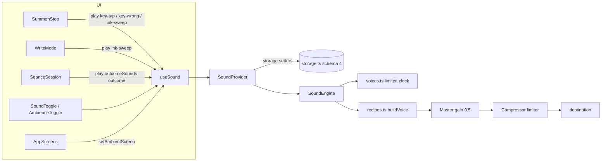
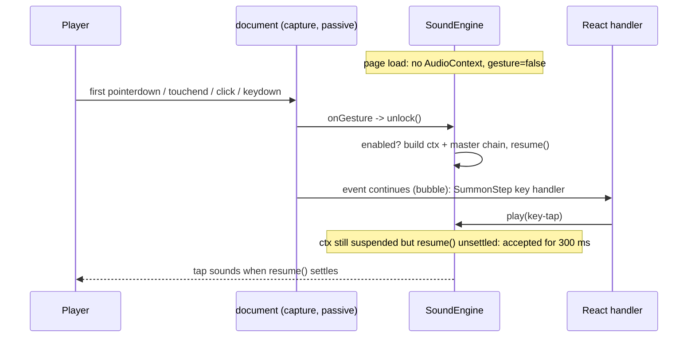

# Design Document

## Overview

Night sounds adds seven quiet effect sounds and one optional wind loop to Ghost Script. Every sound is synthesised with the Web Audio API. There is no audio file, sample or library. A speaker toggle on every screen turns sound on and off; a second toggle on the menu and the Graveyard turns the wind on and off. Both choices are saved in schema 4 of the save.

This design follows `requirements.md` of this spec. The human approved every decision recorded in the section "Decisions approved by the human" at the end of this document, and each steering amendment. No task edits `kiro-log.md`; the human writes it.

### Method

- Code read: `app/src/storage/storage.ts`, `App.tsx`, `StartMenu.tsx`, `IntroScreen.tsx` (structure only), `LevelScreen.tsx` (structure only), `SeanceSession.tsx`, `SessionSummary.tsx` (structure only), `Graveyard.tsx`, `Credits.tsx`, `CangjieGuide.tsx` (structure only), `modes/SummonStep.tsx`, `modes/WriteMode.tsx`, `SealStamp.tsx`, `SkyCap.tsx`, `styles/index.css`, `styles/index.css.test.ts`, `e2e/helpers.ts`, `e2e/sky-cap.spec.ts`, `e2e/slips.spec.ts`, `scripts/check-bundle-size.ts`, the steering files and `tests/unit/steering-art-direction.test.ts`.
- Layout measured, not guessed: I built the app to a temporary folder outside the repo (`/tmp/gs-dist`), served it, and ran a throwaway Playwright script (`/tmp/gs-measure`) at 1024 x 768, 992 x 768, 991 x 768, 1440 x 900, 375 x 812 and 320 x 640. The script read the bounding boxes of every control and text element near the candidate toggle boxes on the menu, Graveyard, Sources & licences and Séance, and (at 4 widths) on the intro, Level screen and Cangjie guide. The Summary screen was not measured (it needs a played séance); it is reasoned from its source. Nothing from `/tmp` is part of the repo.
- Bundle size measured by a prototype: I wrote throwaway versions of the modules in `/tmp/gs-proto`, minified them with the repo's `esbuild` and gzipped them at level 9 (the level `check:bundle` uses). Section "Bundle estimate" gives the numbers.
- Not verified: behaviour on a real iPhone, iPad or Android device (iOS unlock events, the silent switch, the `interrupted` state). The requirements already mark these as unverified; a manual device check is a review step for the human, not a test.

### Findings that change the plan

These were found while reading the code. Each is carried into the design below.

1. **The séance header collides with the toggle up to about 600 px, not only below 360 px.** Measured: at 375 x 812 the "Ghost 1 of 10" heading spans x 182 to 287 and the toggle (x 243 to 287 with the chosen gap) lies on it; at 320 x 640 the heading spans 148 to 232 and the toggle (x 188 to 232) lies on it. Moving the heading only below 360 px would leave 375 px broken, so the design moves it at every width (see "Séance header").
2. **A media query is not allowed.** `index.css.test.ts` line 40 to 52 lists every `@media` condition in the stylesheet and fails on any other. The toggle's switch at 992 px therefore uses the `clamp()` trick the file already uses for `--moon-room`, with no new `@media` block.
3. **The Moon-scan test reads 3 rem either side of the disc.** `discExtent(..., 3 * rem, ...)` in `e2e/sky-cap.spec.ts` scans the row through the disc centre from 48 px left of it. A toggle 8 px from the disc would put 8 px of paper inside that scan and break the 64 ± 2 px diameter check. The design uses a 16 px gap (still "at least 8 px" for Requirement 14.3), so no existing assertion changes.
4. **Position at 992 px and above.** At 992 px the Graveyard "Back to menu" button ends at x 864 (measured). A toggle 16 px left of the Moon spans x 860 to 904 and y 8 to 52, so it overlaps that button (y 34 to 78) by 4 px; even an 8 px gap leaves only 4 px clear. The Summary heading box (x 120 to 872 by calculation from `Shell` and `SessionSummary`) would overlap it as well. The design therefore places the toggle below the Moon from 992 px. This replaces the words "to the left of the Moon_Disc" of the first Requirement 14.3 for widths of 992 px and above; Requirements 14.3 and 14.11 now state both positions (see "Decisions approved by the human").
5. **Requirement 5.1 and Requirement 4.6.** On a first meeting, the forming of the character calls `enqueueInk` for every remaining stroke, and Requirement 4.6 says the forming stays silent. The design plays the sweep only for strokes inked by an accepted key, and Requirement 5.1 says so.
6. **Location of the engine.** The module lives in `app/src/audio/`, and Requirement 1.6 and the Glossary say so.
7. **Existing storage tests change.** The test at `storage.test.ts` line 786 to 790 ("resets a save newer than version 3") uses a schema 4 blob, which becomes valid. It must become schema 5, which keeps its meaning. Section "Existing assertions that change" lists all of them.
8. **`sky-cap.spec.ts` line 135** removes only `html, body, #root, .sky-cap` from the list of things beneath the band. The fixed toggle is a new fixed thing in the band and must be named there.

## Architecture

### Module split

```
app/src/audio/
  voices.ts        pure: SoundId, voice limiter, rate limiter, createLimiter(clock)
  recipes.ts       pure data and small functions: RECIPES, AMBIENCE, MASTER_GAIN, LIMITER,
                   outcomeSounds(), fillNoise(), buildVoice(ctx, ...)
  engine.ts        createSoundEngine(deps), isWebAudioAvailable(): lazy AudioContext, master chain,
                   unlock, resume, suspend, visibility, reduced motion, failure latching
  SoundProvider.tsx  React context, useSound(), SoundApiContext (tests), saves the two settings
  audioMock.ts     test double for AudioContext (imported only by tests, never by app code)
app/src/components/
  SoundToggle.tsx
  AmbienceToggle.tsx
```

`voices.ts`, `recipes.ts` and `engine.ts` import no React. Only `SoundProvider.tsx` and the two components import React. `recipes.ts` imports `AudioContext` types from `lib.dom` only.

### Data flow



### Gesture unlock sequence



The engine's listeners are on `document` with `capture: true`, so they run before React's root listeners and before the `window` bubble listener of `SummonStep`. The first physical key therefore both unlocks and sounds.

## Components and Interfaces

### voices.ts

```ts
export type SoundId =
  | 'key-tap' | 'key-wrong' | 'ink-sweep'
  | 'seal-thud' | 'rest-clean' | 'rest-struggled' | 'rest-gave-up';

export const MAX_VOICES = 4;            // R7.1
export const MAX_KEY_INK_VOICES = 3;    // R7.2: key-tap + key-wrong + ink-sweep together
export const MAX_PER_ID = 2;            // R7.3
export const SPACING_MS: Readonly<Partial<Record<SoundId, number>>> =
  { 'key-tap': 40, 'key-wrong': 40, 'ink-sweep': 80 };   // R7.4, R7.5

export interface Voice { readonly id: SoundId; readonly end: number }
export interface PlannerState {
  readonly active: readonly Voice[];
  readonly last: Readonly<Partial<Record<SoundId, number>>>;   // last accepted time per id
}
export type DropReason = 'spacing' | 'per-id' | 'group' | 'total';
export type Decision = { readonly accept: true } | { readonly accept: false; readonly reason: DropReason };
export const EMPTY_PLANNER: PlannerState;

/** Pure. Reads no clock and no global. Prunes voices with end <= now, then decides. */
export function plan(state: PlannerState, id: SoundId, now: number, durationMs: number):
  { state: PlannerState; decision: Decision };

/** Wraps plan() with a state variable and an injected clock. */
export function createLimiter(clock: () => number, durations: Readonly<Record<SoundId, number>>):
  { accept(id: SoundId): Decision; reset(): void };
```

Decision order: spacing, then per-id and group (only for the three key and ink ids), then total. Outcome ids skip the first three checks, so an outcome is accepted whenever fewer than 4 voices are active (R7.7). A dropped request returns the pruned state and is never queued (R7.6). The limiter has no timer, so a drop changes nothing else (R7.8).

`durations` is `DURATION_MS` from `recipes.ts`: delay plus envelope end, in milliseconds. For `rest-clean` that is 180 + 900 = 1,080 ms, so the planner counts the chime from the request, not from its audible start. That is conservative by 180 ms and keeps the rule simple.

### recipes.ts

```ts
export const MASTER_GAIN = 0.5;                                         // R3.3 (at most 0.6)
export const LIMITER = { threshold: -18, knee: 6, ratio: 12, attack: 0.003, release: 0.25 } as const;  // R3.4
export const FLOOR = 0.0001;                                            // R3.5

export interface Osc   { type: 'sine'; f0: number; f1?: number; sweep?: number; peak: number; attack: number; end: number }
export interface Noise { kind: 'bandpass' | 'lowpass'; f0: number; f1?: number; sweep?: number; q: number; peak: number; attack: number; end: number }
export interface Recipe { delay: number; dur: number; osc: readonly Osc[]; noise: readonly Noise[] }

export const RECIPES: Readonly<Record<SoundId, Recipe>>;
export const AMBIENCE: { loopSeconds; centre; depth; lfoHz; q; base; lfoGain; fadeIn; fadeOut };
export const DURATION_MS: Readonly<Record<SoundId, number>>;

/** The only mapping from a game result to sounds. Takes the outcome and nothing else. */
export function outcomeSounds(outcome: 'clean' | 'struggled' | 'gave-up'): readonly SoundId[];

/** Fixed-seed (mulberry32) noise. `smooth` low-passes it for the wind. Same samples on every run (R3.8). */
export function fillNoise(out: Float32Array, smooth?: boolean): void;

/** Builds and starts one effect voice at t0 + recipe.delay. Every started source is added to `sources`. */
export function buildVoice(ctx: AudioContext, dest: AudioNode, r: Recipe, noise: AudioBuffer,
                           t0: number, sources: Set<AudioScheduledSourceNode>): void;
```

`outcomeSounds` takes an `Outcome` only. No function in `audio/` takes a character, a code, a key name or a stroke (R1.5, R12.4). `play(id)` takes a `SoundId` and nothing more.

### engine.ts

```ts
export interface SoundEngine {            // R1.1: these six operations only
  play(id: SoundId): void;
  setEnabled(on: boolean): void;
  setAmbience(wanted: boolean): void;     // "wanted" already includes the saved wind choice and the screen
  unlock(): void;
  suspend(): void;
  dispose(): void;
}

export interface EngineDeps {             // how tests inject the engine's world
  createContext?: () => AudioContext;     // default: new (AudioContext ?? webkitAudioContext)()
  now?: () => number;                     // default: performance.now()
  doc?: Document;                         // default: document
  matchMedia?: (q: string) => Pick<MediaQueryList, 'matches' | 'addEventListener' | 'removeEventListener'>;
}
export function createSoundEngine(deps?: EngineDeps): SoundEngine;
export function isWebAudioAvailable(): boolean;   // checks AudioContext / webkitAudioContext is a function; constructs nothing
```

Behaviour:

- **Construction of the engine** adds the listeners and builds no AudioContext (R2.1). Listeners: `pointerdown`, `touchend`, `click`, `keydown` on `document` with `{ capture: true, passive: true }` (R2.7), `visibilitychange` on `document`, and `change` of `(prefers-reduced-motion: reduce)` (R9.6). `dispose()` removes all of them (R2.7, R9.6, R10.4). Where `MediaQueryList.addEventListener` is missing (Safari before 14), it falls back to `addListener`.
- **`unlock()`** does nothing unless the setting is on and the engine is neither broken nor disposed (R2.4). Otherwise it records that a gesture happened, builds the context and the master chain once (R2.3, R2.8), and calls `resume()` once per call when the state is not `running` or `closed` (R2.6). The gesture listener calls it. The toggle's click handler also calls it, because the listener runs before React updates the saved setting (see "Autoplay policy").
- **`play(id)`** returns at once unless: enabled, a gesture has happened, not broken, not disposed, document visible, context exists, and the context is `running` or a `resume()` call made less than 300 ms ago has not settled (R2.2, R10.3, R11.5). Then it asks the limiter, and on `accept` calls `buildVoice` inside `try/catch`. Any throw is swallowed and the request dropped (R11.4). `play` never throws and never awaits (R12.3).
- **`setEnabled(false)`** stops every tracked source, resets the limiter, stops the wind and calls `suspend()` (R13.6). `setEnabled(true)` after a gesture resumes the context.
- **`setAmbience(wanted)`** stores the wish and runs `sync()`. `sync()` starts the wind only when enabled, wanted, a gesture happened, not broken, the context is `running`, the document is visible, and reduced motion is not requested (R8.1). It fades the wind out when any of those stops being true (R8.4, R9.2, R10.1).
- **`suspend()`** stops the wind and calls `ctx.suspend()` inside `try/catch`.
- **Failure latching**: a throw from the constructor sets `broken` for the page session and is never retried (R11.2). A rejected `resume()` clears the unsettled flag; the next gesture calls `resume()` again (R11.3). No path logs to the console (R11.6). No path changes the saved settings, because the engine never touches storage (R11.7).
- **Resume window** (Requirement 2.10): between a first `resume()` call and its promise settling, a `play` is accepted and scheduled at the frozen `currentTime`; it sounds when the context starts. The window is time-boxed to 300 ms, so on iOS (where a `pointerdown` does not unlock and the promise may stay unsettled until `touchend`) a burst of old voices cannot pile up. It keeps the very first key tap audible.
- **Noise buffers** are created on first need and reused (R3.9): a 1 s mono buffer for the effects (`sampleRate` samples), a 3 s mono buffer for the wind, built when the wind first starts (R8.6, R19.4: both well under 4 s).

### SoundProvider.tsx and useSound

```ts
export interface SoundApi {
  available: boolean;            // Web_Audio_Available
  soundOn: boolean;
  ambienceOn: boolean;
  reducedMotion: boolean;        // for the Ambience_Toggle's disabled state
  play(id: SoundId): void;       // stable identity, never throws, never awaits
  setSoundOn(on: boolean): void;       // saves, then engine.setEnabled / unlock / confirming tap
  setAmbienceOn(on: boolean): void;    // saves
  setAmbientScreen(on: boolean): void; // called by AppScreens: true on menu and graveyard
}
export const SoundApiContext: React.Context<SoundApi>;   // default value is a no-op API with available:false
export function SoundProvider(props: { children: ReactNode; createEngine?: () => SoundEngine }): JSX.Element;
export function useSound(): SoundApi;
```

- **Outside a provider, `useSound()` returns the no-op API** (`available: false`, every method does nothing). The existing component tests render `SummonStep`, `WriteMode`, `SeanceSession`, `StartMenu` and `Graveyard` without a provider, so none of them changes, and the two toggles render nothing there.
- The engine is created in a `useEffect` and disposed in its cleanup. This is safe under `StrictMode` (`main.tsx` uses it): the first engine is disposed, its listeners removed, and a second engine is created. The engine is not created when `available` is false.
- Initial state comes from `getSoundOn()` and `getAmbienceOn()` (storage). The React state is the source of truth for the page session, so the toggles keep working when saving fails (R16.10).
- `setSoundOn(true)`: `setSound(true)`, `storage.setSoundOn(true)`, `engine.setEnabled(true)`, `engine.unlock()`, `engine.play('key-tap')` (R13.7). `setSoundOn(false)`: save, then `engine.setEnabled(false)` (R13.6).
- An effect calls `engine.setAmbience(ambienceOn && ambientScreen)` whenever either changes. The engine adds the other conditions itself.
- `reducedMotion` is read from `matchMedia` with a `change` listener, only so the Ambience_Toggle can show its disabled state.
- `play` is a `useCallback` with an empty dependency list that reads the engine from a ref. Callers can list it as a dependency without restarting any effect.

### SoundToggle.tsx

```tsx
export function SoundToggle(): JSX.Element | null   // null when !available (R11.1)
```

A native `<button type="button" data-testid="sound-toggle" aria-label="Sound" aria-pressed={soundOn}>` with classes `slip sound-toggle h-11 w-11 p-0` plus the focus ring string already used by `StartMenu` (`focus:outline-none focus-visible:ring-2 focus-visible:ring-ghost focus-visible:ring-offset-2 focus-visible:ring-offset-background`). No `slip-primary`. Its click calls `setSoundOn(!soundOn)` and leaves the focus where it is (R13.8: a button keeps focus on click in the browsers the app targets; the test asserts `document.activeElement`). The accessible name is the fixed word "Sound" and the state is `aria-pressed`.

Icon: one inline SVG, `aria-hidden="true"`, `viewBox="0 0 24 24"`, 24 px, built from paths only, no text, no ghost shape, colour `currentColor` (the slip's `--ink-on-paper`, which is the existing paper-label ink):

- speaker body (both states): `M4 9.5h3.5L12 6v12l-4.5-3.5H4z`, filled.
- on: two wave arcs `M15.2 9.3a3.8 3.8 0 0 1 0 5.4M17.8 6.8a7.4 7.4 0 0 1 0 10.4`, stroke 1.8, no fill.
- off: no arcs, one diagonal slash `M4 4l16 16`, stroke 2.2.

The state is carried by shape (arcs against slash), never by colour alone (R13.2). The slip colour contrast is the existing 4.5:1 / 3:1 slip rule; no new colour is used (R13.4).

### AmbienceToggle.tsx

```tsx
export function AmbienceToggle(): JSX.Element | null   // null when !available
```

`<button type="button" aria-label="Night wind" aria-pressed={ambienceOn} aria-disabled={disabled ? 'true' : undefined} aria-describedby={note ? 'wind-note' : undefined}>` with the visible text `Night wind: on` or `Night wind: off`, classes `slip min-h-[44px] px-6 py-2 text-base` plus the focus ring string. `disabled = !soundOn || reducedMotion`. The click handler returns at once when `disabled` (it uses `aria-disabled`, not the `disabled` attribute, so the button stays focusable and the note is reachable). The note is a `<p id="wind-note" className="text-center text-sm text-muted">` with one of two texts:

- sound off: "Turn sound on to hear the night wind."
- reduced motion: "The night wind is off while reduced motion is requested."

The existing cursor rule gives `aria-disabled="true"` the `not-allowed` cursor and every other enabled button the Link_Cursor, with no new rule (R13.9). The label-in-name rule holds: the accessible name "Night wind" is contained in the visible text.

### Screens that render things

- **`App.tsx`**: `App` becomes `<SoundProvider><SkyCap /><AppScreens /></SoundProvider>`. `AppScreens` keeps its hooks and moves the existing `switch` (line 448 onward) into a local function `renderScreen()`. It returns `<>{renderScreen()}{showToggle ? <SoundToggle /> : null}</>` where `showToggle` is true for every `view.screen` except `loading` and `error` (R14.10). The toggle is therefore the last child of `#root` after `<main>`, so the first Tab stop and initial focus of every screen are unchanged (R13.10). `AppScreens` also calls `setAmbientScreen(view.screen === 'menu' || view.screen === 'graveyard')` in an effect keyed on `screenName` (the existing constant at line 287).
- **`StartMenu.tsx`**: `<AmbienceToggle />` is added inside the button column (`flex w-full max-w-sm flex-col gap-2`), after the "Graveyard" button and before the "Sources & licences" block. The component has no new props.
- **`Graveyard.tsx`**: `<AmbienceToggle />` is added after the paragraph "Your séances draw new ghosts from level …" (line 184), wrapped in a `self-start` element like the restless button.
- **`SeanceSession.tsx`**: the header change is described in "Séance header".

## Data Models

### Synth recipes

All gains are linear, before the Master_Gain (0.5). Every envelope is `setValueAtTime(0, t)`, `linearRampToValueAtTime(peak, t + attack)`, `exponentialRampToValueAtTime(0.0001, t + end)`; the source stops 20 ms after `end`, when the gain is already 0.0001 or lower. All attacks are at least 2 ms (R3.5). The "peak" of a sound is the sum of its component peaks, so the table's bound holds for the total.

| Sound_Id | Components (type, frequency, filter) | Envelope per component | Duration (env end, plus delay) | Peak sum | Bound in R3 |
|---|---|---|---|---|---|
| `key-tap` | sine 260 Hz falling to 200 Hz over 60 ms; noise band-pass 1,100 Hz, Q 1.2 | sine: attack 3 ms, end 75 ms, peak 0.07; noise: attack 2 ms, end 25 ms, peak 0.03 | 80 ms | 0.10 | body 180 to 320 Hz, band-pass 700 to 1,600 Hz, 40 to 100 ms, at most 0.10 |
| `key-wrong` | sine 140 Hz falling to 120 Hz over 80 ms; noise low-pass 380 Hz, Q 0.7 | sine: attack 4 ms, end 105 ms, peak 0.06; noise: attack 3 ms, end 50 ms, peak 0.02 | 110 ms | 0.08 | body 110 to 180 Hz and at least 30% below `key-tap` (140 is 46% below 260), low-pass at most 500 Hz, 60 to 140 ms, at most 0.08 |
| `ink-sweep` | noise band-pass, centre sweeps 2,200 Hz to 3,400 Hz linearly over 200 ms, Q 0.9 | attack 40 ms, end 220 ms, peak 0.035 | 220 ms | 0.035 | centre 1,500 to 4,000 Hz, moves 1,200 Hz (at most 1,500), 120 to 300 ms, at most 0.04 |
| `seal-thud` | sine 90 Hz falling to 50 Hz over 180 ms; noise low-pass 320 Hz, Q 0.7 | sine: attack 4 ms, end 300 ms, peak 0.15; noise: attack 3 ms, end 120 ms, peak 0.04 | 300 ms | 0.19 | sine 90 to 50 Hz, low-pass at most 400 Hz, 200 to 400 ms, at most 0.20 |
| `rest-clean` | sine 294 Hz; sine 588 Hz (2 times) | 294: attack 12 ms, end 900 ms, peak 0.09; 588: attack 12 ms, end 500 ms, peak 0.03 | 900 ms, delay 180 ms, ends 1,080 ms | 0.12 | fundamental 262 to 330 Hz, second partial gain at most 0.4 of the first (0.03 is 0.33), 700 to 1,000 ms, at most 0.12, ends at most 1,200 ms |
| `rest-struggled` | sine 294 Hz only | attack 12 ms, end 600 ms, peak 0.07 | 600 ms | 0.07 | same fundamental, no partial, 500 to 800 ms, at most 0.09 |
| `rest-gave-up` | sine 330 Hz falling to 196 Hz over 700 ms | attack 20 ms, end 800 ms, peak 0.06 | 800 ms | 0.06 | 330 to 196 Hz, 500 to 1,000 ms, at most 0.08 |
| wind | looped noise (3 s, smoothed, fixed seed) through band-pass centre 500 Hz, Q 0.8; one 0.1 Hz sine LFO moves the centre by plus or minus 150 Hz and the gain by plus or minus 0.01 | gain 0 to 0.02 over 1.5 s; fade out 0.45 s | loop 3 s | 0.03 at the top of the LFO | centre 300 to 700 Hz (350 to 650), LFO 0.05 to 0.15 Hz, loop 2 to 4 s, fade in 1,000 to 2,000 ms, fade out 300 to 600 ms, at most 0.03 |

Why each one sounds the way its name says:

- **Soft wooden tap (`key-tap`)**: a short sine with a small downward pitch step gives the hollow "tok" of wood; a 25 ms band-passed noise click around 1.1 kHz is the knock of the contact. It is 80 ms long, with a 3 ms attack and no tail, so it never rings.
- **Dull tap (`key-wrong`)**: the same shape one octave-ish lower (140 Hz) with the noise low-passed at 380 Hz, so the bright click is gone. The ear hears "muffled".
- **Brush sweep (`ink-sweep`)**: band-passed noise whose centre rises over the stroke, with a slow 40 ms rise. A bristle dragging over paper is hiss that brightens, with no pitch. Its peak of 0.035 is the quietest sound, so it never competes with the taps.
- **Low paper thud (`seal-thud`)**: a sine dropping from 90 to 50 Hz is a soft low "thump" without a tone; the low-passed noise burst adds the paper-and-wax contact. It is the loudest effect (0.19) because it marks the best moment, and is still below the 0.2 cap.
- **Soft low chime (`rest-clean`)**: two sines at 294 Hz (D4) and its octave, the octave quieter and half as long, with a 12 ms attack and a 0.9 s exponential decay. That is a bell-like fall without the inharmonic partials of a real bell, so it stays gentle. It starts 180 ms after the thud so the two do not blur.
- **Struggled chime (`rest-struggled`)**: the same note, one partial, shorter and 22% quieter. It differs from `rest-clean` by shape and length, not only by loudness.
- **Quiet falling tone (`rest-gave-up`)**: one sine falling from 330 to 196 Hz (about a fifth) over 0.7 s, peak 0.06. A slow fall reads as "slipping away" and not as a buzzer.
- **Night wind**: smoothed noise has more low energy than white noise; a Q of 0.8 band-pass at 500 Hz gives a broad "whoosh" and the 0.1 Hz LFO (a 10 s cycle) swells it slowly. The base gain 0.02 plus the LFO's plus or minus 0.01 stays at or below 0.03.

Master chain: voices connect to one `GainNode` (0.5), then one `DynamicsCompressorNode` (threshold −18, knee 6, ratio 12, attack 0.003, release 0.25), then `destination` (R3.2 to R3.4). With the 0.2 per-voice cap, four voices at the master gain sum to at most 0.4 (R3.10). Noise is always filtered, at most 3,400 Hz here, under the 6,000 Hz bound (R3.6). The longest effect, `rest-clean`, ends 1,080 ms after its request, under 1,200 ms (R3.7).

Stroke count reminder: a Write step with a 12-stroke character can request 12 sweeps, one per accepted stroke. The 80 ms spacing and the group limit keep them light.

### Persisted state (schema 4)

```ts
export const CURRENT_SCHEMA_VERSION = 4;

export interface PersistedState {
  readonly schemaVersion: number;
  readonly introSeen: boolean;
  readonly cangjieIntroSeen: boolean;
  readonly level: Level;
  readonly levelChosen: boolean;
  /** Whether sound is on. Added in schema 4. Default true. */
  readonly soundOn: boolean;
  /** Whether the night wind is on. Added in schema 4. Default false. */
  readonly ambienceOn: boolean;
  readonly history: ReviewHistory;
}
```

Changes in `storage.ts` (line numbers are of the file today):

1. `CURRENT_SCHEMA_VERSION` (line 13) becomes 4.
2. `PersistedState` (lines 21 to 30) gains the two fields, placed before `history` to keep the blob readable.
3. `SHIPPED_MIGRATIONS` (lines 80 to 85) gains key `3`: `(old) => ({ ...(old as Record<string, unknown>), soundOn: true, ambienceOn: false })`. It overwrites any `soundOn` or `ambienceOn` a schema 3 blob happens to carry, so a migrated blob is always well formed. The loop at lines 189 to 196 already chains migrations, so a schema 2 blob runs `2` then `3` (R16.4). The doc comment above `SHIPPED_MIGRATIONS` is updated.
4. `validateState` (lines 129 to 145) keeps its early `return undefined` lines for `introSeen`, `cangjieIntroSeen`, `level`, `levelChosen` and `history` (R16.6), and then builds the result with per-field repair:
   ```ts
   soundOn: typeof blob.soundOn === 'boolean' ? blob.soundOn : true,
   ambienceOn: typeof blob.ambienceOn === 'boolean' ? blob.ambienceOn : false,
   ```
   A bad sound field never returns `undefined`, so it never causes `loadState` to return `defaultState` and drop the history (R16.5). A schema above 4 is rejected by the existing `stored > version` test at line 187 (R16.9).
5. `defaultState` (lines 154 to 161) gains `soundOn: true, ambienceOn: false` (R16.2).
6. **The copy-by-name pitfall.** `saveState` (lines 183 to 191) and `recordOutcome` (lines 204 to 211) both build the blob by naming each field. A field not named there is silently dropped at the next write, which would reset the player's sound choice every time an outcome is recorded. Both get `soundOn: state.soundOn, ambienceOn: state.ambienceOn` (`prior.soundOn`, `prior.ambienceOn` in `recordOutcome`) (R16.8). A test records an outcome with `soundOn: false` and `ambienceOn: true` saved and reads both back.
7. New store methods, matching the style of `setCangjieIntroSeen`: `getSoundOn(): boolean`, `setSoundOn(on: boolean): void`, `getAmbienceOn(): boolean`, `setAmbienceOn(on: boolean): void`. Each setter is `saveState({ ...loadState(), <its field>: on })`, so it changes only its own field (R16.7). The `Store` interface (lines 49 to 66), the returned object and the default-store exports (lines 270 to 280) all gain them.
8. `resetToDefaults` already removes the key, so the next load returns the defaults (R16.11).

Default: `soundOn: true`, in `defaultState`, in the validation repair and in migration `3`. The schema 3 migration also gives `soundOn: true`. The blob stays in the one existing key.

### Layout constants

New CSS in `app/src/styles/index.css`, outside the motion block, outside any `@media`, after the `@layer components` block so it follows `.slip`:

```css
/* Sound_Toggle: fixed beside the Moon. Below 992 px it sits in the Moon_Room, 1 rem left of the
   disc; from 992 px it sits 1 rem below the disc. The switch is a clamp(), not a media query
   (index.css.test.ts lists every @media). z-index 30 is above the Sky_Cap (10) and the sticky headers (20). */
.slip.sound-toggle {
  position: fixed;
  z-index: 30;
  width: 2.75rem;
  height: 2.75rem;
  padding: 0;
  display: inline-flex;
  align-items: center;
  justify-content: center;
  top: clamp(0.5rem, calc(0.5rem + (100vw - 991px) * 1000), calc(var(--moon-inset-y) + var(--moon-size) / 2 + 1rem));
  right: clamp(calc(var(--moon-inset-x) - 1.375rem), calc((var(--moon-inset-x) + var(--moon-size) / 2 + 1rem) - (100vw - 991px) * 1000), calc(var(--moon-inset-x) + var(--moon-size) / 2 + 1rem));
}
```

Values with the current variables (`--moon-inset-x` 2.5 rem, `--moon-inset-y` 2.5 rem, `--moon-size` 4 rem, root font 16 px):

| Viewport | top | right | Box (x from left edge to right edge, y) |
|---|---|---|---|
| 320 | 8 px | 88 px | x 188 to 232, y 8 to 52 |
| 375 | 8 px | 88 px | x 243 to 287, y 8 to 52 |
| 991 | 8 px | 88 px | x 859 to 903, y 8 to 52 |
| 992 | 88 px | 18 px | x 930 to 974, y 88 to 132 |
| 1024 | 88 px | 18 px | x 962 to 1006, y 88 to 132 |
| 1440 | 88 px | 18 px | x 1378 to 1422, y 88 to 132 |

The Moon disc is x (vw − 72) to (vw − 8), y 8 to 72 (centre vw − 40, 40, radius 32). Below 992 px the toggle's right edge is 16 px left of the disc. From 992 px its top edge is 16 px below the disc and it is centred under the disc (right 18 px, width 44 px, so the centre is at vw − 40). The `clamp()` pair is the same device as `--moon-room`: at 991 px and below `100vw − 991px` is zero or negative and the first value wins; at 992 px it is positive and times 1000 pushes past the other bound. Fractional widths between 991 and 992 px take the 992 values, as the `--moon-room` rule also flips at the same instant.

The rule uses `.slip.sound-toggle` (two classes) so it wins over `.slip { position: relative; min-height: 44px }` whatever the layer order.

## Toggle placement on every screen

### Fixed numbers

- Moon disc: centre (vw − 40, 40), radius 32, so x (vw − 72) to (vw − 8), y 8 to 72. These come from `--moon-inset-x`, `--moon-inset-y` and `--moon-size` (`index.css` lines 57 to 59).
- Moon_Room: 76 px below 992 px, 0 from 992 px (`--moon-room`, line 60). `SkyCap` is `position: fixed`, z-index 10, as tall as the Moon_Room (`index.css` lines 165 to 172), hidden on the séance (`#root:has(> main.no-moon-room) > .sky-cap`, line 189).
- Sticky headers of the Graveyard and Sources & licences: `sticky z-20`, `top: var(--moon-room)`, `min-h-[64px]` (`Graveyard.tsx` line 152, `Credits.tsx` line 38).
- `#root` has `position: relative; z-index: 1` (`index.css` lines 127 to 130, asserted by `index.css.test.ts` line 322), so the toggle, rendered inside `#root`, shares that stacking context with the Sky_Cap and the headers. A z-index of 30 puts it above both.

### Measured clearance of the chosen position

Candidate boxes: below 992 px "A" (right edge 88 px from the right, top 8 px, 44 px square); from 992 px "B" (right edge 18 px from the right, top 88 px). The first table is the measurement of 8 px-gap boxes made before the gap was widened to 16 px; the gap change moves A 8 px to the left, which only moves it away from the Moon and towards content on its left, and the séance rows are re-checked below.

| Viewport | Menu | Graveyard header | Sources header | Intro, Level, Cangjie guide | Séance |
|---|---|---|---|---|---|
| 1440 x 900 | B clear | B clear (Back ends x 1088) | clear | not measured at this width (column is centred, max 768 px, far from x 1378) | B clear |
| 1024 x 768 | B clear | B clear (Back ends x 880, toggle starts x 962) | clear | clear | B clear (séance column ends x 800) |
| 992 x 768 | B clear | B clear (Back ends x 864, toggle starts x 930) | clear | clear | B clear |
| 991 x 768 | A clear (no elements in the top 76 px) | A clear (sticky header is below the Moon_Room, y from 76) | clear | not measured | A clear |
| 375 x 812 | A clear | A clear | clear | clear | A overlaps the heading "Ghost 1 of 10" (x 182 to 287, y 22 to 50); fixed by moving the heading |
| 320 x 640 | A clear | A clear | clear | clear | A overlaps the heading (x 148 to 232, y 26 to 46); fixed by moving the heading |

The Summary was not measured. Below 992 px it starts below the Moon_Room, so the toggle is clear of it. From 992 px, B is at y 88 or lower and x 930 or more, while the Summary column ends at x 872 at 992 px and grows no closer. The end-to-end fit tests in the Testing Strategy measure it.

### Why A below 992 px and B from 992 px

- **A below 992 px** is the chosen position: inside the Moon_Room, so it cannot overlap scrolling content (the Top_Room is kept free) and it does not change the Moon_Room's height (R14.6). The Sky_Cap is beneath it (10 against 30).
- **B from 992 px** exists because of the 992 px edge case measured above. The toggle sits in the margin to the right of every content column from 992 px (the widest column, 768 px, ends at x 880 at 992 px; B starts at x 930). It is still 16 px from the Moon and does not meet it. It never meets the sticky header (y 0 to 64) because it is at y 88 or lower. Below 992 px, where the Moon_Room is kept free of content, A needs no change to any column.

### The Moon stays unobstructed

`moonIntruders` (`e2e/helpers.ts` line 325) reports any `button`, `a`, input or text element whose box comes within the radius (32 px) of the disc centre, measured as the nearest point of the box. The nearest point of A is the middle of its right edge: the edge is 88 px from the viewport's right edge and the centre is 40 px from it, so 48 px (A spans y 8 to 52, which contains the centre's y of 40). The nearest point of B is the middle of its top edge, 48 px below the centre (y 88 against 40). Both are over the 32 px radius, so `moonIntruders` stays empty and `expectMoonInside` (used by `e2e/screenshots.spec.ts`) passes on every screen without a change. The glow (candle, on hover or focus) and the focus ring are `box-shadow`, which `moonIntruders` does not count. The 16 px gap keeps the toggle out of the 48 px scan of `discExtent` (finding 3).

### Other layout points

- **Stacking.** Sky_Cap 10, sticky headers 20, toggle 30. The toggle is a `.slip`, which sets `isolation: isolate`, so its deckled `::before` (z-index −1) stays inside it.
- **Cursor.** The existing `button:not(:disabled):not([aria-disabled="true"])` rule gives it the Link_Cursor on fine pointers (`index.css` line 464).
- **Focus ring.** The same `focus-visible` string as the other buttons; the global `*:focus-visible` rule (aged paper with candle glow) applies.
- **Hover lift.** The slip rule lifts it 2 px; from y 8 it stays inside the viewport.
- **Horizontal overflow.** At 320 px the toggle's left edge is at x 188, far from any edge, so `no-horizontal-overflow.spec.ts` is unaffected.
- **Menu and Graveyard ambience toggle** sits in page content (see Components), not fixed, so it scrolls with the page and never meets the Moon.

### Séance header

Current structure (`SeanceSession.tsx` lines 215 to 232): a row `flex w-full items-center justify-between gap-3 pr-[4.5rem]` holding the Leave button and the `h2` "Ghost n of N". Measured at 320 x 640: Leave x 16 to 130, heading x 148 to 232. Measured at 375 x 812: Leave x 16 to 148, heading x 182 to 287. There is no room for the toggle (x 188 to 232 at 320 px; x 243 to 287 at 375 px) in the same row.

Design: **the heading moves out of the header row for every width and joins the step label.** The ghost prompt row (lines 259 to 262) is `flex items-center justify-center gap-3` with `GhostPrompt` (97 px wide, 72 px high) and the step label `p` (117 px wide at 320 and 375 px, 134 px at 1,024 px, 16 to 20 px high). That row is 226 px wide at 320 px inside a 288 px column. The step label's `p` becomes a `div` with `flex flex-col` holding the `h2` and the `p`. The column is `max(117, 84 to 105) = 117` px wide, so the row stays 226 px wide, and it is `28 + 16 = 44` to `28 + 20 = 48` px high, under the 72 px of the `GhostPrompt`, so the row's height does not change. The paper does not shrink; the minimum paper sizes (260, 240 and 96 px) hold.

Details:

- The header row keeps `pr-[4.5rem]` because `App.test.tsx` line 569 asserts the class. It now holds only the Leave button, which is 114 to 132 px wide.
- The `h2` keeps its text, `Ghost {index + 1} of {total}`, and its classes (`text-lg`, `max-[359px]:whitespace-nowrap max-[359px]:text-sm`). The many existing tests use `getByText('Ghost 1 of 10')` (e.g. `App.test.tsx` lines 201, 261, 303) and the e2e helper uses `getByRole('heading', { name: /^Ghost \d+ of \d+$/ })` (`e2e/helpers.ts` line 706); both find the one `h2` wherever it sits. One element is kept on purpose: two copies shown and hidden by CSS would make `getByText` find two nodes in jsdom, where CSS does not apply.
- Reading order: the column is placed first in the DOM and the row uses `flex-row-reverse` so the heading is read before the clue and the visual order stays "ghost, then text".
- Why every width: the collision exists at 375 px (measured) and continues until the column stops filling the viewport, near 600 px, and one element keeps every `getByText('Ghost …')` test valid.
- From 992 px, the toggle (x 930 or more at y 88 or more) is outside the séance column (ends at x 800 at 1,024 px), and the header has nothing to avoid.

Height check at 320 x 640 (measured today): the document is 640 px high and the Summon section ends at y 626. The toggle is fixed and adds nothing to the flow; the heading move adds nothing to any row height. R14.8 holds. This is confirmed by the existing `fits-one-screen.spec.ts` and the new fit test.

## Where each sound is triggered

All calls are fire and forget: `play` is a plain function call with no `await`, no timer and no return value used, placed after the state update it belongs to (R12.1, R12.3). `useSound().play` already swallows any throw; call sites need no extra `try`. For the "a throwing `play` changes nothing" test (R21.6) the test provider's `play` throws, and the call sites are wrapped by the provider's own guard, so nothing the player does differs.

| Event | Exact call site (file, current line) | Sound |
|---|---|---|
| Physical Summon key accepted or counted wrong | `SummonStep.tsx` `onKeyDown` (lines 183 to 192): after `commit(...)` (line 190) and `reportMiss(prev, next)` (line 191), add `soundForKey(prev, next)` | `key-tap` when `next.filled > prev.filled`; `key-wrong` when `next.mistakes > prev.mistakes` |
| On-screen Summon key | `SummonStep.tsx` `enterKey` (lines 170 to 177): after `reportMiss(prev, next)` (line 176), add `soundForKey(prev, next)` | same |
| An ignored key | none: for a physical key `next === prev` makes `onKeyDown` return at line 188; for an on-screen key the state is unchanged, so `soundForKey` plays nothing | none (R4.3) |
| The last key of the code | the same lines: it is an accepted key | `key-tap` only; no sound for the forming, hold or fade (R4.6) |
| Give up in the Summon step | `handleGiveUp` (line 231): no call | none |
| Ink of an accepted key | `enqueueInk` (line 128): new second parameter `sweep: boolean`; inside the chain callback, immediately before `await writer.animateStroke(s)` (line 136) and after the `disposedRef` / `brokenRef` guard, add `if (sweep) play('ink-sweep')` | `ink-sweep`, once per stroke, when its animation starts |
| `enqueueInk` from `afterKey` (line 152) | pass `true` | sweeps |
| `enqueueInk` from the first-meeting forming (line 300) | pass `false` | silent |
| `animateCharacter` for an opaque character (line 311) | no call | silent |
| Write step, accepted stroke | `WriteMode.tsx` `onCorrectStroke` (line 123): after `setFeedback('✓ Stroke accepted')`, call `soundRef.current('ink-sweep')`; the existing `if (resolvedRef.current) return` guard comes first | `ink-sweep` |
| Write step, rejected stroke | `onMistake` (line 112): no call | none (R5.3) |
| Write step data failure | `fail` (line 89) reports `gave-up` through `resolve`; the outcome sound comes from the session | via the session |
| Outcome | `SeanceSession.tsx` `handleOutcome` (lines 151 to 158): after `onOutcomeRef.current(record.character, outcome, Date.now())` (line 157), add `outcomeSounds(outcome).forEach(playRef.current)` | `clean`: `seal-thud` then `rest-clean`; `struggled`: `rest-struggled`; `gave-up`: `rest-gave-up` |

Details that keep the rules true:

- **Once per ghost, none after leaving.** `handleOutcome` returns before any of this when `resolvedRef.current` or `leftRef.current` is set (line 152), so the sounds are requested exactly once per ghost and never after "Leave" (R6.4). The sounds are requested for the nightly mode, the review mode and the walkthrough ghost alike because all three run through the same function (R6.5).
- **No sound on navigation.** `handleAdvance`, `openLeave`, `stay`, `leave` and `onComplete` get no call (R6.6).
- **Seal and thud together.** The seal appears from the same `setResult(outcome)` (line 155) that precedes the sound call. `rest-clean` carries its own 180 ms delay in its recipe, so the caller does not schedule anything (R6.1: 150 to 250 ms on the audio clock).
- **`soundForKey`** is a small `useCallback` in `SummonStep` comparing only two `SummonState` numbers. It cannot see the key, the code or the character (R4.4, R4.5, R12.4):
  ```ts
  const soundForKey = useCallback((prev: SummonState, next: SummonState) => {
    if (next.filled > prev.filled) playRef.current('key-tap');
    else if (next.mistakes > prev.mistakes) playRef.current('key-wrong');
  }, []);
  ```
- **Never-reveal.** Every sound depends on a count or an outcome and on nothing else. `key-tap` and `key-wrong` are the same two recipes for all characters and positions. The wrong-key tap reveals only what the status line "✗ Not that key" and the flinch already show (R12.5). No sound is attached to the target character, a code, a key name or a stroke index, and no DOM node, attribute or text is added for sound beyond the toggles (R12.6). The forming of the character (the approved first-meeting reveal) stays silent so that sound cannot add to what is shown.
- **Stale closures.** `SummonStep` and `WriteMode` read `play` from a ref (`playRef.current = play` each render), as they already do for `onDone` and `onWrongKey`. `WriteMode`'s main effect depends on `[record.character, dataset]` and must not restart the quiz when `play` changes, so it must not list `play`.
- **Reduced motion.** Ink sweeps are requested under reduced motion too (R5.5). With `SUMMON_REDUCED_SPEED = 1000` a stroke finishes in a frame, and the 80 ms spacing and the group limit drop most of the sweeps of a multi-stroke key; one remains.
- **Failed ink.** If `brokenRef` is set the chain callback returns before the sweep (R5.4).

## Autoplay policy

- **Unlock events**: `pointerdown`, `touchend`, `click`, `keydown` on `document`, capture phase, passive. `touchend` and `click` are the ones iOS Safari accepts; `pointerdown` and `keydown` serve desktop. On iOS a context built at `pointerdown` stays suspended and the later `touchend` or `click` calls `resume()` again (R2.6).
- **Lazy construction.** `createSoundEngine` builds nothing at load. The first gesture with sound on calls `build()` inside the handler (R2.3). A gesture with sound off builds nothing (R2.4).
- **Toggling on.** The document capture listener runs before React's click handler, so at that moment the setting is still off and the listener does nothing. The click handler then calls `setEnabled(true)`, `unlock()` (which builds the context and calls `resume()` inside the same click activation, R2.5) and `play('key-tap')`.
- **Resume.** Each gesture while the state is `suspended` or `interrupted` calls `resume()` once (R2.6). A rejection clears the unsettled flag and the next gesture tries again (R11.3). `visibilitychange` to visible calls `resume()` as well (R10.2). `ctx.onstatechange` re-runs `sync()` so the wind starts when a late `resume()` succeeds.
- **No sound before the first gesture.** `play` returns while `gesture` is false (R2.2). The intro's legend ink is silent.
- **End-to-end init script** (Audio_Recorder), added to `e2e/helpers.ts` as `installAudioRecorder(page)`:
  ```ts
  await page.addInitScript(() => {
    const rec = { constructed: 0, resumes: 0, suspends: 0, starts: [] as { kind: string; loop: boolean }[] };
    (window as unknown as { __audio: typeof rec }).__audio = rec;
    const Orig = window.AudioContext;
    window.AudioContext = class extends Orig {
      constructor(o?: AudioContextOptions) { super(o); rec.constructed += 1; }
      resume() { rec.resumes += 1; return super.resume(); }
      suspend() { rec.suspends += 1; return super.suspend(); }
    };
    const start = AudioScheduledSourceNode.prototype.start;
    AudioScheduledSourceNode.prototype.start = function (...a) {
      rec.starts.push({ kind: this.constructor.name, loop: (this as unknown as { loop?: boolean }).loop === true });
      return start.apply(this, a);
    };
  });
  ```
  Chromium's default autoplay policy is kept (no `--autoplay-policy` flag), so the contexts really start suspended until Playwright's click or key press counts as a user activation. A second helper `recordMedia(page)` listens to `request` and `response` events and collects any `resourceType() === 'media'` request or `audio/*` content type (R18.3).

## Reduced motion and visibility

- The engine reads `matchMedia('(prefers-reduced-motion: reduce)')` at construction and listens for `change` (R9.6). `reduced` is one input of `sync()`. A change to reduce while the wind plays fades it out in 450 ms and releases its nodes, and the saved Ambience_Setting is unchanged because the engine never saves (R9.2). A change back starts it again if the other conditions hold (R9.3).
- The effect sounds do not look at `reduced` (R9.5, R5.5).
- The `AmbienceToggle` shows `aria-disabled="true"` and its note while reduced motion holds (R9.4). The provider keeps its own `reducedMotion` state from the same media query for that.
- The feature adds no animation, keyframe or transition. The new CSS rule has none, so `index.css.test.ts` ("has animations and keyframes only inside the no-preference block", line 55) and its transition check stay as they are. The toggle's slip hover and press transitions are the existing 200 ms ones inside the motion block (R9.7). The wind is not added to the ambient exemption.
- Visibility: `visibilitychange` to hidden stops the wind, stops tracked sources and calls `suspend()`; to visible calls `resume()` and `sync()`. `play` returns while hidden (R10.1 to R10.3).

## Error Handling

| Failure | Behaviour | Requirement |
|---|---|---|
| `AudioContext` and `webkitAudioContext` both missing | `isWebAudioAvailable()` is false; the provider builds no engine; both toggles render `null`; `useSound().play` is a no-op | R11.1 |
| Constructor throws (for example too many contexts) | `broken = true` for the session; every operation returns; never retried | R11.2 |
| `resume()` rejects, throws or never settles | unsettled flag cleared (or expires after 300 ms); `play` returns while the state is not `running`; next gesture calls `resume()` again | R11.3 |
| A node, parameter or `start` call throws in `buildVoice` | caught in `play`; the voice is dropped; sources already started for that voice finish on their own (they have a 20 ms stop after a 0.0001 gain) | R11.4 |
| Context state `closed` or anything not `running` after the window | `play` drops | R11.5 |
| Any of the above | no console output, no unhandled rejection (every promise has a rejection handler), saved settings untouched | R11.6, R11.7 |
| `localStorage` missing or write fails | the provider's React state keeps the choices for the session; `isSavingWorking()` already reports the failure for the existing notice | R16.10 |
| A saved sound field is not a boolean | that field is replaced by its default; history kept | R16.5 |
| `play` throws in a caller (tests) | the provider's wrapper catches; callers never see it | R12.2 |

## Testing Strategy

### Why there are no property-based tests

This spec adds no property-based test and no mutation testing. The human's decision of Nov 15 in `tech.md` stops new property tests, and this feature has no exception. The design therefore has no Correctness Properties section. Every rule that could have been a property (the voice limits, the spacing, the recipe bounds, the migration chain) is checked with fixed examples and a table of cases instead, as Requirement 21.1 and 21.11 say. The existing property tests are untouched and none of them covers code this feature changes (the scheduler, the dataset, the summon ink, the prompt cleanup).

### Requirement groups and tests

| Requirement group | Test file (new unless marked) | Tests |
|---|---|---|
| R1, R7 planner | `app/src/audio/voices.test.ts` with a fake clock `let t = 0; const clock = () => t` | fourth voice accepted, fifth dropped (`total`); three key/ink voices then a fourth key/ink dropped (`group`) but an outcome accepted; two of one id then a third dropped (`per-id`); `key-tap` at 39 ms dropped, at 40 ms accepted; `ink-sweep` at 79 ms dropped, at 80 ms accepted; drop is not queued (state equals pruned state, no later accept); end-time bookkeeping: a voice ending at `t + dur` frees its place exactly at `end`; `plan` reads no clock (same inputs, same outputs); `DURATION_MS['rest-clean']` is 1,080 |
| R3 recipes | `app/src/audio/recipes.test.ts` | table-driven: every `RECIPES` row against the bounds of Requirement 3 (peak sum, frequency, duration, filter limits, partial ratio and gain ratio, `key-wrong` body at least 30% below `key-tap`, fundamental of `rest-struggled` equals `rest-clean`); every attack at least 2 ms; every envelope end value 0.0001; no component peak above 0.2; every noise centre or cut-off at most 6,000 Hz; end of every voice including the delay at most 1,200 ms; `outcomeSounds` returns the expected list for each outcome; `fillNoise` twice gives equal arrays and a golden first-four-sample check; AMBIENCE bounds |
| R3 synth through a mock | same file, with `audioMock.ts` | `buildVoice` on the mock: first gain event is 0, ramps to the peak no sooner than 2 ms, ends at 0.0001 before the source stop time; every source ends in the master chain; no gain above 0.2; noise sources have a filter; the noise buffer is created once for many voices |
| R2, R10, R11 engine | `app/src/audio/engine.test.ts` with the Audio_Mock and injected `createContext`, `now`, `doc`, `matchMedia` | no construction at creation; no construction before a gesture; none while disabled; first gesture builds exactly one context and calls `resume()` once; a second gesture while `running` does not call `resume()`; gesture while `suspended` or `interrupted` calls it once; `setEnabled(true)` then `unlock()` builds the context in the same call; `webkitAudioContext` only; hidden document: `suspend()` called and `play` dropped, visible: `resume()`; constructor throws: broken, no second attempt, no throw, no console call (spy); `resume()` rejects: no unhandled rejection (the test awaits a microtask flush and checks), `play` dropped, next gesture retries; a throwing node method drops that voice; context `closed` drops; the 300 ms resume window; `setEnabled(false)` stops sources and suspends; `dispose()` removes the four gesture listeners, the visibility listener and the media listener (counted through `removeEventListener` spies) |
| R8, R9 ambience | same file | wind starts only when enabled, wanted, gesture, running, visible and not reduced; not started when any one is false (one test per condition); two `setAmbience(true)` calls do not restart it; `setAmbience(false)` fades in 0.45 s and releases nodes on `ended`; reduced-motion `change` to reduce stops it and back starts it; the wind noise buffer is built once and is 3 s; the base gain plus LFO gain is at most 0.03 |
| R4, R5 Summon | `app/src/modes/SummonStep.sound.test.tsx` with `SoundApiContext.Provider` and a recording `play` | accepted physical key: `['key-tap']`; wrong physical key: `['key-wrong']`; accepted and wrong on-screen keys; a non-letter key and a key after completion: nothing; the last key: one `key-tap` and nothing during the hold and fade (fake timers advance 1,500 + 1,500 ms); ink sweeps once per `animateStroke` for key-driven strokes and none for the first-meeting forming; none after `brokenRef`; a character with the same code gives the same list (R4.4); a throwing `play` leaves the same `state`, status text and `onDone` result |
| R5 Write | `app/src/modes/WriteMode.sound.test.tsx` | `onCorrectStroke` plays `ink-sweep`, `onMistake` plays nothing, nothing after `resolvedRef` or give-up, a throwing `play` leaves the outcome unchanged |
| R6 outcomes | `app/src/components/SeanceSession.sound.test.tsx` | `clean` requests `seal-thud`, `rest-clean`; `struggled` requests `rest-struggled`; `gave-up` requests `rest-gave-up`; exactly once per ghost even when the outcome callback fires twice; none after Leave; none on Next ghost, Finish, Stay, Leave; review mode and walkthrough ghost; a throwing `play` leaves the saved history and `onOutcome` call identical |
| R13 toggle | `app/src/components/SoundToggle.test.tsx` | name "Sound"; `aria-pressed` true then false; classes include `slip` and `sound-toggle` and `h-11 w-11`, not `slip-primary`; the SVG is `aria-hidden` and differs between states (arcs against slash) and has no `<text>`; Enter, Space and click flip it and call the setter; focus stays on the button after activation; not rendered when `available` is false |
| R15 ambience toggle | `app/src/components/AmbienceToggle.test.tsx` | name "Night wind", `aria-pressed`, visible text on and off, `aria-disabled` and the note when sound is off, the other note under reduced motion, no flip when disabled, `slip` and not `slip-primary`, min height class |
| R16 storage | `app/src/storage/storage.test.ts` (existing file, additions) | defaults; migration `3` from a schema 3 blob keeps every field; chain 2 to 4 equals 2 to 3 then 3 to 4; a schema 4 blob with `soundOn: 'yes'` or missing is repaired to true and `ambienceOn` to false with the history kept; an invalid history still resets; each setter changes only its field; `recordOutcome` and `saveState` keep both; schema 5 resets; write failure: getters keep defaults and `isSavingWorking()` is false; `resetToDefaults` gives true and false |
| R14, R2, R12, R17 App | `app/src/App.sound.test.tsx` | the toggle renders on intro, menu, Graveyard, Sources, guide, séance, summary and not on loading or error; it is the last element in `#root`; `setAmbientScreen` is true on menu and Graveyard and false on the others; the first Tab stop on the menu is unchanged; a provider is not created without `AudioContext` |
| R18 | `tests/unit/no-audio-files.test.ts` | see "Audio file scan" |
| R19 | `tests/unit/bundle-size.test.ts` (existing) and `npm run check:bundle` | the budget test continues to pass; the before and after figures are recorded by the implementation task |
| R20 | `tests/unit/steering-art-direction.test.ts` (existing, additions after approval) | one assertion per amended rule (see Steering amendments) |
| CSS | `app/src/styles/index.css.test.ts` (existing, additions) | `.slip.sound-toggle` is `position: fixed`, `z-index` 30 greater than the cap (10) and the sticky headers (20), has no `transition` or `animation`, and the conditions list of `@media` blocks is unchanged |
| R2.3 to R2.5, R8, R9, R13 e2e | `e2e/sound.spec.ts` with `installAudioRecorder` | zero constructions after load; one after the first click; zero after a click with sound off seeded; the toggle flips, persists across `page.reload()` and survives an outcome write (seed schema 4); the wind is off by default and no looping source starts on the menu; with `ambienceOn` seeded and `reducedMotion: 'no-preference'` a looping source starts on the menu and stops on the séance; `page.emulateMedia({ reducedMotion: 'reduce' })` stops it and `'no-preference'` brings it back; a physical Summon key press starts a source; a wrong key starts a source; no `media` request and no `audio/*` response across the menu, a Summon and a Write step |
| R14 fit e2e | `e2e/sound-toggle-fit.spec.ts` | at 1024 x 768, 375 x 812 and 320 x 640, plus 992 x 768 and 991 x 768: on the intro, Level, menu, Graveyard, Sources & licences, Cangjie guide, séance Summon, séance Write and Summary, the toggle has the same bounding box (compare against the first screen at that width), is 44 x 44, meets no other control or text box (`boxGap` from `helpers.ts`), and `moonIntruders` is empty; at those widths the Sticky_Header of the Graveyard and Sources & licences sits at its place at scroll 0 and its Back button is not covered (R14.9); the séance heading, Leave button and toggle do not overlap |
| Existing e2e that still run | `fits-one-screen`, `no-horizontal-overflow`, `sky-cap`, `slips`, `cursors`, `screenshots`, `night-scene`, `graveyard-fit` | run unchanged except the two edits below |

### Existing assertions that change

The human approved this list on the condition that no rewrite loosens a test. None of these is loosened. Each is either brought up to date with the new schema number, which keeps its meaning, or told about the one new fixed element.

| File and line | Today | Change | Why it is not a loosening |
|---|---|---|---|
| `storage.test.ts` 99 | `expect(CURRENT_SCHEMA_VERSION).toBe(3)` | `toBe(4)` | the version is 4 by Requirement 16.1 |
| `storage.test.ts` 100 to 107 | `DEFAULT_STATE` equals a schema 3 object | the object has `schemaVersion: 4`, `soundOn: true`, `ambienceOn: false` | same strict `toEqual` |
| `storage.test.ts` 150, 220 to 227, 675 to 682, 715 to 724, 817 | loaded or saved objects with `schemaVersion: 3` and no sound fields | `schemaVersion: 4` plus the two fields, `toEqual` kept (`toMatchObject` stays `toMatchObject`) | same strictness |
| `storage.test.ts` 160 to 300 (custom `currentVersion` and `migrations`) | loaded states without sound fields | the two default fields added to every expected state | `validateState` now repairs missing sound fields for every version, so the expected object must contain them |
| `storage.test.ts` 787 to 791 | "resets a save newer than version 3": a blob with `schemaVersion: 4` | the blob uses `schemaVersion: 5`; the name says "newer than version 4" | a schema 4 blob is now current and valid; the test's rule, that a newer save is never migrated, is unchanged |
| `storage.test.ts` 54 to 64 `validBlob` | stamps `schemaVersion: 3` | stays 3 for the migration tests; a new `validBlobV4` helper is added for the schema 4 tests | no existing expectation weakened |
| `e2e/helpers.ts` 22 to 29 `SeedState` | `schemaVersion: 3` literal | the type becomes `3 \| 4` with optional `soundOn` and `ambienceOn`; the default seeds stay at 3 | seeds at 3 still go through the new migration, which is also tested |
| `e2e/sky-cap.spec.ts` line 135 | the beneath-the-band filter excludes `html, body, #root, .sky-cap` | add `[data-testid="sound-toggle"]` to the excluded matcher, and add one assertion in the same spec that the toggle is `position: fixed` with a z-index above the cap and lies inside the Moon_Room box below 992 px | the check still fails for any other element in the band; the one allowed fixed control is named and itself tested |
| `e2e/sky-cap.spec.ts` line 195 | the reference run hides the cap with an injected style | the same style also hides `.sound-toggle` (`.sky-cap,.sound-toggle{display:none!important}`) for the reference and the capped run, so the pixels compared are the sky's | the compared pixels are still the sky's; the sample points lie outside 7 rem of the Moon centre, which already excludes the toggle's box, but `discExtent` could read its edge, so it is hidden for that test only |
| `tests/unit/steering-art-direction.test.ts` | asserts the `## Sound` heading only | gains assertions after approval | additions only |
| `SeanceSession.test.tsx`, `App.test.tsx` | `App.test.tsx` 569 requires the header row to keep `pr-[4.5rem]` | unchanged; the class stays | n/a |

Existing tests that use `getByText('Ghost 1 of 10')` and `getByRole('heading', { name: /^Ghost \d+ of \d+$/ })` do not change; the `h2` is still one element with the same text. Existing component tests render without a provider, so `useSound()` is the no-op and the toggles render nothing; none changes.

### Audio file scan

`tests/unit/no-audio-files.test.ts` (outside `app/src`, so it does not scan itself):

- walks `app/public` and `app/src` (not `app/dist`) and fails on any file ending in `.mp3 .wav .ogg .oga .opus .m4a .aac .flac .aif .aiff .weba .mid .midi`;
- reads every non-test source file under `app/src` (names not ending in `.test.ts` or `.test.tsx`) and fails on `data:audio/`, `new Audio(`, `<audio`, `createMediaElementSource`, `decodeAudioData`, and on `fetch(` or `XMLHttpRequest` calls that name an audio extension;
- reads `app/package.json` and expects `Object.keys(dependencies)` to equal `['@fontsource/cormorant-garamond', 'hanzi-writer', 'react', 'react-dom']` (R18.4);
- confirms `app/public` holds no file this feature added (R19.5) by listing the known files.

### Manual review (not a test)

Listen on one laptop and one phone: the taps, sweep, thud, chime, falling tone and wind; confirm the unlock on iOS Safari with the silent switch off and note what the switch does. The human decides if the levels are right. If a number changes, it changes in `RECIPES` and in the table above together, and the bound test must still pass.

## Bundle estimate

Method: a prototype of `voices.ts`, `recipes.ts`, `engine.ts` and the provider and toggles (about 480 lines) was written in `/tmp/gs-proto`, minified with the repo's `esbuild` (`--minify`) and gzipped at level 9. Types and comments are stripped; React is external.

| Module | Minified | gzip (alone) |
|---|---|---|
| `voices.ts` | 804 B | 495 B |
| `recipes.ts` | 2,536 B | 1,168 B |
| `engine.ts` (includes the wind) | 3,249 B | 1,569 B |
| provider, `SoundToggle`, `AmbienceToggle` | 2,828 B | 1,334 B |
| All four concatenated | 9,417 B | 4,007 B |

Other additions, by reasoning: storage changes about 350 B gzip; call sites in `SummonStep`, `WriteMode` and `SeanceSession` about 150 B; the CSS rule and the two toggle class strings about 250 B in the stylesheet (counted in its own file). Total estimate: **4.4 to 5.4 kB gzip**, against the 8,000 B ceiling (R19.1) and with about 3 kB of margin. In the real build the code joins the 84 kB app script, whose shared dictionary lowers the marginal cost a little, so the estimate is on the high side. The Counted_Bundle today is about 230.4 kB, so after the feature it is about 235 kB, under 300,000 B (R19.2).

The 8,000 B ceiling is the requirement. The tasks measure the real number with `npm run check:bundle` before and after, and update the README figures (R19.3).

Estimated code size per module (source lines): `voices.ts` 70, `recipes.ts` 115, `engine.ts` 210, `SoundProvider.tsx` 90, `SoundToggle.tsx` 35, `AmbienceToggle.tsx` 35, `audioMock.ts` 120 (tests only, not bundled).

## Steering and documentation amendments

The human approved amendments A1 to A6 as worded below, and the README text of A9. Implementation tasks apply them. The working tree already has uncommitted changes to `.kiro/steering/art-direction.md` and `README.md` made by other work, so line numbers below are today's and the edit must match by text, not by line.

### A1. `.kiro/steering/art-direction.md`, "## Sound" (approved by the human)

Current text (the heading line and the one line under it):

```
## Sound
None.
```

Approved text (the heading stays, so `steering-art-direction.test.ts` line 17 still passes):

```
## Sound
Sound is optional, quiet and made in code.
- All sounds are synthesised in the browser with the Web Audio API. The app has no audio file, sample, `Audio` element or audio library, so there is nothing to license.
- The sounds: a soft wooden tap for each Summon key and a duller tap for a wrong key; a faint brush sweep when ink appears and when a stroke is accepted; a low paper thud when the Seal_Stamp appears; a soft low chime when a ghost is laid to rest (shorter and quieter when it struggled) and a quiet falling tone when the player gave up; an optional night wind on the menu and the Graveyard.
- Every effect sound is at most 1.2 s long, every voice peaks at most 0.2 before the master gain (at most 0.6), and a limiter ends the chain. At most 4 effect sounds play at once.
- Nothing sounds before the player's first click, tap or key press. Sound is on by default. The night wind is off by default and stays off while reduced motion is requested.
- One Sound_Toggle, a paper slip with a speaker icon, sits in the same fixed place on every screen except the loading and error screens.
- Sound never delays or blocks play, and the same sound plays for every character, so a sound never carries an answer. The game plays the same with sound off or when Web Audio is missing.
```

### A2. `art-direction.md`, "### Primary action per screen" (approved by the human)

Current text: the table ends with the row

```
| Summon, writing, Graveyard, Sources & licences | none |
```

Approved: add after the table

```
The Sound_Toggle and the Ambience_Toggle are paper slips and never a Primary_Action.
```

### A3. `art-direction.md`, "## Motion" (approved by the human)

Current last bullet:

```
- Every animation and transition sits inside the one `prefers-reduced-motion: no-preference` block. Reduced motion shows the static end state.
```

Approved: add one bullet after it (it does not repeat the capitalised phrase the steering test counts once):

```
- Sound is not motion. The night wind is not one of the named ambient exemptions: it is off while reduced motion is requested, and it adds no animation or transition.
```

### A4. `art-direction.md`, "## Moon, mist and seal placement" (approved by the human)

Current last bullet:

```
- The seal sits in the paper margin and covers no stroke.
```

Approved: add one bullet after it:

```
- The Sound_Toggle is a 44 px square paper slip fixed beside the Moon: below 992 px inside the Top_Room, 16 px left of the Moon_Disc; from 992 px 16 px below it. It never meets the Moon_Disc, and it lies above the Sky_Cap and the sticky headers.
```

This amendment states the approved position, including the split at 992 px.

### A5. `.kiro/steering/tech.md`, "## Things to avoid" (approved by the human)

Current last bullet:

```
- Adding `.kiro/` to `.gitignore`. It must stay in the repo for judging.
```

Approved: add one bullet before it:

```
- Audio files, samples, `Audio` elements and audio libraries. All sound is synthesised in code with the Web Audio API and loaded from nowhere.
```

### A6. `.kiro/steering/structure.md`, the project tree (approved by the human)

Current lines:

```
│       ├── engine/      # pure game logic: scheduler (haunting), scoring, hints, session builder
...
│       ├── storage/     # localStorage wrapper
```

Approved: add one line after the `storage/` line:

```
│       ├── audio/       # Web Audio sound engine: voice limits, recipes, engine, provider
```

This amendment exists because the module lives in `app/src/audio/` (Requirement 20.8).

### A7. Files that stay as they are

`product.md` and `content-accuracy.md` need no change. `.kiro/specs/ink-and-candlelight/requirements.md` line 355 ("THE App SHALL play no sound.") stays as a record; this spec supersedes it.

### A8. Steering test additions

In `tests/unit/steering-art-direction.test.ts`, one test per amendment A1 to A4, written as `toContain` on the exact new line, plus:

- `expect(text).not.toMatch(/## Sound\nNone\./)`;
- `expect(text.split('Ambient exemption').length - 1).toBe(1)` (the existing assertion on line 134) keeps passing, which proves A3 did not add the capitalised phrase.

### A9. README

A new section "## Sound" after "## What the game contains", and the new first-load figures in "## Bundle and file weights" (R19.3). Approved text of the new section:

```
## Sound

Ghost Script has quiet sounds, all made in your browser with the Web Audio API. There is no audio file, sample or sound library, so there is nothing to license.

- A soft wooden tap for each Summon key, and a duller tap for a wrong key.
- A faint brush sweep when ink appears and when the Write step accepts a stroke.
- A low paper thud when the seal appears, followed by a soft low chime.
- A shorter, quieter chime when a ghost struggled, and a quiet falling tone when you gave up.
- An optional night wind on the menu and the Graveyard.

Sound is on by default, but nothing sounds until your first click, tap or key press. The night wind is off by default, and it stays off while your device asks for reduced motion. The speaker button at the top of every screen turns all sound on or off, and the night wind has its own button on the menu and the Graveyard. Both choices are saved in your browser. The sounds are the same for every character, so they never hint at an answer.
```

`THIRD_PARTY_NOTICES.txt` and the Credits screen stay unchanged (R18.5).

### A10. `kiro-log.md`

No task edits `kiro-log.md`. The human writes its entry for this spec.

## Decisions approved by the human

The human approved the answer given with every open question of the requirements, including the ones this design added, and approved all of the following departures. Requirements 1.6, 2.2, 2.10, 5.1, 14.3, 14.7 and 14.11 are amended to match.

- **Module path:** `app/src/audio/` (Requirement 1.6); `structure.md` gains the `audio/` line (A6).
- **Toggle position:** 16 px left of the Moon below 992 px, 16 px below it from 992 px (Requirements 14.3 and 14.11). The 16 px gap replaces 8 px.
- **Sweep:** only for strokes inked by an accepted key (Requirement 5.1).
- **Resume window:** 300 ms for the first key tap (Requirements 2.2 and 2.10).
- **Séance heading:** moves into the step-label column at every width, as one element (Requirement 14.7).
- **Existing assertions:** the list under "Existing assertions that change" (the storage "newer than 3" test moves to 5, the loaded-state `toEqual` gains the two fields, the two `sky-cap.spec.ts` lines, the `SeedState` type, and the `App.test.tsx` header class kept), none loosened.
- **Sound:** on by default (also for an old schema 3 save), never before the first gesture. The night wind is built, off by default, on the menu and the Graveyard only, with its toggle in the page content, disabled with a visible note while sound is off or reduced motion is requested.
- **Sounds:** an ignored key, a rejected Write stroke and navigation are silent; the sweep also plays under reduced motion; the thud only after a clean outcome, with the chime 180 ms later; struggled has one partial, shorter and quieter; gave-up is a quiet fall from 330 to 196 Hz.
- **Toggle:** name "Sound" with `aria-pressed`; not on the loading and error screens; one confirming `key-tap` when sound is turned on; not rendered when Web Audio is missing.
- **Engine:** unlock on `pointerdown`, `touchend`, `click` and `keydown`; no retry after a constructor throw; limits 4, 3, 2, 40 ms and 80 ms with no voice stealing; effect sounds stay on under reduced motion.
- **Storage:** one blob in schema 4; a corrupt sound field is repaired alone and the history kept.
- **Tests and bundle:** ceiling 8,000 B gzip; recorder-only end-to-end checks; the audio-file scan covers `app/src` and `app/public`, not `app/dist`.
- **Steering amendments:** A1 to A6 approved as worded above.
- **README:** the silent-switch sentence is omitted, because no device check has been made yet.
- **`kiro-log.md`:** no task edits it; the human writes it.
