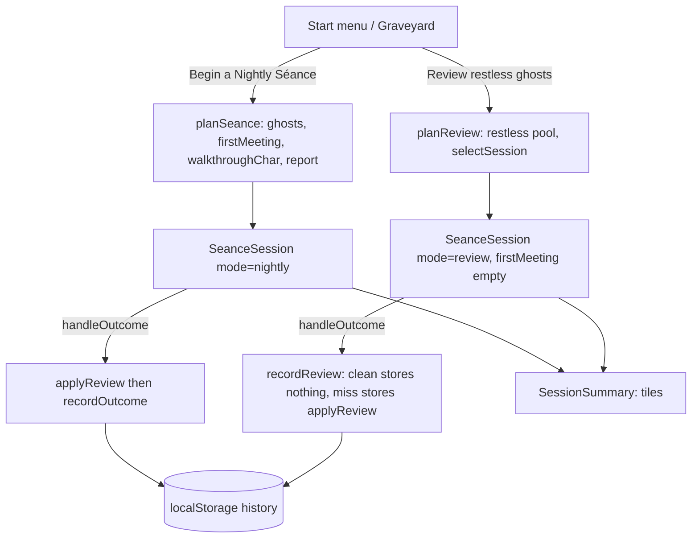
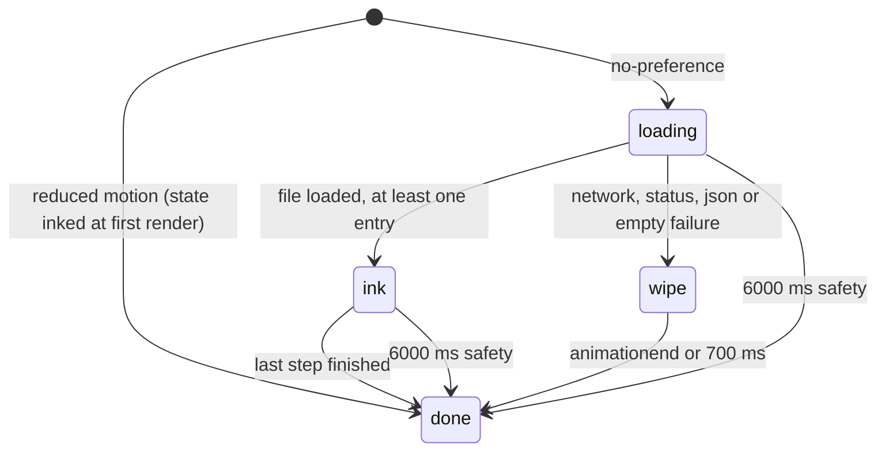

# Design Document

## Overview

Proof Pass answers the third outside review. This design covers the thirteen items of `requirements.md` in the human's priority order, plus the constraints of Requirement 14. It is a design only: nothing is implemented, and no steering file, data file, code file or `kiro-log.md` is edited by this phase.

Three rules shape every section:

- **Pending answers.** The open questions of `requirements.md` are not yet answered by the human. Each choice below that rests on a recommended answer is marked "pending the human's answer to Item N Qm", and the alternative is given where the human might reject the recommendation. The questions are collected, with the design consequence of each answer, in the last section.
- **Steering amendments stay proposed.** The exact wording of amendments 1 to 5 is written out in "Proposed steering amendments" so that the human can approve each one separately. None is approved. Items 1, 11 and 13 are not implemented until their amendments are approved (Requirement 14.17).
- **No new property-based tests.** The Nov 15 decision stands (see Testing Strategy).

### Design-time checks the requirements assigned, with results

| Check | Result |
| --- | --- |
| R1: does `SUMMON_REDUCED_SPEED` exist? | Yes. `app/src/modes/SummonStep.tsx` line 29: `const SUMMON_REDUCED_SPEED = 1000;` It is not exported. The design exports it so tests can assert it. |
| R2: indices of the six clues | Verified read-only with `parseCcCedict` and `stripBoundForm` on `data/raw/cc-cedict/cedict_ts.u8`. Each requested text matches exactly one pair. See Item 2. |
| R2: pinyin of 么 | Entry 1 reads `ma5`, so `numberedToToneMarks` gives `ma` (neutral tone, no mark). The current clue shows `me`. |
| R2.24: do `levels.json` example meanings use 么, 本 or 天? | No. The examples are "child", "year", "now", "level", "to stretch", "to break", "to discuss", "window", "brave". The manifest takes them from the character list order (not the learning order) at positions 75, 150, 225 (level 1) and so on. Simulating the three new level 1 meanings, the two level 2 and the one level 3 meaning leaves all nine examples unchanged. |
| R3: page padding | 32 px confirmed: the séance shell is `px-2` (8 + 8) and `SeanceSession` is `p-2` (8 + 8). Vertical padding is also 16 + 16. |
| R3: the 484 px figure | **Not true today.** Measured with Chromium at 1024 × 768, 375 × 812 and 320 × 640, the other Summon content is 544, 564 and 586 px. The 484 px is a target that needs about 60, 80 and 100 px of compaction. See Item 3. |
| R7: font requests | Static analysis finds no Han character outside the level 1 range on the intro, the Level_Screen or the first séance. The e2e test is the arbiter. |
| R11: samples | The literal rule of R11.6 gives 去, 哭 and **竹** (not 鬼). See "Conflicts and surprises". |

### Conflicts and surprises found

1. **The 484 px budget is a target, not a measurement** (R3.4, R3.7). Today the other Summon content is 544 / 564 / 586 px at the three viewports, and the Summon step already overflows at 320 × 640 (document height 682 px, guided 714 px). Item 3 therefore needs real compaction, not only a new formula.
2. **The Start menu overflow is caused by `min-h-screen`, not by its content** (R9). `StartMenu`'s own `<main>` is `min-h-screen` and sits inside the Shell's padded `<main>`. The page measures 936 px at 375 × 812 (as the human saw) and 816 px at 1024 × 768, which already fails R9.2. The content alone is about 684 px at 375 and 688 px at 1024.
3. **R11.6 gives 竹, not 鬼, for level 3.** The level 1 font range holds the 25 Cangjie key shapes and the legend glyphs. 竹 (a key shape) is at level 3 position 224, before 鬼 at 370. The text of Item 11 Q1 says 鬼. Open question Item 11 Q5.
4. **R2.23 is too narrow.** The sampled 刚 row of `prompt-review-sample-level2.csv` changes in `chosenMeaning` and `source` (default to override), not only in `reviewedBy`.
5. **R2.21 is incomplete.** The README block between the `prompt-counts` markers is regenerated too (level 2: 53 reviewed, 347 not; level 3: 60 reviewed, 440 not). The README sentence "48 overrides" needs a manual change to 49.
6. **A third pin changes.** `tests/unit/reviewed-by.test.ts` pins the SHA-256 of the 48 `human-approved` rows of `data/prompt-overrides.csv` and accepts only `human-approved` or empty in `data/prompt-review.csv`. Replacing the 么 and 本 rows and adding 天 breaks both. See Item 2.
7. **`GhostPrompt.test.tsx` loses its 么 mask case.** The test 'masks the target in 么 and 第 meanings' reads the real 么 clue. After the change the clue has no 么 in it. The case is kept with the old clue text as a literal fixture.
8. **A literal `summonPaperSize` has no ceiling** (R3.4). `summonPaperSize(4000, 4000)` would be 3516 px, wider than the 560 px column. The design adds a ceiling of 560 px that changes none of the five asserted values. Pending the human's answer to Item 3 Q5 (new).
9. **"No overlap" cannot hold between hill tufts in one row** (R12). The 12 existing hill tufts already overlap at a 296 px wrapper (pitch 23.7 px, tuft width 29 to 38 px). The design guarantees no overlap between the two tufts of a tablet, between hill rows, and with any Marker or glyph. Pending the human's answer to Item 12 Q4 (new).
10. **"Draw no stroke" on give-up (R1.10) is ambiguous** when keys were already accepted: their strokes were already requested. The design reads it as "no stroke is added after the give-up". Pending the human's answer to Item 1 Q6 (new).
11. **`WALKTHROUGH_LINE_PX` (24) under-reserves by the 8 px flex gap** between the line and the next row. The design compacts the other content to at most 480 px (484 minus the new 4 px gap) so that the reserve stays 24.
12. **`app/public/data/levels.json` is read by the build in character-list order, not learning order** (`exampleMeanings`). Samples need the learning order, so the manifest builder computes `learningOrder(records)` itself.

## Architecture

### Where each item lands

| Item | Layer | Files (new in **bold**) |
| --- | --- | --- |
| 1 | UI, engine | `modes/SummonStep.tsx`, `components/SeanceSession.tsx`, tests |
| 2 | Data, tests | `data/prompt-overrides*.csv`, **`scripts/lib/clue-corrections.ts`**, `scripts/build-data.ts`, **`tests/helpers/record-hashes.ts`**, **`tests/fixtures/proof-pass/`** |
| 3 | Engine, UI | `engine/surfaceSize.ts`, `modes/SummonStep.tsx`, `components/SeanceSession.tsx`, `App.tsx` (Shell padding) |
| 4 | UI, engine | `components/SessionSummary.tsx`, `components/SealStamp.tsx`, `engine/formatReturn.ts` |
| 5 | Engine, UI | **`engine/crossLevel.ts`**, `App.tsx` (`planSeance`), `components/SeanceSession.tsx` |
| 6 | Engine, UI | **`engine/graveyardOrder.ts`**, `components/Graveyard.tsx` |
| 7 | UI, scripts, docs | `data/credits.ts`, `components/Credits.tsx`, `scripts/check-bundle-size.ts`, `README.md`, **`e2e/font-requests.spec.ts`** |
| 8 | UI | `modes/WriteMode.tsx` |
| 9 | UI | `components/StartMenu.tsx` |
| 10 | Engine, UI | **`engine/review.ts`**, `App.tsx`, `components/StartMenu.tsx`, `components/Graveyard.tsx`, `components/SeanceSession.tsx`, `components/SessionSummary.tsx` |
| 11 | Pipeline, UI | `scripts/lib/levels.ts`, `scripts/build-data.ts`, `app/src/data/types.ts`, `app/src/data/charDataLoader.ts`, `components/LevelScreen.tsx` |
| 12 | Engine, UI | **`engine/graveyardRows.ts`**, `engine/grassPattern.ts`, `components/Graveyard.tsx` |
| 13 | Pipeline, UI, CSS | **`scripts/lib/legend-strokes.ts`**, `scripts/build-data.ts`, **`app/src/data/legendStrokes.ts`**, **`engine/legendInk.ts`**, **`engine/grain.ts`**, `components/IntroScreen.tsx`, `styles/index.css`, `e2e/helpers.ts` |

### Séance modes and data flow



`SummonStep` decides first meeting or returning from one prop, `firstMeeting`. The prop is threaded as: `planSeance` returns `firstMeeting: firstMeetingSet(history, ghosts)`, the `seance` view stores it, `SeanceSession` receives it (default is an empty set), and passes `firstMeeting.has(record.character)` to `SummonStep`. `SummonStep` defaults the prop to `false`, so an unset prop means returning. A Review_Run passes the empty set, so every ghost of it is a Returning_Ghost.

### Order of work that matters

1. Capture the hash fixtures of Item 2 and commit them before the first edit to any override CSV.
2. Run `npm run build:data`, then `npm run build:font` only if `fonts.css` is stale (the Level_1_Font_Range is read from the level 1 glyph set), then `npm run build:data` again. A test fails with a clear message if the on-disk `fonts.css` and the computed set disagree.
3. Items 1, 11 and 13 start only after their amendments are approved.
4. Measure the layout (Item 3, Item 9) with the helpers named below before and after each change.

### Measurement method used for the layout figures

Chromium (Playwright) loaded a production build of the current source at the three viewports. For the Summon step, the other content is `session height + Shell vertical padding − ink side − line block`. The session is `main > div > div`, the line block is the walkthrough or cross-level line height plus its flex gap, and the ink side is `[data-testid="ink-surface"]` height. The implementation adds `summonOtherHeight(page)` to `e2e/helpers.ts` with the same definition, and the Fit_Tests assert it is at most 480.


## Components and Interfaces

The sections follow the human's priority order. Each lists the change, the code-level detail, and the pending answers it rests on.

### Item 1: Returning ghosts show no formed character (Requirement 1)

Not implemented until steering amendments 1 to 3 are approved (R1.1, R14.17). Until then the Summon step keeps today's reveal for every ghost.

**Design to the recommended answers:** no hold and no fade for a transparent or partial returning ghost (pending the human's answer to Item 1 Q1); give-up shows nothing (Item 1 Q2); the opaque note stays (Item 1 Q3); first meetings keep the full hold and fade (Item 1 Q4).

**`SummonStep.tsx` changes**

- `const returning = !firstMeeting;` computed once.
- Export `SUMMON_REDUCED_SPEED` (it exists, value 1000). The writer created in the "Ink classes" effect already uses it under `prefers-reduced-motion: reduce`, so the Inked_Parts of a returning ghost are drawn at that speed with no further change (R1.18).
- The "Forming, holding and fading" effect gets a first branch. When `returning` is true:

```ts
if (returning) {
  const settle = inks ? chainRef.current : Promise.resolve();
  if (inks) { settle.then(() => { if (!disposed) finish(); }); }
  else { finish(); }               // opaque: no animation to wait for, onDone once
  return () => { disposed = true; container.replaceChildren(); };
}
```

  `finish()` is the existing function: it guards with `doneRef`, clears the container, sets `fallback` to false and calls `onDone(status)` once. In this branch:
  - `holdAndFade`, `useFallback`, `SUMMON_HOLD_MS` and `SUMMON_FADE_MS` are never reached, so no hold or fade timer starts (R1.7, R1.19). A test asserts `vi.getTimerCount()` is 0 after `onDone`.
  - The `enqueueInk(Array.from({ length: strokeCount }, ...))` call is skipped, so only strokes queued by accepted keys in `afterKey` are animated (R1.6). `animateCharacter` is never called, and for an opaque ghost no `HanziWriter.create` runs at all (R1.4, R1.5).
  - If `HanziWriter.create` threw or `onLoadCharDataError` fired, `brokenRef` is true or `writerRef` is null, so each queued stroke resolves at once and `settle` resolves. `finish()` then runs with `fallback` never set, so no `<p lang="zh">` node exists (R1.8, R1.9).
  - Give-up goes through the same branch: `handleGiveUp` commits `giveUpSummon`, the phase becomes `forming`, and `finish()` passes `gave-up` to `onDone` (R1.12). No stroke is enqueued and the fallback node is never rendered (R1.10, R1.11).
- The first-meeting branch is the current code, unchanged (R1.13 to R1.16). `SUMMON_HOLD_MS`, `SUMMON_FADE_MS` and `SUMMON_INK_SPEED` keep 1500, 1500 and 2 (R1.17).
- The `fallback` render condition stays `fallback ? <p lang="zh" ...>`, and `fallback` can only become true in the first-meeting branch.

**No safety timer.** A returning ghost whose `animateStroke` never settles would never call `onDone`. The data loader is an in-memory lookup (`makeCharDataLoader(dataset)`), so this does not happen with real data, and a timer would conflict with R1.7. The design adds none.

**Surprise (R1.10, pending the human's answer to Item 1 Q6, new).** If the player types two keys and then gives up, the strokes of those two keys were already requested. The design lets them finish and adds none. The test asserts: with zero keys typed, no stroke call at all; with k keys typed, the number of calls does not grow after give-up. Alternative: also cancel queued-but-not-started strokes on give-up with a `cancelRef` checked in `enqueueInk`'s chain; it costs five lines.

**Tests that exercise the default prop.** Existing Summon tests mount `SummonStep` without `firstMeeting`, which now means returning. Their render helpers gain `firstMeeting: true` (see the list in Testing Strategy), so they keep pinning the first-meeting reveal with unchanged expectations. New returning cases sit beside them.

**`SummonStep.neverReveal.test.tsx` extensions (R1.20 to R1.26)**

The module mock becomes spy-based (`vi.hoisted`): `animateCharacter`, `animateStroke`, a `createThrows` flag and a `loadError` flag (the mock's `create(container, char, opts)` calls `opts.onLoadCharDataError?.()` when set). New `describe.each` over the two returning variants (`returning`, `returning with walkthrough lines`) and over every playable record:

1. Type the whole code with `fireEvent.keyDown(window, { key })`, then `await vi.advanceTimersByTimeAsync(3000)`. Assert `findLeaks(character)` is empty (text nodes, all attributes, `document.title`), `onDone` called exactly once, `animateCharacter` never called, every `animateStroke` index in `new Set(record.summonInk.keyStrokes.flat())` (empty set for opaque), and `vi.getTimerCount()` is 0.
2. Failure injection, same assertions: `createThrows`, then `loadError`. Also assert no `p[lang="zh"]` exists.
3. For the two first-meeting variants under both failures: the `p.text-6xl` fallback holds the character at 0 ms, nothing has changed at 1499 ms, the fade starts at 1500 ms, and `onDone` fires once at 3000 ms. This is the existing behaviour pinned for every record.

**`e2e/summon-ink.spec.ts` additions (R1.27, R1.28)**

Seed one met ghost (history entry for 明) so the first séance ghost is returning. Pick a transparent or partial returning record whose last key inks at most three strokes (the test computes it from the dataset). Install a `MutationObserver` on `document` before the last key; it records any added node or changed character data whose text includes the target. After the last key, `expect(page.getByRole('region', { name: 'Write mode' })).toBeVisible({ timeout: 1000 })`, then assert the recorded list is empty.

### Item 2: Six corrected clues (Requirement 2)

**Verified indices** (read-only, `parseCcCedict`, `stripBoundForm`, `numberedToToneMarks`):

| Char | Level | Text | (entry, meaning) | Reading | New pinyin | Matching pairs |
| --- | --- | --- | --- | --- | --- | --- |
| 么 | 1 | interrogative final particle | (1, 0) | ma5 | ma | 1 |
| 本 | 1 | root; stem | (0, 0) | ben3 | běn | 1 (gloss has the "(bound form) " prefix, stripped) |
| 天 | 1 | sky | (0, 1) | tian1 | tiān | 1 |
| 云 | 2 | cloud | (2, 0) | yun2 | yún | 1 |
| 刚 | 2 | just; only a short while ago | (0, 3) | gang1 | gāng | 1 |
| 获 | 3 | to reap; to harvest | (1, 0) | huo4 | huò | 1 (prefix stripped) |

`cleanupMeaning` leaves all six texts unchanged, so the displayed clue equals the stored one.

**CSV edits** (through the override files only; data files are never edited by hand, R14.16). The value `human` is the Level_1_Review_Value, pending the human's answer to Item 2 Q1. The alternative is `human-approved` for the three level 1 rows, which needs no change to the two pins below.

- `data/prompt-overrides.csv`: line `么,2,0,human-approved` becomes `么,1,0,human`; line `本,0,8,human-approved` becomes `本,0,0,human`; the row `天,0,1,human` is appended.
- `data/prompt-overrides-level2.csv`: append `云,2,0,human` and `刚,0,3,human`.
- `data/prompt-overrides-level3.csv`: append `获,1,0,human`.
- `data/prompt-approvals.csv` keeps `刚,human`. The build marks a character reviewed when it has an override or an approval (`override !== undefined || approvals.has(char)`), so both rows together raise no error. Pending the human's answer to Item 2 Q3, the fallback of removing the approval row is not needed.

**Guard in the Pipeline (R2.2, R2.3).** New `scripts/lib/clue-corrections.ts`:

```ts
export interface ClueCorrection { character: string; level: Level; text: string }
export const CLUE_CORRECTIONS: readonly ClueCorrection[] = [
  { character: '么', level: 1, text: 'interrogative final particle' },
  /* 本, 天 (level 1), 云, 刚 (level 2), 获 (level 3) */
];
export function matchingPairs(entry: CcCedictEntry, text: string): { entryIndex: number; meaningIndex: number }[];
export function checkClueCorrections(level: Level, characters: ReadonlySet<string>,
  cc: ReadonlyMap<string, CcCedictEntry>, overrides: ReadonlyMap<string, PromptOverride>): string[];
```

`buildDataset` calls `checkClueCorrections` right after it loads the overrides and the dictionary, and throws one `Error` listing every failure (character, text, number of matching pairs, or "no override row"). It throws before `writeAllLevels` runs, so no generated file changes. A character that is not in the level's list is skipped, so existing fixture-based tests are unaffected.

**Fixtures, captured before any override edit (R2.14).** New `tests/helpers/record-hashes.ts` (pure): `hashRecord(record)` is SHA-256 of `JSON.stringify(record)` (key order as in the file); `hashRecordWithoutPrompt(record)` is the same after omitting `prompt` and, for levels 2 and 3, `promptReview`. A CLI, `tests/helpers/capture-proof-pass-fixtures.ts`, writes under `tests/fixtures/proof-pass/`:

- `level1-record-hashes.json`, `level2-record-hashes.json`, `level3-record-hashes.json`: `{ char: { full, noPrompt } }`.
- `prompt-review-level1-line-hashes.json`: SHA-256 of each line of `data/prompt-review.csv`, keyed by character.
- `prompt-review-sample-level2-line-hashes.json`: the same for the level 2 sample file.

Capture steps: (1) `git status` shows `data/` and `app/public/data/` clean; (2) `npx tsx tests/helpers/capture-proof-pass-fixtures.ts`; (3) commit the fixtures alone; (4) only then edit the CSVs and run `npm run build:data`.

**Tests** (`tests/unit/clue-corrections-data.test.ts`, new): the no-prompt hash of all 300 level 1 records matches; the whole-record hash matches for 297 and differs for exactly 么, 本, 天; the new clue of each equals the text plus the reading in the table; every line of `data/prompt-review.csv` except those three matches its fixture and the three show the new meaning and `human`; level 2 differs only in 云 and 刚 and level 3 only in 获 (whole-record hash; the no-prompt hash matches everywhere); `reviewedBy` is `human` for 云, 刚, 获 in the level 2 and 3 review files; the two sample files keep the same characters at the same positions.

**Pinned values that change, none loosened.**

- `tests/unit/level1-protected.test.ts`: the SHA-256 of `characters.json` and `prompt-review.csv` take new values, computed once from the first approved build. The SHA-256 of `character-list.txt` is unchanged. The fixtures above prove that the change is confined to the three prompts.
- `tests/unit/reviewed-by.test.ts` pins the 48 `human-approved` rows. After the edit 46 remain. The old pin stays and a new assertion is added: replacing the three new `human` rows by their old text (`么,2,0,human-approved`, `本,0,8,human-approved`, and dropping 天) reproduces the old hash and count. Its `review-level1` rule accepts `human-approved`, empty, and `human` only on the rows of 么, 本, 天. The `overrides-level1` rule keeps accepting `human` for new rows.
- `README.md` says "48 overrides"; it becomes 49, and a new one-line test (`tests/unit/readme-override-count.test.ts`) compares the number with the row count of `data/prompt-overrides.csv`.

**Regenerated files.** `characters.json`, `characters-level2.json`, `characters-level3.json`, `levels.json` (clues only; the example meanings do not change), the three review files, `prompt-review-sample-level2.csv` (the 刚 row changes in `chosenMeaning`, `source` and `reviewedBy` cells; the others do not), `app/src/data/promptCounts.generated.ts` (level 2: 53 reviewed, 347 not, level 3: 60 and 440, totals 113 and 787), and the `prompt-counts` block of `README.md`. `data/prompt-rule-changes.csv` does not list 云, 刚 or 获 and does not change. `oracle/power/data/oracle-data.json` has no prompt field and does not change. Running the build twice gives byte-identical output (R2.11); the existing determinism tests cover this.

**Consequence of "reading of 么".** 么 is opaque with three strokes. The new clue pinyin is `ma`. Pending the human's answer to Item 2 Q2; the alternative keeps entry 2 and fails R2.1.

### Item 3: A bigger Summon paper (Requirement 3)

**`surfaceSize.ts`**

```ts
/** Column width of the séance: 560 px inner width at max-w-xl. */
export const SUMMON_PAPER_MAX_PX = 560;          // pending the human's answer to Item 3 Q5 (new)
/** Height of all other Summon content at the tightest card, measured; see the budget table. */
export const SUMMON_OTHER_PX = 484;
export function summonPaperSize(width: number, height: number, reservedPx = 0): number {
  return Math.max(96, Math.min(Math.floor(Math.min(width - 32, height - reservedPx - SUMMON_OTHER_PX)), SUMMON_PAPER_MAX_PX));
}
```

The five values of R3.14 hold: 284, 260, 328, 156, 96. The ceiling changes none of them. Without the ceiling (the literal R3.4) the function returns 3516 at 4000 × 4000. `writeSurfaceSize` is unchanged.

**Measured budget of the other Summon content (returning ghost).** "Today" is measured; "Target" uses the levers below.

| Part (px) | Today 1024 | Today 375 | Today 320 | Target 1024 | Target 375 | Target 320 |
| --- | --- | --- | --- | --- | --- | --- |
| Shell + session padding (vertical) | 32 | 32 | 32 | 16 | 16 | 16 |
| Header row (Leave, Ghost n of N) | 44 | 44 | 66 | 44 | 44 | 44 |
| Clue card + step label | 72 + 20 | 72 + 20 | 72 + 20 | 72 (label beside the card) | 72 | 72 |
| Code slots | 48 | 48 | 48 | 40 | 40 | 40 |
| Status line (two lines at 14 px) | 40 | 40 | 40 | 40 | 40 | 40 |
| Key rows (3 × 44 + 2 × 2) | 136 | 136 | 136 | 136 | 136 | 136 |
| System-input note | 20 | 40 | 40 | 16 (12 px) | 32 | 32 |
| Unihan note | 16 | 16 | 16 | 16 | 16 | 16 |
| Give up slip | 44 | 44 | 44 | 44 | 44 | 44 |
| Gaps (8 px today, 4 px target) | 72 | 72 | 72 | 32 | 32 | 32 |
| **Other content** | **544** | **564** | **586** | **456** | **472** | **472** |
| Limit (484 minus the 4 px line gap) | 480 | 480 | 480 | 480 | 480 | 480 |
| Slack | | | | 24 | 8 | 8 |

The target column counts eight gaps: two between the three session rows (header, clue row, section) and six between the seven section items (slots, paper, status, keys, system-input note, Unihan note, Give up). Today there are nine, because the step label has its own row. The target sums are 16 + 44 + 72 + 40 + 40 + 136 + 16 + 16 + 44 + 32 = 456 at 1024, and 472 at 375 and 320, where the system-input note wraps to two lines.

**Levers, in the order to pull them.** Each lever is a class change, so each can be backed out alone.

1. `App.tsx` `Shell` compact: `py-2` to `py-1`; `SeanceSession` wrapper: `p-2` to `px-2 py-1` (saves 16; the horizontal 32 px is unchanged, so `width − 32` still holds). `App.test.tsx` checks `px-2` and `no-moon-room` only.
2. `SeanceSession` wrapper `gap-2` to `gap-1`; Summon `section` `gap-2` to `gap-1` (saves 36). `WriteMode` keeps `gap-2` because `WriteMode.test.tsx:222` asserts it.
3. Put the step label (`text-xs sm:text-sm text-muted`) in one flex row with the clue card (`flex items-center justify-center gap-3`). At 320 the row is 116 + 12 + about 150 = 278 px, inside 288.
4. Slots `h-12` to `h-10`: letter `text-xs leading-none`, shape `text-lg leading-none` (saves 8).
5. System-input note `text-sm` to `text-xs` (12 px; saves 4 to 8).
6. Below 360 px: the Leave séance button takes `px-3 text-sm` and the heading `text-sm whitespace-nowrap`, so the header stays one row at 320 (saves 22).
7. Last resort, only if measurement still exceeds 480: status line `text-sm` to `text-xs` with `min-h-8` (saves 8). This changes the two assertions at `SummonStep.test.tsx:467-468`.

**Reconciling R3 with R5 criterion 15.** The cross-level line is shown only above the first ghost of a non-guided séance, so it never shares the screen with the walkthrough line. It reserves the same way:

- `WALKTHROUGH_LINE_PX = 24` for one line.
- `CROSS_LEVEL_LINE_PX = 24` when the container is at least 600 px wide or the text has at most 40 characters, and `CROSS_LEVEL_LINE_WRAP_PX = 44` otherwise (two lines of 20 px plus the 4 px gap). `crossLevelReserve(text, width)` is a pure function in `surfaceSize.ts`.
- `SummonStep` gains an optional `reservedPx` prop that overrides `walkthroughLines ? WALKTHROUGH_LINE_PX : 0`.

Results with the reserve: 1024 × 768 gives paper 260 (24 reserved), total 456 + 28 + 260 = 744 px. 375 × 812 with a two-line line gives paper min(343, 812 − 44 − 484) = 284, total 472 + 44 + 284 = 800 px. 320 × 640 with a two-line line gives max(96, 640 − 44 − 484) = 112, total 472 + 44 + 112 = 628 px. All fit.

**Existing 320 × 640 overflow.** Today the Summon step does not fit at 320 × 640 (document 682 px; guided 714 px). With all levers the other content is 472 px, so the formula's 156 px paper gives 628 px, inside 640. This is why R3.13 adds 320 × 640 to the Fit_Tests.

**Fit_Tests (R3.12, R3.13).** `fits-one-screen.spec.ts` adds 320 × 640 to the Summon viewports, adds an `ink-surface` size assertion (square, at least 260 px at 1024 × 768, at least 240 px at 375 × 812), and a returning-ghost run (seeded history) next to the guided one. `summonOtherHeight(page)` (see Architecture) is asserted at most 480.

### Item 4: The summary as a reward (Requirement 4)

**Data plumbing.** `ReturnRow` gains `outcome: Outcome`. `buildReturnRows(ghosts, entries, outcomes?)` takes an optional `ReadonlyMap<string, Outcome>`; when it is absent the row uses `entry.lastOutcome`, so old callers and tests keep working. `SessionResults` gains `mode?: 'nightly' | 'review'`. `App.tsx` keeps an `outcomesRef` next to `returnsRef` and fills both in `handleOutcome`. The outcome of a ghost is `ReturnRow.outcome`, which is how `SessionResults` carries it (R4.8). `formatReturn` is untouched (R4.9).

**Component.** `SessionSummary` drops the nested `min-h-screen` and `py-10` (the same defect as the Start menu: the Shell already pads and centres) and uses `py-2`.

- Heading: `<h1 id="summary-title" className="font-display text-3xl font-semibold tracking-wide sm:text-5xl">` (R4.1).
- Count line: `role="status"`, `card-slip`, `px-5 py-2 text-lg`, same text and same `normalise` rule (R4.11). With no ghosts it shows "No ghosts appeared this time" and no tiles (R4.13).
- Tiles: `<ul aria-label="Ghosts that will return" className="grid grid-cols-5 gap-1.5 sm:gap-2">` under an `<h2>` with the unchanged text "Ghosts that will return". Five columns at every width, two rows for ten ghosts. Each tile is `<li className="card-slip ..." aria-label={tileName(row, finishedAt)}>` (so the existing assertion that each row is a `card-slip` still holds).
- Tile content, top to bottom: a glyph box `relative flex h-14 items-center justify-center sm:h-[72px]`; the pinyin (`text-xs sm:text-sm`, `lang="zh-Latn-pinyin"`); the Return_Text (`text-xs`, `formatReturn(row.nextDue, finishedAt)`, unchanged output).
  - `outcome === 'clean'`: `<SealStamp character={row.character} placement="flow" size={40} />`. The stamp's glyph span keeps `lang="zh"`, so the glyph is on every clean tile and carries only the ghost's own character.
  - `outcome === 'struggled' | 'gave-up'`: `<GhostFigure className="absolute inset-0 m-auto h-12 w-10 text-ghost opacity-30" />` behind `<span lang="zh" className="relative text-3xl">{row.character}</span>`. No `SealStamp`.
  - Beneath the tile text, a visible outcome word (`text-xs`): "Laid to rest" for clean, "Struggled" for struggled, "Gave up" for gave-up, so colour and shape are never the only signal (R4.7). This is one more 16 px line per tile.
- Accessible name: `"{char}, {pinyin}, {meaning}, {outcome in words}, {return text}"`, for example "我, wǒ, I, laid to rest, returns tomorrow". The meaning is only in the name (pending the human's answer to Item 4 Q3; the alternative is a visible third line, which costs 16 px per tile row and still fits).
- `SealStamp` gets two optional props, `placement?: 'corner' | 'flow'` (default `'corner'`, today's absolute bottom-right) and `size?: number` (default `SEAL_SIZE_PX`; glyph size is `size * 0.75`). With no props it renders exactly as today, so `SealStamp.test.tsx` and the write-step seal are unchanged.
- "Begin another Séance" stays the only `slip-primary` (`min-h-[44px] px-8 py-2`, `mt-3`).
- Motion: tiles use the existing `.seal-stamp` animation (300 ms) inside the existing no-preference block; nothing new.

**Worked height budget for 10 ghosts** (Shell `py-6` = 48 px; root padding-top is the Moon room, 76 px below 992 px, 0 above):

| Part (px) | 1024 × 768 | 375 × 812 |
| --- | --- | --- |
| Moon room | 0 | 76 |
| Shell vertical padding | 48 | 48 |
| Summary `py-2` | 16 | 16 |
| Heading (`text-5xl` / `text-3xl`) | 48 | 36 |
| Count line (`py-2 text-lg`, `mt-2`) | 44 + 8 | 44 + 8 |
| `h2` (`text-base`, `mt-3`) | 24 + 12 | 24 + 12 |
| Tile: glyph box + pinyin + outcome word + return text | 72 + 4 + 20 + 16 + 16 = 128 | 56 + 4 + 16 + 32 (outcome wraps to two lines) + 64 (return text, up to four lines) = 172 |
| Two rows and one gap | 2 × 128 + 8 = 264 | 2 × 172 + 6 = 350 |
| Button (`mt-3`, 44) | 56 | 56 |
| **Total** | **520** | **670** |
| Viewport | 768 | 812 |
| Slack | 248 | 142 |

Tile width is (width − 32 − 4 gaps) / 5: 147 px at 1024 (container `max-w-3xl`, 768 px) and 64 px at 375. At 64 px "returns in 10 minutes" wraps to at most four lines of 16 px, and "Laid to rest" wraps to two. The tile text is 12 px (`text-xs`), the floor of the art direction.

**Fit_Tests (R4.17).** `reachSummary` in `e2e/helpers.ts` already gives up every ghost; a new `reachFullSummary(page)` seeds so that ten ghosts are played, and `fits-one-screen`, `sky-cap` and `no-horizontal-overflow` each add the Summary at both viewports.

**Pending:** Item 4 Q1 (clean tiles are seals, struggled and gave-up are faint ghosts, every tile shows a Return_Text); Item 4 Q2 (struggled counts as laid to rest on the count line, but gets no seal); Item 4 Q4 (up to ten `GhostFigure` instances are allowed).

### Item 5: A line when due ghosts from another level come first (Requirement 5)

**Report from `planSeance` (R5.10).** `SeancePlan` gains `report: readonly PlannedGhost[]`:

```ts
export interface PlannedGhost { readonly character: string; readonly level: Level | null; readonly due: boolean }
```

`SeanceScope` gains `chosenLevel: Level` and `levelOf: ReadonlyMap<string, Level>` (built in `startSeance` from the loaded levels). Without a scope (old tests), `level` is `null` and the line is `null`. `due` is decided at planning time with the scheduler's rule, written in `engine/crossLevel.ts` so that `scheduler.ts` stays unchanged: `isDueAt(entry, now) = entry !== undefined && (Number.isFinite(entry.nextDue) ? Math.max(0, entry.nextDue) : 0) <= now`. The report lists the ghosts after `composeFirstSession`, so it covers only the at most ten selected ghosts (R5.4).

**Pure line builder, `engine/crossLevel.ts`.**

```ts
export function otherLevelCounts(report: readonly PlannedGhost[], chosen: Level): [Level, number][];
export function crossLevelLine(report: readonly PlannedGhost[], chosen: Level, guided: boolean, review: boolean): string | null;
```

It returns `null` for a Review_Run, a séance with the Guided_Ghost, or no due ghost of another level. Otherwise, with parts `"{n} ghost(s) from level {L}"` (`1 ghost`, `n ghosts`): one level and n = 1 gives `"1 ghost from level L returns first."`; one level and n ≥ 2 gives `"N ghosts from level L return first."`; two levels give `"{part1} and {part2} return first."` with levels ascending. Pending the human's answer to Item 5 Q1: the line shows whenever at least one due other-level ghost is in the séance (alternative: only when other-level ghosts fill it; the builder takes a `minimum` parameter, default 1).

**Display.** `SeanceSession` gets `crossLevelLine?: string | null`. When `index === 0` and the line is set, it renders `<p data-testid="cross-level-line" className="min-h-6 text-center text-sm text-ink">` above the clue row, in Summon, Write and outcome. It sits in the first `SeanceSession` flow, not inside `SummonStep`, so it disappears when `index` changes (R5.5, R5.6). It is not a Slip, not a heading, and has no role, so it is read as text (R5.12, R5.13). The reserve is passed as `reservedPx` to `SummonStep` and `WriteMode` (see Item 3). Pending the human's answers to Item 5 Q2 (above the first ghost) and Item 5 Q3 (no line in a Review_Run).

**Tests.** `engine/crossLevel.test.ts` covers the cases of R5.16 with `PlannedGhost` fixtures: ten from one level, one, two, two levels (including 1 and 1, and 2 and 1), none, Chosen_Level only, Chosen_Level due, other-level not due, review, guided. A component test mounts `SeanceSession` with three ghosts and the line, and asserts the line is present at ghost 1, absent after "Next ghost", and absent in the summary. `App.levels.test.tsx` adds a `planSeance` case with three due level 1 entries and level 2 chosen. The e2e test (new, in `e2e/harder-ghosts.spec.ts`) seeds three due level 1 entries with `level: 2`, asserts "3 ghosts from level 1 return first." above the first ghost, asserts it is gone after "Next ghost", and runs the fit assertions at 1024 × 768, 375 × 812 and 320 × 640 for both Summon and Write.

### Item 6: Graveyard order says what is true (Requirement 6)

**Reorder function, `engine/graveyardOrder.ts`.**

```ts
export function graveyardOrder(level: Level, order: readonly string[], dataset: CharacterDataset): string[] {
  if (level !== 1) return [...order];
  const guided = pickWalkthroughGhost(order, dataset);
  if (guided === null) return [...order];
  return [guided, ...order.filter((c) => c !== guided)];
}
export function graveyardExplanation(level: Level, hasGuided: boolean): string;
```

`Graveyard.tsx` calls `buildGraveyard(graveyardOrder(level, learningOrder(dataset), dataset), history, now)`. `learningOrder`, session order, history, `classifyEntry` and the datasets are untouched (R6.10), so the Level_1_Pin stays valid. Positions are numbered 1 to 300 in displayed order, so each accessible name's position equals its displayed position (R6.2). With real data the guided ghost is 明, found by `pickWalkthroughGhost` (never hard-coded), at index 12 (position 13) today; it moves to grave 1 and the 12 graves before it shift by one.

An unmet grave 1 is the existing blank stone named "Ghost 1 of 300, never met", with no Han character in any text or attribute (R6.6). Pending the human's answer to Item 6 Q2: position alone reveals nothing.

**Explanation text** (`graveyardExplanation`):

- Level 1 with a Guided_Ghost: "These graves are the ghosts of level 1. The guided first ghost comes first, then the rest in the order you will meet them. A ghost you have not met stays hidden."
- Otherwise (level 1 with none, level 2, level 3): "These graves are the ghosts of level N, in the order you will meet them. A ghost you have not met stays hidden."

**Case analysis (R6.11).**

(a) A brand-new player at any chosen level meets the Guided_Ghost first. `planSeance` takes `pickWalkthroughGhost(scope.walkthrough.order, scope.walkthrough.dataset)`, which is always level 1, and `composeFirstSession` puts it first. It is true for level 2 or 3 too, because the walkthrough scope is level 1.
(b) A player who starts at level 2 meets 明 first, and it shows as grave 1 of the level 1 Graveyard. The shown level 2 Graveyard is unchanged.
(c) A player who starts at level 1 meets it first in the same way.
(d) A player whose history predates the walkthrough never got the guided session. `isBrandNewPlayer` is false for them, so they meet 明 at its learning position (13). The reordered Graveyard would then not match their order, which is why the sentence says "the guided first ghost" and not "the first ghost".

**Tests.** `engine/graveyardOrder.test.ts`, with real level 1 data: index 0 is the picked ghost, the other 299 follow in `learningOrder` with no duplicate, the total is 300; a dataset with no qualifying ghost gives `learningOrder`; levels 2 and 3 equal `learningOrder`. `Graveyard.test.tsx` asserts the names of graves 1 and 2 while unmet ("Ghost 1 of 300, never met", "Ghost 2 of 300, never met"), no glyph in grave 1, and both sentences. Pending the human's answer to Item 6 Q1: both the move and the wording. Alternative: wording only, which leaves the order untrue for brand-new players.

### Item 7: Complete data credits, an honest first load, no unneeded font (Requirement 7)

**Credits data.** `app/src/data/credits.ts` gains `DATA_FILES`, in the same wording style as `DATA_SOURCES`:

```ts
export interface DataFileCredit { readonly path: string; readonly holds: string; readonly sources: string }
```

| `path` | `holds` | `sources` (names and licences copied from `DATA_SOURCES`) |
| --- | --- | --- |
| `characters.json` | the 300 level 1 records: pinyin, meanings, strokes, decompositions, Cangjie codes | hanzi-writer-data (Arphic Public License); Make Me a Hanzi (GNU LGPL v3.0-or-later); CC-CEDICT (CC BY-SA 4.0); Unihan (Unicode License V3); HSK 3.0 list (MIT) |
| `characters-level2.json` | the 400 level 2 records, same fields | same five |
| `characters-level3.json` | the 500 level 3 records, same fields | same five |
| `levels.json` | per level: record count, average strokes, three English example meanings, one sample character | derived from the level files: CC-CEDICT, hanzi-writer-data, HSK 3.0 list, with the terms of those files |
| `legend-strokes.json` | stroke outlines and median lines of the six Han characters of the legend line | hanzi-writer-data (Arphic Public License) |
| `oracle/power/data/oracle-data.json` | a copy of the three level files with the Cangjie code and decomposition fields, for the Kiro Power | Unihan (Unicode License V3); Make Me a Hanzi (GNU LGPL v3.0-or-later) |

No new licence claim is written; each row reuses names already in `DATA_SOURCES` and `COMBINED_WORK_NOTE`. The `levels.json` and `legend-strokes.json` rows name no Han glyph, so the Sources screen requests no extra font subset.

`Credits.tsx` adds a "Data files" section (table from `sm`, definition-list cards below, the same pattern as "Data sources"). The README gets a table "Data files shipped" with the same six rows (R7.12).

**Tests.** `Credits.test.tsx` reads `readdirSync('app/public/data')` and `readdirSync('oracle/power/data')` at test time, keeps `.json` names, and fails if any is missing from the rendered screen (R7.4, R7.5). `credits-readme.test.ts` compares `DATA_FILES` with the README table. `credits.test`-style assertions that `DATA_SOURCES` equals the README sources table stay.

**First-load honesty.** `scripts/check-bundle-size.ts` keeps its first output line byte for byte, and adds after the lazy list:

```
First load: <counted> bytes counted + <level1> bytes level 1 dataset = <sum> bytes gzip
```

through a new pure `firstLoad(files)` returning `{ counted, level1, total }` (`level1` is the gzip size of `data/characters.json`, level 9, like the other figures). Today this is 214,206 + 361,679 = 575,885 (README figures; the check prints the current ones). The budget of 300,000 still applies to the counted part only.

The README "Bundle and file weights" section states the budget, the counted figure, the level 1 figure and their sum, and says the budget does not count the level 1 dataset (R7.6, R7.7). It also refreshes the stale file table: the on-disk level 2 file is 1,227,660 bytes, the README says 1,228,185. All figures are copied from the `check:bundle` output at the time of the change; a test compares the README sum with `counted + level1` only for arithmetic (it cannot know the build).

**The legend file is counted.** `LAZY_PATHS` is unchanged, so `data/legend-strokes.json` (14,208 bytes raw, about 6,350 bytes gzip level 9) is part of the counted first load: the intro fetches it on the first screen, so counting it is the honest choice (R7.9). The counted total goes from about 214 kB to about 221 kB, inside 300 kB. `bundle-size.test.ts` asserts `isLazy('data/legend-strokes.json')` is false and `firstLoad` adds correctly.

**Font-request e2e (R7.10), `e2e/font-requests.spec.ts`.** A fresh browser context (no seed) registers `page.on('request')` before `goto`, then: intro, "Begin the Séance", the Level_Screen, the "Level 1" slip, the first Summon step (`region` "Summon step" visible), then `waitForLegendReveal`. It asserts that no request URL contains `lxgw-wenkai-subset-level2` or `lxgw-wenkai-subset-level3` and that the level 1 subset was requested. If a request is found (R7.11), the implementer identifies the glyph (by listing `[lang="zh"]` text and `font-family` fallbacks on each screen), removes the cause and records both here.

**Static analysis of Han glyphs on the first path.**

| Screen | Han text | In level 1 range? |
| --- | --- | --- |
| Intro | the legend line 天雨粟，鬼夜哭 (7 code points) | yes: all seven, because `build-font` adds `LEGEND_SOURCE.zh` to the level 1 set |
| Level_Screen (today) | none | n/a |
| Level_Screen (Item 11) | three samples chosen inside the range | yes by construction |
| First séance (Summon) | 25 key shapes of `CANGJIE_KEYS`, slot shapes, walkthrough lines (日 月 for 明) | yes: all 25 key shapes are in the range |
| Write step | strokes are SVG paths, not text; the seal carries the ghost's own character after a clean outcome | the ghost is a level 1 character, all 300 in range |

Pending the human's answer to Item 7 Q1: `levels.json` is named in the credits (recommended). Item 7 Q3: the README figure is copied from `check:bundle`, not hand-maintained.

### Item 8: Give up is a paper slip (Requirement 8)

`WriteMode.tsx` line 189: the class string becomes `slip min-h-[44px] px-4 py-2 focus:outline-none focus-visible:ring-2 focus-visible:ring-ghost disabled:opacity-50`. `rounded-md`, `border` and `border-muted` and `text-ink` (the `slip` class carries its own ink-on-paper colour) are dropped. The existing logic is unchanged: it renders only while `status === 'writing'`, is `disabled={loading}`, and `handleGiveUp` cancels the quiz, reveals the character and reports `gave-up` once. `.slip:hover:not(:disabled)` already excludes a disabled slip, so a loading Give up does not lift.

**Tests.** `WriteMode.test.tsx` adds: the control has classes `slip min-h-[44px] px-4 py-2` and the two focus classes, and none of `rounded-md`, `border`, `border-muted` (R8.1 to R8.4); it is absent once resolved; disabled while loading and enabled after (R8.5 to R8.7); no `slip-primary` in the region (R8.9). The existing give-up behaviour tests stay. `e2e/slips.spec.ts` adds a screen entry "Write step" to its `SCREENS` table whose `open` seeds a met ghost, gives up the Summon step and waits for "Write mode"; the existing loop then asserts the 2 px lift with glow on hover, the keyboard-focus lift with glow, the 1 px press sink, and the 44 px height at the widths it already tests (R8.10 to R8.13). The Write entry's expected `.slip-primary` count is 0.

### Item 9: The start menu fits one screen (Requirement 9)

**Root cause.** `StartMenu`'s `<main>` has `min-h-screen` and `py-8` inside the Shell's `<main>` (`min-h-[100dvh − Moon room]`, `py-6`). Heights stack: at 375 × 812 the page is 76 (Moon room) + 48 (Shell padding) + 812 (`min-h-screen`) = 936 px; at 1024 × 768 it is 48 + 768 = 816 px. The content alone is smaller. `IntroScreen.test.tsx` already asserts that the intro root has no `min-h-screen`; the Start menu gets the same treatment.

**Layout change.** `StartMenu` root: `flex flex-col items-center justify-center px-4 py-4 text-ink` (no `min-h-screen`). The Shell centres it. Other changes, all class-level:

- Ghost figure `h-14 w-12 sm:h-20 sm:w-16`, `mb-2`; title `text-4xl sm:text-7xl` (the display stays at `font-display`); `moon-glow mb-4 sm:mb-6`.
- Slips: `py-2` (the 44 px floor comes from `min-h-[44px]`; today `py-3` makes them 50 px); column `gap-2`.
- The sources hint text and wording are unchanged (R9.9), `text-sm text-muted`.

**Worked budget, worst case** (finished notice, "Move on" slip, review slip with a 4-digit count):

| Part (px) | 1024 × 768 | 375 × 812 |
| --- | --- | --- |
| Moon room | 0 | 76 |
| Shell `py-6` + menu `py-4` | 48 + 32 | 48 + 32 |
| Ghost + gap | 80 + 8 | 56 + 8 |
| Title (`text-7xl` / `text-4xl` line) | 72 | 40 |
| Gap under the header block | 24 | 16 |
| Begin, Starting level, Review (3 × 44) | 132 | 132 |
| Finished notice (20 + 8 + Move on 44) | 72 | 72 |
| Legend, Cangjie, Graveyard (3 × 44) | 132 | 132 |
| Sources slip + hint (44 + 8 + 20 / 40) | 72 | 92 |
| Column gaps (7 × 8) | 56 | 56 |
| **Total** | **728** | **760** |
| Viewport | 768 | 812 |
| Slack | 40 | 52 |

Without the notice and the review slip the totals are 596 and 628. An error line from a failed review start (Item 10) is at most two lines of 20 px and fits the slack. A 4-digit count keeps the review slip one line ("Review restless ghosts (1234)", about 230 px at 16 px).

**Fit_Tests (R9.11 to R9.13).** `fits-one-screen.spec.ts` adds a `StartMenu` block at both viewports: plain, and worst case (300 level 1 entries met and not due, the finished notice at level 1, 1,000 restless entries across the three levels so the count has four digits). Each asserts `scrollHeight ≤ innerHeight`, `scrollWidth ≤ innerWidth`, every `.slip`/`.slip-primary` at least 44 px high, exactly one `.slip-primary`, and no text below 12 px. `no-horizontal-overflow.spec.ts` and `sky-cap.spec.ts` add the worst case (the last at 375 × 812). R9.14: Items 9 and 10 are built together, because the worst case needs the review slip.

**Pending:** Item 9 Q1 (only the two viewports; 320 × 640 is not required and is not designed for), Item 9 Q2 (the levers above rather than a two-column grid), Item 9 Q3 (12 px floor, 4-digit count).

### Item 10: Review restless ghosts outside the nightly schedule (Requirement 10)

**Pure engine, `app/src/engine/review.ts`** (`scheduler.ts` and its tests are untouched, R10.17):

```ts
export function restlessCharacters(history: ReviewHistory, now: number, known?: ReadonlySet<string>): string[];
export function restlessCount(history: ReviewHistory, now: number, known?: ReadonlySet<string>): number;
export function reviewPool(orders: readonly (readonly string[])[], history: ReviewHistory, now: number): string[];
export function planReview(orders: readonly (readonly string[])[], history: ReviewHistory, now: number, config: EngineConfig): string[];
export function recordReview(prior: ReviewEntry | undefined, outcome: Outcome, now: number, config: EngineConfig): ReviewEntry | null;
```

- `restlessCharacters` uses `classifyEntry(entry, now) === 'restless'` from `graveyard.ts`, so the definition is the Graveyard's: a ghost with an entry whose `lastOutcome` is not `clean`, or is `clean` with `nextDue <= now`; no entry is never restless; all levels (R10.1). `known` limits the count to characters present in a loaded dataset, so stale history keys cannot inflate it.
- `reviewPool(orders, ...)` takes the learning orders of the loaded levels in ascending level order and keeps the restless characters in that order, no duplicates (R10.10).
- `planReview` is `selectSession(history, reviewPool(...), now, config)`: due ghosts first and most overdue first, then not-yet-due soonest first, at most `sessionSize` (10), all of them when fewer (R10.11). Restless ghosts in history are never "new", so band (b) is empty.
- `recordReview(prior, outcome, now, config)` returns `null` for `clean` (store nothing, R10.15) and `applyReview(prior, outcome, now, config)` for `struggled` and `gave-up` (R10.16). A `prior` of `undefined` returns `null` (a review never creates an entry). This is the pure recording function (R10.18). Pending the human's answers to Item 10 Q1 and Q2; the alternative (a clean review calls `applyReview` and advances the ladder) changes only the `clean` branch, and the spacing then lets a player push a ghost to long intervals by self-selected reviews.

**App wiring.**

- `View.seance` gains `mode: 'nightly' | 'review'` and `crossLevelLine: string | null`. `SeancePlan` gains `report`.
- `ensureHistoryLevels(history)`: the start-up loop (`unplacedHistoryKeys`, `nextLevelToLoad`, `loadLevel`) is extracted into a callback that both the start-up effect and the review start use. It returns `false` when a load fails.
- `startReview()`: `await ensureHistoryLevels(loadState().history)`; on `false`, `setReviewError(true)` and return (R10.28; history unchanged, the screen stays). Otherwise build `orders` from the loaded levels, `ids = planReview(...)`, map to records through the merged lookup, and `setView({ screen: 'seance', mode: 'review', ghosts, firstMeeting: new Set(), walkthroughChar: null, report: [], crossLevelLine: null, sessionId })`. If `ids` is empty (the set changed since the menu was drawn), the menu re-renders with a fresh count.
- `handleOutcome(char, outcome, now)`: nightly keeps today's `applyReview` + `recordOutcome`. Review: `const next = recordReview(prior, outcome, now, DEFAULT_CONFIG); if (next !== null) recordOutcome(char, next);`. In both modes `returnsRef.set(char, next ?? prior)` and `outcomesRef.set(char, outcome)`, so the summary's Return_Text comes from the stored entry after the run (R10.23). Leaving a review during a ghost stores nothing for it and keeps earlier entries (R10.27): the existing `leftRef` guard in `SeanceSession.handleOutcome` already stops a late outcome.
- `SeanceSession` gets `mode` (default `'nightly'`), which selects `RESULT_TEXT`: review `clean` is "Remembered. It rests after its next séance."; review `struggled` is "Still restless. It will return soon." (no "laid to rest" in either case, R10.20); `gave-up` unchanged.
- `SessionSummary` gets the run's `mode`: for a review the count line is `"{N} of {M} ghosts remembered"` (`"1 of 1 ghost remembered"` for one) with N the clean ghosts, and no tile text says "laid to rest": the clean outcome word is "Remembered". Clean tiles keep the `SealStamp` (R10.22). The primary action stays "Begin another Séance" and starts a nightly séance (R10.24). Pending the human's answers to Item 10 Q3 and Q6.

**Start menu and Graveyard.** `StartMenu` gains `restlessCount: number`, `onReviewRestless: () => void`, `reviewError: boolean`. When `restlessCount > 0` it renders, right after "Starting level" (so before the finished notice and any "Move on" slip, R10.3), `<button className="slip min-h-[44px] px-6 py-2 text-base">Review restless ghosts ({restlessCount})</button>`. `Graveyard` gets the same three props and renders the same slip after the "Your séances draw new ghosts" sentence. Both counts come from `restlessCount(history, now, known)` over all loaded levels (pending Item 10 Q5; the alternative is the shown level for the Graveyard only, which breaks R10.5). With zero restless ghosts neither slip renders (R10.6, R10.7). A failed start shows `<p role="alert">The review could not start. Check your connection and try again.</p>` under the slip.

**After a review.** The stored history is the only source: `buildGraveyard` over `loadState().history` gives the counts, and the grave accessible-name format is unchanged (R10.25, R10.26). A clean reviewed ghost stays restless until a nightly séance clears it (the cost named in Item 10 Q1).

**Tests.** `engine/review.test.ts`: restless for a missed ghost, a clean due ghost, a clean not-due ghost, no entry (R10.29); pool order across levels, `selectSession` order, cap 10 with a pool of 11, all with fewer (R10.30); `recordReview` for the three outcomes and for `undefined` (R10.31). `StartMenu.test.tsx` and `Graveyard.test.tsx`: slip present with a count and absent with none; position among three controls (second after "Starting level" among Begin, Starting level, Review, then Move on); `slip` and not `slip-primary` (R10.32, R10.33). `App.test.tsx` runs a full review with the datasets mocked: stored history, a failed level load shows the alert and leaves history unchanged. `e2e/review.spec.ts` (new): seed three restless ghosts, run a review with one clean and two missed (the clean by writing, the missed by Give up), assert the clean entry equals its seed, the missed entries have `step` 0 and `nextDue` equal to the recording time plus `relearnDelayMs` (600,000 ms; tolerance of the run's clock), and the Graveyard counts equal `buildGraveyard` over the stored history (R10.34, R10.35).

### Item 11: The level screen shows the ghost and one sample per level (Requirement 11)

Not implemented until steering amendment 4 is approved (R11.19, R14.17). Until then the Level_Screen keeps showing no Han character.

**Selection rule (R11.6), pending the human's answer to Item 11 Q1.** For each level, in `buildManifest`: take `learningOrder(records)` of that level's own dataset (R11.9), skip the first 30 (positions 1 to 30), and take the first character whose code point is in the Level_1_Font_Range. The range is the level 1 glyph set that `scripts/build-font.ts` already computes (`computeRepoGlyphSet(root)`: level 1 dataset, the 25 key shapes, the legend line, and Han characters in UI source). `buildAllLevels` receives it as `fontGlyphs?: ReadonlySet<string>` from `main()`. If a level has no such character it throws `Level_Manifest: level N has no sample in the level 1 font range.` before any file is written (R11.7). Two runs give identical samples because the inputs are pure (R11.8). The manifest builder computes the learning order itself from the records; the example meanings keep using the character-list order, as today.

**Result with today's data** (computed read-only with `learningOrder` and the `unicode-range` of the first `@font-face` of `fonts.css`):

| Level | Sample | Learning position | In range because |
| --- | --- | --- | --- |
| 1 | 去 | 31 | it is a level 1 character (all 300 are in the range) |
| 2 | 哭 | 107 | it is in the legend line |
| 3 | **竹** | 224 | it is a Cangjie key shape |

The requirements text of Item 11 Q1 says 鬼 (position 370) for level 3. That does not follow from the rule, because 竹 comes first. Pending the human's answer to Item 11 Q5 (new): keep the rule as written (竹), or exclude the 25 key shapes from eligibility so the samples are 去, 哭 and 鬼. The second needs `buildManifest` to receive the key-shape set and changes only the level 3 sample. The design implements the rule as written, because the acceptance criterion is normative and the text of Q1 is a prediction.

The 竹 and 哭 samples are in the level 1 range only because of the key shapes and the legend line. If either source changes, the manifest changes with it; `tests/unit/level-samples.test.ts` reads `fonts.css` itself, so a stale `fonts.css` fails the test (run `npm run build:font` then `npm run build:data`).

**Manifest and loader.** `LevelInfo` gains `sample?: string` (documented as "one Han character, never a ghost of the first 30"). `isLevelManifest` accepts a missing `sample` (R11.11) and rejects a `sample` that is not a string of one code point. `serialiseManifest` writes `"sample"` after `exampleMeanings`. `levels.json` is otherwise unchanged (the example meanings do not move, see the design-time checks).

**Screen.** `LevelScreen` shows `<GhostFigure className="mx-auto mb-1 h-8 w-7 text-ghost sm:h-14 sm:w-12" />` above the heading (aria-hidden by the component, no text, R11.1). Each level `li` keeps its slip button and gains a leading square: `<span data-testid="level-sample" aria-hidden="true" className="card-slip flex h-10 w-10 shrink-0 items-center justify-center sm:h-12 sm:w-12"><span lang="zh" className="text-2xl">{sample}</span></span>`. The button becomes a flex row of the square and the existing text column. The text column adds the label: `Level {n}` plus `easy`, `harder` or `hardest` in the same line (`Level 2 · harder`), then the unchanged `describeLevel` line (R11.4, R11.5). The sample is `aria-hidden`, so the button's accessible name does not gain a Han glyph. A level with no `sample` omits its square and keeps the slip and the label (R11.11); with no manifest, no squares, the three slips with their numbers and the existing alert (R11.12). No `slip-primary` (R11.13).

**Height budget** (first run has no Back slip; opened from the menu it has one, 44 px plus `mt-3`). Measured today: content 334 px at 1024 × 768, 378 px at 375 × 812, 418 px at 320 × 640, plus Moon room 76 px below 992 px and Shell `py-2` 16 px.

| Part (px) | 320 × 640, from the menu |
| --- | --- |
| Moon room + Shell `py-2` | 76 + 16 |
| Ghost figure + gap | 32 + 4 |
| Heading (`text-3xl`) + `mt-2` + subtitle | 36 + 8 + 20 |
| Three slips: `py-2`, label 24, description at `text-xs` (12 px, three lines at 208 px text width) 48, plus 20 for "Current level" on one | 3 × 88 + 20 = 284 |
| Gaps between slips (2 × 8) | 16 |
| Back slip (`mt-3`, 44) | 56 |
| Status line (`mt-3`, 24) | 36 |
| **Total** | **584** (slack 56 of 640) |

At 375 × 812 and 1024 × 768 the slack is larger. Lever order if measurement disagrees: description at `text-xs` below `sm`, square 40 px below `sm`, ghost `h-8`.

**Tests.** `LevelScreen.test.tsx` replaces 'renders no Chinese character in text or attributes' (line 50) with: exactly three Han characters appear, one per `[data-testid="level-sample"]`, each equal to the manifest sample, none among the first 30 of its level (read from the real datasets); missing sample omits the square; manifest failure shows no squares and keeps three slips and the alert; no `slip-primary`; every control at least 44 px by class. `e2e/harder-ghosts.spec.ts` (line 91) replaces "shows no Chinese character" in the same way and adds the first-30 check against `levelOrder(n)`. `tests/unit/level-samples.test.ts` (new, real data, no property test): the position rule (position at least 31), the font-range rule (against `fonts.css`), determinism (two builds are equal), the own-dataset rule, and the failure case with a fixture level that has no eligible character.

### Item 12: A shorter Graveyard with more grass (Requirement 12)

**Visible rows, `engine/graveyardRows.ts`** (pure):

```ts
export const GRAVE_MIN_PX = 48, GRAVE_GAP_PX = 8, GRAVE_PAD_PX = 12;
export function columnCount(wrapperWidth: number): number {
  const inner = wrapperWidth - 2 * GRAVE_PAD_PX;
  return Math.max(1, Math.floor((inner + GRAVE_GAP_PX) / (GRAVE_MIN_PX + GRAVE_GAP_PX)));
}
export function visibleGraveCount(total: number, columns: number, lastMetIndex: number): number {
  const cols = Math.max(1, Math.floor(columns));
  if (total <= 0) return 0;
  if (lastMetIndex < 0) return Math.min(total, cols);              // one blank row, R12.3
  return Math.min(total, (Math.floor(lastMetIndex / cols) + 2) * cols); // through the row of the last met grave, plus one row, R12.1, R12.2
}
export function notYetMetText(collapsed: number): string | null; // null for 0, "1 ghost not yet met", "N ghosts not yet met"
```

`lastMetIndex` is the index in the displayed (reordered) order of the last grave whose state is not `unmet`, found in one pass over `model.graves`. `columnCount` is the browser's own `auto-fill` count: `repeat(auto-fill, minmax(48px, 1fr))` with an 8 px gap and 12 px padding gives `floor((inner + 8) / 56)` tracks, and the `1fr` stretch does not change the count.

**Column detection.** A `useGridColumns(ref)` hook in `Graveyard.tsx` measures the wrapper `div` (`relative isolate overflow-hidden`) with `clientWidth` in a `useLayoutEffect` (so no 300-row frame is painted), and observes it with `ResizeObserver` (falling back to the window `resize` event when `ResizeObserver` is missing, as in jsdom). The callback sets state immediately, so the shown graves and the paragraph update in well under 500 ms (R12.7). The e2e test compares `columnCount` with the number of tracks in `getComputedStyle(ul).gridTemplateColumns` at several widths.

**Rendering.** `Graveyard` renders `model.graves.slice(0, shown)` as `li` elements, with accessible names built from the full order position and the full total (`graveLabel(grave, total)` with `total = model.graves.length`, R12.9). The legend counts come from `model.counts`, which covers every grave (R12.8). Collapsed graves have no `li` and no character anywhere (R12.10, R12.11). After and outside the `ul`, and after the hillside wrapper, `notYetMetText(total - shown)` renders as `<p className="text-sm text-ink">` when not null (R12.4 to R12.6). The existing `noneMet` sentence stays.

Level 1 with the guided ghost met and nothing else: `lastMetIndex` is 0, so with 6 columns the first row plus one row show (12 graves) and 288 collapse. A player who has met ghosts spread across 40 graves with 6 columns shows rows 1 to 8.

**Grass, `engine/grassPattern.ts`.**

- `HILL_SLOTS = 24`. Slots 0 to 11 are today's, unchanged, on the far ridge. Slots 12 to 23 sit on the near ridge, staggered by half a pitch, at `xPercent` 5, 10.5, 18, 26, 34, 42, 50, 58, 66, 74, 82, 89.5 with `crestY` 34.25, 32.88, 31.78, 31.30, 31.07, 30.53, 29.15, 26.99, 26.03, 26.30, 27.27, 27.98 (evaluated on the near-ridge Bézier `M0 36 C20 28 36 34 54 28 C74 22 88 32 100 26`, in the 48-unit viewBox), `scale` 1.2 to 1.4. A shared `NEAR_RIDGE_PATH` constant is exported and `Graveyard.tsx` draws that path instead of the literal. The x values keep `xPercent × 2.96 ≥ TUFT_WIDTH × scale / 2` at 296 px (first slot: 14.8 ≥ 14.4).
- Tufts stay `aria-hidden`, not focusable, before the grid in document order and with no `z-index` (the `grass.spec` checks stay). The grass colour `#30505c` has 1.59:1 against `hillFar` (`#202c4c`), 1.90:1 against `hillNear` (`#161e38`), and 1.59:1 and 1.88:1 against the stone gradient ends, all above 1.3:1 (R12.16).
- Tablet pair. `TABLET_TUFT_SCALE = 0.8`. `TABLET_TUFTS` (first tuft) keeps its shapes and `dx` values. `TABLET_TUFTS_SECOND` is new, with a different shape and the opposite side (for `dx = 0` the second is on the right):

| position mod 5 | first (shape, dx) | second (shape, dx) | gap between blade extents |
| --- | --- | --- | --- |
| 0 | 0, −5 | 1, +10 | 2.2 px |
| 1 | 3, +4 | 1, −9 | 2.9 px |
| 2 | 1, 0 | 3, +13 | 2.9 px |
| 3 | 4, −3 | 1, +13 | 2.7 px |
| 4 | 2, +5 | 1, −11 | 2.9 px |

  Gaps are computed on the control-point extents of each shape at scale 0.8 (a conservative bound), and each tuft box (19.2 × 7.2 px) lies inside the 48 px minimum tablet (`|dx| + 9.6 ≤ 24`). `tabletTufts(position): readonly [Tuft, Tuft]` is the new accessor. Each is rendered as `<span data-grass="tablet" aria-hidden="true" className="pointer-events-none absolute bottom-0 -z-10" style={{ left: '50%', marginLeft: dx − 9.6 }}>`. Height 7.2 px is under 16 (R12.15); the Marker sits above (the tablet content is centred in 56 px, leaving 12 px at the foot).
- Pending the human's answer to Item 12 Q1: 24 hill tufts and two per tablet. Fallback (R12 Q1): 18 hill tufts if 24 look crowded at 375 px; the near-ridge row is the one to thin.

**Tests.**

- `engine/graveyardRows.test.ts` (R12.20): no Met_Ghost; a Met_Ghost in the first row; in the last row; a last row that is not full; one column; fewer graves than one row. Plus `columnCount` at 296, 343 and 768 px, and `notYetMetText`.
- `Graveyard.test.tsx`: with `clientWidth` stubbed, the shown rows, the paragraph ("1 ghost not yet met" / "N ghosts not yet met" / none), no `li` for collapsed graves, legend counts over all graves, names with full position and total, and a width change through the stubbed observer.
- `grassPattern.test.ts`: `HILL_SLOTS` and `HILL_TUFTS` are 24; slots 0 to 11 equal the old table; `crestY` of slots 12 to 23 is within 0.05 of the near-ridge evaluation; the pair is different in shape, on opposite sides (or right when the first is centred), blade extents disjoint, box inside 48 px. `hillTuft(24)` wraps to slot 0 and `hillTuft(-1)` is slot 23.
- `e2e/grass.spec.ts`: 24 hill tufts (was 12) and `row.count` of 2 per tablet (was 1); every other assertion stays and applies to each tuft. `e2e/graveyard-fit.spec.ts` adds, at both viewports, the collapsed paragraph, the single blank row with no Met_Ghost, and Met_Ghosts across several rows (R12.17).

### Item 13: The legend line inks itself in (Requirement 13)

Not implemented until steering amendment 5 is approved (R14.17). Until then the intro keeps the existing `ink-reveal` wipe, and the Legend_Strokes_File, the Grain_Fall and the Ink_In are not built.

**The Legend_Strokes_File (R13.1 to R13.5).** `scripts/lib/legend-strokes.ts` exports `legendCharacters(zh)` (the unique Han characters, U+4E00 to U+9FFF, of `LEGEND_SOURCE.zh` in order, which are 天 雨 粟 鬼 夜 哭 and not ，) and `buildLegendStrokes(dir, chars)`, which reads `data/raw/hanzi-writer-data/<char>.json` and returns `Record<string, { strokes; medians; radStrokes? }>` with each source file's content unchanged. A missing or unparsable stroke file throws and names the character. `build-data.ts` adds `legendStrokesJson` to `AllLevelsOutput`, `legendStrokes` to `AllLevelsPaths` (`app/public/data/legend-strokes.json`) and one entry to `filesToWrite`, so the existing atomic write covers it and a failure writes nothing. Format: compact `JSON.stringify` of the object in legend order plus one trailing newline: 14,208 bytes raw, about 6,350 bytes gzip. The shape of each entry is hanzi-writer's own character data, so the loader hands `legend[char]` straight to `HanziWriter`. `build-data.ts` is the only writer; the Sources screen and the README list the file with the Arphic Public License.

**Loader, `app/src/data/legendStrokes.ts`.**

```ts
export type LegendResult =
  | { ok: true; strokes: Readonly<Record<string, HanziWriterCharData>> }
  | { ok: false; reason: 'network' | 'status' | 'json' | 'empty' };
export function loadLegendStrokes(url?: string): Promise<LegendResult>;
```

`'network'`: `fetch` throws. `'status'`: `!response.ok`. `'json'`: the text does not parse to an object. `'empty'`: no entry for any of the six characters. A partial file succeeds; a character without an entry is wiped (R13.7). The loader never throws.

**Timing plan, `engine/legendInk.ts` (pure).** hanzi-writer 3.7.3 animates a stroke in `(len + 600) / (3 × speed)` ms, where `len` is the summed length of the stroke's median points (verified in `dist/hanzi-writer.js`, `animateStroke`). With `delayBetweenStrokes: 0` and `strokeFadeDuration: 0` a character takes the sum over its strokes. Per character the plan picks

`speed = max( Σ(len + 600) / (3 × 840), max(len + 600) / (3 × 199) )`

so the character takes at most 840 ms (under the 900 ms limit, with 60 ms of margin for frames) and no stroke takes 200 ms or more. Constants: `LEGEND_CHAR_BUDGET_MS = 840`, `LEGEND_STROKE_CAP_MS = 199`, `LEGEND_WIPE_MS = 600`, `LEGEND_TOTAL_CAP_MS = 6000`. Computed from the real stroke files:

| Char | Strokes | Speed | Character time | Shortest and longest stroke |
| --- | --- | --- | --- | --- |
| 天 | 4 | 2.351 | 696 ms (the 199 ms cap binds) | 143 and 199 ms |
| 雨 | 8 | 3.131 | 840 ms | 74 and 197 ms |
| 粟 | 12 | 4.555 | 840 ms | 52 and 89 ms |
| ， | n/a | n/a | wipe 600 ms | n/a |
| 鬼 | 9 | 3.702 | 840 ms | 67 and 132 ms |
| 夜 | 8 | 3.255 | 840 ms | 73 and 136 ms |
| 哭 | 10 | 3.662 | 840 ms | 67 and 111 ms |
| **Total** | **51** | | **5,496 ms** | |

The remaining 504 ms of the 6,000 ms limit covers the file fetch (about 6 kB), layout and frame rounding. `planLegendInk(line, data)` returns `{ steps, totalMs }` where each step is `{ kind: 'ink', char, speed, strokeMs[], totalMs }` or `{ kind: 'wipe', char, ms }`. Pending the human's answer to Item 13 Q1; the alternative of 200 ms per stroke takes about 10 s.

**Component flow.** `IntroScreen` calls `useLegendReveal(reduced)`, where `reduced` is `prefersReducedMotion()` (the helper moves out of `SummonStep.tsx` into `engine/motion.ts` and `SummonStep` imports it). Phases: `loading`, `ink`, `wipe`, `done`.



`data-legend-phase` carries the phase for CSS and `data-legend-state` is `inking` until `done`, then `inked` and never another value (R13.14). The root of the legend is the existing `<figure className="card-slip ...">`; the quote is

```tsx
<figure data-legend-state={state} data-legend-phase={phase} className="card-slip relative ...">
  <blockquote className={phase === 'wipe' || (phase === 'done' && fellBack) ? 'ink-reveal' : undefined}>
    <div className="relative">
      <p lang="zh" className="legend-text text-3xl sm:text-4xl">天雨粟，鬼夜哭</p>
      {phase === 'ink' ? <LegendInk plan={plan} strokes={strokes} onDone={finish} /> : null}
    </div>
    <p className="mt-2 text-base">&ldquo;Heaven rained grain and ghosts wept at night.&rdquo;</p>
  </blockquote>
```

- The `<p lang="zh">` is always the one text string read by assistive technology. `LegendInk` is `aria-hidden="true"` with `pointer-events-none`, so the strokes are announced as nothing (R13.11). The English line and caption show at once, so the buttons and Sources are usable throughout; nothing waits for the ink (R13.12, pending the human's answer to Item 13 Q2).
- `LegendInk` renders one `<span data-legend-cell={ch} data-ink="pending|active|done" style={{ width: '1em', height: '1em' }}>` per character in an `absolute inset-0 flex items-center justify-center` row. The row has the same font size as the text, and WenKai sets every glyph of the line, including ，, at 1 em, so the cells overlay the glyphs. Each Han cell hosts one `HanziWriter.create(host, ch, { width: px, height: px, padding: 0, showCharacter: false, showOutline: false, strokeColor: theme.inkOnPaper, strokeAnimationSpeed: step.speed, delayBetweenStrokes: 0, strokeFadeDuration: 0, charDataLoader })`, where `px` is the computed `font-size` of the text and the loader reads from the file. The steps run in order: `data-ink="active"`, `await writer.animateCharacter()`, `data-ink="done"`. Strokes are drawn in stroke-data order (R13.6).
- The cell of ， (or of a character without an entry) gets `ink-reveal` when its turn comes: the existing left-to-right mask wipe at 600 ms, no new keyframes (R13.7). Pending the human's answer to Item 13 Q6 (new): reusing the 600 ms wipe for the comma costs 600 ms of the 6,000 ms.
- When the last step finishes, `phase` becomes `done`; the overlay fades out (200 ms) and the WenKai text, transparent while `data-legend-phase` is `loading` or `ink`, fades in (200 ms). Both are transitions inside the no-preference block.
- The fallback (`wipe`) is today's behaviour: the blockquote takes `ink-reveal`, the state becomes `inked` on `animationend` or after 700 ms, and no error text is shown (R13.13). The class stays after the wipe, as today.
- The 6,000 ms safety timer moves any phase to `done`, so `data-legend-state="inked"` is guaranteed within 6,000 ms of the intro opening even if frames are throttled (R13.9).
- Reduced motion: `phase` starts as `done`, there is no fetch, no overlay and no grain, the line is plain WenKai text with `data-legend-state="inked"` from the first render (R13.21, R13.22).

**Grain_Fall, `engine/grain.ts` and CSS.** `GRAINS` is a fixed table of 24 entries `{ xPercent, sizePx (2 to 4), alpha (0.18 to 0.35), speed: 'a' | 'b' | 'c', delayS (negative, so the grain is already falling) }`. The intro `<main>` becomes `relative isolate`, and its first child is `<div className="legend-grain" aria-hidden="true">` with one `<span className="grain grain-a|b|c" style={{ left, width, height, backgroundColor: rgba(theme.ink, alpha), animationDelay }}>` per grain. CSS, outside the block (static):

```css
.legend-grain { position: absolute; inset: 0; z-index: -1; overflow: hidden; pointer-events: none; }
.grain { position: absolute; top: -8px; border-radius: 9999px; }
[data-legend-state='inked'] .legend-ink { opacity: 0; }
```

and inside the one `prefers-reduced-motion: no-preference` block:

```css
.grain-a { animation: grain-fall 14s linear infinite; }
.grain-b { animation: grain-fall 17s linear infinite; }
.grain-c { animation: grain-fall 20s linear infinite; }
@keyframes grain-fall { from { transform: translateY(0); } to { transform: translateY(110vh); } }
.legend-text { transition: color 200ms ease-out; }
.legend-ink { transition: opacity 200ms ease-out; }
[data-legend-phase='loading'] .legend-text, [data-legend-phase='ink'] .legend-text { color: transparent; }
```

Each pass takes 14, 17 or 20 s, at least the 12 s of R13.17. The layer sits behind the figure and every text (negative `z-index` inside the isolated `main`), has `pointer-events: none`, and is absolutely positioned, so layout does not change (R13.18). The colour is the `ink` token (`#ece6d6`) at alpha 0.35 at most, never `seal` and never `candle` (R13.16, R13.25; `candle-usage.test.ts` stays green). Contrast with a grain at 0.35 alpha behind: the `ink` text on the dark page over a grain (`#5c5c5d`, lum 0.107) is 5.35:1, and the ink-on-paper text on the paper slip is unaffected because the slip is opaque and covers the grain (R13.19).

**CSS tests that change (additive, none loosened).** `index.css.test.ts`: the keyframes allow-list gains `grain-fall`; the `animations()` name pattern gains the prefix `grain`; `AMBIENT` gains `grain-fall` (the infinite 14 to 20 s animations). That is exactly the one named exemption of amendment 5. The 200 to 600 ms bound for every other animation, the 200 ms transition rule, the one-block rule and the `ink-reveal 600ms` assertions are unchanged. `steering-art-direction.test.ts` still matches `Ambient exemption` and `Rite-timing exemption` and gains an assertion for the legend-ink exemption sentence once amendment 5 is approved.

**`waitForLegendReveal` and the specs (R13.26, R13.27).** `e2e/helpers.ts`:

```ts
export async function waitForLegendReveal(page: Page): Promise<void> {
  await expect(page.locator('figure[data-legend-state]')).toHaveAttribute('data-legend-state', 'inked', { timeout: 8_000 });
}
```

`screenshots.spec.ts` and `night-scene.spec.ts` replace `waitForInkReveal` with it; `fits-one-screen`, `sky-cap`, `slips`, `cursors` call it before any intro screenshot or colour check. `waitForInkReveal` stays for the fallback test only, because the `blockquote.ink-reveal` exists only on the fallback path.

**Tests (R13.28 to R13.31).** `tests/unit/legend-strokes.test.ts`: the six entries deep-equal the source files, no entry for ，, two runs are byte-identical, legend order, and a missing stroke file fails naming the character. `tests/unit/legend-range.test.ts`: the seven code points lie in the first `@font-face` `unicode-range` of `fonts.css`. `engine/legendInk.test.ts`: with the real file, every stroke is at most 199 ms, every character at most 840 ms (under 900), 51 strokes, the wipe step for ，, the total under 5,600 ms. `data/legendStrokes.test.ts`: success, partial, and each failure kind. `IntroScreen.test.tsx`: reduced motion gives `inked` at first render and no grain; no-preference with a failing loader reaches `inked` with the `ink-reveal` class and no alert; success (mocked `HanziWriter`, fake timers) runs the cells in order and ends `inked`; one `p[lang="zh"]` with the whole line; at most 24 grains, `aria-hidden`, alpha at most 0.35, no `seal` or `candle` colour; only one `slip-primary`. `e2e/legend-ink.spec.ts` (new): `inked` within 6,000 ms of load; per cell, the time from `active` to `done` (a `MutationObserver` on `data-ink`) at most 900 ms; each failure kind through `page.route` reaches `inked` with the wipe and no error text; reduced motion shows `inked` at once and no `.grain`; "Sources" is clickable 300 ms after load; no vertical scroll and no horizontal overflow at 1024 × 768, 375 × 812 and 320 × 640 during and after; computed `animation-duration` of every grain is at least 12 s; `pointer-events` is `none`.

### Item 14: Constraints that apply to every item (Requirement 14)

- **No target character before reveal (R14.1).** The Level_Screen samples are the one new place a character appears before a ghost is met, and only through amendment 4. The summary may show glyphs of finished ghosts (already approved). The tile accessible names appear only after the séance.
- **One `slip-primary` per screen (R14.3, R14.4).** Intro: Begin the Séance. Start menu: Begin a Nightly Séance (the review slip is a `slip`). Summary: Begin another Séance (also after a review). Level_Screen, Summon, Write, Graveyard, Sources: none.
- **Motion (R14.5, R14.6).** New CSS animation and transitions are only the grain keyframes and two 200 ms transitions, all in the one block. The Ink_In is script-driven and starts only when `prefers-reduced-motion: reduce` is not set. Returning ghosts add no timer.
- **Contrast and sizes (R14.7 to R14.9).** All new text is `text-xs` (12 px) or larger, on `ink`, `ghost` or `ink-on-paper`. Decorative graphics (grain, ghost watermark on a tile, grass) are `aria-hidden`. Every new control keeps `min-h-[44px]`.
- **Tests (R14.10 to R14.13).** Only unit, component and e2e tests are added. No property-based test and no mutation testing. The existing property tests, including `summonInk.property.test.ts`, are not touched.
- **Files (R14.14 to R14.16).** `kiro-log.md` is not edited by this work; the human writes it (pending the human's answer to Item 14 Q1). No steering file is edited until its amendment is approved. Data changes go through the CSV override files and the Pipeline; the three level datasets, `levels.json`, `legend-strokes.json`, the review files, `promptCounts.generated.ts` and the README count block are generated.
- **Names (R14.18).** No personal name appears in the design, the specs, the code or the tests; "the human" is used. The new `no-personal-names` test already covers this.

## Data Models

New and changed types, by file. All are explicit; no `any`.

```ts
// app/src/data/types.ts
export interface LevelInfo {            // one entry of levels.json
  level: Level; file: string; count: number; averageStrokes: number;
  exampleMeanings: string[];            // English, never a character
  sample?: string;                      // NEW: one Han character, position 31 or later of its learning order
}

// app/src/data/legendStrokes.ts  (file: app/public/data/legend-strokes.json)
export type LegendStrokesFile = Record<string, HanziWriterCharData>; // keys: 天 雨 粟 鬼 夜 哭, source files unchanged

// app/src/engine/crossLevel.ts
export interface PlannedGhost { readonly character: string; readonly level: Level | null; readonly due: boolean }

// app/src/App.tsx
export interface SeancePlan {
  readonly ghosts: CharacterRecord[]; readonly firstMeeting: ReadonlySet<string>;
  readonly walkthroughChar: string | null;
  readonly report: readonly PlannedGhost[];          // NEW
}
export interface SeanceScope { /* existing fields */ readonly chosenLevel: Level; readonly levelOf: ReadonlyMap<string, Level> }
type SeanceMode = 'nightly' | 'review';
// View.seance: SeancePlan & { sessionId: number; mode: SeanceMode; crossLevelLine: string | null }

// app/src/engine/formatReturn.ts
export interface ReturnRow { character: string; pinyin: string; meaning: string; nextDue: number; outcome: Outcome } // outcome NEW
// app/src/components/SessionSummary.tsx
export interface SessionResults { total: number; laidToRest: number; returns?: readonly ReturnRow[]; finishedAt?: number; mode?: SeanceMode } // mode NEW

// scripts/lib/clue-corrections.ts
export interface ClueCorrection { character: string; level: Level; text: string }

// app/src/engine/legendInk.ts
export type LegendStep =
  | { kind: 'ink'; char: string; speed: number; strokeMs: number[]; totalMs: number }
  | { kind: 'wipe'; char: string; ms: number };
```

Constants added: `SUMMON_OTHER_PX = 484`, `SUMMON_PAPER_MAX_PX = 560`, `CROSS_LEVEL_LINE_PX = 24`, `CROSS_LEVEL_LINE_WRAP_PX = 44`, `TABLET_TUFT_SCALE = 0.8`, `HILL_SLOTS = 24`, `GRAVE_MIN_PX = 48`, `GRAVE_GAP_PX = 8`, `GRAVE_PAD_PX = 12`, `LEGEND_CHAR_BUDGET_MS = 840`, `LEGEND_STROKE_CAP_MS = 199`, `LEGEND_WIPE_MS = 600`, `LEGEND_TOTAL_CAP_MS = 6000`, `GRAIN_COUNT = 24`. `SUMMON_REDUCED_SPEED` becomes an export. Storage: `CURRENT_SCHEMA_VERSION` stays 3; no history field is added (Item 10 needs none).

Files in `app/public/data/` after the work: `characters.json`, `characters-level2.json`, `characters-level3.json`, `levels.json`, `legend-strokes.json` (new). Fixtures: `tests/fixtures/proof-pass/*.json` (new).

## Error Handling

| Situation | Behaviour |
| --- | --- |
| A clue correction does not match exactly one pair, or its override row is missing (Item 2) | `buildDataset` throws one `Error` that names each character, text and match count; `writeAllLevels` never runs, so every generated file is unchanged. |
| A level has no sample in the font range (Item 11) | `buildManifest` throws naming the level; no file is written. |
| A legend stroke file is missing or invalid (Item 13) | `buildLegendStrokes` throws naming the character; no file is written. |
| `HanziWriter.create` throws, `onLoadCharDataError` fires, or `animateStroke` rejects, returning ghost (Item 1) | `brokenRef` is set, queued strokes resolve, `finish()` calls `onDone` once with no hold, no fade and no fallback node. A first meeting uses the plain-text fallback with the 1500 ms hold and fade, as today. |
| Level dataset fails to load when the review slip is activated (Item 10) | `startReview` returns early, shows `role="alert"` "The review could not start. Check your connection and try again.", leaves history unchanged and keeps the player on the screen. |
| Level manifest fails to load or has no `sample` (Item 11) | No squares (all missing) or the missing level's square omitted; the three slips, numbers and the existing alert stay; choosing a level still works. |
| Legend file: network failure, non-ok response, invalid JSON, no entry (Item 13) | `loadLegendStrokes` returns `{ ok: false, reason }`; the intro takes the `ink-reveal` wipe, reaches `data-legend-state="inked"` and shows no message. |
| Intro animation never finishes (throttled frames) | A 6,000 ms safety timer sets `done` and `inked`. |
| `ResizeObserver` is missing (Item 12) | The window `resize` event and one measure on mount are used. |
| `levels.json` or `fonts.css` is stale relative to the datasets | `level-samples.test.ts` fails with the message to run `npm run build:font` then `npm run build:data`. |
| Storage write fails during a review | The existing `isSavingWorking` path applies; a review stores nothing for a clean ghost, so only missed ghosts can be affected. |

## Testing Strategy

### Why there is no Correctness Properties section

The Nov 15 decision in `tech.md` allows no new property-based tests and no mutation testing, with one exception that is already used (`summonInk.ts`). Most of this work is also not a fit for properties: it is UI layout, CSS, a generated-data change checked against pinned hashes, and file and network behaviour. The pure functions added (`summonPaperSize`, `crossLevelLine`, `graveyardOrder`, `visibleGraveCount`, `planReview`, `recordReview`, `planLegendInk`) are small and are covered with named example cases and real data. This design therefore has no Correctness Properties section, and the existing property tests (scheduler, learning order, prompt cleanup, summon-ink) stay unchanged and must keep passing (R14.13).

### Test approach

Unit tests (Vitest, Node and jsdom), component tests (React Testing Library with `hanzi-writer` mocked where an animation would run), and Playwright e2e specs at the viewports named by each requirement. `npm test` runs the Vitest suites. The e2e specs run with `npm run test:e2e`; the measurements in this design were taken the same way, with the production build in Chromium.

### Requirement to test map

| Req | AC group | Test file | Test | New or existing |
| --- | --- | --- | --- | --- |
| 1 | 1.1, 1.17 (gating, constants) | `modes/SummonStep.test.tsx` | constants 1500 / 1500 and speed 2; amendments checked at review | existing (lines 88-89) |
| 1 | 1.2 to 1.6, 1.13 to 1.16 | `modes/SummonStep.ink.test.tsx`, `modes/SummonStep.test.tsx` | returning: `onDone` once after queued strokes, no `animateCharacter`, strokes only from keys, opaque: no create; first meeting: full reveal at 1500 / 1500 | new (returning) and existing (first meeting, with `firstMeeting: true`) |
| 1 | 1.7 to 1.12, 1.18, 1.19 | `modes/SummonStep.ink.test.tsx` | no timer (`vi.getTimerCount()` 0), failures, give-up (zero keys and k keys), reduced motion passes `SUMMON_REDUCED_SPEED` to `create` | new |
| 1 | 1.20 to 1.26 | `modes/SummonStep.neverReveal.test.tsx` | both returning variants over every playable record, failure injection, first-meeting fallback timing | new cases in existing suite |
| 1 | 1.27, 1.28 | `e2e/summon-ink.spec.ts` | Write step within 1000 ms; `MutationObserver` sees no target text | new |
| 2 | 2.1 to 2.3 | `tests/unit/clue-corrections.test.ts` | exact-one-pair guard, failure message, no write on failure | new |
| 2 | 2.4 to 2.10, 2.17, 2.19 | `tests/unit/clue-corrections-data.test.ts` | CSV rows, indices, new clues with the reading (`ma` for 么), review lines | new |
| 2 | 2.11, 2.21 | `tests/unit/build-all-levels.test.ts`, `prompt-counts.test.ts`, `credits-prompts.test.ts` | determinism, counts 53 / 347 and 60 / 440 | existing |
| 2 | 2.12, 2.13 | `tests/unit/level1-protected.test.ts` | two new hashes, list hash unchanged | existing, updated |
| 2 | 2.14 to 2.16, 2.18, 2.20, 2.22, 2.23, 2.9 | `tests/unit/clue-corrections-data.test.ts` | per-record and per-line fixtures; 297 whole-record matches; 云 刚 获 only; sample rows | new |
| 2 | 2.24 | `tests/unit/clue-corrections-data.test.ts` | the nine `levels.json` example meanings are unchanged | new |
| 3 | 3.4, 3.5, 3.14 | `engine/surfaceSize.test.ts` | 284, 260, 328, 156, 96; ceiling 560; floor 96; integers | existing, updated |
| 3 | 3.1 to 3.3, 3.9 to 3.13 | `e2e/fits-one-screen.spec.ts` | `ink-surface` square and at least 260 / 240; 320 × 640 added; returning, first meeting, guided | existing, extended |
| 3 | 3.6 to 3.8 | `e2e/fits-one-screen.spec.ts` | `summonOtherHeight` at most 480; computed font size at least 12 px; contrast 4.5:1 | new assertions |
| 4 | 4.1 to 4.9, 4.11 to 4.13, 4.18, 4.19 | `components/SessionSummary.test.tsx`, `engine/formatReturn.test.ts` | clean, struggled and gave-up tiles and names, no seal for the last two, empty séance, `outcome` passed through, `formatReturn` unchanged | new and existing |
| 4 | 4.10, 4.14 to 4.17 | `e2e/fits-one-screen.spec.ts`, `sky-cap.spec.ts`, `no-horizontal-overflow.spec.ts` | ten-ghost summary at both viewports, Moon room, no overflow | extended |
| 5 | 5.1 to 5.4, 5.7 to 5.11, 5.16 | `engine/crossLevel.test.ts` | the eleven cases of R5.16 | new |
| 5 | 5.5, 5.6, 5.12 to 5.14 | `components/SeanceSession.test.tsx` | line above ghost 1, gone after "Next ghost", not a slip, no role | new |
| 5 | 5.10, 5.4 | `App.levels.test.tsx` | `planSeance` report levels and `due` | new case |
| 5 | 5.15, 5.17 | `e2e/harder-ghosts.spec.ts` | three due level 1 ghosts, level 2, line text, removal, fit at three viewports | new |
| 6 | 6.1 to 6.5, 6.10, 6.12 | `engine/graveyardOrder.test.ts` | real level 1 data: index 0, 299 follow, 300 total; null case; levels 2 and 3 | new |
| 6 | 6.6 to 6.9, 6.13 | `components/Graveyard.test.tsx` | names of graves 1 and 2, no glyph in grave 1, both sentences | existing, updated and new |
| 6 | 6.11 | this design | case analysis a to d | recorded here |
| 7 | 7.1 to 7.5, 7.12 | `components/Credits.test.tsx`, `tests/unit/credits-readme.test.ts` | every `.json` in the two folders is named; README table equals `DATA_FILES` | new |
| 7 | 7.6 to 7.9 | `tests/unit/bundle-size.test.ts` | `firstLoad`, legend file counted, print line | existing, extended |
| 7 | 7.10, 7.11 | `e2e/font-requests.spec.ts` | no level 2 or level 3 subset request on the first path | new |
| 8 | 8.1 to 8.9, 8.13 to 8.15 | `modes/WriteMode.test.tsx` | classes, absent when resolved, disabled while loading, one report, no `slip-primary` | new |
| 8 | 8.10 to 8.12 | `e2e/slips.spec.ts` | Write step added to `SCREENS` (lift 2 px with glow, focus lift, 1 px sink, 44 px) | extended |
| 9 | 9.1 to 9.4, 9.11 to 9.13 | `e2e/fits-one-screen.spec.ts`, `no-horizontal-overflow.spec.ts`, `sky-cap.spec.ts` | plain and worst case at both viewports | new |
| 9 | 9.5 to 9.10 | `components/StartMenu.test.tsx` | accessible names unchanged, hint unchanged, one `slip-primary`, 44 px by class | existing, extended |
| 10 | 10.1, 10.10, 10.11, 10.29 to 10.31 | `engine/review.test.ts` | restless definition, pool order, cap of 10 with 11, `recordReview` | new |
| 10 | 10.2 to 10.9, 10.32, 10.33 | `components/StartMenu.test.tsx`, `components/Graveyard.test.tsx` | presence and absence, position, `slip` not `slip-primary`, equal counts | new |
| 10 | 10.12 to 10.14, 10.19 to 10.24, 10.27, 10.28 | `App.test.tsx`, `components/SeanceSession.test.tsx`, `components/SessionSummary.test.tsx` | returning behaviour, result texts, "N of M ghosts remembered", leave keeps earlier entries, load failure | new |
| 10 | 10.15 to 10.18, 10.25, 10.26, 10.34, 10.35 | `e2e/review.spec.ts` | one clean and two missed: stored entries, `nextDue`, Graveyard counts | new |
| 11 | 11.1 to 11.5, 11.10 to 11.17 | `components/LevelScreen.test.tsx`, `e2e/harder-ghosts.spec.ts` | three samples equal to the manifest and not in the first 30; missing and failed manifest; no `slip-primary`; fit | existing, updated and new |
| 11 | 11.6 to 11.9, 11.18 | `tests/unit/level-samples.test.ts` | position, font range (from `fonts.css`), determinism, own dataset, failure case | new |
| 12 | 12.1 to 12.7, 12.19, 12.20 | `engine/graveyardRows.test.ts`, `components/Graveyard.test.tsx` | the six cases of R12.20, column count, paragraph, width change | new |
| 12 | 12.8 to 12.11 | `components/Graveyard.test.tsx` | legend counts over all, names, no `li` and no glyph for collapsed graves | new |
| 12 | 12.12 to 12.16, 12.18 | `engine/grassPattern.test.ts`, `e2e/grass.spec.ts`, `components/GrassTuft.test.tsx` | 24 hill tufts, pair rules, non-overlap, contrast 1.3:1 | existing, updated and new |
| 12 | 12.17 | `e2e/graveyard-fit.spec.ts` | collapsed paragraph, single blank row, several rows | extended |
| 13 | 13.1 to 13.5, 13.28 | `tests/unit/legend-strokes.test.ts`, `tests/unit/credits-readme.test.ts` | contents equal sources, determinism, credits and README rows | new |
| 13 | 13.6 to 13.14 | `engine/legendInk.test.ts`, `data/legendStrokes.test.ts`, `components/IntroScreen.test.tsx`, `e2e/legend-ink.spec.ts` | plan limits, failure kinds, order, `inked` within 6,000 ms, fallback, a11y | new |
| 13 | 13.15, 13.29 | `tests/unit/legend-range.test.ts` | seven code points in the level 1 range | new |
| 13 | 13.16 to 13.25 | `components/IntroScreen.test.tsx`, `styles/index.css.test.ts`, `e2e/legend-ink.spec.ts` | grain count, alpha, duration, no seal or candle, reduced motion, fit | new and existing, extended |
| 13 | 13.26, 13.27 | `e2e/helpers.ts` and six specs | `waitForLegendReveal` used before intro screenshots and colour checks | new |
| 13 | 13.30, 13.31 | `data/legendStrokes.test.ts`, `components/IntroScreen.test.tsx` | each failure kind; reduced-motion static state | new |
| 14 | 14.1 to 14.9 | `SummonStep.neverReveal.test.tsx`, `index.css.test.ts`, `candle-usage.test.ts`, the fit specs | covered by the suites above | existing and extended |
| 14 | 14.10 to 14.13 | `npm test` | no property or mutation test added; existing property tests pass unchanged | existing |
| 14 | 14.14 to 14.18 | `tests/unit/no-personal-names.test.ts`, review of the diff | no name, no `kiro-log.md` edit, no steering edit before approval | existing and review |

### Existing assertions that would change, and the condition

The condition for every row: the expectation is kept, made stricter, or moved to equivalent new data. No expectation is loosened, deleted or skipped. Any test that fails after implementation and is not in this list is fixed by changing its inputs, never its expectation, and is added to the list with the reason.

| Existing assertion | Change | Reason |
| --- | --- | --- |
| `SummonStep.test.tsx` lines about 208 to 320, 413, 457 to 462, 706 to 730; `SummonStep.ink.test.tsx` lines about 261 to 396 and 522 to 525; `SeanceSession.test.tsx` lines 455 to 458 (check on implementation) | The render helper adds `firstMeeting: true`; every number and DOM expectation stays | The default prop now means returning; these tests pin the first-meeting reveal |
| `engine/surfaceSize.test.ts` 'gives the budgeted size at the four viewports' | `[160, 150, 96, 160]` becomes `[284, 328, 156, 416]` | R3.4; 1440 × 900 gives min(1408, 416) |
| `surfaceSize.test.ts` 'caps at 160' | Becomes 'caps at 560' | R3.4 removes the 160 cap; the ceiling is the column width |
| `styles/index.css.test.ts` keyframe allow-list, `animations()` name pattern, `AMBIENT` | Gain `grain-fall` and the prefix `grain` | Amendment 5, one named ambient animation; the 200 to 600 ms bound for all others is unchanged |
| `components/IntroScreen.test.tsx` 'keeps the legend line as real static text in an ink-reveal blockquote' | Waits for the fallback phase before asserting the `ink-reveal` class; the other expectations stay | The class is applied on the fallback path |
| `components/LevelScreen.test.tsx` line 50 and `e2e/harder-ghosts.spec.ts` line 91 | 'no Chinese character' becomes 'exactly three, equal to the manifest, none in the first 30' | Amendment 4, R11.16, R11.17 |
| `components/SessionSummary.test.tsx` 'lists each ghost in order with glyph, pinyin, meaning and return text' | The meaning is asserted with `toHaveAccessibleName` instead of `textContent` | Item 4 Q3 (meaning only in the accessible name) |
| `components/Graveyard.test.tsx` level 1 explanation and real-data positions | New level 1 sentence; positions 1 to 13 move by one | R6.1, R6.7 |
| `engine/grassPattern.test.ts` 'has 12 slots', 'wraps past 11', `crestY` of every slot | 24 slots, wrap past 23, `crestY` per ridge | R12.12 |
| `e2e/grass.spec.ts` hill count 12 and tufts per tablet 1 | 24 and 2 | R12.12, R12.13 |
| `components/GhostPrompt.test.tsx` 'masks the target in 么 and 第 meanings' | The 么 case uses the old clue text as a literal fixture; same expectations (`～`, `什～`, no 么) | The real 么 clue no longer contains 么 |
| `tests/unit/level1-protected.test.ts` | Two SHA-256 values change; the third is unchanged | R2.12, R2.13 |
| `tests/unit/reviewed-by.test.ts` | Old 48-row pin kept and proved by reverting the three rows; `review-level1` accepts `human` only on 么, 本, 天 | R2.4 to R2.6 |
| `README.md` "48 overrides" and its count test | 49, with a new test | R2.6 |
| `SummonStep.test.tsx` lines 467 to 468 (`min-h-[2.5rem]`, `text-sm`) | Only if lever 7 of Item 3 is needed | R3.6 allows it only as far as R3.7 needs |
| `e2e/screenshots.spec.ts`, `night-scene.spec.ts` | `waitForInkReveal` becomes `waitForLegendReveal` | R13.27 |

## Proposed steering amendments

All five are proposed. **None is approved.** Each can be approved or declined alone. The current text is quoted so the human can compare. When an amendment is approved, the phrase "approved by the human" is added to that line and the matching item may start. Amendments 6 and 7 of the requirements need no change.

### Amendment 1: `content-accuracy.md`, "What is not an answer leak" (gates Item 1)

Current line 47:

> - The designed summon reveal: once the code is complete, the character forms, holds and fades before writing starts. The plain-text fallback used when the animation fails follows the same timing and is also allowed.

Proposed:

> - The designed summon reveal, for a first meeting only: once the code is complete, the character forms, holds and fades before writing starts. The plain-text fallback used when the animation fails follows the same timing and is also allowed for a first meeting. For a returning ghost, only the parts that the typed keys inked are shown. Nothing is held or faded, and the plain-text fallback is not allowed; if the animation fails, writing starts with nothing shown.

### Amendment 2: `product.md`, core game loop step 2 (gates Item 1)

Current line 27:

> - **Summon:** type the character's Cangjie code (physical or on-screen keyboard); each key reveals one shape until the character forms, then it fades.

Proposed:

> - **Summon:** type the character's Cangjie code (physical or on-screen keyboard); each key reveals one shape. On a first meeting the character then forms and fades. On a returning ghost only the shapes the keys inked appear, and writing starts at once.

### Amendment 3: `art-direction.md`, Motion, rite-timing exemption (gates Item 1)

Current line 71:

> - Rite-timing exemption (approved by the human, Q12): `SUMMON_HOLD_MS`, `SUMMON_FADE_MS` and `SUMMON_INK_SPEED` stay as they are.

Proposed:

> - Rite-timing exemption (approved by the human, Q12): `SUMMON_HOLD_MS`, `SUMMON_FADE_MS` and `SUMMON_INK_SPEED` stay as they are. They apply to a first meeting; a returning ghost has no hold and no fade.

### Amendment 4: `content-accuracy.md`, "What is not an answer leak", second bullet (gates Item 11)

Current line 46:

> - The level screen shows English example meanings, never a character. The Graveyard shows the glyph of a character with a Review entry at any level.

Proposed:

> - The level screen shows English example meanings and one sample character per level. Each sample comes from the Level_Manifest, is at position 31 or later of its level's learning order, and lies in the level 1 font range. The Graveyard shows the glyph of a character with a Review entry at any level.

The `harder-ghosts` requirement and design text that say "no Chinese character on the Level_Screen" (`.kiro/specs/harder-ghosts/design.md` line 442 and the matching requirement) are amended at the same time, and the tests named in Item 11 change with them. No spec file is edited until the human approves.

### Amendment 5: `art-direction.md`, Motion (gates Item 13)

Current line 70:

> - Ambient exemption (approved by the human, Q2): the two mist bands, the idle ghost float, the idle candle glow and the wisp of a restless tablet. They have no cause and may be slow. They are named here and nowhere else.

Proposed:

> - Ambient exemption (approved by the human, Q2): the two mist bands, the idle ghost float, the idle candle glow, the wisp of a restless tablet and the intro's Grain_Fall. They have no cause and may be slow. They are named here and nowhere else.

New line, after the rite-timing exemption:

> - Legend-ink exemption: the Ink_In of the intro's legend line draws the six Han characters one at a time, in at most 6 s in total, at most 900 ms per character and under 200 ms per stroke. It runs once when the intro opens, never blocks a control, and reduced motion shows the finished line.

### Not amended

`tech.md` keeps the Nov 15 testing decision (no new property-based tests, no mutation testing). `structure.md` needs nothing: `legend-strokes.json` is a generated file under `app/public/data/`, produced only by `scripts/`.

## Open questions, with recommended answers and the design consequence

The human can answer all of these at once. Each row names the design consequence of the recommended answer (what this design assumes) and of the alternative.

| Item.Q | Question (short) | Recommended | If the recommended answer is kept | If rejected |
| --- | --- | --- | --- | --- |
| 1.1 | Hold or fade for a transparent returning ghost | No hold, no fade | `onDone` right after the last queued stroke | A returning transparent ghost needs a new, named timing and its own exemption in amendment 3 |
| 1.2 | Give-up in Summon, returning | Show nothing | `finish()` with `gave-up` and no node | Reveal on give-up needs a fallback path again and breaks R1.9 |
| 1.3 | Opaque note for returning ghosts | Keep | `OPAQUE_NOTE` unchanged | Hide it while typing for returning ghosts: one condition in `SummonStep` |
| 1.4 | First meetings keep hold and fade | Yes | first-meeting branch unchanged | A shorter first-meeting timing needs the Q12 exemption reopened |
| 1.5 | `SUMMON_REDUCED_SPEED` | Exists; export it | exported, tested | n/a (it exists) |
| 1.6 (new) | Give-up after some keys: strokes already requested | Let them finish, add none | R1.10 read as "no stroke added" | Cancel queued strokes with a `cancelRef` (five lines) |
| 2.1 | `reviewedBy` for the three level 1 rows | `human` | `reviewed-by.test.ts` is extended as described | `human-approved`: no change to the two pins except the 48-row proof |
| 2.2 | 么 reads `ma` | Accept | clue pinyin `ma` | Keep entry 2: R2.1 cannot be met for 么 |
| 2.3 | 刚 has an approval and an override | Keep both | no change to `prompt-approvals.csv` | Remove `刚,human`; counts are unchanged |
| 2.4 | Prove level 1 is otherwise unchanged | Per-record hash fixtures | captured before the first CSV edit | A diff review only; weaker |
| 3.1 | 240 px floor at 375 × 812 | Yes | formula gives 328 | Lower the floor; no code effect |
| 3.2 | Floor at 320 × 640 | Keep 96; formula gives 156 | needs 472 px of other content | Accept a smaller paper at 320 only |
| 3.3 | 484 px for other content | Accept | the compaction levers of Item 3 are needed (the current figure is 544 to 586) | Raise `SUMMON_OTHER_PX`; smaller paper |
| 3.4 | Page padding and the line | 32 px confirmed; reserve inside `reservedPx` | `CROSS_LEVEL_LINE_PX` 24 or 44 | n/a |
| 3.5 (new) | Ceiling on the paper | 560 px | literal values unchanged, no overflow on large screens | No ceiling: 3516 px at 4000 × 4000 |
| 4.1 | Faint-ghost tiles carry a Return_Text | Every tile shows one | R4.3 stays | Only faint tiles show it; R4.3 changes |
| 4.2 | Struggled counts as laid to rest | Keep, no seal | count rule unchanged | Count only clean: `normalise` changes |
| 4.3 | Visible meaning on the tile | No, accessible name only | `SessionSummary.test.tsx` meaning assertion moves to the name | Visible third line: about 16 px per row, still fits |
| 4.4 | Up to ten `GhostFigure` copies | Yes | filter per figure | Flat copies are reserved for favicon and cursors |
| 5.1 | When the line shows | Whenever N is at least 1 | `minimum` parameter 1 | Show only when other-level ghosts fill the séance |
| 5.2 | Where | Above the first ghost | in `SeanceSession` | A separate screen needs a new primary action |
| 5.3 | Review_Run | No line | `review` flag returns null | n/a |
| 6.1 | Move the guided ghost or reword only | Both | `graveyardOrder` | Reword only: order stays untrue for brand-new players |
| 6.2 | Blank first stone | Not a leak | name "never met" | n/a |
| 7.1 | Credit `levels.json` | Yes | six rows in `DATA_FILES` | Five rows |
| 7.2 | A font request is found | Fix in this spec | recorded in this design | n/a |
| 7.3 | README figure | Printed by `check:bundle`, then copied | `firstLoad` print | Hand-maintained; can go stale |
| 8 | Give up | Decided | n/a | n/a |
| 9.1 | 320 × 640 for the Start menu | Not required | two viewports | Add 320: the table needs about 60 px more savings |
| 9.2 | How to make room | Remove nested `min-h-screen`, smaller figure, `py-2` slips | table in Item 9 | Two-column grid of small slips |
| 9.3 | 12 px floor, 4-digit count | Keep | n/a | n/a |
| 10.1 | A clean review does not advance the ladder | Agree | `recordReview` returns null for clean | Clean calls `applyReview`; ladder can be pushed by self-selected reviews |
| 10.2 | Record a clean review | No | nothing stored | Store it; summary counts need a rule |
| 10.3 | Seal on a clean review | Yes, with "Remembered" | tile keeps `SealStamp` | No seal; R10.22 changes |
| 10.4 | Due ghosts are restless too | Keep | classifier unchanged | Exclude due ghosts: a new definition |
| 10.5 | Graveyard count | All levels | equals the menu count | Shown level only; R10.5 fails |
| 10.6 | Review summary action | "Begin another Séance" | one primary | A second primary breaks R14.3 |
| 11.1 | Sample font subset | Level 1 subset only | rule of R11.6 | Add the samples to the level 1 subset |
| 11.2 | First N characters excluded | 30 | position at least 31 | Another N changes the three samples |
| 11.3 | Samples also in the legend | Accept | side effect | n/a |
| 11.4 | Labels | easy, harder, hardest | visible next to the number | n/a |
| 11.5 (new) | Level 3 sample is 竹, not 鬼 | Keep the rule as written (竹) | `level-samples.test.ts` pins 去, 哭, 竹 | Exclude the 25 key shapes: 去, 哭, 鬼 |
| 12.1 | How much grass | 24 hill tufts, two per tablet | table in Item 12 | 18 hill tufts if crowded |
| 12.2 | Rows between met ghosts | Show all rows to the last met | `visibleGraveCount` | Show met graves only: order is lost |
| 12.3 | Wording | "N ghosts not yet met" | `notYetMetText` | n/a |
| 12.4 (new) | "No overlap" for hill tufts | Guarantee it between rows, between a tablet's tufts and with Markers; not within one row | existing row pitch kept | Shrink the hill tufts to scale 0.6 so no row overlaps |
| 13.1 | Ink time | 6 s total, 900 ms per character, strokes under 200 ms | 5,496 ms planned | 200 ms per stroke takes about 10 s |
| 13.2 | Intro waits | No | buttons work throughout | A gate on Begin needs a new Primary_Action rule |
| 13.3 | Strokes of 粟 | Lazy-fetched file, counted in the first load, wipe fallback | `legend-strokes.json`, about 6.4 kB gzip | Embed in the bundle: no file, no fallback test |
| 13.4 | Grain under reduced motion | None | not rendered | n/a |
| 13.5 | Grain colour | `ink` at low alpha | n/a | n/a |
| 13.6 (new) | Comma wipe reuses the 600 ms `ink-reveal` | Yes | 504 ms of slack remain | A new 300 ms keyframe adds slack and one named animation |
| 14.1 | `kiro-log.md` | The human writes it | not edited | n/a |

### Corrections proposed to `requirements.md` (not applied; the human decides)

- **R2.21**: add that the `prompt-counts` block of `README.md` regenerates with the counts (level 2: 53 and 347; level 3: 60 and 440).
- **R2.23**: the sampled 刚 row changes in `chosenMeaning`, `source` and `reviewedBy`; only the positions and characters stay.
- **R3.7 and R3.4**: state that 484 is a target; the current figure is 544 at 1024 × 768.
- **R11.6 and Item 11 Q1**: the rule gives 竹 for level 3, not 鬼.
- **R1.10**: "draws no stroke" means no stroke is added after the give-up.
- **R12**: "no overlap" is guaranteed as in Item 12 Q4 (new), not within one hill row.
