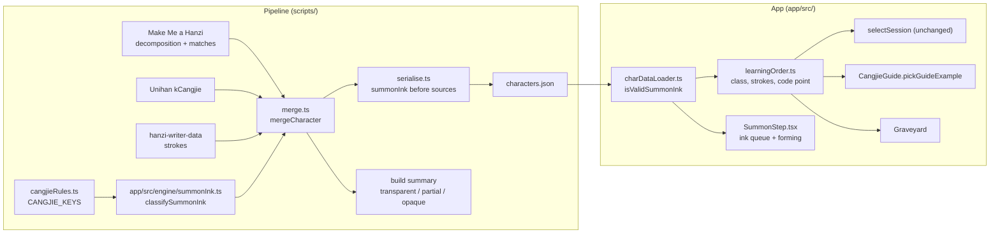
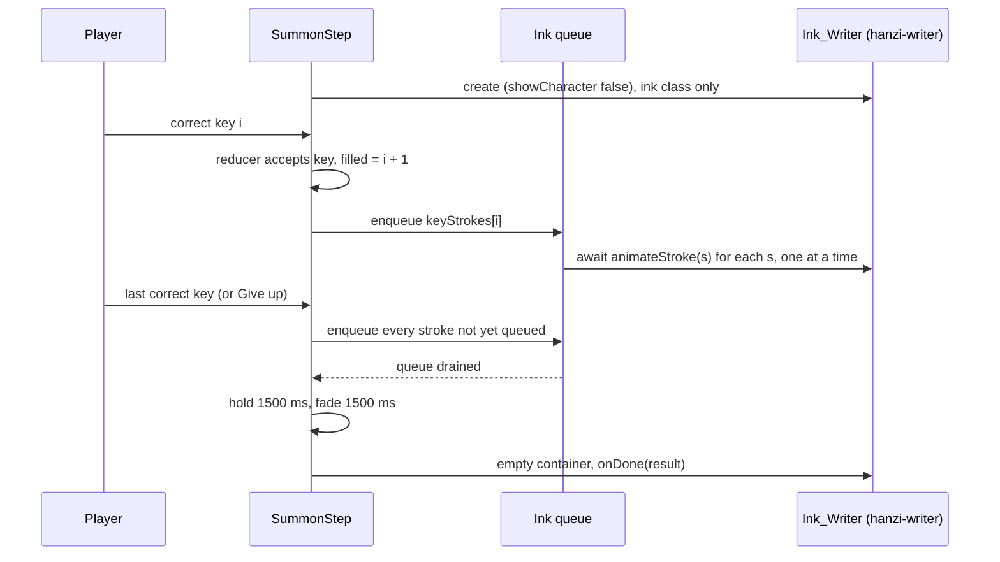

# Design Document: summon-ink

## Overview

Each correct key in the Summon step inks the strokes of the part that the key's base shape stands for. Whether a key can ink anything is decided once, in the data pipeline, by comparing the code's keys with the character's decomposition tree and stroke-to-component matches. The result is stored per character as `summonInk` in `characters.json`. The App reads it; it never recomputes it.

The design has four moving parts:

1. **A pure classifier** (`app/src/engine/summonInk.ts`) used by the pipeline (to write the field), the loader (to validate it) and the tests (to recompute it).
2. **A dataset field** `summonInk`, serialised between `cangjie` and `sources`, so the generated file changes by added lines only.
3. **Summon step changes**: for `transparent` and `partial` characters a hanzi-writer instance exists from the start, strokes are drawn one at a time through a queue, and the rest of the character forms when the code completes.
4. **A new Learning order**: class first, then stroke count, then code point.

Nothing in the scheduler, outcomes, thresholds or storage changes.

### Kiro features used

- **Specs**: this requirements-first spec (`.kiro/specs/summon-ink/`), with tasks and a wave plan.
- **Steering**: the four steering files shaped the design (`tech.md` stack and the property-test rule, `structure.md` names and layout, `product.md` never-reveal and one-rite principles, `content-accuracy.md` derived-data and answer-leak rules). Two of them are edited by tasks of this spec.
- **MCP server (Cangjie Oracle)**: the `decompose` and `lookup` tools of the cangjie-oracle server were used to spot-check the eight characters in the table below before this design relied on them.
- **Custom agent**: `accuracy-reviewer` reviews the new on-screen text and the README change, including both honest-message lines (task 8.4).
- **Hook**: `data-check-on-save` runs `npm run check:data` (the dataset build and the node-project tests) when `data/character-list.txt`, `data/prompt-overrides.csv` or a file under `data/raw/` is saved. It does not fire on `scripts/` edits or on `build:data` itself. The new dataset tests live in `tests/unit/`, so they run in that hook's `test:data` step.
- **Playwright e2e**: the existing `e2e/` suite is extended with `summon-ink.spec.ts`.

### Spot-check with the cangjie-oracle tools

The following was spot-checked with the cangjie-oracle tools. The class and stroke columns come from the throwaway computation described under "Research".

| Char | Code | Key base shapes | Decomposition | Class | `keyStrokes` |
|---|---|---|---|---|---|
| 明 | AB | 日 月 | ⿰日月 | transparent | [[0,1,2,3],[4,5,6,7]] |
| 早 | AJ | 日 十 | ⿱日十 | transparent | [[0,1,2,3],[4,5]] |
| 天 | MK | 一 大 | ⿱一大 | transparent | [[0],[1,2,3]] |
| 果 | WD | 田 木 | ⿱田木 | transparent | [[0,1,2,3],[4,5,6,7]] |
| 里 | WG | 田 土 | ⿱田土 | transparent | [[0,1,2,3],[4,5,6]] |
| 本 | DM | 木 一 | ⿻木一 | transparent | [[0,1,2,3],[4]] |
| 下 | MY | 一 卜 | ⿱一卜 | transparent | [[0],[1,2]] |
| 干 | MJ | 一 十 | ⿱一十 | transparent | [[0],[1,2]] |

本 and 干 are transparent on the strokes as well as the components: the `matches` of 本 are `[0] [0] [0] [0] [1]` and of 干 are `[0] [1] [1]`, so every stroke belongs to exactly one of the two components.

## Research

### What the data looks like

`decomposition` in `characters.json` has `decomposition` (an IDS string), `matches` (one entry per stroke: `null` or an index path into the IDS tree), `atomic` and `components` (leaf characters, de-duplicated, only code points from the CJK, radical and stroke blocks). Findings from a read-only script (in `/tmp`, not in the repository) over all 300 records:

- **Paths are tree paths.** A path such as `[1,1,0]` walks the IDS tree: child 1 of the root, child 1 of that, child 0 of that. For 南 (`⿱十⿵冂⿱丷干`) the path `[1,0]` is 冂 and `[1,1,0]` is 丷. The first index alone would put 冂, 丷 and 干 together. All 1,985 non-null paths in the data (1,896 of depth 1, 84 of depth 2, 5 of depth 3) resolve to a leaf exactly, and 126 strokes have a `null` match (31 in the 9 atomic records, 95 in 33 non-atomic records).
- **`components` cannot be used to match keys**: it is de-duplicated (二 has two 一 leaves, but `components` lists 一 once) and it drops `？`. The classifier therefore matches against the leaves of the tree, and a test checks that every leaf is in `components` or is `？`.
- **Atomic records** have `matches` all `null`; the classifier uses the character itself as the one instance.
- **Counts**: 15 transparent, 95 partial, 190 opaque (see the requirements for the surprises with numbers).

### hanzi-writer 3.7.3: the verified way to draw individual strokes

hanzi-writer 3.7.3 (`node_modules/hanzi-writer`, public typings in `dist/types/hanzi-writer.d.ts`) has no public `showStroke`. It has `animateStroke(strokeNum, options)`, `highlightStroke`, `showCharacter`, `hideCharacter`, `animateCharacter`, `updateColor`, and the option `strokeAnimationSpeed`. Reading `dist/hanzi-writer.js` and running a probe in jsdom (a throwaway script in `/tmp`, real library, real stroke data for 明) established:

1. **`animateStroke(n)` draws stroke `n` and leaves it visible.** Its first mutation sets the main character's opacity to 1 and every stroke's opacity to *current character opacity times current stroke opacity*. With `showCharacter: false` the character opacity starts at 0, so on the first call all other strokes become invisible and stroke `n` animates in. On later calls, strokes already drawn keep opacity 1. Probe result for 明 after `await animateStroke(0)` and `await animateStroke(1)`: exactly the main-layer paths 0 and 1 had effective opacity 1.
2. **At mount, nothing is visible.** With `showCharacter: false` and `showOutline: false`, all 24 stroke paths in the svg (8 outline, 8 main, 8 highlight for 明) have effective opacity 0.
3. **Calls must not overlap.** `RenderState.run` cancels any running chain whose scope overlaps, and the draw mutation is not marked `force`, so a cancelled stroke is not completed. Probe: calling `animateStroke(4)` and `animateStroke(5)` without awaiting gave results `{canceled:true}` and `{canceled:false}`, and stroke 4 stayed invisible. The Summon step therefore queues every stroke call and awaits each one.
4. **Duration**: a stroke takes `(length + 600) / (3 × strokeAnimationSpeed)` milliseconds, and the option is read when the animation starts from `options.strokeAnimationSpeed`. A very large speed makes a stroke finish within one animation frame; that is the reduced-motion path.
5. **`animateCharacter()` is not used for the ink classes**, because it hides every stroke first and redraws all of them with a pause of `delayBetweenStrokes` (default 1000 ms) between strokes, which would erase and redraw the inked parts. The opaque class keeps `animateCharacter()` as today.

Other rejected options: `highlightStroke` flashes a stroke and fades it, so it does not leave ink. A second, hand-made SVG layer with the dataset's stroke paths would need its own geometry (`HanziWriter.getScalingTransform` exists) and would sit beside the hanzi-writer layer used for forming. One renderer is simpler.

## Decisions

Decisions D3, D5, D9, D12 to D17 were decided or confirmed by the human; no open questions remain.

| ID | Decision | Rationale | Requirements |
|---|---|---|---|
| D1 | Classify against the leaves of the IDS tree, by exact path, not against `components` and not by the first path index. | `components` is de-duplicated and loses repeats and `？`; nested paths need the whole path. | 1.4, 1.6, 1.8 |
| D2 | Keys map to instances with a forward-only cursor (first fit). | Deterministic, handles repeated shapes (二, 从, 朋) in order, and keeps "in key order" well defined for overlap layouts: the order of the IDS leaves. Transparent is then exactly "the code's shapes equal the glyphs of the eligible leaves, in order, and no stroke is unattributed". | 1.8, 1.9, 1.12 |
| D3 | Atomic records have one instance, the character itself; `matches` is ignored. Confirmed by the human: an atomic character whose single key's Base_Shape is the character itself is `transparent` (一 M, 人 O, 女 V, 手 Q). | Atomic `matches` are all `null`, so the general rule would call 一 opaque although its key M is 一. AC 1.17 states the case explicitly, and the unit tests and Property 1 cover it. | 1.3, 1.17 |
| D4 | A `null` or non-leaf path never counts toward a key, and any such stroke prevents `transparent`. | Strokes that no key explains cannot be called "built from the keys". | 1.6, 1.12 |
| D5 | Decided by the human: no variant table in this spec. A component matches a key only when it is literally the key's base shape; this spec does not compare different characters. | A hand-written list is against the data rules. The numbers are reported for the human. A variant table, if ever wanted, needs its own spec and a sourced dataset. | 2.2 |
| D6 | `summonInk` sits between `cangjie` and `sources`; `sources` gets no new key. | The generated diff is lines added only (no `}` becomes `},`), and "existing fields byte-identical" holds for `sources` too. Attribution is in the type documentation, README and `content-accuracy.md`. | 2.3, 2.4, 2.7, 8.4 |
| D7 | The Pipeline computes the class inside `mergeCharacter`, from the data it already holds. | One assembly point; the function stays pure; no change to the call order in `build-data.ts`. | 2.1 |
| D8 | The shared key table moves to `cangjieRules.ts` and `cangjie.ts` re-exports it. | `cangjieRules.ts` imports nothing, and the Pipeline and the oracle already import it by relative path. Importing `cangjie.ts` would pull the reducer and `outcome.ts` into the Pipeline. | 1.2 |
| D9 | Strokes are drawn with `animateStroke` through a promise queue; `strokeAnimationSpeed` is 2 (about half of the default drawing time per stroke), and 1000 under reduced motion. | Verified API (Research 1 to 4). Decided by the human: `SUMMON_INK_SPEED = 2` stays a named, exported constant, tuned by eye (task 10.1); the unit tests assert only that reduced motion uses the fast value and do not pin the number. | 4.2, 4.6, 4.9 |
| D10 | For ink classes the Ink_Writer is created when the step mounts, and forming draws the not-yet-inked strokes in index order. For `opaque` nothing changes. | Keeps the opaque path byte-for-byte as today and risk-free. | 4.1, 4.5, 4.7 |
| D11 | Give up inks nothing extra for untyped keys; the strokes not yet inked form like at completion. | The final picture is the same, with one code path. The full code still shows in the slots. | 4.8 |
| D12 | Honest message, two lines, one per kind of character. A `partial` character shows "This key's shape is one the game doesn't show yet." per key, only for an Inkless_Key. An `opaque` character shows one line for the whole ghost, the Opaque_Note "This code uses shapes the game doesn't show yet.", and nothing per key. A `transparent` character shows neither. Approved by the human. | In a `transparent` character no key is inkless. In an `opaque` character every key is silent, so a per-key message would repeat on every key (or single out one key, for example the X in 身). | 5.1, 5.3, 5.4, 5.6 |
| D13 | Decided by the human: stroke paths at zero opacity for strokes not yet inked are acceptable in the DOM during typing (they are in the public dataset anyway). The character is never present as text or in any attribute, and the never-reveal test keeps checking text and attributes. | A subset loader or a second writer would add a second renderer for a protection the public JSON file already makes moot. | 6.1 |
| D14 | The existing-fields check uses a recorded checksum fixture, not `git show HEAD`. The fixture, its test and its provenance paragraph exist only to prove this change; the final checkpoint deletes all three after the check has passed. | Works in a shallow clone and after the change is committed. Once the check has passed on the final dataset, the fixture would only go stale when a later spec changes existing fields on purpose. | 8.3, 8.5 |
| D15 | The Opaque_Note shows from the start of the Summon step until the code is complete or given up, as a static paragraph directly below the slots. It is plain text in an element with no `role` and no `aria-live`, outside the status line. | Static text near the slots is seen before the first key and is not re-announced on every key press, as a live region would be. Screen-reader users reach it in reading order. Colour is not the only signal because it is a sentence. | 5.4, 5.5, 5.8 |
| D16 | The derived-data note for `content-accuracy.md` stays a task of this spec (task 8.2). | `summonInk` is the first derived field, so the steering file needs a rule for it. | 2.7 |
| D17 | Task 10.1 (the `kiro-log.md` entry and the by-eye speed check) stays a non-coding task done by the human. Kiro does not write `kiro-log.md`. | The log is first person, written by the human. | 4.2, 4.9 |

## Architecture





## Components and Interfaces

### `app/src/engine/cangjieRules.ts` (change)

Moves `CangjieKey`, `CangjieKeyInfo` and `CANGJIE_KEYS` here from `cangjie.ts`. The file keeps importing nothing. `cangjie.ts` re-exports them (`export { CANGJIE_KEYS } from './cangjieRules'` and `export type { CangjieKey, CangjieKeyInfo }`), so no other import changes. `KEY_FACE_CHARACTERS` stays in `cangjie.ts`.

### `app/src/engine/summonInk.ts` (new, pure, imports only `cangjieRules` and types)

```ts
import { CANGJIE_KEYS } from './cangjieRules';
import type { SummonInk } from '../data/types';

/** The fields of a CharacterRecord that the rule reads. A full record fits. */
export interface ClassifierInput {
  readonly character: string;
  readonly cangjie: string | null;
  readonly strokeCount: number;
  readonly decomposition: {
    readonly decomposition: string;
    readonly matches: ReadonlyArray<ReadonlyArray<number> | null> | null;
    readonly atomic: boolean;
  };
}

export type IdsNode =
  | { readonly leaf: string }
  | { readonly op: string; readonly kids: readonly IdsNode[] };

/** null unless the string is exactly one complete tree. Operators U+2FF0..U+2FFB; U+2FF2 and U+2FF3 take 3 operands, the rest 2. */
export function parseIds(ids: string): IdsNode | null;

/** The Base_Shape of each key A..Y except X (24 entries). */
export const BASE_SHAPE_BY_KEY: ReadonlyMap<string, string>;

export function classifySummonInk(input: ClassifierInput): SummonInk;

/** Structural validity for one record (Requirement 3.3 to 3.7). */
export function isValidSummonInk(
  value: unknown,
  code: string | null,
  strokeCount: number,
): value is SummonInk;

/** transparent 0, partial 1, opaque 2; anything else 2. */
export function summonInkRank(value: unknown): 0 | 1 | 2;
```

Algorithm of `classifySummonInk`:

```ts
const OPAQUE: SummonInk = { class: 'opaque' };

function instancesOf(input): { glyph: string; strokes: number[] }[] | null {
  const { atomic, decomposition, matches } = input.decomposition;
  const all = Array.from({ length: input.strokeCount }, (_, i) => i);
  if (atomic) return [{ glyph: /* the character */, strokes: all }];
  const tree = parseIds(decomposition);
  if (tree === null) return null;
  const leaves = collectLeaves(tree);           // [{ glyph, path }] left to right
  const instances = leaves.map((l) => ({ glyph: l.glyph, path: l.path, strokes: [] as number[] }));
  if (matches !== null && matches.length === input.strokeCount) {
    matches.forEach((path, stroke) => {
      if (path === null) return;                // Unattributed_Stroke
      const hit = instances.find((x) => samePath(x.path, path));
      if (hit) hit.strokes.push(stroke);        // inner-node or bad paths find nothing
    });
  }
  return instances;
}
```

For the atomic branch the glyph is `input.character`.

```ts
export function classifySummonInk(input: ClassifierInput): SummonInk {
  const code = input.cangjie;
  if (code === null || code.length === 0) return OPAQUE;
  const instances = instancesOf(input);
  if (instances === null) return OPAQUE;
  let cursor = 0;
  let matched = 0;
  const covered = new Set<number>();
  const keyStrokes: number[][] = [];
  for (const key of code) {
    const shape = BASE_SHAPE_BY_KEY.get(key);   // undefined for X
    let hit = -1;
    if (shape !== undefined) {
      for (let j = cursor; j < instances.length; j++) {
        if (instances[j].strokes.length > 0 && instances[j].glyph === shape) { hit = j; break; }
      }
    }
    if (hit < 0) { keyStrokes.push([]); continue; }
    cursor = hit + 1;
    matched += 1;
    keyStrokes.push([...instances[hit].strokes]);   // ascending: strokes were pushed in index order
    instances[hit].strokes.forEach((s) => covered.add(s));
  }
  if (matched === 0) return OPAQUE;
  const all = matched === code.length && covered.size === input.strokeCount;
  return { class: all ? 'transparent' : 'partial', keyStrokes };
}
```

`isValidSummonInk` checks: plain object; class in the three values; `opaque` has no `keyStrokes` property; ink classes have `keyStrokes` that is an array of `code.length` arrays of integers in `[0, strokeCount)` ascending within a key and unique across keys, with a non-null code; `transparent` covers every index; `partial` has at least one non-empty entry. It does not recompute the class (the exhaustive dataset test does).

### `app/src/data/types.ts` (change)

```ts
export type SummonInkClass = 'transparent' | 'partial' | 'opaque';

/**
 * Derived by the pipeline from `decomposition` (Make Me a Hanzi), `cangjie` (Unihan)
 * and the Cangjie key table. It adds no dataset and no licence. `keyStrokes[i]` lists
 * the stroke indexes that the code's key number i inks; opaque characters store the class only.
 */
export type SummonInk =
  | { class: 'opaque' }
  | { class: 'transparent' | 'partial'; keyStrokes: number[][] };

export interface CharacterRecord { /* ...existing fields... */ cangjie: string | null; summonInk: SummonInk; sources: FieldSources; }

export type BuildResult = /* ok: true variant gains */ { summonInkCounts: Record<SummonInkClass, number> } /* ... */;
```

### Pipeline (`scripts/`)

- `scripts/lib/merge.ts`: after assembling the record fields, set `summonInk: classifySummonInk({ character: char, cangjie, strokeCount: hw.strokes.length, decomposition: { decomposition: mm.decomposition, matches: mm.matches, atomic: mm.atomic } })`.
- `scripts/lib/serialise.ts`: `OrderedRecord` and `orderRecord` emit `summonInk` after `cangjie` and before `sources`, rebuilt as `{ class }` or `{ class, keyStrokes }` in that key order.
- `scripts/build-data.ts`: counts the classes while merging, returns `summonInkCounts` in the success result, and `formatCangjieSummary` is followed by `formatSummonInkSummary(counts)`, which prints `Summon ink: transparent 15, partial 95, opaque 190` (values computed, not typed).
- README "Data and licences": one sentence for the derived field (Requirement 2.7).

### `app/src/data/charDataLoader.ts` (change)

`isCharacterRecord` adds `isValidSummonInk(v.summonInk, v.cangjie as string | null, v.strokeCount)`. A failure returns `invalid-shape`, the same as other fields.

### `app/src/engine/learningOrder.ts` (change)

The parameter type becomes `ReadonlyMap<string, Pick<CharacterRecord, 'strokeCount'> & { summonInk?: unknown }>`. The comparator is `summonInkRank` ascending, then `strokes` ascending (non-finite last), then code point sequence, as today. With the real dataset the first 15 entries are transparent, so the first five new ghosts of a first-time player become 一 二 人 下 女 (they were 一 七 九 了 二), and 一 stays first.

### `app/src/modes/SummonStep.tsx` (change)

State and refs added:

```ts
export const SUMMON_INK_SPEED = 2;            // strokeAnimationSpeed while drawing (D9)
const SUMMON_REDUCED_SPEED = 1000;            // one animation frame per stroke

const ink = record.summonInk;
const keyStrokes = ink.class === 'opaque' ? null : ink.keyStrokes;
const inks = keyStrokes !== null && code !== '';

const chainRef = useRef<Promise<void>>(Promise.resolve());
const queuedRef = useRef<Set<number>>(new Set());   // strokes already queued
const brokenRef = useRef(false);                    // writer failed: stop inking, use the text fallback
```

Behaviour:

1. **Create (mount effect, `inks` only).** `HanziWriter.create(container, record.character, { width: side, height: side, padding: 12, showCharacter: false, showOutline: false, strokeColor: theme.inkOnPaper, strokeAnimationSpeed: prefersReducedMotion() ? SUMMON_REDUCED_SPEED : SUMMON_INK_SPEED, charDataLoader: makeCharDataLoader(dataset), onLoadCharDataError: () => { brokenRef.current = true; } })`. Cleanup sets a `disposed` flag, empties the container and clears `writerRef`. If `create` throws, `brokenRef.current = true`.
2. **Ink on a correct key.** `commit(next, message)` is where the reducer result is applied. When `next.filled > prev.filled` and `inks`, call `enqueueInk(keyStrokes[prev.filled])`:

```ts
function enqueueInk(strokes: readonly number[]) {
  const writer = writerRef.current;
  for (const s of strokes) {
    if (queuedRef.current.has(s)) continue;
    queuedRef.current.add(s);
    chainRef.current = chainRef.current
      .then(async () => {
        if (disposedRef.current || brokenRef.current || writer === null) return;
        await writer.animateStroke(s);          // never two calls at once (Research 3)
      })
      .catch(() => { brokenRef.current = true; });
  }
}
```

   A wrong key calls nothing. A correct key with an empty list loops zero times.
3. **Forming (the existing `started` effect).** For `inks`: do not create a new writer. Call `enqueueInk` with every index in `0..strokeCount-1` not in `queuedRef`, then `chainRef.current.then(() => brokenRef.current ? useFallback() : holdAndFade())`. The hold, fade and `finish()` code is unchanged, and `finish()` empties the container so the Paper holds no path when `onDone` runs. For a transparent character the remainder is empty, so the hold starts as soon as the queue drains. For `opaque`, the effect is the existing one (create, `animateCharacter()`, hold, fade).
4. **Surface visibility.** `InkSurface` gets `hidden={phase === 'typing' && !inks}`. The paper size and grid are unchanged, so the layout does not move.
5. **Status text (partial only).** `describe(prev, next)` gains a third argument, `inkless: boolean`, true when `ink.class === 'partial'` and `keyStrokes[prev.filled]` is empty and the key was accepted:

```ts
const INKLESS_TEXT = "This key's shape is one the game doesn't show yet.";
// accepted key: '✓ Key accepted' or '✓ Code complete', then ' ' + INKLESS_TEXT when inkless
```

   The text goes in the existing `role="status"` `aria-live="polite"` paragraph, which already has `min-h-[2.5rem]` (two lines at 14 px). The longest message, "✓ Code complete This key's shape is one the game doesn't show yet. · Mistakes: 0", is about 80 characters, so two lines at 375 px, which the e2e fit test checks.
   **Opaque_Note.** For an `opaque` record the step renders one static paragraph directly below the slots while `phase === 'typing'`:

```tsx
const OPAQUE_NOTE = "This code uses shapes the game doesn't show yet.";
{record.summonInk.class === 'opaque' && phase === 'typing' && (
  <p data-testid="opaque-note" className="text-sm text-ink-muted">{OPAQUE_NOTE}</p>
)}
```

   The element has no `role` and no `aria-live`, and it is not inside the status paragraph, so it is not announced again on key presses. `describe` never adds text for an `opaque` or a `transparent` record. The paragraph disappears when forming starts. It takes one or two lines at 375 px; the Paper size comes from `summonPaperSize`, which already reserves room for the other controls, and the e2e fit test checks an opaque character at both sizes. The text uses the secondary-text token that already meets contrast on the dark theme.
6. **Give up.** `handleGiveUp` is unchanged; forming (step 3) draws everything not queued.
7. **Reduced motion** is read once when the writer is created; the fade handling is unchanged.
8. **Unmount.** The existing cleanup runs, plus `disposedRef.current = true`, so queued steps stop and `onDone` is not called.

The tests for the existing component keep the hanzi-writer mock; the mock gains an `animateStroke` method that resolves and records its calls.

### `app/src/components/CangjieGuide.tsx`

No code change. `pickGuideExample` still returns the last Playable character with a two or three key code in `learningOrder`. With the new order that is **黑** (code WGF, position 293 of 300, class opaque), where it was 想 (DUP, position 291). Both are far past position 30. The existing Answer_Leak test (index at least 30) stays. The test that hard-codes `想` and `DUP` changes to `黑`, and the code is read from the dataset.

### `e2e/` (new and changed)

- `e2e/helpers.ts` gains `datasetRecord(char)`, `datasetMap()`, `seedBefore(char)` and `visibleInkPaths(page)`, and the two local helpers `expectInside` and `expectNoVerticalScroll` of `fits-one-screen.spec.ts` move here so both specs share them.
- `seedBefore(char)` computes `learningOrder` over the dataset read at test time (importing the pure function from `app/src/engine/learningOrder`), and returns a seed state whose history marks every character before `char` as reviewed `clean` with `nextDue` 30 days ahead. Nothing is due, so the scheduler's new-character band starts at `char`. No App hook or backdoor is added.
- `visibleInkPaths(page)` counts stroke paths under `[data-testid="ink-container"]` (`path[clip-path]`) whose own and ancestors' computed opacity multiply to more than 0 and none of which has `display: none`. The probe in jsdom confirmed that hidden layers have effective opacity 0, so only drawn main strokes count. In Chromium the check uses `getComputedStyle`.
- `e2e/summon-ink.spec.ts`:
  1. *Ink after the first key*: seed before 明, open the Séance, confirm the page shows 明's prompt pinyin read from the data, press `record.cangjie[0]`, and poll until `visibleInkPaths` equals `keyStrokes[0].length`.
  2. *Honest message, partial*: seed before the first partial character in the learning order, type the code up to and including the first key whose `keyStrokes` entry is empty, expect the status line to contain the text of AC 5.1, and expect no Opaque_Note on the page.
  3. *Honest message, opaque*: seed before the first opaque character in the learning order; before any key, expect the Opaque_Note to be visible, to have no `role` and no `aria-live`, and not to be inside the status line; type the first key and expect the status line not to contain the text of AC 5.1 and the Opaque_Note unchanged.
  4. *Fit with ink and notes* at 1024 by 768 and 375 by 812: after the first key on 明, after the inkless key of 2, and with the Opaque_Note of 3, the Summon step controls from `fits-one-screen.spec.ts` are inside the viewport and there is no vertical scroll.

## Data Models

### Stored field

For 明 (code `AB`), serialised between `cangjie` and `sources`:

```json
"cangjie": "AB",
"summonInk": {
  "class": "transparent",
  "keyStrokes": [
    [0, 1, 2, 3],
    [4, 5, 6, 7]
  ]
},
"sources": { ... }
```

For an opaque character:

```json
"summonInk": {
  "class": "opaque"
},
```

`JSON.stringify(…, null, 2)` prints each number on its own line. The file grows by a few thousand lines; `characters.json` is excluded from the bundle budget (`check:bundle`).

### Partial example

三 (code MMM, leaves 一 二, strokes 0 in 一 and 1 and 2 in 二): the first M matches 一; the second M finds no 一 after the cursor (the next leaf is 二), so it is unmatched, and so is the third. Result: `partial`, `keyStrokes [[0],[],[]]`. In that character the second and third keys are Inkless_Keys.

### Class counts (current data, from the throwaway computation)

| Class | Count | Code lengths 1 / 2 / 3 / 4 / 5 |
|---|---|---|
| transparent | 15 | 4 / 11 / 0 / 0 / 0 |
| partial | 95 | 0 / 15 / 51 / 29 / 0 |
| opaque | 190 | 10 / 29 / 53 / 61 / 37 |

### Guide example and Learning order on the current data

- New order starts: 一 二 人 下 女 干 从 天 手 本 早 里 明 朋 果 (all transparent), then partial characters (the first 30 positions are 15 transparent, then 15 partial), then opaque.
- Guide example: 黑 (WGF), position 293 of 300.
- `selectSession` receives `learningOrder(dataset)` for its new-character bands and for tie-breaking, so a player who already has history keeps it (history is keyed by character and the schema stays version 2), but the next *new* characters they meet now follow the new order. This is approved by the human. The Graveyard also lists characters in `learningOrder`, so its listing order changes.

### Existing-fields baseline

`tests/fixtures/summon-ink/existing-fields.sha256.json`: an object from character to the SHA-256 (hex) of `JSON.stringify(record)` with `summonInk` removed, taken from the committed `characters.json` before this feature. The fixture is recorded once by task 1.1 from `git show HEAD:app/public/data/characters.json`. The fixtures README gets a provenance paragraph.

The fixture is temporary (D14). In the final checkpoint (task 9), after the existing-fields test has passed, the fixture, `tests/unit/summon-ink-existing-fields.test.ts` and the provenance paragraph in `tests/fixtures/README.md` are deleted (the directory `tests/fixtures/summon-ink/` goes with the fixture, and other files in `tests/fixtures/` stay), and `npm test` is run again to confirm that nothing else depended on them.

## Correctness Properties

*A property is a characteristic or behavior that should hold true across all valid executions of a system-essentially, a formal statement about what the system should do. Properties serve as the bridge between human-readable specifications and machine-verifiable correctness guarantees.*

Reflection on the prework: the testable acceptance criteria of Requirement 1 all describe one pure function, and the approved scope allows exactly one new property-based test. The criteria are therefore merged into one property whose clauses are the invariants and one model comparison. Everything else in the feature is example-based or end-to-end (see the Testing Strategy).

### Property 1: Classification invariants

*For any* generated record (atomic or an IDS tree of up to three levels with binary and ternary operators, strokes assigned to leaf paths, `null`, inner-node paths, over-long paths or out-of-range paths, a `matches` array of the right length, the wrong length or `null`, and a code of zero to five keys or `null`), `classifySummonInk` SHALL satisfy all of these:

1. **Shape**: an `opaque` result has no `keyStrokes`; a `transparent` or `partial` result has `keyStrokes` with exactly one entry per key of the code.
2. **Index invariants**: every index in `keyStrokes` is an integer from 0 to `strokeCount` minus 1, ascending within its entry, and no index appears under two keys; a `partial` result has at least one non-empty entry; a `transparent` result's entries together hold every index from 0 to `strokeCount` minus 1 exactly once.
3. **Model agreement**: the result equals the result of a simple independent model that (a) lists the leaves with at least one stroke in left-to-right order, (b) reduces each key to its base shape or "none" for X, (c) walks the keys against that list with a forward-only cursor, and (d) returns `transparent` exactly when the code's shape sequence equals the list's glyph sequence and no stroke is unattributed, `opaque` when no key matched or the code is `null` or empty, and `partial` otherwise.
4. **Monotone under extra keys**: appending the key X to the code never raises the class (transparent, partial, opaque in that order of rank) and leaves the existing entries of `keyStrokes` unchanged.
5. **Purity**: calling the function twice on a deep-frozen copy of the input gives equal results and does not throw.
6. **Atomic self key**: for an atomic record whose code is exactly one key whose base shape equals the character, the result is `transparent` with `keyStrokes` equal to one entry listing every index from 0 to `strokeCount` minus 1; for an atomic record whose code has two or more keys, the result is never `transparent`.

**Validates: Requirements 1.3, 1.4, 1.6, 1.8, 1.9, 1.11, 1.12, 1.13, 1.14, 1.15, 1.16, 1.17**

## Error Handling

| Situation | Behaviour | Requirement |
|---|---|---|
| IDS string is malformed (cannot be parsed into one tree) | The classifier returns `opaque`; the build continues (no character is dropped). | 1.5 |
| `matches` is `null` or has the wrong length | Every stroke is unattributed; the class is `opaque` (no key can match an instance without strokes). | 1.7 |
| `summonInk` missing or invalid in `characters.json` | `loadDataset` returns `invalid-shape` and the App shows its existing dataset error screen. | 3.3 to 3.7 |
| Ink_Writer creation throws, or the character data fails to load | Keys keep working without ink; at completion the existing plain-text fallback runs with the same hold and fade. | 4.10 |
| A stroke animation rejects | The queue marks the writer broken; the remaining ink calls are skipped; the text fallback runs at completion. | 4.10 |
| Player types faster than strokes draw | Strokes queue and draw in order; the reducer state is unaffected. | 4.6 |
| Unmount during drawing | The queue steps return early, timers are cleared, the container is emptied, `onDone` is not called. | 4.11 |
| Correct key in an `opaque` or `transparent` character | No per-key message. An `opaque` character shows the Opaque_Note from the start of the step; a `transparent` character shows no note. | 5.3, 5.4, 5.6 |

## Testing Strategy

PBT applies to the classifier, which is a pure function with a large input space, and to nothing else in this feature. The UI, the pipeline wiring and the loader are tested with unit, component, integration and e2e tests. By the rule in `tech.md` (amended by this spec for one exception), the Test_Suite gets exactly one new property-based test.

### Property-based test (one)

`app/src/engine/summonInk.property.test.ts`: fast-check, at least 100 runs (use 300), tagged `// Feature: summon-ink, Property 1: Classification invariants`.

Generators: a random IDS tree of depth up to 3 using binary operators and the ternary ones, with leaves drawn from the 24 base shapes, a few non-shape characters (`乂`, `亻`) and `？`; the IDS string printed from the tree; `strokeCount` from 1 to 12; each stroke assigned a leaf path, `null`, or a bad path (inner node, too long, index out of range); `matches` of the right length most of the time and of the wrong length or `null` sometimes; a code of 0 to 5 letters from A to Y, or `null`; and atomic records with all-`null` matches, whose character is often drawn from the 24 base shapes and whose code is often exactly the one key of that shape (the clause 6 case). The shape sequence of the code can be seeded from the leaf glyphs (with random drops, additions and swaps) so that transparent and partial results occur often.

### Unit tests (Requirement 9.1, 9.3 to 9.5)

- `app/src/engine/summonInk.test.ts`: the hand-built cases listed in Requirement 9.1, including the atomic cases (一 with M is `transparent` with all strokes; 八 with HO is `opaque`; an atomic character with the right key plus an extra key is `partial`); `parseIds` on binary, ternary and malformed strings; `isValidSummonInk` accepts and rejects each case of Requirement 3.3 to 3.7; `summonInkRank`; `BASE_SHAPE_BY_KEY` has 24 entries and no X.
- `tests/unit/summon-ink-dataset.test.ts` (node project): exhaustive over all 300 records (stored equals recomputed; every leaf listed in `components` or `？`; counts add up to 300; every stored value passes `isValidSummonInk`; `summonInk` is the key before `sources` in each record's key order), the atomic characters (一 人 女 手 are `transparent`, 八 又 牛 而 身 are `opaque`), and the eight-character spot check with codes, components and `matches` read from the dataset (no typed codes).
- `tests/unit/summon-ink-existing-fields.test.ts`: recomputes each record's checksum without `summonInk` and compares with the fixture; fails with the character names that differ. Temporary: deleted with its fixture in the final checkpoint.
- `tests/unit/serialise.test.ts` and `merge.test.ts`: the new key order and the merged value.
- `tests/unit/build-summary.test.ts`: the summary line and that the three counts add up.
- `app/src/data/charDataLoader.test.ts`: the loader cases of Requirement 3.
- `app/src/engine/learningOrder.test.ts`: class-then-strokes-then-code-point on hand-built maps; a record without `summonInk` ranks as opaque; on the real dataset the class sequence is non-decreasing and the counts match the stored classes.

### Component tests (hanzi-writer mocked, fake timers)

`app/src/modes/SummonStep.test.tsx` and `SummonStep.ink.test.tsx` (new file for the ink cases; the mock adds `animateStroke`): the writer exists from mount for transparent and partial characters and not for opaque; a correct key calls `animateStroke` for exactly that key's strokes; a wrong key calls nothing; two quick keys call `animateStroke` one after the other, never overlapping (the mock tracks concurrency); at completion only the not-yet-queued strokes are drawn, in ascending order, then the hold and fade run with the same constants; Give up draws every undrawn stroke; reduced motion passes the fast speed and skips the fade; a rejected `animateStroke` or a `create` that throws leads to the plain-text fallback; unmount stops everything; the per-key text of AC 5.1 appears for an Inkless_Key of a `partial` character only; the Opaque_Note appears from mount for an `opaque` character only, has no `role` and no `aria-live`, is not inside the status element, stays unchanged across correct and wrong keys, adds no per-key text, and is gone once forming starts; a `transparent` character shows neither line; the Paper has no `path` element when `onDone` runs. Records come from the real dataset: the first transparent record, the first partial record with an inkless key, and the first opaque record.

`SummonStep.neverReveal.test.tsx` extends its loop: for every transparent and partial playable record, after each correct key, the character appears in no text and no attribute (zero-opacity stroke paths are allowed, D13); the loop also covers the opaque characters' Opaque_Note text.

### Integration test (real hanzi-writer in jsdom)

`app/src/modes/SummonStep.hanziwriter.integration.test.ts`, in the style of `charDataLoader.hanziwriter.integration.test.ts`: create a writer for 明 with `showCharacter: false`; confirm all paths have effective opacity 0; `await animateStroke(0)` then `await animateStroke(1)` and confirm exactly those two main-layer paths are visible; call `animateStroke(4)` and `animateStroke(5)` without awaiting and confirm that stroke 4 stays invisible. This is the test that proves why the queue exists. (The probe that this test mirrors used jsdom with a timer-based `requestAnimationFrame`.)

### End-to-end tests

As described under `e2e/` above. They run against the built app served by `playwright.config.ts`.

### Existing tests to update

| File | Change |
|---|---|
| `app/src/modes/SummonStep.test.tsx` | hanzi-writer mock gains `animateStroke`; fixtures that build records gain `summonInk` |
| `app/src/modes/SummonStep.neverReveal.test.tsx` | the loop described above |
| `app/src/engine/learningOrder.test.ts`, `learningOrder.property.test.ts` | new sort key; the existing Property 12 test is amended in place, not added |
| `app/src/components/CangjieGuide.test.tsx` | expected example becomes 黑, code read from the dataset |
| `app/src/components/Graveyard.test.tsx`, `app/src/engine/graveyard.test.ts` | fixtures and order expectations |
| `app/src/App.test.tsx` | the "lowest-strokeCount characters" test: first ten equal `learningOrder(dataset).slice(0, 10)`, and the check that they have the fewest strokes of all characters is replaced by a check of the class order |
| `app/src/components/SeanceSession.resultLine.test.tsx`, `SeanceSession.test.tsx`, `app/src/data/charDataLoader.test.ts` | `summonInk` in fixtures |
| `tests/helpers/arbitraries.ts`, `tests/unit/{merge,serialise,build-summary,cangjie-dataset}.test.ts`, `tests/property/{character-record-schema,record-fields,pipeline-determinism}.test.ts`, `tests/integration/full-pipeline.test.ts` | expected record gains `summonInk` and its serialised position |
| `oracle/tests/oracle.test.ts`, `oracle/tests/server.test.ts` | fixtures gain `summonInk` (the oracle itself does not read it) |
| `e2e/fits-one-screen.spec.ts` | imports the moved helpers |

### Impact summary

Changed source: `cangjieRules.ts`, `cangjie.ts` (re-export), `learningOrder.ts`, `charDataLoader.ts`, `types.ts`, `SummonStep.tsx`, `merge.ts`, `serialise.ts`, `build-data.ts`. Untouched by Requirement 8.1: `config.ts`, `scheduler.ts`, `outcome.ts`, `storage/`.
