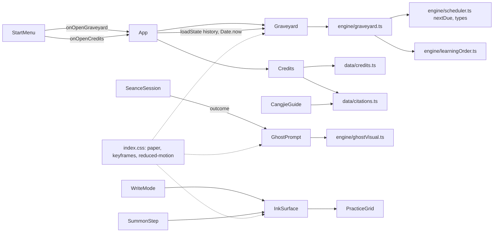

# Design Document: visual-identity

## Overview

This feature is visual only. It adds one pure engine module for the Graveyard, one tiny pure module for ghost states, a handful of presentational components, CSS in `index.css`, and a size check script. It changes no game rule (Requirement 14).

Property-based testing does not apply. The work is presentation, small mapping functions and copy, and the project decided on Nov 15 (`tech.md`) to add no new property tests. The Correctness Properties section is omitted on purpose (the format validator's warning about it is expected). Pure functions get unit tests with concrete cases; components get component tests.

### Kiro features used

| Part | Kiro feature | Why |
| --- | --- | --- |
| Whole feature | Specs | Requirements, design and tasks agreed before code (`structure.md`). |
| Never-reveal, licences, legend source, Cangjie citations | Steering (`content-accuracy.md`, `product.md`, `tech.md`) | Credits copy is copied from steering, not written from memory. |
| Cangjie codes in tests and tasks | MCP server `cangjie-oracle` (`lookup`, `decompose`) | Codes come from verified data, never from the model or by hand. |
| New copy review | Custom agent `accuracy-reviewer` (read-only) | Catches unsourced claims in Credits, Graveyard and README text. |
| Hooks | `data-check-on-save` (unchanged) | Not triggered: no watched input is edited. |

### Research summary

- **hanzi-writer 3.7.3** accepts `strokeColor`, `outlineColor`, `highlightColor`, `drawingColor`, `drawingWidth` and `radicalColor` at creation. It renders into an SVG inside the given container, with a transparent background, so a grid can sit behind the container.
- **Reduced motion.** Putting animations only inside `@media (prefers-reduced-motion: no-preference)` and giving the end state as ordinary static CSS means the reduced-motion user gets the end state with no JavaScript. The existing SummonStep fade keeps its JS check; it is not changed.
- **Fonts, measured.** `@fontsource/cormorant-garamond` 5.3.0 (licence OFL-1.1, copyright "The Cormorant Project Authors"): `cormorant-garamond-latin-600-normal.woff2` is 23,396 bytes (measured from the packed npm tarball). `woff2` is already Brotli-compressed, so gzip adds nothing.
- **Fonts, estimated (not measured).** `@fontsource/noto-serif-sc` 5.3.1 is 87 MB unpacked for 7 weights in 1,695 files, which is about 4 to 6 MB of `woff2` per weight for several thousand glyphs. That suggests roughly 0.3 to 0.5 kB per common glyph. The game uses 300 characters plus about 30 other glyphs, so one subset weight would be roughly 100 to 170 kB.

### Decisions

1. **Fonts.** A Latin display font (Cormorant Garamond, 600, Latin subset, 23.4 kB) for headings and the title. No CJK font file. Chinese text uses a system font stack. Reasons:
   - Size. Current JS is 66,304 B gzip and CSS 2,840 B gzip (measured from `app/dist`). Adding about 10 kB of new JS and CSS and the 23.4 kB font gives about 103 kB, well under 300,000 B. A CJK subset would add an estimated 100 to 170 kB and still leave the budget met, but with little room, for one weight only.
   - Effort. A reproducible CJK subset needs an OFL source font file, a subsetting tool (for example fonttools or `subset-font`) and a script with a pinned input. That is about half a day of the 1.5 days for a gain that is mostly invisible on iOS, macOS, Windows and Android, which all ship a Chinese font.
   - Risk. Linux or ChromeOS devices without a Chinese font would show empty boxes. This is accepted and listed as an open question.
2. **Practice grid and paper as components, not hanzi-writer internals.** An `InkSurface` wrapper draws Paper and the Practice_Grid and hosts the hanzi-writer container. Both modes use it, so the grid is identical in Summon and Write.
3. **Ghost state from the Outcome only.** `ghostStateFor(outcome)` has no access to the character, so no animation can depend on it (Requirement 4.7).
4. **Animations on the figure, not on the text.** The clue text stays at full opacity so it stays readable and keeps its contrast (Requirement 3.4).
5. **Graveyard unmet graves carry no character.** The model type for an unmet grave has no `char` field (Requirement 6.11).
6. **Bundle check as a script plus a pure function.** The function is unit tested; the script reads `app/dist`.

## Architecture



### Directory layout of new and changed files

```
app/src/
  engine/graveyard.ts            NEW  pure classification
  engine/ghostVisual.ts          NEW  Outcome -> GhostState
  data/citations.ts              NEW  Cangjie citations + legend source (shared)
  data/credits.ts                NEW  data sources, fonts, licences (matches README)
  components/PracticeGrid.tsx    NEW
  components/InkSurface.tsx      NEW
  components/Graveyard.tsx       NEW
  components/Credits.tsx         NEW
  components/GhostPrompt.tsx     CHANGED  figure + state
  components/SeanceSession.tsx   CHANGED  passes the outcome to GhostPrompt
  components/CangjieGuide.tsx    CHANGED  wording, imports citations
  components/StartMenu.tsx       CHANGED  two buttons
  modes/WriteMode.tsx            CHANGED  InkSurface, Ink_Palette colours
  modes/SummonStep.tsx           CHANGED  layout
  styles/theme.ts, index.css     CHANGED  tokens, paper, keyframes
  App.tsx                        CHANGED  two views
  main.tsx                       CHANGED  font import
app/tailwind.config.ts           CHANGED  colours, font families
app/package.json                 CHANGED  one font dependency
scripts/check-bundle-size.ts     NEW
package.json (root)              CHANGED  script check:bundle
tsconfig.json (root)             CHANGED  include app/src/data/credits.ts for the README test
tests/unit/                      NEW  bundle-size test, credits-vs-README test
README.md, kiro-log.md           CHANGED
```

## Components and Interfaces

### `engine/graveyard.ts` (Requirement 6)

```ts
import type { ReviewEntry, ReviewHistory } from './scheduler';

export type GraveState = 'unmet' | 'restless' | 'at-rest';

/** A character never met. Deliberately has no `char`. */
export interface UnmetGrave { readonly state: 'unmet'; readonly position: number } // 1-based, Learning_Order
export interface MetGrave {
  readonly state: 'restless' | 'at-rest';
  readonly char: string;
  readonly position: number;
  readonly streak: number;
}
export type Grave = UnmetGrave | MetGrave;
export interface GraveyardModel {
  readonly graves: readonly Grave[];
  readonly counts: Readonly<Record<GraveState, number>>;
}

export function classifyEntry(entry: ReviewEntry | undefined, now: number): GraveState;
export function cleanStreak(entry: ReviewEntry): number;
export function buildGraveyard(order: readonly string[], history: ReviewHistory, now: number): GraveyardModel;
```

**State definitions** (the precise rule, from the existing saved data):

| State | Rule | Why |
| --- | --- | --- |
| `unmet` | no own property `char` in the Review_History (the scheduler's NEW) | Entries are written only when a ghost reaches an Outcome, so "no entry" means the ghost never finished a rite. |
| `restless` | entry exists and (`lastOutcome` is `struggled` or `gave-up`, **or** the next-due time is `<= now`) | A miss, or a clean ghost that is due again (the scheduler's DUE). A missed ghost is restless even before its 10-minute delay ends. |
| `at-rest` | entry exists, `lastOutcome` is `clean`, and next-due time is `> now` | Laid to rest cleanly and not yet due. |

- Next-due: `const d = nextDue(entry); const due = Number.isFinite(d) ? d : 0;` (`nextDue` from `scheduler.ts` already clamps negatives; the finite check mirrors `selectSession`).
- Own-property lookup: `Object.prototype.hasOwnProperty.call(history, ch)`, as `selectSession` and `App.priorEntry` do.
- `cleanStreak`: count the trailing `outcome === 'clean'` items of `entry.history`; with no `history` array, `lastOutcome === 'clean' ? 1 : 0`.
- `buildGraveyard` walks `order` (the caller passes `learningOrder(dataset)`), so entries for characters outside the dataset are ignored by construction. Duplicates in `order` are skipped (first wins).
- Scheduler code is only imported (`nextDue`, types). No scheduler file changes.

### `engine/ghostVisual.ts` (Requirement 4.7)

```ts
export type GhostState = 'haunting' | 'faded' | 'flickering' | 'drifted';
export function ghostStateFor(outcome: Outcome | null): GhostState;
// null -> haunting, clean -> faded, struggled -> flickering, gave-up -> drifted
```

### `components/PracticeGrid.tsx` (Requirement 1)

An inline SVG, `viewBox="0 0 100 100"`, `width/height 100%`, `aria-hidden="true"`, `pointer-events-none`, `absolute inset-0`. Five groups: `<rect>` border, vertical line, horizontal line, two diagonals. Dashed centre and diagonal lines (`stroke-dasharray`), colour `currentColor` from the Ink_Palette grid token at `opacity` 0.25 (at most 0.35). Takes no props, so it cannot depend on a character.

### `components/InkSurface.tsx` (Requirements 1, 2, 8.4, 8.5)

```tsx
interface InkSurfaceProps {
  size: string;               // CSS length, e.g. 'min(80vw, 420px)'
  containerRef: React.RefObject<HTMLDivElement>;
  role?: string; ariaLabel?: string;
  hidden?: boolean;           // visually empty but still reserves space (Summon typing phase)
  style?: React.CSSProperties; // opacity/transition for the fade
}
```

Renders `<div class="ink-paper relative" style={{width:size, aspectRatio:'1/1', touchAction:'none'}}>` containing `<PracticeGrid/>` and the hanzi-writer container (`relative`, transparent, same size). The Paper look is the `.ink-paper` class in `index.css`. The container never uses `display: none`, so the space is always reserved. During the typing phase the paper and grid show and the container stays empty.

### `modes/WriteMode.tsx` changes (Requirement 2)

Replace the surface `<div>` with `InkSurface`, size `min(80vw, 420px)` (unchanged). Pass `strokeColor: theme.inkOnPaper`, `outlineColor: theme.gridLine`, `highlightColor: theme.seal`, `drawingColor: theme.drawing`, `drawingWidth: 5`. `showOutline` stays `false`. Nothing else changes: not the quiz options, callbacks, outcome logic, or messages.

### `modes/SummonStep.tsx` changes (Requirement 8)

- **Keyboard.** Each row becomes a CSS grid, not a wrapping flex row:
  ```tsx
  <div role="group" data-row={i} className="grid justify-center gap-[2px]"
       style={{ gridTemplateColumns: `repeat(${row.length}, var(--key-w))` }}>
  ```
  with `--key-w` defined once on the keyboard wrapper as `clamp(32px, calc((100vw - 2rem - 18px) / 10), 48px)`. At 375 px wide that is (375 - 32 - 18) / 10 = 32.5 px, so row 1 (10 keys, nine 2 px gaps) fits inside the Shell's `px-4` padding. Rows 2 and 3 use the same column width and are centred, which gives the staggered keyboard shape. Key buttons keep `min-h-[44px]`, `w-full`, `min-w-0`, and the same `aria-label`s. No `flex-wrap`.
- **Fixed surface.** `InkSurface` is rendered in every phase with size `min(60vw, 240px)`. It replaces `hidden` on the container. `surfaceSize()` in the file stays and still feeds hanzi-writer.
- **Slots.** The code slot list uses `flex-nowrap`; 5 slots of 48 px plus gaps is 272 px, less than 343 px.
- **Status area.** The `role="status"` paragraph gets `min-h-[3rem]` (two lines at the current text size), so a longer message does not push the keyboard.
- **Plain-text fallback.** The fallback character paragraph is moved inside the reserved surface (absolutely centred) instead of below it, so it does not change the height either.
- Behaviour, timers, hint rules, reducer calls and `aria-label`s are unchanged.

### `components/GhostPrompt.tsx` and `SeanceSession.tsx` (Requirements 3, 4, 5)

`GhostPrompt` gets an optional prop `outcome?: Outcome | null` (default `null`) and renders:

```tsx
<section aria-label="Ghost's clue" data-ghost-state={ghostStateFor(outcome)} className="ghost-card ...">
  <svg aria-hidden="true" className="ghost-figure" viewBox="0 0 64 80"> ...path and two eyes... </svg>
  ...existing meaning and pinyin, unchanged...
</section>
```

The silhouette path (ours): `M8 76 V32 C8 14 20 4 32 4 C44 4 56 14 56 32 V76 L48 68 L40 76 L32 68 L24 76 L16 68 Z`, two eye circles, no `<text>`. The CSS selects on `[data-ghost-state]` to animate `.ghost-figure`. `SeanceSession` passes its existing `result` state as `outcome`; nothing else in it changes. The existing masking of the target in the meaning text is unchanged.

### `styles/index.css` (Requirements 2, 3, 4, 7.9, 13.1)

- `:root` custom properties for the Ink_Palette (same hex values as `theme.ts`; a test checks they match).
- `.ink-paper`: layered `background` of a warm base colour, a soft radial vignette, and one inline SVG `feTurbulence` noise as a `data:` URI at low opacity. Authored here, so no image file.
- State end styles (static, always applied): `[data-ghost-state='faded'] .ghost-figure { opacity: 0 }`, `flickering` → `opacity: .5`, `drifted` → `opacity: 0; transform: translate(12px, -24px)`.
- Animations, all inside `@media (prefers-reduced-motion: no-preference)`: `ghost-float` (haunting, 4 s, translateY ±6 px alternate), `ghost-fade` (1.5 s, forwards), `ghost-flicker` (1.2 s, steps, ends at .5), `ghost-drift` (2 s, forwards), `grave-flicker` (restless graves, 2.5 s infinite, opacity .75 to 1).
- `.grave` shapes: `.grave-wisp` (dashed outline, rounded), `.grave-restless` (double border, wavy top via `border-radius` and `clip-path`), `.grave-rest` (solid, rounded top).

### `components/Graveyard.tsx` (Requirement 7)

```tsx
interface GraveyardProps {
  dataset: CharacterDataset;
  history: ReviewHistory;
  now: number;
  onBack: () => void;
}
```

`useMemo(() => buildGraveyard(learningOrder(dataset), history, now), [...])`. Renders:

- `<h1>Graveyard</h1>`, one intro line, the legend with counts (`Never met: n`, `Restless: n`, `At rest: n`) in text.
- A `<ul>` using `grid-template-columns: repeat(auto-fill, minmax(48px, 1fr))` with `gap-2`. Each `<li class="grave grave-…">`:
  - unmet: no glyph, marker `·`, `aria-label="Ghost 17 of 300, never met"` (uses `position`, not a character);
  - restless: glyph with `lang="zh"`, marker `!`, `aria-label="<glyph>, restless, due again"`, plus the streak when more than 0;
  - at rest: glyph, marker `✓`, `aria-label="<glyph>, at rest, 3 clean in a row"`.
- When all graves are unmet: `<p>No ghost has been met yet. Begin a séance to wake the first one.</p>`.
- `Back to menu` button (44 px, focus ring).

Because `UnmetGrave` has no `char`, the component cannot read a glyph for it; a test also scans the rendered HTML of an all-unmet graveyard for any of the 300 characters.

### `components/Credits.tsx` and the data modules (Requirement 9)

`data/credits.ts` exports:

```ts
export interface DataSourceCredit { name: string; version: string; use: string; licence: string; url: string }
export const DATA_SOURCES: readonly DataSourceCredit[];   // the five README rows, same wording
export const COMBINED_WORK_NOTE: string;                   // characters.json carries each source's terms
export const CODE_LICENCE = 'MIT';
export interface FontCredit { name: string; licence: string }
export const FONTS: readonly FontCredit[];                 // [{ name: 'Cormorant Garamond', licence: 'SIL Open Font License 1.1' }]
```

`data/citations.ts` exports `CANGJIE_CITATIONS` (moved from `CangjieGuide`, same two entries) and `LEGEND_SOURCE`: the zh line `天雨粟，鬼夜哭`, the English rendering already in `IntroScreen`, and the citation string copied exactly from the "Approved legend line" section of `content-accuracy.md`. The names in that citation appear only in `data/citations.ts` and `content-accuracy.md`, not in this spec.

`Credits` renders sections: Data sources (a `<table>` with `scope="col"` headers, or a definition list on narrow screens), Licensing (combined-work note, MIT), Legend, Cangjie, Fonts (including "Chinese text uses fonts already installed on your device"), and a `Back to menu` button. URLs are text, not links.

README cross-check test (`tests/unit/credits-readme.test.ts`, root node project): parse the README table rows under "Data and licences", and for each compare name, version/commit, use, licence and URL with `DATA_SOURCES`; check the `Fonts` line in the README names the same font and licence as `FONTS`; check `LEGEND_SOURCE.citation` appears in `content-accuracy.md` and in the README.

### `components/CangjieGuide.tsx` (Requirement 10)

- Sentence: "Each ghost is summoned by typing its Cangjie code. In this game, a code is one to five keys, typed in order."
- The `<ul aria-label="The 25 Cangjie keys">` gets a visible `<h2 id="guide-keys">The 25 keys in this game</h2>` and `aria-labelledby="guide-keys"`.
- `CITATIONS` is imported from `data/citations.ts`.
- `CangjieGuide.test.tsx` assertions are updated to the new strings.

### `components/StartMenu.tsx` and `App.tsx` (Requirement 11)

`StartMenuProps` gains `onOpenGraveyard` and `onOpenCredits` (both required). Two buttons with the same classes as the other secondary buttons are added after "How Cangjie works". `App.View` gains `{ screen: 'graveyard'; dataset }` and `{ screen: 'credits'; dataset }`. The graveyard case renders `<Graveyard dataset history={loadState().history} now={Date.now()} onBack>`; reading the state and clock happens in the `App` case, not in the component, so the component stays pure to test. Back goes to `menu`.

### Theme tokens (`styles/theme.ts`, `tailwind.config.ts`)

Added tokens (proposed; the theme test confirms each pair at 4.5:1 or better and the task may adjust a hex to pass):

| Token | Proposed hex | Used for |
| --- | --- | --- |
| `paper` | `#e6dcc3` | surface background |
| `inkOnPaper` | `#1c1914` | completed strokes, text on paper |
| `drawing` | `#3a342a` | the stroke being drawn |
| `seal` | `#a3301f` | hint highlight (red seal colour) |
| `gridLine` | `#a3301f` | Practice_Grid lines, shown at opacity 0.25 (decorative) |
| `graveRestless`, `graveRest`, `graveWisp` | dark tints of `surface` | Grave backgrounds; text on them `ink` or `ghost` |

Tailwind `fontFamily`: `display: ['"Cormorant Garamond"', 'Georgia', 'serif']` and `hanzi: ['"Songti SC"', '"Noto Serif CJK SC"', '"Source Han Serif SC"', '"Noto Serif SC"', 'SimSun', 'serif']`. Elements with `lang="zh"` use `font-hanzi` through one rule in `index.css` (`[lang='zh'] { font-family: … }`).

### Fonts (Requirement 12)

`npm install -w app --save-exact @fontsource/cormorant-garamond@5.3.0`; in `main.tsx`, `import '@fontsource/cormorant-garamond/latin-600.css'`. That file declares one `@font-face` with `font-display: swap`, `unicode-range` for Latin, and a self-hosted `woff2`. No network request to another host. The headings (`h1`, `h2`) and the "Ghost Script" title use `font-display`. README records: Cormorant Garamond, package `@fontsource/cormorant-garamond` 5.3.0, SIL OFL 1.1 (SPDX `OFL-1.1`), copyright "2015 The Cormorant Project Authors".

### `scripts/check-bundle-size.ts` (Requirement 12.6 to 12.8)

```ts
export interface SizedFile { readonly path: string; readonly gzipBytes: number }
export const BUNDLE_BUDGET_BYTES = 300_000;
export interface BundleReport { readonly total: number; readonly ok: boolean; readonly largest: readonly SizedFile[] }
export function summariseBundle(files: readonly SizedFile[], budget?: number): BundleReport; // excludes data/characters.json, top 5 largest
```

`main()` (only under the ESM direct-execution guard, like `data-check.ts`) walks `app/dist`, gzips each file with `zlib.gzipSync(buf, { level: 9 })`, prints the total and the five largest, and sets exit code 1 when over budget or when `app/dist` is missing (message: run `npm run build -w app` first). Root script: `"check:bundle": "tsx scripts/check-bundle-size.ts"`.

## Data Models

No stored data changes. `PersistedState` stays at schema 2. New in-memory types: `Grave`, `GraveyardModel`, `GhostState`, `DataSourceCredit`, `FontCredit`, `SizedFile`, `BundleReport`. `characters.json` is read-only for this feature.

## Error Handling

| Situation | Behaviour |
| --- | --- |
| Storage unavailable or corrupt | `loadState()` already returns the empty default; the Graveyard shows all wisps and the "no ghost met" line. |
| History entry with a non-finite `nextDue` | Treated as 0 (due), so `restless`; no throw. |
| History key for a character outside the dataset | Ignored. |
| Font file fails to load | `font-display: swap` keeps the fallback serif visible; no layout dependency on the font. |
| Device without a Chinese font | Boxes instead of glyphs; accepted (Decision 1, open question). |
| `app/dist` missing when running the Bundle_Check | Exit 1 with a message to build first. |
| Reduced motion | Static end states from CSS; no JavaScript branch needed. |

## Testing Strategy

Unit tests and component tests only (Vitest, Testing Library). No property-based tests and no mutation tests are added, per the Nov 15 decision; the existing property tests stay and must still pass.

### New unit tests

- `engine/graveyard.test.ts`: `classifyEntry` for each rule row, built with the real `applyReview` (clean, struggled, gave-up) and fixed `now`; boundary `nextDue === now` is `restless`, `nextDue === now + 1` with `clean` is `at-rest`; non-finite and negative `nextDue`; `cleanStreak` cases (3 clean after a miss, a miss last, no `history`); `buildGraveyard` order equals `learningOrder`, counts sum to the dataset size, unknown history keys ignored, duplicate order entries skipped, unmet graves have no `char` property, keys like `constructor` do not hit the prototype.
- `engine/ghostVisual.test.ts`: the four mappings.
- `data/credits.test.ts`: every `DATA_SOURCES` entry has non-empty fields and an `https://` URL; the citations constants have the two titles and URLs.
- `styles/index.css.test.ts`: read `index.css` as text; every `animation` declaration sits inside a `prefers-reduced-motion: no-preference` block; the `:root` palette values equal `theme.ts`; the `[data-ghost-state]` end states exist for `faded`, `flickering`, `drifted`.
- `styles/theme.test.ts` (extended): contrast of `inkOnPaper`, `drawing`, `seal` on `paper`; text tokens on the grave backgrounds.
- `tests/unit/bundle-size.test.ts`: `summariseBundle` under, at and over budget; `data/characters.json` excluded; only the five largest listed.
- `tests/unit/credits-readme.test.ts`: as above.

### New and updated component tests

- `PracticeGrid.test.tsx`: five groups, `aria-hidden`, no `<text>`, `pointer-events-none`, line opacity at most 0.35.
- `InkSurface.test.tsx`: renders the grid and the container; the container is never `display: none`; same size in every state.
- `Graveyard.test.tsx`: one `<li>` per dataset record; with an empty history the HTML contains none of the characters and the "no ghost met" line; with a mixed history the Met glyphs appear and each state has its marker and accessible name; legend counts; Back button; unmet grave labels contain no glyph; `now` boundaries.
- `Credits.test.tsx`: every `DATA_SOURCES` row visible with its URL; combined-work note; legend line and citation; both Wikipedia titles and URLs as text; font entry and the installed-fonts sentence; Back button; no `<a>` elements.
- `GhostPrompt.test.tsx` (extended): `data-ghost-state` for each outcome; the target character is absent from `container.innerHTML` for every state; the figure has no `<text>`; the clue text elements have no opacity style.
- `SeanceSession.test.tsx` (extended): after an outcome the card state matches and the result text and Next button are present at once.
- `WriteMode.test.tsx` (extended): the mocked `HanziWriter.create` receives the palette colours.
- `SummonStep.test.tsx` (extended): the keyboard has three row groups of 10, 9 and 6 buttons in the given order, no `flex-wrap` class, key classes include `min-h-[44px]`, the `--key-w` clamp has a 32px lower bound; the surface wrapper has the same `width` style in the typing, forming and fading phases; the status element has `min-h-[3rem]`; existing never-reveal tests are untouched.
- `CangjieGuide.test.tsx`: new strings present, old strings absent.
- `StartMenu.test.tsx`: five buttons in order; the two new callbacks fire once; the existing three still fire theirs.
- `App.test.tsx`: Menu to Graveyard to Back, Menu to Credits to Back.

jsdom has no layout, so pixel widths (32 px keys at 375 px) are checked through the computed style tokens in tests and by a manual look at 375, 768 and 1440 px before deploy (open question for the human).

### Test notes

- When a test needs a Cangjie code or a decomposition, call the `cangjie-oracle` tools (`lookup`, `decompose`) and copy the verified value; never type a code from memory.
- Existing tests that assert `toHaveLength(3)` for the menu buttons, the guide strings or the `hidden` class on the summon container must be updated by the task that changes the component.

## Impact on existing code and tests

- `scheduler.ts`, `config.ts`, `outcome.ts`, `learningOrder.ts`, `cangjie.ts`, `storage.ts` and `characters.json` stay untouched (checked with `git diff --stat` in the final checkpoint).
- The `hidden` class on the Summon container goes away; tests that look for it are updated.
- `CangjieGuide`'s `CITATIONS` constant moves to `data/citations.ts`; the rendered output is unchanged.
- `app/package.json` gains one dependency; the root lockfile changes with it.
- Open questions for the human are listed in the final message of the spec run and repeated in the task notes.
